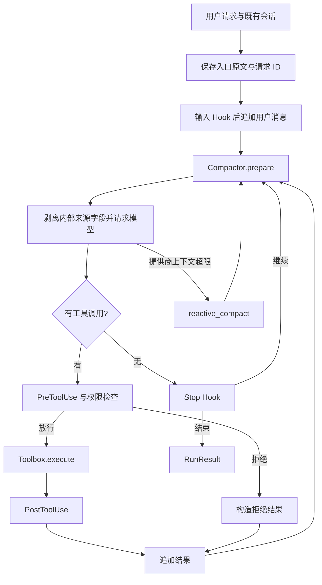

# AgentLoop 实现详解：从状态设计到上下文恢复

这份笔记用于理解 AgentLoop 的模块划分、设计取舍和实际代码。核心实现对应
[agentloop 的 87316f6 提交](https://github.com/still0123/agentloop/tree/87316f6)；
该实现已通过 144 项离线测试。示例中的请求 ID、路径和摘要用于说明数据结构，不是一次真实模型运行的记录。

## 目录

1. [先介绍项目与模块](#1-先介绍项目与模块)
2. [主要优化了哪些问题](#2-主要优化了哪些问题)
3. [怎样比较和选择方案](#3-怎样比较和选择方案)
4. [状态有哪些字段怎样存储](#4-状态有哪些字段怎样存储)
5. [从请求入口进入-react-循环](#5-从请求入口进入-react-循环)
6. [上下文预算与压缩触发](#6-上下文预算与压缩触发)
7. [一个完整案例只读日志分析](#7-一个完整案例只读日志分析)
8. [增量摘要与失败重放](#8-增量摘要与失败重放)
9. [原文怎样回读](#9-原文怎样回读)
10. [权限工具与生命周期](#10-权限工具与生命周期)
11. [模型适配会话恢复与取消](#11-模型适配会话恢复与取消)
12. [如何验证与表述结果](#12-如何验证与表述结果)
13. [沿代码检查与自测](#13-沿代码检查与自测)

## 1. 先介绍项目与模块

AgentLoop 是一个本地 Coding Agent。模型决定下一步行动，程序执行工具并把结果反馈给模型，
在同一个循环中完成文件检查、代码修改和命令行任务。它提供 CLI、Web 和 macOS 桌面入口。

| 模块 | 解决的问题 | 实现入口 |
|---|---|---|
| Agent Loop | 多轮模型请求、工具执行、结果回填与结束判断 | `agent.py: Agent._run` |
| 上下文工程 | 控制完整请求规模，压缩历史，同时保留原文回读能力 | `compact.py: Compactor`、`budget.py: RequestBudget` |
| 短期记忆与长期保存 | 在会话中承接任务，保存消息与工具证据 | `messages`、`CompactionState`、`web.py: SessionStore` |
| 权限与工具 | 工具注册、参数定义、路径检查、命令审批与错误回填 | `tools.py`、`permission.py` |
| 生命周期扩展 | 在输入、工具前后、停止阶段挂接策略 | `hooks.py: HookRegistry` |
| 模型适配 | 统一内部消息，适配 OpenAI 兼容与 Anthropic 协议 | `models.py` |
| 交互与控制 | 流式输出、多会话、停止任务和桌面窗口 | `cli.py`、`web.py`、`desktop.py` |

模块介绍之后，可以选择上下文管理这条链路展开：它连接消息结构、工具协议、磁盘归档、
摘要模型和失败恢复，能体现多种工程约束如何共同工作。

短期记忆主要是当前消息、摘要和执行状态；长期保存目前是会话 JSON、工具输出文本和历史归档。
当前没有跨会话的语义知识库、事实合并或自动召回器，不能把“保存过历史”直接说成“实现了语义长期记忆”。

## 2. 主要优化了哪些问题

| 原问题 | 设计与实现 | 可验证的改善 |
|---|---|---|
| 最新工具结果虽然未超过批次阈值，却已超过请求预算 | 用完整请求预算共同决定落盘；最终重新检查预算 | 120,000 字符结果可以不调用摘要模型就缩小上下文 |
| 简单删除旧结果后无法恢复证据 | 内容哈希命名保存原文，消息保留相对路径 | 压缩后能读回与原工具结果一致的文本 |
| 只取日志开头，漏掉中部错误和尾部结果 | 首部、尾部及错误关键字附近采样 | 固定回放的中部错误和尾部标记均进入摘要输入 |
| 摘要遗漏旧要求，用户说“继续”后约束消失 | 程序维护有序用户原文记录，保留稳定来源 ID | 连续两次固定摘要都遗漏约束，原文记录仍保留它 |
| 摘要失败或被截断后，新旧历史处理状态不清楚 | 保留旧有效摘要，未处理历史归档并排队重放 | 后续摘要可恢复失败增量，成功后移除相应待处理路径 |
| 一次回读又把大文件整段塞回上下文 | 关键词搜索与按行分页读取 | 输出有界，支持定位超长日志行中的关键词 |

这里优化的是请求组织、证据恢复和执行连续性。没有修改基础模型，也没有测得跨模型任务成功率提升。

## 3. 怎样比较和选择方案

比较维度包括：额外模型调用、关键要求保留、原始证据恢复、失败处理、实现复杂度和后续维护成本。

| 方案 | 做法 | 优点 | 主要代价 |
|---|---|---|---|
| 程序截断或滑动窗口 | 按消息条数或长度移除较早内容 | 确定、便宜、无需摘要服务 | 可能丢失旧要求和具体证据 |
| 结构化提取 | 把目标、约束、决定、待办提取到固定字段 | 易查询、易校验格式 | 要处理事实遗漏、冲突、过期与来源；合法 JSON 不保证内容正确 |
| 单独模型摘要 | 历史过长时生成一段摘要 | 可概括复杂语义 | 摘要可能遗漏、截断或调用失败，原文常难恢复 |
| 程序归档与采样，加增量摘要 | 先存原文并减量，必要时更新摘要，保留恢复路径 | 大输出可能无需摘要；证据可回读；失败路径明确 | 增加磁盘 I/O 与回读调用，摘要依然有损 |

AgentLoop 选择最后一种组合。日志和代码中的具体细节往往需要再次确认，原文有实际回读价值；
先保住原文和用户要求，再让模型概括旧过程，适合这个本地开发任务场景。

`CompactionState` 的固定字段属于程序状态管理，并不代表已经实现完整的结构化知识提取。
当前没有让模型生成并维护带来源、冲突解决和过期规则的长期事实库。

设计概念可以结合 [LangChain 记忆说明](https://docs.langchain.com/oss/python/concepts/memory)
与 [Anthropic 上下文工程说明](https://www.anthropic.com/engineering/effective-context-engineering-for-ai-agents)
理解。不能把某个框架概括成只有“结构化提取”或“纯摘要”一种机制，也不能用这些资料证明本项目跑分领先。

## 4. 状态有哪些字段，怎样存储

### 4.1 运行状态：顺序信息用 List，查找信息用 Map

| 状态 | 类型 | 内容与生命周期 |
|---|---|---|
| `messages` | `list[dict]` | 当前有序对话；Web 会话会保存它，CLI REPL 在进程内承接它 |
| 消息 `role / content` | 字符串、文本或块 List | `content` 可是用户文本，也可包含模型文本、工具调用或工具结果 |
| 工具调用块 | `dict` | `type / id / name / input`，例如 `tool_use` 与参数对象 |
| 工具结果块 | `dict` | `type / tool_use_id / content`，用调用 ID 与前面的工具调用关联 |
| `_request_id / _request_text` | 字符串 | 用户输入的稳定 ID 与入口原文；发送提供商前剥离 |
| `_origin` | 字符串 | 内部续跑消息标记为 `internal`，避免当作用户要求 |
| `turns / reactive_retries / todo_gap` | 整数 | 当前 `run` 的轮数、超限补救次数、计划提醒间隔 |
| `usage` | `dict` | 主循环输入/输出用量，进入 `RunResult` 和完成事件 |
| `TodoManager.items` | `list[dict]` | 计划的 `content / status`，保存在工具箱的内存对象中 |
| `Toolbox._tools` | `dict[str, ToolDef]` | 名称映射到描述、参数 schema 和 handler，handler 不序列化到会话 |

消息使用 List，便于追加、切片和保护调用顺序。工具注册表使用 Map，便于通过名称查找 handler。
当前没有一个统一的大 `AgentState`；各模块持有自己的状态。计划对象、循环计数和压缩诊断对象不会随 Web 会话恢复。

### 4.2 压缩状态：固定字段、文本与路径分开

`CompactionState` 是 dataclass，经 `asdict()` 转为 JSON，再放进带 `[Compacted]` 或
`[Reactive compact]` 标记的消息文本中。

| 字段 | 类型 | 含义 |
|---|---|---|
| `schema_version` | `int` | 当前格式版本为 `2` |
| `current_request` | `str` | 当前入口用户原文 |
| `user_requests` | `list[dict]` | 按顺序保留 `source_id + text`；旧格式迁移项可带 `origin=legacy` |
| `summary` | `str` | 模型生成的历史概括，不能改写用户原文记录 |
| `transcript` | `str` | 当前压缩前消息快照的相对路径 |
| `pending_transcripts` | `list[str]` | 待摘要历史文件的路径，不是把文件全文放在这个字段里 |
| `revision` | `int` | 成功处理摘要增量时递增 |
| `summarized_messages` | `int` | 已提交给成功摘要的消息累计数量，不代表每条消息全文都被发送 |
| `mode` | `str` | `summary` 或 `fallback` |
| `summary_error` | `str` 或 `None` | 失败类型，避免将任意异常内容复制进上下文 |

一个说明结构的检查点示例：

```json
{
  "schema_version": 2,
  "current_request": "继续",
  "user_requests": [
    {"source_id": "request-1", "text": "只检查日志原因，不修改文件"},
    {"source_id": "request-2", "text": "继续"}
  ],
  "summary": "已检查日志，发现挂载失败，尚需核对错误附近记录。",
  "transcript": ".transcripts/transcript-time-random.json",
  "pending_transcripts": [],
  "revision": 2,
  "summarized_messages": 8,
  "mode": "summary",
  "summary_error": null
}
```

摘要本身是文本；归档字段保存路径。最终的 `messages` 是“检查点消息 + 近期消息”，
其中工具调用与结果保持完整配对，也可以包含普通用户或模型文本。检查点不是一个脱离消息协议的隐藏服务。

### 4.3 磁盘与诊断状态

- 工具结果：`.task_outputs/tool-results/<SHA-256>.txt`。按内容命名，重复调用 ID 不会覆盖不同原文。
- 消息快照及待处理增量：`.transcripts/transcript-时间-随机值.json`。
- Web 会话：默认 `~/.agentloop/sessions/<workspace-hash>.json`，目录可通过 `AGENTLOOP_HOME` 调整。
- 会话条目：`id / title / created_at / updated_at / messages / events`。保存时有锁，并采用临时文件替换会话 JSON。
- `CompactionReport`：`before_chars / after_chars / summary_calls / summary_input_tokens / summary_output_tokens / fallback / estimated_input_tokens / input_limit_tokens / budget_satisfied`。

报告是最近一次操作的诊断对象，未构成完整会话账单。提供商返回的摘要 Token 与本地预算估算是两类数据。
磁盘归档也不是完整、不可变的全会话事件日志；更早快照可以通过路径追溯，当前消息快照可能已经包含引用。

## 5. 从请求入口进入 ReAct 循环



准确顺序是：保存 `original_request`，执行输入 Hook，追加含 `_request_id / _request_text` 的消息。
上图把原文保存和 ID 生成归在入口步骤，代码中 ID 在追加消息时生成。

每轮先检查取消，再调用：

```python
messages = self.compactor.prepare(
    messages,
    current_request=original_request,
    system_prompt=self.system_prompt,
    tools=self.toolbox.defs,
)
model_messages = [
    {k: v for k, v in message.items()
     if k not in {"_request_id", "_request_text", "_origin"}}
    for message in messages
]
response = self.client.complete(
    self.system_prompt, model_messages, self.toolbox.defs
)
```

模型返回工具调用后，循环执行工具，把结果加到 `messages`，然后再次准备上下文。
没有工具调用时，Stop Hook 可以要求继续，否则返回最终文本。工具调用路径有最大轮数保护；取消与错误也可以结束运行。

## 6. 上下文预算与压缩触发

### 6.1 预算包含什么

`RequestBudget` 序列化 `system + tools + messages`，结合固定协议包装估算，并从应用窗口中扣除输出预留与安全余量。

| 配置 | 默认值 | 作用 |
|---|---:|---|
| `AGENTLOOP_CONTEXT_TOKENS` | 64,000 | 应用配置的窗口，未自动探测厂商真实窗口 |
| `AGENTLOOP_MAX_TOKENS` | 8,000 | 模型输出上限及预算输出预留 |
| `AGENTLOOP_CONTEXT_MARGIN` | 2,000 | 预算安全余量 |
| 可用输入估算额度 | 54,000 | 窗口减输出预留与余量 |
| `char_limit` | 50,000 | 消息 JSON 字符限制，和完整请求估算一起生效 |

默认估算器按 UTF-8 字节计数，可注入模型对应的估算器。它偏保守，不能说成精确 Token 计数。
系统提示或工具定义本身很大时，单纯压缩聊天文本也不能解决，因此最终必须验证整个请求。

### 6.2 `prepare()` 的实际顺序

1. 深复制待处理消息，初始化这次报告。
2. `_spill_batch()` 检查最新工具结果批次。批次超过 200,000 字符，或完整请求已超预算时，优先转存较大结果。
3. `_placeholder()` 处理较早的工具结果，先存原文再换路径；保留最新批次，以及较早批次中最近三个 `tool_result` 块。
4. 若消息超过 50 条，或预算仍不满足，进入统一 `_compact()`。
5. `_finish()` 验证最终预算；不能满足时抛出 `ContextBudgetError`。

旧 `_snip` 方法仍在源码中，但 `prepare()` 不再调用它。不能沿旧“四级 snip”流程解释当前实现。
最新结果在占位阶段被保护，并不保证它会以完整原文进入模型：超大新结果可能在落盘或最终预算阶段缩小。

## 7. 一个完整案例：只读日志分析

用户输入“只检查日志原因，不修改文件”。模型选择 `bash(command="cat service.log")`，调用 ID 为 `t1`。
权限 Hook 放行后，工具返回 120,000 字符日志，循环添加如下调用组：

```text
assistant: tool_use(id=t1, name=bash, input={command: "cat service.log"})
user:      tool_result(tool_use_id=t1, content="120,000 字符日志……")
```

此时还没有进入下一次模型请求。下一轮 `prepare()` 发现完整请求超预算，先保存工具原文，再将结果改为：

```text
assistant: tool_use(id=t1, name=bash, input={command: "cat service.log"})
user:      tool_result(tool_use_id=t1, content="首部、错误附近片段、尾部……
           Full output: .task_outputs/tool-results/<hash>.txt")
```

变化发生在结果的 `content`，工具调用 ID 及 `tool_use_id` 不变。如果处理后满足预算且消息未超过条数阈值，
直接发送给模型。这一步可以零摘要调用，也不会创建新摘要检查点。

后续历史继续增长，才可能触发 `_compact()`：

```text
输入 messages:
[旧检查点（如有）, 新增历史, 近期调用组]

输出 messages:
[user: "[Compacted]\n{用户原文、摘要、归档与待处理路径、版本等}", 近期调用组]
```

通常保留最近五条消息；如果切点落在工具结果上，会向前移动以带上对应调用。最终预算不足时，
也可以将近期调用和结果一起归档，不能只删除调用而留下孤儿结果。

用户再输入“继续”时，会生成新的来源 ID。下次压缩后的 `user_requests` 同时保留“只检查、不修改”和“继续”。
即使摘要文本遗漏了只读要求，程序保存的原文仍在。输入 Hook 的改写不会覆盖原文，内部 Stop Hook 文本也不会成为用户要求。

保留原文是上下文机制；目前没有把自然语言“只读”自动转为所有写工具的强制禁用策略。
后续要求是否替代前一条要求，仍由模型结合原文判断，不能声称程序已经完成语义约束合并。

## 8. 增量摘要与失败重放

### 8.1 摘要处理什么

`_history()` 找到最新检查点，取出先前摘要和用户原文记录；检查点之后的消息是新增历史。
`_compact()` 再把它分为待概括的较早部分和近期部分。旧 `pending_transcripts` 中的历史会与这次较早部分合并。

摘要请求采用：

```json
{
  "previous_summary": "上一次有效摘要",
  "new_history": "这次准备概括的历史采样"
}
```

工具参数、工具名称和结果关系会进入摘要输入。原文有有效落盘路径时先回读，再进行采样：
普通文本、工具参数和结果各有采样上限；首尾与错误关键字附近片段优先保留。

完整消息组按时间顺序加入摘要预算。如果第一组都放不下，进一步缩小该组采样；如果后续组放不下，
则结束当前批次，把剩余历史归档排队。未发送的整条消息不会被记为已摘要，但组内采样依然是有损的。

### 8.2 成功、失败怎样更新状态

| 事件 | 摘要与计数 | 待处理历史 |
|---|---|---|
| 成功得到有效摘要 | 更新摘要，增加 `revision` 和已处理消息数 | 清除已处理前缀；未处理后缀继续归档排队 |
| 摘要调用失败、空文本或过长 | 不用失败结果覆盖旧摘要，不增加成功计数 | 原有 pending 保留，把失败的新历史追加为归档路径 |
| 明确输出截断 | `length / max_tokens` 等异常结束原因进入同一失败路径 | 后续重新摘要失败增量 |
| 预算仍不足 | 近期工具结果可换路径，完整近期调用组可归档，摘要文本也可转存 | 保留相应待处理路径；受保护请求仍装不下则报错 |

模型响应保留提供商原始 `finish_reason`，Anthropic 的 `stop_reason` 也放入该字段。
字段缺失时为兼容性接受，不能据此确认摘要一定未截断。

`pending_transcripts` 是恢复索引，不会使每轮 `prepare()` 都自动调用摘要。只有再次触发摘要时，
才读取这些文件并按预算处理。重新创建 Compactor 后也能从检查点恢复这条队列。

### 8.3 三种失败机制不要混淆

| 机制 | 触发 | 恢复动作 |
|---|---|---|
| 客户端重试 | 临时传输错误、部分状态码等 | 同一客户端按退避策略重新请求 |
| 模型回退 | 当前客户端最终失败且配置了备用模型 | `FallbackClient` 尝试后续客户端 |
| Reactive compaction | 提供商明确拒绝过长上下文 | 重新组织输入，以更小预算进行压缩，再回同一个 Loop |

Reactive 会把目标缩到原请求约一半或配置上限中的较小值，仍要满足最终预算。
每次 `run` 默认最多一次超限补救。磁盘写入失败、程序错误与模型取消不会被伪装成普通摘要成功。

## 9. 原文怎样回读

模型看到归档路径后，可以发起两个普通工具调用：

```text
search_file(path=".task_outputs/tool-results/<hash>.txt", query="ERROR", context=2)
read_file(path=".task_outputs/tool-results/<hash>.txt", offset=120, limit=30)
```

搜索返回行号及有限上下文，再按行分页读取。回读结果和其他工具结果一样通过 `tool_result` 进入消息列表，
下一轮仍经过 `prepare()`。这是对原文的显式工具访问，不是向量检索或自动相关性排序。

| 工具 | 主要上限与行为 |
|---|---|
| `read_file` | 默认最多 200 行、约 50,000 字符；`offset` 从 1 开始；超长单行只留有限前缀并提示搜索 |
| `search_file` | 字面量搜索；默认 20 个匹配、前后两行；最多 50 个匹配、前后 10 行、约 50,000 字符输出 |
| 搜索源扫描 | 约 10 MB；分块读取并处理跨块关键词，提前停止会给出提示 |
| 搜索词 | 单行非空字符串，最多 1,024 字符 |

`safe_path` 限制文件工具路径不能逃出工作区。Shell 的原始输出若已在 200,000 字符处被工具层截断，
超出部分未进入压缩器，不能声称后续归档能恢复它。

## 10. 权限、工具与生命周期

`Toolbox.add()` 注册名称、描述、输入 schema 和 handler。模型看到的是工具定义，实际调用通过名称查表。
参数错误与执行异常会转为 `Error: ...` 结果，回到模型，模型可以据此调整下一步。

| Hook | 时间点 | 返回值影响 |
|---|---|---|
| `UserPromptSubmit` | 用户输入进入消息前 | 可以改写发给模型的文本，入口原文仍单独保留 |
| `PreToolUse` | 执行每个工具前 | 非 `None` 返回值可阻止执行，成为拒绝结果 |
| `PostToolUse` | 工具执行后 | 观察执行结果，可用于记录或通知 |
| `Stop` | 模型没有工具调用、准备结束时 | 非空字符串可以要求继续，标记为内部消息 |

默认 `PermissionGate` 作为 `PreToolUse` Hook 注册。对 Shell 命令先检查禁止模式，再对风险关键词发起审批；
不通过审批时生成拒绝结果。它是字符串规则和人工批准机制，不是系统调用级隔离或强制 Shell 沙箱。

文件读写有工作区边界，Shell 以工作区为当前目录运行，但可以访问宿主机资源。这两个边界必须分开说明。
权限 Hook 与上下文用户要求记录也不能互相替代。

## 11. 模型适配、会话恢复与取消

内部统一使用 `text / tool_use / tool_result` 块。OpenAI 适配层转换为厂商的 `tool_calls` 与工具消息格式；
Anthropic 适配层使用其原生内容块。主循环使用相同的 `complete(system, messages, tools)` 接口。

`ModelResponse` 保存 `text / blocks / usage / finish_reason`。流式路径还会将文本增量送到回调，
最后形成完整响应，再进入工具执行判断。MockClient 用固定响应驱动离线协议测试。

Web 会话恢复加载的是消息与事件。运行中的线程、未完成的调用栈、TodoManager 对象和本次 `run` 的计数，
不会从会话 JSON 中原样重建。CLI REPL 在进程内保留上一轮返回的消息列表，供下一次输入继续使用。

取消标志在请求前、模型返回后及工具执行阶段被检查。Shell 使用独立进程组，取消或超时会终止该组。
模型请求失败重试、摘要失败降级和用户取消是不同事件，不能将取消当作“换个摘要继续跑”。

## 12. 如何验证与表述结果

### 12.1 已有离线证据

回放脚本固定输入和摘要响应，对比 `5154aa2` 与 `87316f6` 的机制行为。测量单位为
`len(json.dumps(messages, ensure_ascii=False))`，不是 Token 数或模型费用。

| 场景 | 修复前 | 改进后 |
|---|---|---|
| 最新工具输出严格 120,000 字符 | 处理后消息 120,458 字符，仍超 50,000，调用摘要 1 次 | 1,577 字符，调用摘要 0 次，尾部错误可见，原文回读一致 |
| 工具日志中部错误与尾部标记 | 两者都未进入摘要输入 | 两者均进入摘要输入 |
| “只读”后“继续”，两次固定摘要均遗漏约束 | 当前上下文丢失早期要求 | 用户原文记录仍保留要求 |
| 第二次增量摘要失败 | 无待处理历史重放字段 | 旧摘要保留，失败增量在第三次摘要中重放 |

第一项处理后字符数下降约 98.69%，但不能据此声称真实 Token 费用下降 98.69%，也不能证明真实模型必然正确回读或遵循要求。
测试能证明程序保留了原文，并不等于模型一定会使用这些原文。

实现版本的完整验证为 **144 passed**，Ruff 检查通过；测试使用离线响应，本机 HTTP/SSE 测试覆盖协议交互。
没有真实模型的跨方案任务成功率、总成本和端到端耗时排名。

### 12.2 复现方式

在 AgentLoop 仓库根目录运行：

```bash
.venv/bin/python scripts/benchmark_context_policy.py
.venv/bin/python -m pytest -q
.venv/bin/ruff check .
.venv/bin/ruff format --check .
```

- [固定回放脚本](https://github.com/still0123/agentloop/blob/87316f6/scripts/benchmark_context_policy.py)
- [原始 JSON 记录](https://github.com/still0123/agentloop/blob/87316f6/docs/evidence/context-policy-replay.json)
- [上下文行为测试](https://github.com/still0123/agentloop/blob/87316f6/tests/test_context_policy.py)
- [恢复集成测试](https://github.com/still0123/agentloop/blob/87316f6/tests/test_context_recovery.py)
- [预算测试](https://github.com/still0123/agentloop/blob/87316f6/tests/test_budget.py)

更早 `16e0a07 → 5154aa2` 的回放是另一组历史记录：14 组工具结果由 142,960 字符缩为 44,110 字符，
代价是增加原文归档。不能把不同输入的 69.15% 与最新大结果场景的 98.69% 当成同一任务的连续性能曲线。

### 12.3 后续真实模型实验

固定模型、温度、任务、仓库状态、工具环境和输入预算，对日志定位、跨文件修复、用户中途修改要求三类任务重复运行。
比较纯窗口、结构化提取、纯摘要和组合方案时，应让各方案有同等实现完整度，不能用人工写好的完美 JSON 代替真实提取。

指标应包括任务验收、要求遗漏、原文回读是否成功、摘要与回读总 Token、模型调用次数以及端到端耗时。
摘要超时、截断、磁盘写入失败和二次上下文超限应独立做故障注入。

## 13. 沿代码检查与自测

建议按以下顺序定位：

1. [Agent._run](https://github.com/still0123/agentloop/blob/87316f6/agentloop/agent.py)：入口原文、每轮 prepare、工具回填、Stop 和超限补救。
2. [Compactor](https://github.com/still0123/agentloop/blob/87316f6/agentloop/compact.py)：`prepare → _spill_batch → _placeholder → _compact → _ask_summary → _finish`。
3. [RequestBudget](https://github.com/still0123/agentloop/blob/87316f6/agentloop/budget.py)：完整请求估算、输出预留与最终判定。
4. [工具箱](https://github.com/still0123/agentloop/blob/87316f6/agentloop/tools.py)：注册、查表执行、落盘证据的搜索与分页读取。
5. [权限](https://github.com/still0123/agentloop/blob/87316f6/agentloop/permission.py) 与 [Hook](https://github.com/still0123/agentloop/blob/87316f6/agentloop/hooks.py)：执行策略如何挂到循环边界。
6. [模型适配](https://github.com/still0123/agentloop/blob/87316f6/agentloop/models.py)：内部消息到厂商协议的转换。
7. [SessionStore](https://github.com/still0123/agentloop/blob/87316f6/agentloop/web.py)：实际保存和恢复哪些数据。

可以不看稿回答这些问题，才算掌握关键链路：

- 为什么消息选择 List，而工具注册表选择 Map？一个消息块里具体有哪些字段？
- 最新工具输出只有 120,000 字符、未超过 200,000 批次阈值，为什么仍会落盘？
- 原文、预览、摘要、检查点、会话 JSON 分别放在哪里？
- 压缩发生在模型调用之前还是工具返回之后？这两个描述怎样同时成立？
- 用户说“继续”时，早期只读要求如何保留？保留原文是否等于强制权限？
- 摘要输入装不下时，哪些消息已处理、哪些进入 pending？
- 摘要模型返回半截文本，为什么不能更新成功计数？
- 新建 Compactor 后怎样恢复 pending？为什么不是每轮都自动重放？
- 归档回读结果如何回到同一个 ReAct 循环？
- 144 项测试和字符下降分别能证明什么，还不能证明什么？

最后可以把设计概括为：完整请求预算决定什么时候减量；程序保存用户原文和证据路径；
模型负责概括预算内的历史；增量计数与待处理路径连接摘要失败后的执行。每个判断都能对应到字段、文件和测试。
