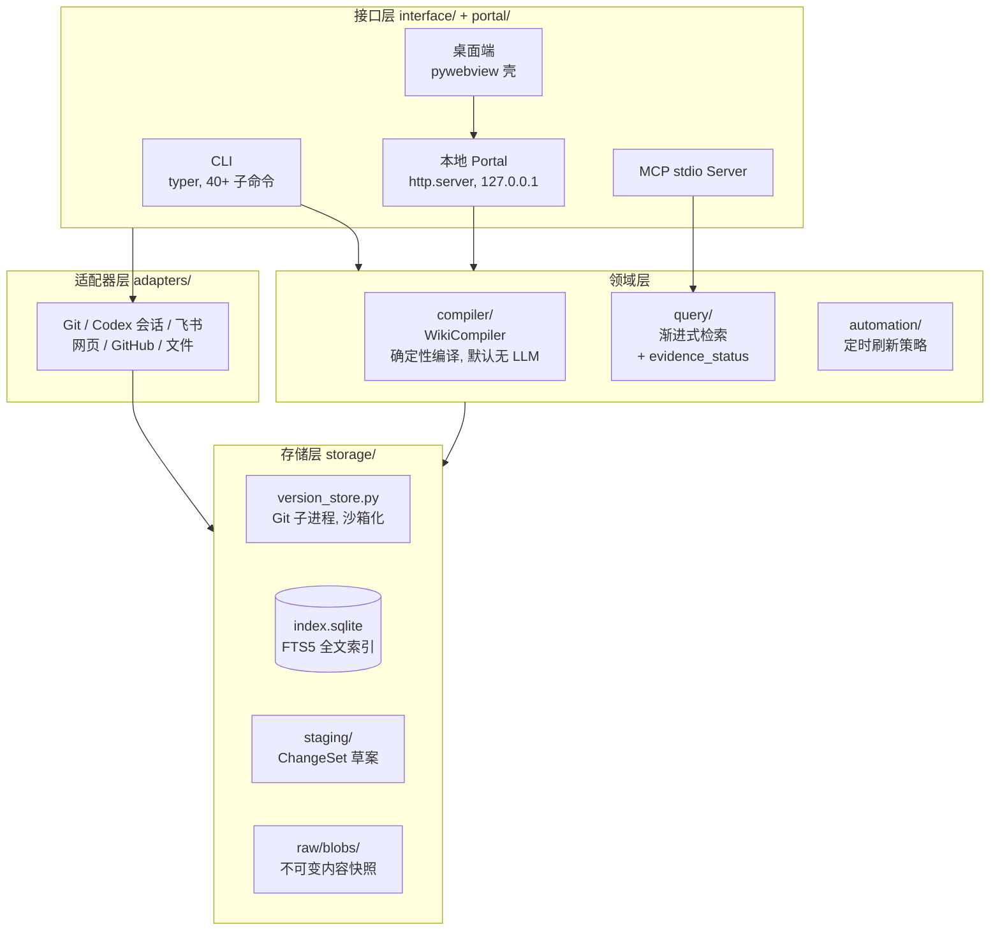
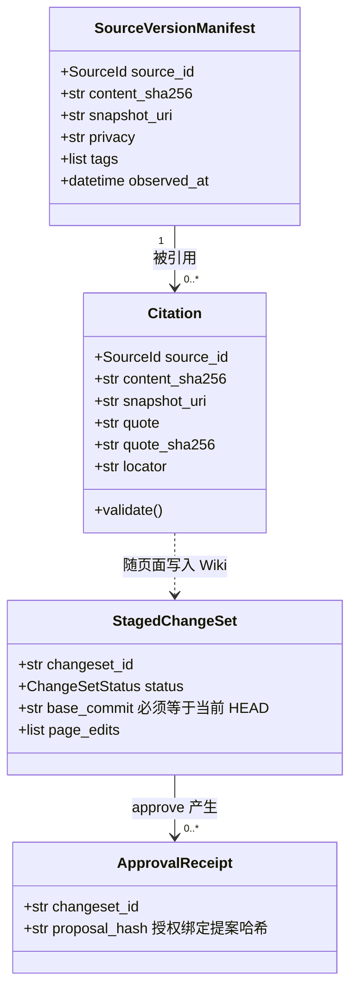
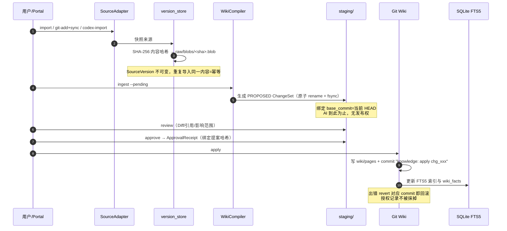
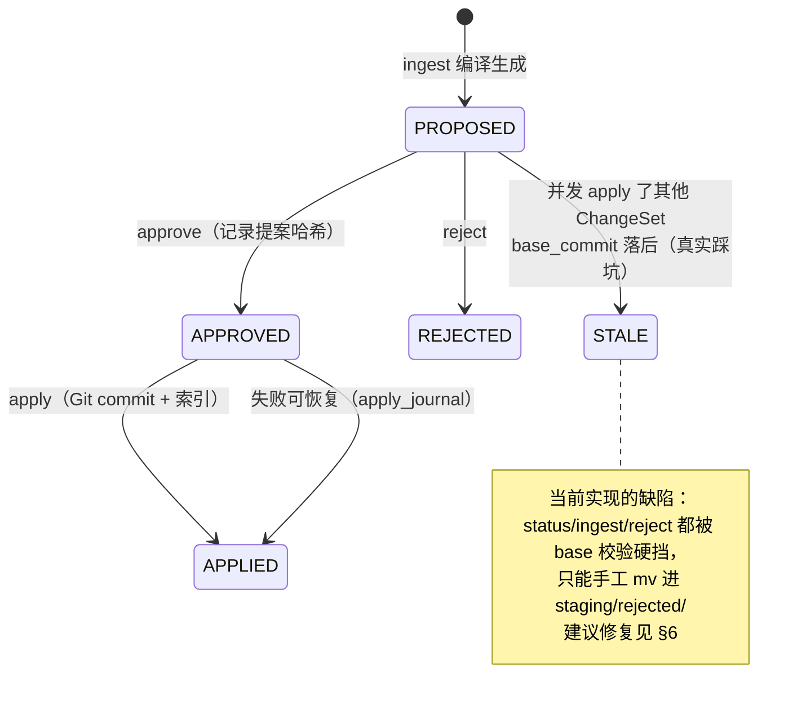
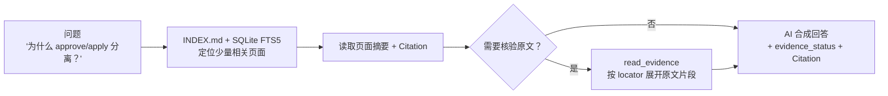
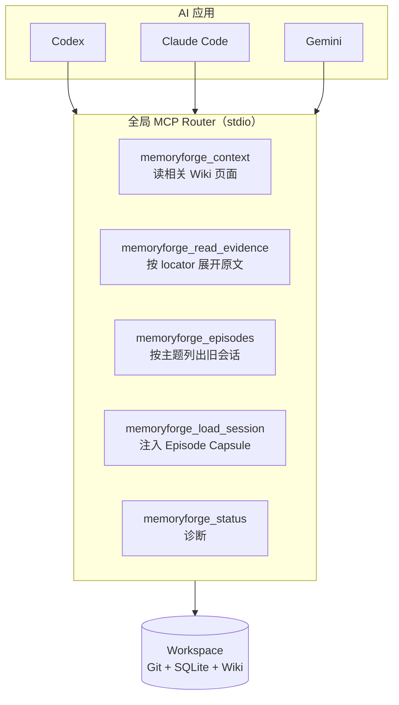
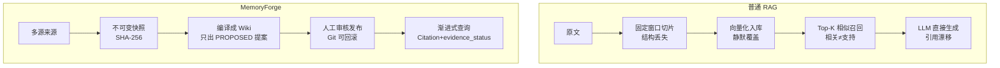
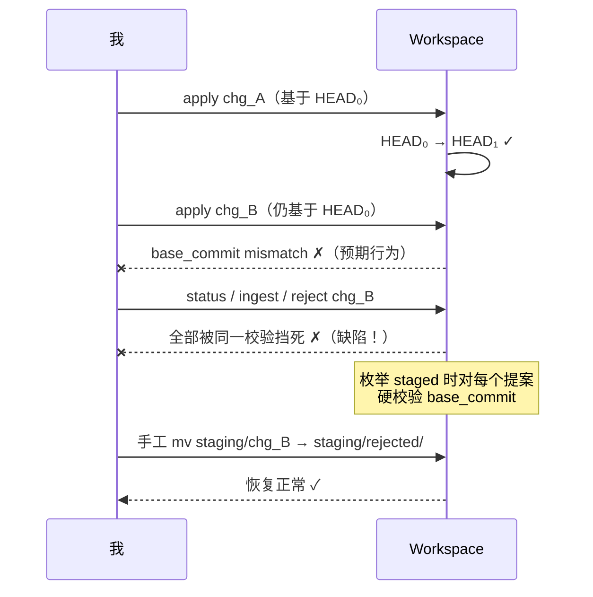

# MemoryForge 面试问答笔记

> 基于 main 分支 `11e2285` 的真实代码整理。所有机制均标注了源码位置（`文件:行号`），面试前建议对照代码再过一遍。
> 图表为 Mermaid，可在 GitHub / VS Code（装 Mermaid 插件）/ Typora 中渲染。

---

## 目录

- [一、30 秒 / 1 分钟 / 3 分钟电梯陈述](#一电梯陈述)
- [二、项目全景与数字](#二项目全景与数字)
- [三、代码架构详解](#三代码架构详解)
- [四、核心机制深挖（配图）](#四核心机制深挖)
- [五、高频面试 Q&A（25 题）](#五高频面试-qa)
- [六、我踩过的坑与调试故事](#六我踩过的坑与调试故事)
- [七、背诵卡](#七背诵卡)

---

## 一、电梯陈述

### 30 秒版

> MemoryForge 是一个本地优先的"知识编译器"。它把 Git 仓库、飞书文档、网页、GitHub Issue 和 AI 对话，编译成一份人类可读、Git 可版本化的 Markdown Wiki。AI 只能生成提案（ChangeSet），人审核后才发布；每条结论都能通过 Citation 回放到固定版本的原文位置。它通过本地 MCP Server 供 Codex、Claude Code、Gemini 按需查询。

### 1 分钟版（加机制）

在 30 秒版基础上补三句：

1. **发布链**：来源先被快照成不可变的 SourceVersion（SHA-256 锁定），编译器只生成 `PROPOSED` 状态的 ChangeSet；`review → approve → apply` 三步分离，apply 才写入 Wiki 并产生可回滚的 Git Commit。
2. **查询链**：不把整个 Wiki 灌进上下文，而是 `INDEX.md + SQLite FTS5` 先定位页面 → 读 Citation → 需要核验才展开原文 Evidence，是一个渐进式有边界的查询。
3. **证据分级**：回答强制带 `evidence_status`（grounded / partial / no_local_evidence），"不知道"是合法输出，杜绝把通用猜测伪装成项目事实。

### 3 分钟版（加取舍）

再加两个设计决策 + 一个数字：

- 为什么不用向量数据库：Wiki 页面是**编译产物**而非原文切片——数量少、标题语义强、全文检索可解释、零外部依赖。向量库在非目标清单里。
- 为什么 Citation 锁内容哈希：路径会移动、链接会失效、文档会改版，SHA-256 不会变，所以任何历史结论都能本地重放。
- 数字：v0.4.0 发布门禁 macOS 656 项测试通过；src 约 4.2 万行 Python；94 个测试文件、982 个测试函数。

---

## 二、项目全景与数字

| 维度 | 数据 |
| --- | --- |
| 版本 | v0.4.0（正式验证平台 macOS，release gate 656 tests passed） |
| 语言/依赖 | Python 3.11+；typer（CLI）、pydantic（模型）、SQLite FTS5、Git 子进程、Tree-sitter、MCP、pywebview、PyInstaller |
| 代码规模 | `src/memoryforge` 约 42,000 行 |
| 测试规模 | 94 个测试文件、982 个测试函数 |
| 许可证 | MIT |
| 平台 | macOS（正式验证）/ Windows（PyInstaller 构建，待原生门禁） |

### 支持的来源类型（SourceAdapter 家族）

`src/memoryforge/adapters/` 下每个来源一个适配器：

| 适配器 | 来源 | 说明 |
| --- | --- | --- |
| `git_adapter.py` / `git_sync.py` | 本地 Git 仓库 | 登记后按 commit 快照，Tree-sitter 解析代码 |
| `codex_adapter.py` | Codex AI 会话 | 解析 rollout JSONL，只取 user/assistant 文本 |
| `botmux_adapter.py` | 其他 AI 会话 | 同上，不同平台格式 |
| `feishu_adapter.py` 等 3 个 | 飞书文档 | 需要本地凭证，local_only |
| `web_adapter.py` | 公开网页 | 单页抓取，不爬站不登录 |
| `github_thread_adapter.py` | GitHub Issue/PR | |
| `importer.py` / `folder_adapter.py` | 文件 / 文件夹 | Markdown/TXT，安全校验后入库 |

---

## 三、代码架构详解

### 3.1 分层架构图



要点：

- **桌面端和网页端是同一套 UI**：`portal/portal_assets.py` 用 Python 字符串内联了 HTML/CSS/JS（无构建步骤），`portal/desktop.py` 用 pywebview 起一个随机端口（`port=0`）的 LocalPortalServer 再包一层原生窗口。
- **MCP 是独立 stdio 进程**：`interface/mcp_server.py`，注册 5 个工具（见 §4.4）。
- **存储是双轨的**：Git 管 Wiki 内容与历史（可回滚、可 diff 审计），SQLite 管索引与元数据（FTS5 检索、changeset 记录、wiki_facts）。

### 3.2 Workspace 目录布局

```text
my-wiki/
├── .git/                    # Wiki 自身的 Git 仓库（每次 apply 一个 commit）
├── wiki/
│   ├── INDEX.md             # 人工可读的总索引（导航起点）
│   └── pages/*.md           # 所有 Wiki 页面（含 Citation）
├── raw/
│   └── blobs/ab/<sha256>.blob   # 不可变来源快照，按内容哈希寻址
├── .memoryforge/
│   ├── index.sqlite         # 元数据 + FTS5 虚拟表
│   ├── config.yaml / schema.yaml
│   ├── workspace.lock       # 独占锁（跨进程互斥）
│   ├── manifests/           # SourceVersion 清单
│   ├── staging/             # ChangeSet 草案目录
│   │   ├── chg_xxx/         #   PROPOSED/APPROVED
│   │   ├── applied/         #   已应用归档
│   │   └── rejected/        #   已拒绝归档
│   ├── capture/ / traces/   # 采集与审计痕迹
│   └── vectors/             # 预留
└── AGENTS.md / obsidian/    # Agent 规则与 Obsidian 视图
```

### 3.3 核心数据模型（`core/models.py`，全部 pydantic `frozen=True`）



**最值得背的一段代码**——Citation 的自校验（`core/models.py:382`）：

```python
class Citation(BaseModel):
    source_id: SourceId
    content_sha256: str = Field(pattern=r"^[a-f0-9]{64}$")
    snapshot_uri: str = Field(pattern=r"^mf://blob/[a-f0-9]{64}$")
    quote: str = Field(min_length=1)
    quote_sha256: str = Field(pattern=r"^[a-f0-9]{64}$")
    locator: str = Field(pattern=r"^chars:\d+-\d+$")

    @model_validator(mode="after")
    def validate_source_version(self) -> "Citation":
        if self.snapshot_uri != f"mf://blob/{self.content_sha256}":
            raise ValueError("snapshot_uri must identify the cited content_sha256")
        if hashlib.sha256(self.quote.encode()).hexdigest() != self.quote_sha256:
            raise ValueError("quote_sha256 must identify the exact quoted text")
        ...
```

三个哈希互相咬合：**引用指向的快照 = 内容哈希 = 引文哈希可重算**。任何一段被篡改，模型校验直接失败。这就是"可重放"的工程含义。

### 3.4 Git 调用的沙箱化（`storage/version_store.py:363`）

所有 Git 操作走子进程，并做了四层隔离——这是很容易被追问"你怎么保证 Git 操作安全/确定"的答案：

```python
command.extend(["-c", "core.hooksPath=/dev/null",    # 1. 禁用户 hooks
                "-c", "core.fsmonitor=false",
                "-c", "commit.gpgSign=false"])        # 2. 禁签名，保证可复现
environment = {k: v for k, v in os.environ.items() if not k.startswith("GIT_")}
environment["GIT_CONFIG_NOSYSTEM"] = "1"              # 3. 隔离系统/全局配置
environment["GIT_CONFIG_GLOBAL"] = "/dev/null"
# 4. SOURCE_DATE_EPOCH → 固定 GIT_AUTHOR_DATE/COMMITTER_DATE，可复现构建
```

每次命令执行前后还各做一次 `validate_metadata()`（校验 .git 元数据未被外部动过）。

---

## 四、核心机制深挖

### 4.1 发布管线（最重要，必背）



细节弹药：

- **staged 目录写入是原子的**：先写临时目录，`os.rename` + `fsync` 落盘（`storage/changesets.py:150`），并附 digest 文件（`sha256(metadata)`）做完整性校验，读取时重算比对（`changesets.py:207`）。
- **`get()` 强校验**：目录里的记录状态必须是 `PROPOSED` 且 `changeset_id` 一致，否则报"immutable identity or state was modified"（`changesets.py:217`）。
- **apply 幂等审计**：`storage/apply_journal.py` 记录 apply 日志，commit message 固定为 `knowledge: apply <changeset_id>`（`apply_journal.py:216`），可对账。
- **自动更新也不能绕链路**：`automation/` 只是定时触发 ingest，发布仍需人工 approve。

### 4.2 ChangeSet 状态机（含我发现的坑）



### 4.3 渐进式查询链（反"全量灌上下文"）



FTS5 真实 schema（`storage/workspace_contract.py:85`）：

```sql
CREATE VIRTUAL TABLE source_fts USING fts5(
    title, content, search_terms, tokenize='unicode61');

CREATE VIRTUAL TABLE wiki_fact_fts USING fts5(
    section_path, quote, routing_text, symbol, relation_type,
    content='wiki_facts',        -- 外部内容表：索引与数据分离
    content_rowid='id',
    tokenize='unicode61');
```

加分点（主动说出来）：

- `wiki_fact_fts` 用了 FTS5 的 **external content table** 模式，索引不复制正文，节省空间且与主表同步靠 `content_rowid` 关联。
- **诚实披露**：`unicode61` 分词器对中文按字符切分的效果有限（CJK 没有空格），中文长查询的召回是已知改进点——可讨论换 `trigram` 或自建 bigram 分词。主动讲这个比被问出来好。

### 4.4 多客户端 MCP 架构



- 每个 Workspace 只注册一次（`memoryforge connect <client>`），不改写项目的 `AGENTS.md`/`.mcp.json`，当前目录只是**排序提示不是访问边界**。
- 默认只暴露 `public` 来源；读 `local_only` 必须连接时显式 `--allow-local-llm`（egress 白名单在 `compiler/egress_policy.py`）。
- **Episode Capsule 有字符上限**（`_PROMPT_CONTEXT_LIMIT = 8000`，`storage/workspace.py:80`），旧会话不会自动注入，选择后才进入上下文。

### 4.5 Portal 与桌面端安全

| 机制 | 实现 | 位置 |
| --- | --- | --- |
| 只绑定本机回环 | `127.0.0.1`，随机/指定端口 | `portal/local_portal.py` |
| CSRF | `secrets.token_urlsafe(32)`，POST 必须带 `X-MemoryForge-CSRF` 头，不符返回 403 `invalid_csrf` | `local_portal.py:343,734` |
| 同源静态资源 | HTML/CSS/JS 内联于包内，无 CDN/外部脚本 | `portal/portal_assets.py` |
| 导入安全 | 拒绝符号链接、必须在允许根内、敏感文件名黑名单（.env 等）、后缀白名单 | `adapters/importer.py:93` |
| 会话隐私 | 剥离 `<environment_context>` 等元数据前缀，绝对路径替换为 `<local-path>`，超大 tool 记录整条跳过 | `adapters/codex_adapter.py:21,114` |
| 跨进程互斥 | `workspace.lock` 独占锁，锁文件不安全直接抛 `WorkspaceSecurityError` | `storage/workspace.py:654` |

### 4.6 与普通 RAG 的管线对比（口述版）



仓库里有现成高清图：`assets/diagrams/vs-rag-pipeline.zh.svg`（README 在用）。

---

## 五、高频面试 Q&A

> 每题按「答 → 追问 → 代码依据」组织。先背加粗要点，再展开。

### Q1. 用一句话说清这个项目解决什么问题？

**答**：给 AI 补项目知识，常见做法要么整包塞上下文（贵、乱、过期），要么 RAG（答案无法溯源、索引更新没人审）；MemoryForge 把知识**发布**变成可审计的工程链路——编译、审核、发布、溯源——AI 只能提案，人审核后才生效。

**追问：为什么不直接用 Cursor/Claude 的 memory 功能？** 答：它们是隐式记忆，无审核、无版本、无引用契约；MemoryForge 的差异化恰恰是治理层（ChangeSet）和证据层（Citation/SHA-256）。

### Q2. 为什么 approve 和 apply 是两个步骤？

**答**：职责分离——`approve` 只记录一次**与提案哈希绑定**的授权（ApprovalReceipt），`apply` 才写盘并创建 Git Commit。三者可独立审计：出问题时 revert Commit 回滚内容，但授权记录还在，能查到"谁在何时批了哪个哈希的提案"。自动更新也不能绕过。

**代码**：`storage/changesets.py`、`storage/apply_journal.py:216`、`compiler/lifecycle.py:199`。

### Q3. Citation 为什么要锁 SHA-256？具体锁了什么？

**答**：锁了四元组——`SourceVersion`（哪个来源哪个版本）+ `locator`（原文 `chars:N-M` 字符区间）+ `snapshot_uri`（`mf://blob/<content_sha256>`）+ `quote_sha256`（引文自身的哈希）。路径会移动、链接会失效、文档会改版，内容哈希不会变；模型校验器强制三个哈希互相咬合（§3.3），所以任何历史结论都能本地重放"当时读的是哪段原文"。

**追问：locator 为什么用字符区间不用行号？** 答：行号对编辑敏感（前面插一行全偏移），字符区间 + 内容哈希双重定位，先验哈希再取区间，即使文件变了也能发现不一致。

### Q4. 为什么用 SQLite FTS5 而不是向量数据库？

**答**：三个理由——(1) Wiki 页面是**编译产物**不是原文切片：数量少（几十到几百页）、标题和结构语义强，全文检索足以定位；(2) FTS5 结果可解释（能说出命中了哪个词），向量相似度不可解释且"相关 ≠ 支持"；(3) 零外部服务依赖，符合本地优先。向量数据库明确写在非目标清单。

**追问：中文检索怎么办？** 答：现状 `unicode61` 对 CJK 逐字切分，长查询召回一般；改进方向是 `trigram` tokenizer 或 bigram 自定义分词，这是已识别的 roadmap 项（主动披露比被问出来好）。

**追问：那语义检索完全不支持？** 答：支持到"页面级"——编译器把 synonym/路由文本写进 `search_terms` 和 `routing_text` 字段（`wiki_fact_fts`），用确定性方式补了一部分语义泛化；真正 embeddings 是非目标。

### Q5. evidence_status 三级是谁决定的？为什么不让模型自评？

**答**：由**检索命中结果**决定，不是模型自评。`grounded` = 命中页面足以支撑 → 必须带 Citation；`partial` = 部分命中 → 只能陈述已命中部分并显式标边界；`no_local_evidence` = 未命中 → 只能给通用分析且必须标注。不自评的原因是**阈值漂移**：模型信心不可复现，绑到检索结果上才能在 Benchmark 里独立统计每级的准确率/召回率，回归测试才有抓手。

### Q6. 编译器什么时候用 LLM？

**答**：默认**完全不用**。代码 Wiki 走 Tree-sitter AST + 模块规划（`compiler/code_wiki_compiler.py` + `module_planner.py`），确定性输出；LLM 是可选增强（`--llm` 配 OpenAI 兼容 provider，或 `--trae` 固定模型重编译会话），且必须显式 `--allow-local-llm` 才会把本地内容发给模型。**确定性优先**是可复现和可审计的前提。

**追问：Tree-sitter 支持哪些语言？** 答：pyproject 声明了 go/python/typescript 三种 grammar（`tree-sitter>=0.23`），其余语言退化为文本处理。

### Q7. ChangeSet 的写入怎么保证不出现"半个提案"？

**答**：两级原子性——staged 目录先写临时名，`os.rename` 原子切换 + `fsync`（`changesets.py:150-161`）；元数据带 digest 文件，读取时重算 sha256 比对（`changesets.py:207`）。apply 侧由 Git 事务性保证：要么 commit 成功（apply_journal 对账），要么失败不落盘。

### Q8. 多进程/并发怎么防冲突？

**答**：`.memoryforge/workspace.lock` 独占文件锁（`core/platform_lock.py` 的 `exclusive_workspace_lock`），CLI/Portal/MCP 任何写操作前抢锁；锁文件权限异常直接抛 `WorkspaceSecurityError` 拒绝运行（防符号链接攻击）。读路径（MCP 查询、Portal 浏览）走 `Workspace.open_readonly` 无锁快照读，读写不互卡。

### Q9. MCP Server 怎么实现的？和 Portal 什么关系？

**答**：独立 stdio 进程（`interface/mcp_server.py`），AI 应用（Codex/Claude/Gemini）各注册一次全局 Router 指向它；它和 Portal 共享同一套 Workspace 读写 API，但 UI 完全无关。五个工具：`memoryforge_context`（读相关页面）、`memoryforge_read_evidence`（按 locator 展开原文）、`memoryforge_episodes`（按主题列旧会话）、`memoryforge_load_session`（注入 ≤8000 字符的 Capsule）、`memoryforge_status`（诊断）。读工具标注 read-only annotations，写操作不暴露给 MCP。

### Q10. Portal 怎么防 CSRF/SSRF？

**答**：Portal 只监听 `127.0.0.1`；会话启动时生成 `secrets.token_urlsafe(32)`，所有 POST 必须带 `X-MemoryForge-CSRF` 头且与会话令牌比对，不符返回 403（`local_portal.py:734`）。静态资源同源内联，无外部脚本，杜绝供应链注入。网页导入（web_adapter）只抓单页、不跟随登录、不爬站。

### Q11. 桌面端架构？

**答**：`memoryforge-desktop` = pywebview 原生窗口 + 后台线程跑 `LocalPortalServer(port=0)`（随机端口防占用/防猜测），关闭窗口即 shutdown server（`portal/desktop.py:134`）。最近打开的 workspace 记在 `~/Library/Application Support/MemoryForge/desktop.json`。Windows 用 PyInstaller 打成单文件 exe。**好处**：桌面/网页零 UI 代码分叉，一次美化两端受益（我就是这么改的）。

### Q12. 会话导入怎么处理隐私和噪声？

**答**：三层清洗（`adapters/codex_adapter.py`）——(1) 忽略 `<environment_context>`、`<permissions instructions>` 等 UI 元数据前缀；(2) `_PRIVATE_PATH` 正则把本地绝对路径替换成 `<local-path>`；(3) 超过 `MAX_SOURCE_BYTES` 的整条记录（通常是巨型 tool 输出）直接跳过不解析。只保留 user/assistant 的 `input_text/output_text`。会话来源默认 `local_only`。

### Q13. 导入文件有什么安全校验？

**答**：`adapters/importer.py:93` 的 `validate_source_path`——拒绝符号链接；必须在允许根（CLI 的 cwd）内防越界读取；敏感文件名黑名单（`.env`、credentials 等）+ 敏感词干 + 后缀白名单（md/txt 等）。这是典型的"导入即攻击面"防御。

### Q14. 数据规模大了怎么办？（性能追问）

**答**：分层——(1) 查询侧本来就是渐进式：FTS5 定位页面 → 按需展开，复杂度与 Wiki 页数相关而非原文总量；(2) 来源侧增量：git-sync 只拉新 commit，重复内容哈希幂等去重（同 blob 不重复存）；(3) 索引侧 external content table 省空间；(4) 真正的瓶颈在编译吞吐，那是 ingest 异步任务（Portal 的 jobs 页）+ automation 定时 incremental。诚实边界：单机单 workspace 设计，不做分布式。

### Q15. 测试策略是什么？

**答**：三层——(1) 单元/集成：94 个文件 982 个测试函数，覆盖 adapter 解析、changeset 状态机、portal API（我改 UI 后跑 `test_local_portal.py + test_portal_control.py` 29 项全过）；(2) 发布门禁：release gate 按 commit 跑全量，v0.4.0 macOS 656 passed 才打 tag；(3) Benchmark：`docs/BENCHMARK.md` 含方法、负案例（什么时候拒答）和复现步骤，`demo/` 下 20+ 个 benchmark 脚本。

### Q16. 项目的已知缺陷？（诚实题，必备）

**答**：主动说三个——(1) **stale ChangeSet 死锁**（我实际踩到，见 §6）：base_commit 过期的提案会卡死 status/ingest/reject；修复方向：`reject` 改走 `get_for_recovery()`（代码里已有这个宽松读取路径，`changesets.py:183`），status 对过期项降级为警告。(2) FTS5 unicode61 中文召回弱。(3) Windows 未过原生门禁。能说出"缺陷 + 修复方向 + 代码里已有什么"是最加分的组合。

### Q17. 为什么用 Git 做底层存储而不是全放 SQLite？

**答**：Wiki 的核心诉求是**版本化、可 diff、可回滚、可审计**——这正是 Git 的原生能力，自建等于重造；而索引/元数据是"当前态"，适合 SQLite。双轨各取所长：内容进 Git（每次 apply 一个 commit，message 绑 changeset_id），索引进 SQLite（FTS5 + facts）。且 Git 调用做了沙箱化（§3.4），不受用户 gitconfig/hooks 影响。

### Q18. 非目标为什么这么设计？（SaaS/多用户/向量库/图谱/Agent 编排都不做）

**答**：定位是**个人开发者的本地知识治理**，卖点是治理与溯源，不是规模与协同。每砍一个功能都换来边界的清晰：不做多用户 → 不需要权限系统，安全模型简化为 local_only/public 两档；不做向量库 → 零依赖可解释；不做通用 Agent → MCP 只暴露读工具，写权永远在人。面试时这题考察的是 product judgement。

### Q19. 和 GraphRAG / Obsidian / 企业 wiki 比？

**答**：GraphRAG 解决"召回结构"，没解决"发布治理"——图谱也会静默更新、结论照样难重放；MemoryForge 的 Wiki 页间有确定性关联（直接链接/精确提及/同项目，Portal 里可见），够用且可解释。Obsidian 是编辑器不是治理系统，无提案/审核/引用契约；本项目反而能导出 Obsidian 视图（`obsidian-build` 命令）。企业 wiki 靠流程约束人，MemoryForge 用机制约束 AI。

### Q20. 一次完整的"知识更新"走一遍？（白板题）

按 §4.1 时序图讲：import → 快照（SHA-256 幂等）→ ingest 出 PROPOSED → review 看 Diff/引用 → approve 记录提案哈希 → apply 写 Git commit + 更新 FTS5 → Portal/AI 可查。强调两个不变量：**AI 永远止步于 PROPOSED**；**每次 apply 都有可 revert 的 commit 和可对账的 journal**。

### Q21. recompile conversations 是干嘛的？为什么只生成提案？

**答**：把历史 AI 会话重新编译进 Wiki（包括已应用过的），用更新的编译规则提升质量。即使内容已发布过，recompile 也只产生新的 PROPOSED ChangeSet——**编译规则升级不能悄悄改写已审核的知识**，必须重新走人工审核。这是"治理优先于便利"的又一处体现。

### Q22. INDEX.md 是什么？为什么不只用 FTS5？

**答**：`wiki/INDEX.md` 是人工可读的总导航（也是给 AI 的目录页）。FTS5 服务关键词定位，INDEX 服务结构浏览和 LLM 的"先看目录再选页"策略——两者配合构成渐进式查询的第一跳。且 INDEX 本身在 Git 里版本化，检索入口本身可审计。

### Q23. 你在项目里做过的最有含金量的改动？（个人故事题）

准备 2-3 个真实故事，建议用这次的：
1. **RAG 对比图重设计**：把文字清单式对比改成双管线流程图，用 Python 脚本生成 SVG（宽度用 PIL 精确测量防溢出，中英双语）。
2. **Portal UI 升级**：内联 CSS 无构建约束下做设计系统（图标导航/hero 徽章/卡片彩条/markdown 排版），29 项 portal 测试保证不回归。
3. **dogfooding 演示环境**：用项目自己编译自己的仓库 + 构造真实会话/网页/笔记四源数据，走完整发布链截图。
4. **发现 stale ChangeSet 死锁 bug**（§6）。

### Q24. 如果给你两周，你最想改进什么？

答（优先级）：(1) 修 stale changeset 死锁（reject 走 recovery 路径 + status 降级警告）；(2) FTS5 换 trigram/bigram 提升中文召回并补评测；(3) GitHub Actions 双平台 CI（现在 release gate 是本地脚本）；(4) Windows 原生门禁。顺序反映"正确性 > 检索质量 > 工程便利"。

### Q25. 这个项目最难的地方？

**参考答**：不是某个算法，而是**不变量的设计**——"AI 不能写正式 Wiki"要贯穿 CLI、Portal、MCP、automation 四个入口和 PROPOSED/APPROVED/APPLIED 三个状态；"可重放"要从 blob 存储一路贯穿到 Citation 校验器。每加一个功能都要检查不破坏这两条线（比如 recompile、automation 都被刻意限制在提案层）。这种"约束驱动的架构"是和普通 CRUD 项目最大的区别。

---

## 六、我踩过的坑与调试故事

### 6.1 stale ChangeSet 死锁（真实复现，最佳素材）



**讲法**：现象 → 根因（`changesets.py:150` 的 base 校验在枚举路径上也被执行，而 `reject` 走的 `get()` 同样强校验）→ 应急处置（手工归档，与产品自身 `archive_rejected` 行为一致，`changesets.py:445`）→ 修复建议（`reject` 改用已有的 `get_for_recovery()`；`status`/`ingest` 对过期提案降级为警告并提示 reject）。体现的是**故障排查 + 对状态机的理解 + 修复方案落地到代码层**。

### 6.2 其他小坑

- `import` 的允许根是 **CLI 的 cwd**（`interface/cli.py:402` `source_root=Path.cwd()`），在仓库目录里 import /tmp 文件会被拒——面试可提"边界防御有时会反噬易用性，可以考虑 workspace 相对白名单"。
- 会话编译器会把**有序列表归一成无序列表**、**剥掉 blockquote**——确定性管线的表达力取舍，我通过重写源内容为加粗+列表结构来规避。
- `screencapture` 需要 Screen Recording 权限（macOS TCC），自动化截图前要先给宿主进程授权——跨平台交付细节。

---

## 七、背诵卡

### 数字

| 项 | 值 |
| --- | --- |
| 版本 | v0.4.0，release gate macOS **656 passed** |
| 代码量 | src ≈ **42,000 行** Python |
| 测试 | **94** 文件 / **982** 测试函数 |
| 适配器 | **8 类**来源（Git/会话×2/飞书/网页/GitHub/文件/文件夹） |
| MCP 工具 | **5 个**（context/read_evidence/episodes/load_session/status） |
| Capsule 上限 | **8000 字符** |
| Citation 字段 | source_id + content_sha256 + snapshot_uri + quote + quote_sha256 + locator(chars:N-M) |
| evidence_status | grounded / partial / no_local_evidence |

### 五条不变量（贯穿全项目的设计红线）

1. AI 永远止步于 `PROPOSED`，发布权在人。
2. 来源快照不可变（内容寻址 `mf://blob/<sha256>`），重复导入幂等。
3. Citation 三哈希互锁，任何历史结论可本地重放。
4. 每次 apply = 一个可 revert 的 Git commit + 一条可对账的 journal。
5. `local_only` 默认，出境（发给 LLM）必须显式授权。

### 命令速记

```bash
memoryforge init ./wiki                              # 初始化
memoryforge import <file> -w ./wiki                  # 导入文件（须在 cwd 内）
memoryforge git-add <repo> --public && memoryforge git-sync <rid>   # 代码仓库
memoryforge codex-import <rollout.jsonl> --title ..  # AI 会话
memoryforge web-import <url>                         # 网页
memoryforge ingest --pending                         # 编译 → PROPOSED
memoryforge review|approve|apply <chg_id>            # 发布三步
memoryforge ask '...' / recall                       # 查询
memoryforge connect codex|claude [--startup-hook]    # MCP 接入
memoryforge start / desktop                          # Portal / 桌面端
```

### 答不上来时的兜底话术

> "这个细节我在代码里的位置记得（说出文件名），准确的行为我会在动手前先读实现确认——做这个项目让我养成了不猜机制、直接看代码和测试的习惯。"

---

*笔记生成于 2026-08-17，对应 main@11e2285。机制均核对过源码；若后续代码演进，以 `SPEC.md` 和 `storage/`、`compiler/` 实现为准。*
