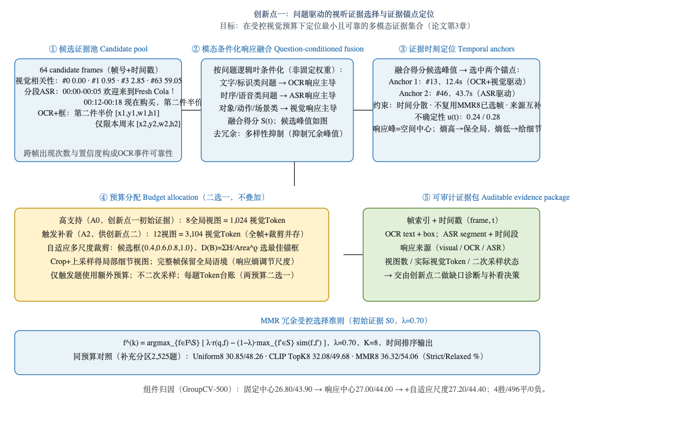

# AdsQA 论文研究归档

本目录汇总 AdsQA 广告视频问答硕士论文的定稿、实验、文献与答辩材料。内容按“保留最新权威版本、历史过程进入审计索引”的原则去重。

## 内容导航

| 目录 | 内容 |
|---|---|
| [`thesis/`](thesis/) | 2026-08-17 最新论文全文 |
| [`experiments/`](experiments/) | 最终结果摘要与完整实验复现索引 |
| [`literature/`](literature/) | AdsQA 原论文笔记、后续工作、2026 文献与引用文件 |
| [`defense/`](defense/) | 答辩问题与回答 |
| [`figures/`](figures/) | 最新方法图 SVG 与 PNG |

## 研究主线

1. 在固定视觉 Token 预算下，融合问题、OCR 与 ASR 信息选择低冗余视听证据。
2. 根据初始答案的证据缺口执行时间或区域补看。
3. 使用声明级证据充分性验证和保守门控决定是否更新答案。
4. 通过冻结协议、视频级 Bootstrap 与可追溯实验索引约束结论边界。

## 去重与发布边界

- 仅保留最新完整论文，不重复收录旧章节、改写稿和闭环审查过程。
- 单项预注册、阶段结果和负结果统一由完整实验索引追溯。
- 不包含数据集、模型权重、API 凭据、机器裁判原始响应或私有参考答案。
- 不复制研究源码；可复现代码位于 [adsqa-research-code](https://github.com/still0123/adsqa-research-code)。
- 文档中的机器裁判结果均按 `not_human_gold=true` 理解，不等同于人工金标准。

## English

This folder is the deduplicated AdsQA thesis research archive. It keeps the latest thesis draft, final experiment summary, auditable experiment index, core literature notes, defense material, and current method figures. Historical drafts, datasets, model weights, credentials, private answers, and duplicated source code are excluded.
