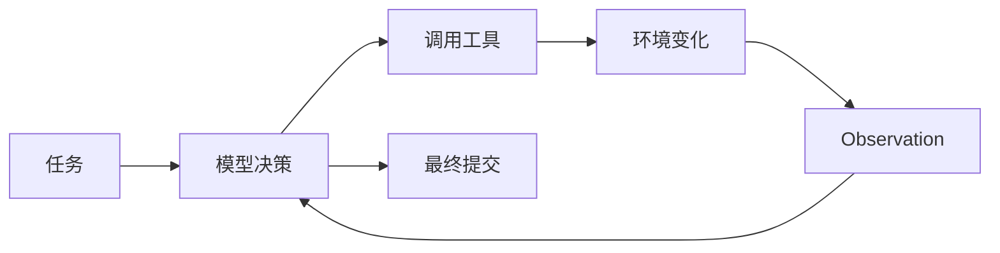
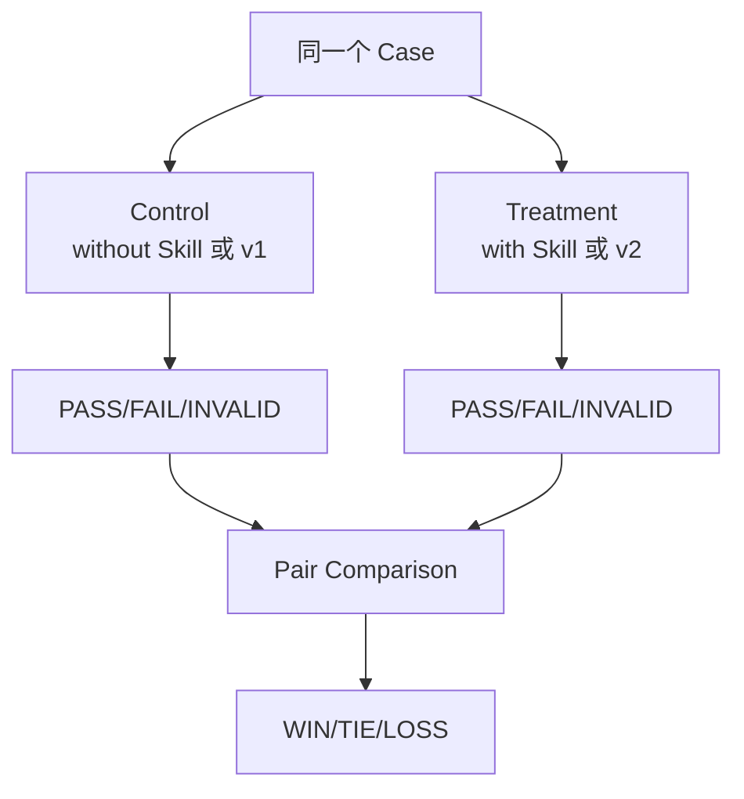
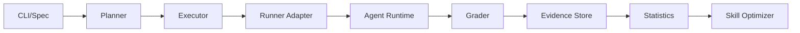
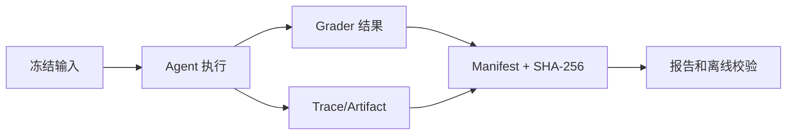
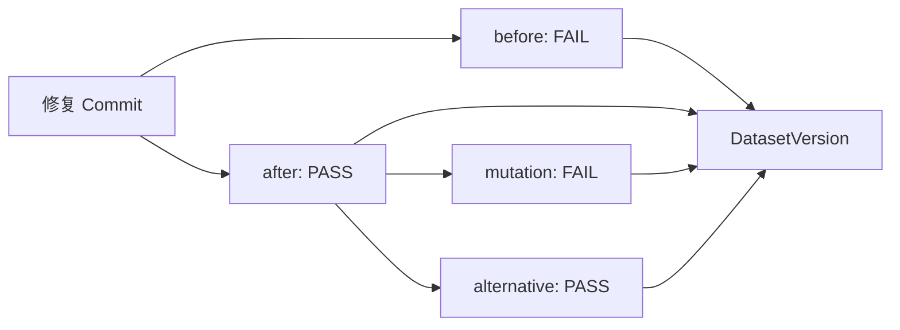

# AgentSkill-Eval 一天速成版

> 目标：用 8～10 小时建立基本认知，能在秋招面试中讲清项目题眼、核心架构、一次评测流程和真实边界。
> 完整版参考：[AgentSkill-Eval 秋招知识与源码讲解手册](./AgentSkill-Eval_秋招知识与源码讲解手册.md)

---

## 一、今天只掌握六件事

1. Agent 是“模型 + 工具 + Runtime + 环境”的循环，不只是一次对话。
2. Skill 是可复用工作方法，不是 Tool，也不等于单次 Prompt。
3. 项目通过同题配对实验估计 Skill 的边际价值。
4. `PASS`、`FAIL`、`INVALID` 必须分开。
5. 一次评测经过 Planner、Runner、Grader、Evidence、Statistics。
6. 项目证明了评测和门禁链可用，但尚未发布真实 Skill v2。

---

# 上午：建立核心认知

## 1. 09:00～10:00：Agent 基础

### 1.1 最小心智模型



### 1.2 六个关键词

| 概念 | 一句话解释 |
|---|---|
| Model | 做语言理解和决策 |
| Prompt | 描述本次目标和上下文 |
| Tool | 读取或改变外部环境 |
| Skill | 面向任务族的可复用方法 |
| Runtime | 维护多轮循环、预算和状态 |
| Evaluator | 判断任务是否真正完成 |

### 1.3 必背区别

```text
Prompt：这次要做什么
Tool：可以做什么
Skill：这类任务应该怎样做
Runtime：如何组织多轮执行
```

面试回答：

> Agent 不是 LLM 的别名，而是围绕模型构建的执行系统。模型负责决策，Tool 负责外部动作，Runtime 负责循环、预算和状态，Evaluator 负责验证真实结果。

## 2. 10:00～11:00：项目题眼

Agent 结果同时受到多个变量影响：

```text
Result = Model + Prompt + Skill + Tool + Runtime + Environment + Budget + Randomness
```

AgentSkill-Eval 的核心：

> 冻结其他变量，只改变 Skill，让同一个 Case 在 control 和 treatment 两臂执行，通过配对结果估计 Skill 的边际价值。



为什么不直接比较两组总成功率：

- 两组任务难度可能不同；
- 模型和环境可能漂移；
- 无法知道具体改进和回归发生在哪个 Case。

## 3. 11:00～12:00：三个结果语义

| 结果 | 定义 | 后续动作 |
|---|---|---|
| PASS | 有效执行，且 grader 通过 | 成功证据 |
| FAIL | 有效执行，但 grader 未通过 | 可进入 Skill 诊断 |
| INVALID | 无法判断任务能力 | 修基础设施，不进入优化 |

典型 INVALID：

- Provider 错误；
- Runner 崩溃；
- 超时；
- grader 环境坏；
- result.json 缺失；
- 证据被 Secret 污染。

关键回答：

> 如果把 Provider 超时也当成 FAIL，Optimizer 会尝试通过修改 Skill 修复基础设施问题，训练信号会被污染。

---

# 下午：顺着源码理解主链

## 4. 13:30～14:30：系统架构



模块映射：

| 模块 | 职责 |
|---|---|
| `contracts` | 领域对象和状态约束 |
| `experiment/planning.py` | PairBlock 和 Run 规划 |
| `experiment/execution.py` | 执行和结果发布 |
| `runner_adapters` | 外部 Runner 协议转换 |
| `experiment/storage` | Manifest、Blob、SQLite |
| `experiment/statistics.py` | 配对统计 |
| `benchmark_gen` | Git 历史 Case 重建 |
| `skill_optimizer` | 候选搜索和发布门禁 |

今天只打开六个文件：

1. [`experiment.py`](https://github.com/ranmaoxia0123/AgentSkill-Eval/blob/main/packages/contracts/agentskill_eval_contracts/experiment.py)
2. [`run.py`](https://github.com/ranmaoxia0123/AgentSkill-Eval/blob/main/packages/contracts/agentskill_eval_contracts/run.py)
3. [`planning.py`](https://github.com/ranmaoxia0123/AgentSkill-Eval/blob/main/packages/experiment/agentskill_eval_experiment/planning.py)
4. [`execution.py`](https://github.com/ranmaoxia0123/AgentSkill-Eval/blob/main/packages/experiment/agentskill_eval_experiment/execution.py)
5. [`skill_up.py`](https://github.com/ranmaoxia0123/AgentSkill-Eval/blob/main/packages/runner_adapters/agentskill_eval_runner_adapters/skill_up.py)
6. [`statistics.py`](https://github.com/ranmaoxia0123/AgentSkill-Eval/blob/main/packages/experiment/agentskill_eval_experiment/statistics.py)

## 5. 14:30～15:30：核心对象

```text
ExperimentManifest
├── Variant: control
├── Variant: treatment
└── PairBlock(case, repeat)
    ├── Run(control)
    │   └── Attempt
    └── Run(treatment)
        └── Attempt
```

| 对象 | 含义 |
|---|---|
| Experiment | 冻结的数据、协议和预算 |
| Variant | 一个实验臂 |
| PairBlock | 同 Case、同 repeat 下的两臂 |
| Run | 逻辑执行 |
| Attempt | 一次物理尝试 |
| Measurement | Token、时延、费用等指标 |

为什么 Run 和 Attempt 分开：

- Run 保持逻辑身份；
- Attempt 允许超时、恢复和重试；
- 可以明确最终选择了哪个 Attempt。

## 6. 15:30～16:30：Planner 和 Runner

### Planner 必看代码

```python
block_id = uuid5(experiment.id, f"pair-block:{case.id}:{repeat_index}")
block_seed = hash(random_seed, case.id, repeat_index)
order = shuffle(variants, block_seed)
run_id = uuid5(block_id, f"run:{variant_id}")
```

你必须理解：

- UUIDv5 让相同输入产生相同 ID；
- 固定 seed 使随机顺序可复现；
- 随机顺序降低缓存和时间偏差；
- fingerprint 防止恢复时配置漂移。

### Runner Adapter 必看

Adapter 将外部 `skill-up` CLI 翻译为内部统一协议：

```text
RunnerRequest -> skill-up argv/eval.yaml
skill-up result.json -> RunnerResult
```

Adapter 还负责：

- 校验二进制 SHA-256；
- 创建独立 HOME；
- 注入 Secret；
- timeout/cancel；
- 解析结构化结果；
- 声明 capability unavailable。

## 7. 16:30～17:30：Evidence



三个技术点：

### 原子写

```text
临时文件 -> write -> fsync -> replace -> fsync directory
```

避免进程崩溃后出现半写 JSON。

### 内容寻址

```text
objects/sha256/<digest>
```

相同字节共享同一个地址，可去重和校验。

### 准确边界

项目是 tamper-evident，不是密码学不可篡改：

- SHA-256 能发现内容变化；
- 但有权限的人可以修改内容后重算哈希；
- 更强方案需要数字签名和外部 provenance。

---

# 晚上：Benchmark、统计与面试

## 8. 19:00～20:00：四态 Benchmark



| 验证 | 防止的问题 |
|---|---|
| before-fail | Case 本来就通过 |
| after-pass | 历史修复无效 |
| mutation-fail | Grader 对关键逻辑不敏感 |
| alternative-pass | Grader 只接受参考补丁 |

必须知道五个 split：

```text
train
-> validation_search
-> regression_dev
-> validation_confirm
-> locked_test
```

## 9. 20:00～21:00：统计和 Skill 演化

### W/T/L

| Control | Treatment | 结果 |
|---|---|---|
| 失败 | 成功 | WIN |
| 成功 | 成功 | TIE_POSITIVE |
| 失败 | 失败 | TIE_NEGATIVE |
| 成功 | 失败 | LOSS |

### Skill 演化链

```text
有效 FAIL
-> 失败诊断
-> 候选 Skill
-> validation_search
-> regression_dev
-> validation_confirm
-> locked_test
-> human review
-> SkillVersion
```

Successive halving：

- 所有候选先跑少量 Case；
- 淘汰差候选；
- 晋级候选再获得更多预算。

Search winner 不能直接发布，因为它已经适应 validation_search。

## 10. 21:00～22:00：项目真实结果和面试

必须记住：

- 项目一键模拟 Demo 可以完成 72 个 Run；
- 公开 Benchmark release 有 20 个历史 Bug Case、5 个仓库；
- 真实 validation_search 完成 48 Run；
- 真实 regression 完成 16 Run；
- regression 为 `0W/4T/0L`；
- 因没有正向 Win，未进入 confirmation 和 locked test；
- 没有真实 Skill v2。

推荐讲法：

> 系统找到 provisional winner 后，在 regression 中检测到 base 和 winner 都是 100%，没有回归但也没有正向增益，因此按预注册门禁拒绝 Promotion。这个负结果证明门禁有效，也暴露了数据存在 ceiling effect。

### 当前三大问题

1. 一 split 一仓库，仓库效应和 split 效应混淆；
2. 默认独立组门槛过低，不足以支撑确认性统计；
3. 工程控制面很完整，但真实 v1 到 v2 正向闭环尚未完成。

---

# 一天结束时的自测

不看资料回答：

1. Agent 和 LLM 有什么区别？
2. Skill 和 Tool 有什么区别？
3. 为什么做配对实验？
4. 为什么需要 PairBlock？
5. 为什么随机化执行顺序？
6. 为什么 Run 和 Attempt 分开？
7. FAIL 和 INVALID 有什么区别？
8. Adapter 解决什么问题？
9. 四态 Benchmark 分别验证什么？
10. 为什么 search winner 不能直接发布？
11. locked test 为什么只能消费一次？
12. 为什么当前没有真实 Skill v2？

能正确回答 10 题以上，即达到一天速成目标。

---

# 一页背诵卡

```text
Agent = Model + Tool + Runtime + Environment
Skill = 可复用的领域工作方法

题眼 = 固定其他变量，只改变 Skill，做同题配对实验

主链 =
Spec -> Planner -> PairBlock/Run -> Runner Adapter
-> Agent -> Grader -> PASS/FAIL/INVALID
-> Manifest/Trace -> Statistics -> Optimizer

Benchmark =
before FAIL + after PASS + mutation FAIL + alternative PASS

发布门 =
search -> regression -> confirmation -> locked -> human review

真实结论 =
工程链可用，真实 regression 0W/4T/0L，
无增益候选被阻止，真实 Skill v2 尚未发布。
```
