# AgentSkill-Eval 秋招知识与源码讲解手册

> 面向读者：第一次系统学习 Agent、Agent Skill 和 Agent Evaluation 的开发者
> 文档目标：不仅能“背项目”，还要能顺着源码解释一次实验如何被规划、执行、判分、存证和用于 Skill 演化
> 代码基线：`ranmaoxia0123/AgentSkill-Eval@67479ba`，2026-07-15 的 `main`
> 项目地址：<https://github.com/ranmaoxia0123/AgentSkill-Eval>

---

## 0. 如何使用这份手册

不要从头到尾死记。建议分三轮学习：

1. 第一轮只看“L1 必须掌握”的章节和所有图，建立完整心智模型。
2. 第二轮打开对应源码，按“输入、处理、输出、异常”四个问题阅读关键函数。
3. 第三轮脱离文档，用自己的语言回答文末面试题，并现场画出系统架构图。

### 0.1 学习优先级

| 级别 | 含义 | 秋招要求 |
|---|---|---|
| L1 必须掌握 | 项目的题眼和核心调用链 | 必须能脱稿解释，并能定位源码 |
| L2 应该掌握 | 支撑核心链路的工程技术 | 能解释设计理由和取舍 |
| L3 了解即可 | 扩展能力和研究细节 | 被追问时不说错，不必背实现 |

### 0.2 学完后你应该能回答

- LLM、Agent、Tool、Skill、Memory、RAG、Runtime 分别是什么？
- 为什么不能只比较“加载 Skill 后的成功率”？
- 什么是配对实验，为什么要随机化两臂执行顺序？
- `PASS`、`FAIL`、`INVALID` 为什么必须分开？
- Runner Adapter 解决了什么兼容性问题？
- 为什么 Manifest 要做 SHA-256、原子写入和内容寻址？
- 如何从 Git 历史重建一个 Bug Fix Benchmark？
- mutation-fail 和 alternative-pass 分别防止什么问题？
- successive halving、Pareto 选择和 locked test 是什么？
- 这个项目目前真正证明了什么，又没有证明什么？

---

# 第一部分：Agent 新人必备基础

## 1. 什么是大语言模型

大语言模型可以先理解为一个条件概率模型：

```text
给定已有上下文 x，预测后续 Token y 的概率 P(y | x)
```

它擅长理解和生成文本，但模型本身通常不具备以下能力：

- 不会天然读取你的本地文件；
- 不会天然执行终端命令；
- 不会天然访问数据库和浏览器；
- 不会自动保存跨会话状态；
- 不知道工具执行后的真实世界是否发生变化。

所以，单独的 LLM 更像“会推理和生成文本的大脑”，而不是完整的软件执行系统。

## 2. 什么是 Agent

Agent 是一个围绕模型构建的执行循环。它让模型能够观察环境、选择动作、调用工具、读取结果并继续决策。

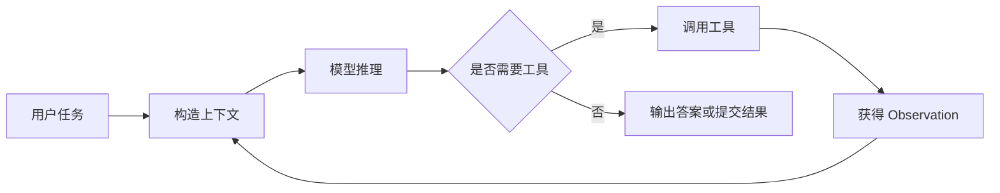

一个最小 Agent 循环可以写成：

```python
messages = [system_prompt, user_task]

for turn in range(max_turns):
    response = model.generate(messages, tools=tool_definitions)

    if response.tool_call:
        observation = execute_tool(response.tool_call)
        messages.append(response)
        messages.append(observation)
        continue

    return response.final_answer

raise BudgetExceeded("max_turns reached")
```

这里已经出现了 Agent 系统的几个关键组成部分：

| 组成 | 作用 |
|---|---|
| Model | 生成计划、动作或答案 |
| Prompt | 告诉模型身份、目标和约束 |
| Tool | 让模型影响或读取外部环境 |
| Runtime | 维护循环、上下文、超时和预算 |
| Environment | 文件系统、代码仓库、数据库等真实状态 |
| Evaluator | 判断任务是否真的完成 |

## 3. Prompt、Tool、Skill 的区别

这是面试中最容易混淆的概念。

### 3.1 Prompt

Prompt 是一次模型调用中的指令和上下文。

例如：

```text
你是一名 Python 工程师，请修复当前仓库中的缓存失效问题。
```

Prompt 通常回答“这次要做什么”。

### 3.2 Tool

Tool 是 Agent 可以调用的外部能力。

例如：

- `read_file(path)`；
- `run_command(command)`；
- `search_code(query)`；
- `query_database(sql)`；
- `browser_click(element)`。

Tool 回答“可以对环境做什么”。

### 3.3 Skill

Skill 是一组可复用的领域流程、约束和经验，通常以 Markdown、模板、脚本或配置形式被加载到 Agent 上下文。

例如 Python Bug Fix Skill 可能要求：

1. 先定位失败测试；
2. 阅读调用链，不直接猜补丁；
3. 修改最小范围；
4. 先运行目标测试，再运行回归测试；
5. 检查异常路径和边界条件。

Skill 回答“面对某类任务应该怎样做得更稳定”。

### 3.4 三者关系

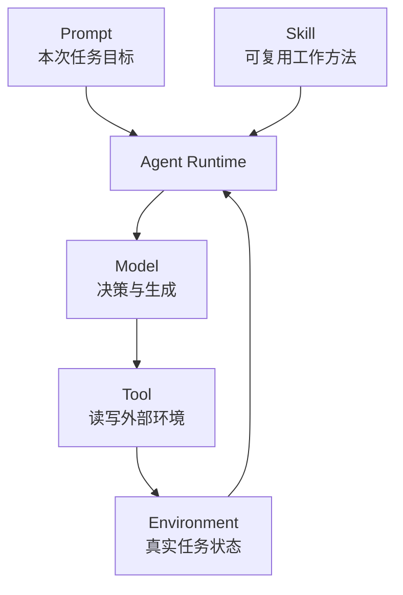

面试回答模板：

> Prompt 描述当前任务，Tool 提供外部动作能力，Skill 提供跨任务复用的领域策略。Agent Runtime 把它们编排成多轮观察和行动循环。

## 4. Memory 和 RAG

### 4.1 Memory

Memory 用于保存和恢复 Agent 的历史信息，例如：

- 用户偏好；
- 已完成步骤；
- 过去失败经验；
- 长期项目背景；
- 当前任务状态。

Memory 不一定是向量数据库，也可以是结构化 JSON、关系数据库或文件。

### 4.2 RAG

RAG 是 Retrieval-Augmented Generation，即先检索外部知识，再把检索结果放进模型上下文。

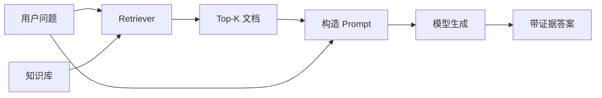

Memory 更强调“过去发生了什么”，RAG 更强调“当前需要哪些外部知识”。两者可能使用相同存储技术，但语义不同。

## 5. 什么是 Agent Evaluation

普通 LLM 评测通常比较输入和最终输出；Agent 评测还必须评估整个执行过程。

```text
LLM Evaluation:
输入 -> 输出 -> 判断答案

Agent Evaluation:
任务 -> 多轮计划 -> 工具调用 -> 环境变化 -> 最终状态 -> 判断是否完成
```

Agent 可能出现以下情况：

- 最终回答说“已经修好”，实际测试仍失败；
- 选择了错误工具；
- 参数正确但调用顺序错误；
- 修改了目标文件，却引入其他回归；
- Provider 超时，任务根本没有得到有效执行；
- 在预算耗尽前没有提交结果。

因此，Agent Evaluation 不能只相信模型自述，必须尽量使用可执行 Oracle。

### 5.1 Oracle

Oracle 是判断任务是否成功的规则。

| 场景 | Oracle |
|---|---|
| Bug Fix | 冻结测试命令退出码为 0 |
| 数据库任务 | 目标记录和约束满足预期 |
| MCP 工具任务 | 最终工具环境状态满足条件 |
| RAG 问答 | 答案、引用和证据对应关系正确 |
| 文件编辑 | 目标文件内容、格式和测试通过 |

项目坚持“能用确定性脚本判断的内容，不交给 LLM Judge”，这是一个正确的工程原则。

---

# 第二部分：理解 AgentSkill-Eval 的题眼

## 6. 项目到底解决什么问题

Agent 的效果由许多变量共同决定：

```text
Agent Result =
Model
+ System Prompt
+ Skill
+ Tools
+ Memory/RAG
+ Runtime
+ Environment
+ Budget
+ Randomness
```

如果加载一个 Skill 后成功率变高，不能直接说明是 Skill 带来的，因为模型版本、任务、预算或随机性可能同时发生变化。

AgentSkill-Eval 的核心思想是：

> 冻结 Agent、模型、任务、工具、环境和预算，只改变 Skill，通过同题配对实验估计 Skill 的边际价值。

数学上可以理解为：

```text
同一个 Case i:

Y_i(0) = 不加载 Skill 时的结果
Y_i(1) = 加载 Skill 时的结果

Skill Effect_i = Y_i(1) - Y_i(0)
```

现实中无法让同一次随机模型调用同时处于两个状态，所以项目通过重复执行、随机化顺序和同题配对来近似控制其他变量。

## 7. 为什么是配对实验

假设有两道题：

- Case A 很简单，任何 Agent 都能做对；
- Case B 很难，任何 Agent 都容易失败。

如果 baseline 只跑 A、treatment 只跑 B，直接比较成功率没有意义。

配对实验要求同一个 Case 同时出现在两臂：

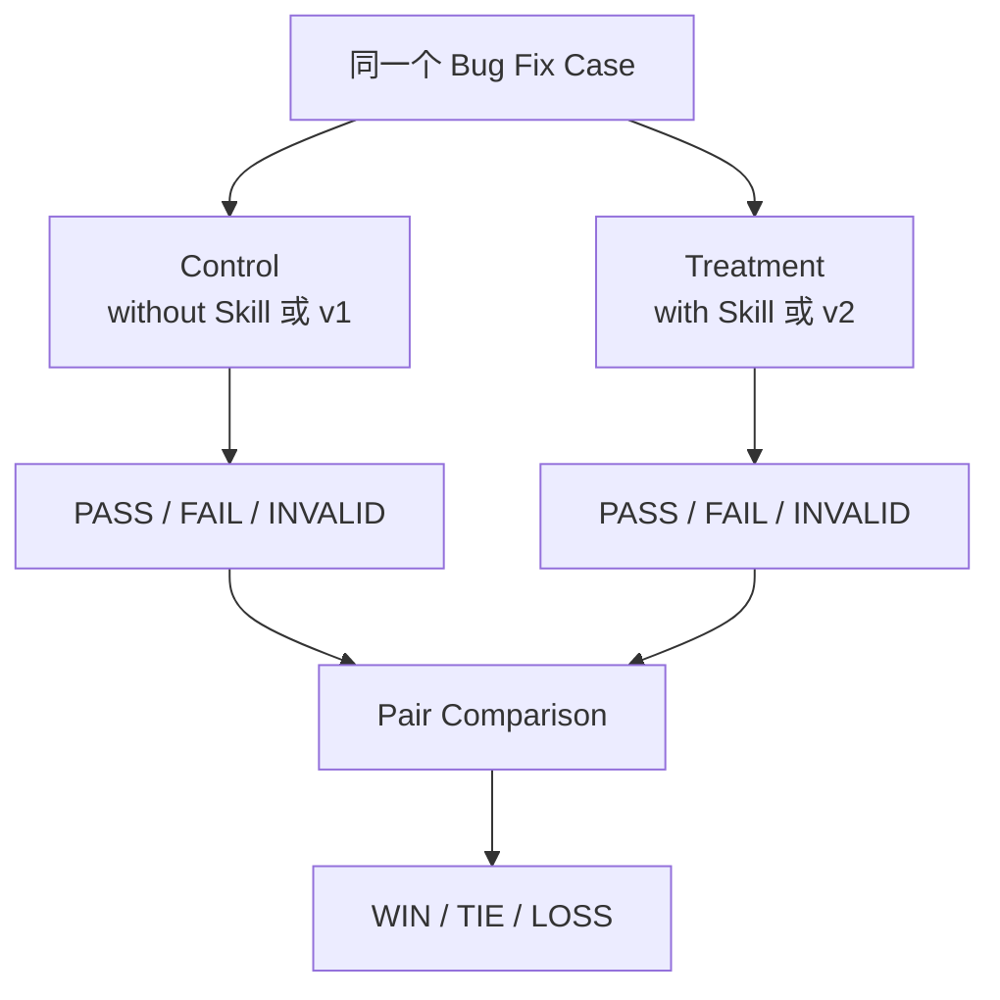

配对的价值：

- 消除 Case 难度差异；
- 可以定位具体改进和回归；
- 可以计算每个 Case 的效果；
- 适合使用 paired bootstrap、McNemar 等配对统计方法。

## 8. 项目当前真正证明了什么

截至上述代码基线，项目已经证明：

- 本地配对实验链路可以运行；
- Runner、Trace、Manifest 和报告可以形成完整工程链；
- 可以从真实 Git 历史重建 Bug Fix Case；
- 可以运行真实 Qwen Code 和 DeepSeek 小规模实验；
- 可以区分任务失败和基础设施失效；
- 可以在候选没有正向收益时阻止 Promotion。

项目尚未证明：

- Skill 对广泛任务具有稳定普遍增益；
- 自动优化一定能生成更好的 Skill v2；
- 当前统计结果具有大样本推断意义；
- 当前执行环境是生产级强安全沙箱；
- MCP 和 Memory/RAG 已达到真实生产评测能力。

面试时主动说清边界，比夸大项目更可信。

---

# 第三部分：系统总体架构

## 9. 架构总览

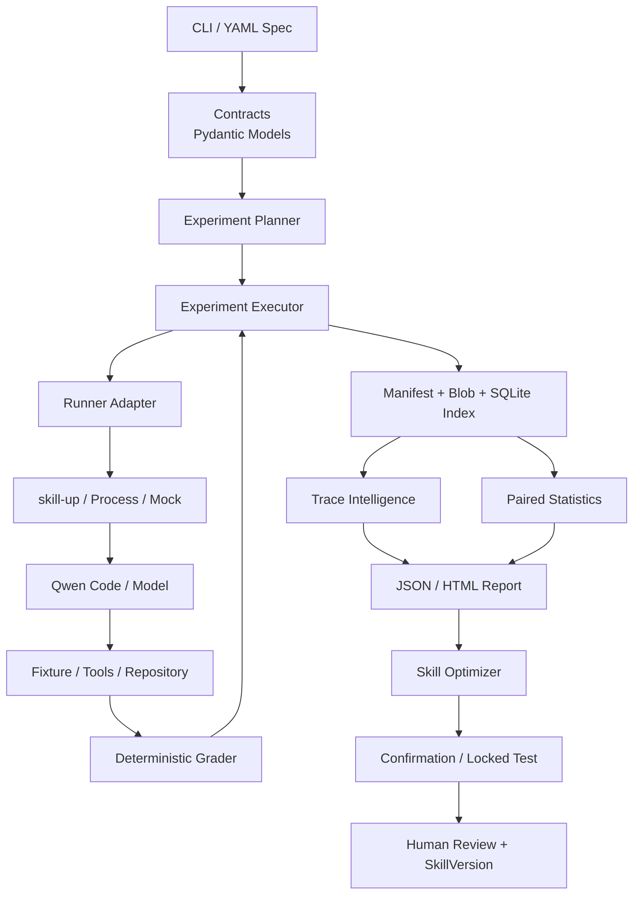

## 10. 模块职责

| 模块 | 主要职责 | 优先级 |
|---|---|---|
| `apps/cli` | 命令入口和参数校验 | L2 |
| `packages/contracts` | 跨模块领域对象和状态约束 | L1 |
| `packages/experiment` | 实验计划、执行、存储、统计和报告 | L1 |
| `packages/runner_adapters` | 隔离外部 Runner 差异 | L1 |
| `packages/trace_intelligence` | 规范化 Trace 和失败归因 | L2 |
| `packages/benchmark_gen` | 从 Git 历史重建 Benchmark | L1 |
| `packages/skill_optimizer` | 候选生成、搜索、终评和发布 | L1 |
| `packages/real_evidence` | 真实运行授权、预算和证据边界 | L2 |
| `packages/mcp_lab` | MCP 专项离线评测 | L3 |
| `packages/memory_rag_lab` | Memory/RAG 专项离线评测 | L3 |
| `packages/scenarios` | 不同评测场景的统一抽象 | L2 |
| `apps/web` | 本地只读证据展示 | L3 |

### 10.1 主要代码入口

- [CLI main.py](https://github.com/ranmaoxia0123/AgentSkill-Eval/blob/main/apps/cli/agentskill_eval_cli/main.py)
- [实验规划 planning.py](https://github.com/ranmaoxia0123/AgentSkill-Eval/blob/main/packages/experiment/agentskill_eval_experiment/planning.py)
- [实验执行 execution.py](https://github.com/ranmaoxia0123/AgentSkill-Eval/blob/main/packages/experiment/agentskill_eval_experiment/execution.py)
- [配对统计 statistics.py](https://github.com/ranmaoxia0123/AgentSkill-Eval/blob/main/packages/experiment/agentskill_eval_experiment/statistics.py)
- [Runner Adapter skill_up.py](https://github.com/ranmaoxia0123/AgentSkill-Eval/blob/main/packages/runner_adapters/agentskill_eval_runner_adapters/skill_up.py)
- [Benchmark generator.py](https://github.com/ranmaoxia0123/AgentSkill-Eval/blob/main/packages/benchmark_gen/agentskill_eval_benchmark_gen/generator.py)
- [Skill search.py](https://github.com/ranmaoxia0123/AgentSkill-Eval/blob/main/packages/skill_optimizer/agentskill_eval_skill_optimizer/search.py)
- [Final evaluation.py](https://github.com/ranmaoxia0123/AgentSkill-Eval/blob/main/packages/skill_optimizer/agentskill_eval_skill_optimizer/final_evaluation.py)

---

> 下面从领域模型开始，沿着 `ExperimentManifest -> PairBlock -> Run -> Attempt -> Evidence -> Report` 进入真实源码。

# 第四部分：领域模型和数据关系

## 11. 为什么先读 Contracts

大型系统最稳定的部分通常不是某个函数，而是模块之间的数据契约。

AgentSkill-Eval 使用 Pydantic v2 定义领域对象，可以获得：

- 类型和字段约束；
- JSON/YAML 序列化；
- 不可变对象；
- 跨模块统一语义；
- JSON Schema 导出；
- 输入非法时尽早失败。

对应源码目录：

[packages/contracts/agentskill_eval_contracts](https://github.com/ranmaoxia0123/AgentSkill-Eval/tree/main/packages/contracts/agentskill_eval_contracts)

## 12. 核心对象关系

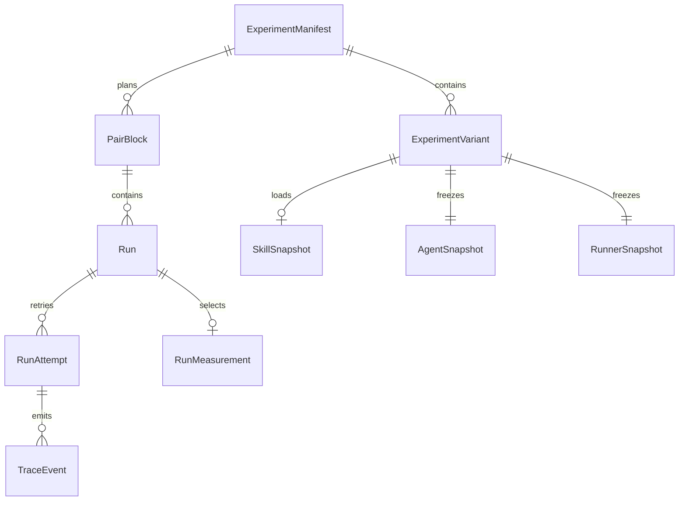

### 12.1 ExperimentManifest

`ExperimentManifest` 表示一次已经冻结的实验。

关键字段：

| 字段 | 含义 |
|---|---|
| `dataset_version_id` | 使用哪个 DatasetVersion |
| `dataset_sha256` | 数据集内容指纹 |
| `code_revision` | 平台代码版本 |
| `protocol_snapshot` | repeats、seed 等实验协议 |
| `statistics_plan` | 统计方法和阈值 |
| `budget_snapshot` | Run、Token、费用预算 |
| `variants` | 参与比较的实验臂 |
| `status` | DRAFT、FROZEN 等状态 |

它解决的问题是：

> 实验运行后，如何证明当时使用的数据、协议和实验臂没有被偷偷改变？

### 12.2 ExperimentVariant

Variant 表示一个实验臂。

```text
Control Variant:
Qwen Code + DeepSeek + no Skill + fixed tools

Treatment Variant:
Qwen Code + DeepSeek + Python Bug Fix Skill v1 + same tools
```

Variant 记录：

- Agent 版本；
- 模型及生成参数；
- Runner 版本和二进制哈希；
- Skill 内容哈希和注入模式；
- Tool 配置；
- Sandbox 声明；
- Price 快照。

`variant_sha256` 不包含显示名称和数据库 ID，只哈希影响实验语义的字段。这样即使对象 ID 不同，只要实验语义相同，指纹仍然一致。

### 12.3 PairBlock

PairBlock 是“同一个 Case、同一次 repeat 下的所有实验臂”。

```text
PairBlock(case=cache-bug, repeat=0)
├── control run
└── treatment run
```

关键字段：

- `case_id`；
- `independence_group`；
- `repeat_index`；
- `seed`；
- `execution_order`。

### 12.4 Run 和 RunAttempt

Run 是逻辑执行单元，Attempt 是一次物理尝试。

区分二者的原因：

- Provider 可能超时；
- 进程可能崩溃；
- 平台可能在持久化前退出；
- 同一个逻辑任务可能需要恢复或重试；
- 需要明确哪一个 Attempt 被选为最终证据。

这种设计与分布式任务系统中的 Job/Attempt 很相似。

### 12.5 RunMeasurement

保存一次 Run 的可比较指标：

- Token；
- 时延；
- 费用；
- 得分；
- Tool 调用数；
- 其他专项指标。

结果和资源开销分开建模，可以避免“成功率高，但成本无限增加”的错误优化。

## 13. 为什么模型要 Frozen

项目中的基础模型继承 `FrozenModel`，本质上使用 Pydantic 的 `frozen=True`。

不可变对象的好处：

- 创建后不能原地篡改；
- 状态迁移需要构造新对象；
- 哈希计算更可靠；
- 审计历史更容易理解；
- 并发读取时减少共享可变状态。

注意：Python 对象不可变不等于磁盘文件无法被修改。磁盘完整性还需要 SHA-256、原子写入和发布规则。

---

# 第五部分：实验规划源码

## 14. LocalExperimentPlanner 做什么

源码：

[planning.py](https://github.com/ranmaoxia0123/AgentSkill-Eval/blob/main/packages/experiment/agentskill_eval_experiment/planning.py)

主入口：

```python
class LocalExperimentPlanner:
    def build(
        self,
        experiment,
        variants,
        runtime_specs,
        cases,
        *,
        repeats,
        random_seed,
        max_attempts=1,
    ) -> PlannedExperiment:
        ...
```

可以按四步理解 `build()`：

1. 校验实验是否已冻结；
2. 校验 Variant、Runtime 和 Case 是否一一对应；
3. 为每个 Case × Repeat 创建 PairBlock；
4. 为 PairBlock 中的每个 Variant 创建 Run。

## 15. 为什么要严格校验

代码会拒绝：

- 实验未进入 `FROZEN`；
- Variant 少于两个；
- Case ID 重复；
- Experiment 引用的 Variant 与实际输入不一致；
- Runtime Spec 不能一一映射到 Variant；
- 总 Run 数超过预算；
- Case 或 Grader 哈希格式错误。

这些校验属于 fail closed：

> 无法证明配置正确时，拒绝运行，而不是猜一个默认值继续执行。

这是评测系统比普通业务脚本更重要的原则。

## 16. PairBlock ID 和 Run ID

项目使用 UUIDv5 生成确定性 ID：

```python
block_id = uuid5(
    experiment.id,
    f"pair-block:{case.id}:{repeat_index}",
)

run_id = uuid5(block_id, f"run:{variant_id}")
```

UUIDv5 的特点：

- 输入命名空间和名称相同，输出 ID 相同；
- 不依赖数据库自增 ID；
- 重复规划可以识别同一个逻辑对象；
- 有利于幂等恢复。

面试追问：

> 为什么不用 UUIDv4？

回答：

> UUIDv4 每次随机生成，不便于识别重复规划。UUIDv5 把实验语义映射为稳定 ID，可以支持幂等写入和重放校验。

## 17. 为什么随机化执行顺序

核心代码：

```python
block_seed = self._block_seed(random_seed, case.id, repeat_index)
order = list(reference_ids)
random.Random(block_seed).shuffle(order)
```

如果永远先跑 control，再跑 treatment，可能引入顺序偏差：

- 第二次运行命中更多缓存；
- Provider 在不同时间段负载不同；
- 仓库第一次执行完成依赖安装；
- 网络、磁盘缓存或服务负载发生变化。

项目使用预注册的固定 seed 随机化顺序，同时保证实验可复现。

```mermaid
sequenceDiagram
    participant P as Planner
    participant B as PairBlock
    participant C as Control
    participant T as Treatment
    P->>P: hash(seed, case, repeat)
    P->>B: shuffle([C,T])
    alt 本次顺序为 T,C
        B->>T: execute
        B->>C: execute
    else 本次顺序为 C,T
        B->>C: execute
        B->>T: execute
    end
```

## 18. RunPlanFingerprint

项目会为 Run 计算计划指纹，包含：

- Case 哈希；
- Grader 哈希；
- 平台编译 Prompt 哈希；
- Variant 哈希；
- Engine、Environment、MCP 配置；
- artifact 收集规则；
- timeout 和 max turns；
- image digest。

如果恢复执行时这些值变化，平台应该拒绝把新执行结果挂到旧 Run 上。

这和数据库乐观锁的思想类似：

> 只有“我准备执行的对象”仍然是“之前冻结的对象”，才允许继续。

## 19. persist() 做什么

`persist()` 的职责不是简单 `save()`：

1. 保存 Experiment；
2. 冻结 Case 的源码、fixture 和 grader；
3. 冻结 treatment Skill 文件树；
4. 保存 Variant；
5. 保存 PairBlock；
6. 创建 Run；
7. 把 Run 推进到 `QUEUED`。

幂等规则：

- 相同 Run 已存在且关键字段一致：保留现状；
- 相同 ID 但 PairBlock、Variant 或指纹不同：拒绝；
- 已执行的 Run 不能被重新规划回初始状态。

---

# 第六部分：执行状态机和 Executor

## 20. 为什么需要状态机

Agent 执行不是一个原子函数。它包含准备、外部调用、判分和持久化，任何一步都可能失败。

Run 状态机可以概括为：

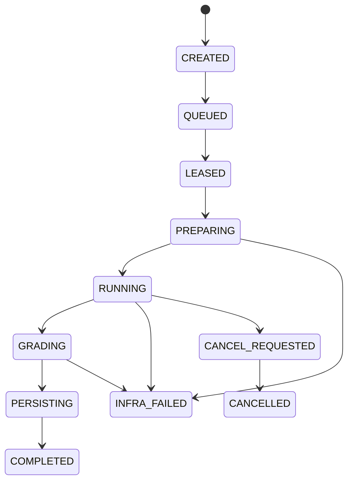

状态机的价值：

- 明确“失败发生在哪一步”；
- 限制非法状态跳转；
- 支持崩溃恢复；
- 防止同一 Run 被重复领取；
- 让监控和审计有统一语义。

## 21. LocalExperimentExecutor 的主流程

源码：

[execution.py](https://github.com/ranmaoxia0123/AgentSkill-Eval/blob/main/packages/experiment/agentskill_eval_experiment/execution.py)

可以把 Executor 理解成一个应用服务：

```text
读取计划
-> 按 PairBlock.execution_order 遍历 Run
-> 创建 Attempt
-> 编译 RunnerRequest
-> 校验 Runner
-> 启动执行
-> 收集结果和 Trace
-> 判定 PASS/FAIL/INVALID
-> 扫描 Secret
-> 归档 Artifact
-> 保存 Measurement
-> 发布 Run 终态
```

## 22. PASS、FAIL、INVALID

这是整个项目最重要的语义之一。

### 22.1 PASS

Agent 执行有效，且确定性 grader 证明最终状态满足任务目标。

### 22.2 FAIL

Agent 执行有效，但最终结果不满足任务目标。

例如：

- 测试执行成功，但测试断言失败；
- 文件修改未满足要求；
- 工具环境最终状态错误。

FAIL 是 Agent/Skill 能力证据，可以进入失败诊断和 Skill 优化。

### 22.3 INVALID

执行过程不能支持能力判断。

例如：

- Provider 连接失败；
- Runner 崩溃；
- 超时；
- grader 环境缺依赖；
- 报告缺失；
- 证据被 Secret 污染；
- artifact 完整性异常。

INVALID 是基础设施证据，不能直接当成 Skill 任务失败。

```mermaid
flowchart TB
    R[Runner 返回] --> V{执行证据有效}
    V -- 否 --> I[INVALID<br/>基础设施问题]
    V -- 是 --> G{Grader 通过}
    G -- 是 --> P[PASS<br/>任务成功]
    G -- 否 --> F[FAIL<br/>任务失败]
    F --> O[可进入 Skill 优化]
    I --> FIX[修复平台或环境]
```

面试回答：

> 如果把 Provider 超时和代码修复错误都记成 FAIL，Optimizer 会尝试用修改 Skill 的方式修复基础设施问题，优化信号会被污染。因此必须将任务失败和基础设施失效分开。

## 23. Attempt 和 fencing token

在分布式任务系统里，旧 Worker 可能在租约过期后继续写结果。

常见防护方法：

- lease generation；
- fencing token；
- active attempt ID；
- 终态对象不可修改。

即使当前项目主要是本地执行，这些字段也让状态模型具备向并发 Worker 扩展的基础。

## 24. 持久化顺序为什么重要

项目最终发布证据时遵循类似顺序：

1. 归档 Runner 原始字节；
2. 写内容寻址 Blob；
3. 写终态 Attempt；
4. 写 RunMeasurement；
5. 写 Artifact Manifest；
6. 最后更新 Run 的 selected Attempt 和终态。

如果先把 Run 标成 COMPLETED，再写 artifact，进程中途崩溃就会出现“结果显示完成，但证据不存在”的假完成状态。

这体现了数据库事务的基本思想：

> 先准备依赖数据，最后发布对外可见的提交点。

---

# 第七部分：Runner Adapter

## 25. Runner 是什么

Runner 是实际启动 Agent、加载 Skill、准备任务环境并输出结构化结果的执行内核。

项目没有把某一个 Agent CLI 写死在实验模块中，而是抽象 Runner Adapter：

```text
Experiment Core
      |
      v
Runner Adapter Interface
      |
      +-- MockRunnerAdapter
      +-- SkillUpRunnerAdapter
      +-- Process Adapter
```

## 26. 为什么使用 Adapter 模式

不同 Runner 可能存在差异：

- CLI 参数不同；
- 结果 JSON 结构不同；
- 状态码不同；
- Trace 事件能力不同；
- 取消方式不同；
- 模型和 Skill 注入方式不同。

如果实验核心直接理解每种 Runner，代码会出现大量条件分支。

Adapter 的作用：

> 把外部系统的协议翻译为内部统一的 `RunnerRequest`、`RunnerResult` 和 `RunnerEvent`。

这也叫 Anti-Corruption Layer，防止外部协议污染内部领域模型。

## 27. SkillUpRunnerAdapter 源码拆解

源码：

[skill_up.py](https://github.com/ranmaoxia0123/AgentSkill-Eval/blob/main/packages/runner_adapters/agentskill_eval_runner_adapters/skill_up.py)

### 27.1 verify_binary()

```python
digest = hashlib.sha256(self.binary.read_bytes()).hexdigest()
if digest != self.expected_sha256:
    raise IncompatibleRunnerError(...)
```

作用：

- 不只检查版本字符串；
- 确认实际执行的二进制字节；
- 防止同版本名称对应不同实现；
- 让实验可以绑定精确 Runner 构建。

局限：

- SHA-256 证明“字节一致”，不证明“这个二进制可信”；
- 可信来源仍需发布签名、供应链证明或人工审核。

### 27.2 隔离 HOME

Adapter 为每个 Run 构造独立：

- `HOME`；
- `XDG_CONFIG_HOME`；
- `XDG_CACHE_HOME`；
- `TMPDIR`。

这样可以降低：

- 读取开发者本地配置；
- 复用其他实验缓存；
- 意外发现周围 Skill；
- 把凭据写到真实用户目录。

### 27.3 Secret 注入

Secret 只从显式允许的环境变量注入，并禁止覆盖 Runner 管理的关键变量。

正确原则：

- 不把 Key 放在命令行参数；
- 不把 Key 写进 Manifest；
- 不把 Key 写进 Agent HOME 配置；
- 输出持久化前做精确扫描。

### 27.4 validate() 和 execute()

`validate()`：

- 校验二进制哈希；
- 编译单 Case 执行目录；
- 检查 Runner 版本；
- 调用 `skill-up validate`。

`execute()`：

- 发送 `runner.started` 事件；
- 调用 `skill-up run`；
- 处理取消、超时和 CLI 错误；
- 检查 `result.json`；
- 解析为统一 `RunnerResult`。

## 28. compile_evaluation()

源码：

[compiler.py](https://github.com/ranmaoxia0123/AgentSkill-Eval/blob/main/packages/runner_adapters/agentskill_eval_runner_adapters/compiler.py)

它会创建干净的单 Case、单 Variant 目录：

```text
run-dir/
└── compiled/
    ├── SKILL.md              # 中性根 Skill，阻止向上发现
    ├── evals/
    │   ├── eval.yaml
    │   └── fixture...
    └── skills/
        └── selected/         # treatment 才存在
```

关键安全检查：

- 拒绝符号链接；
- Case 文件必须位于 source eval 目录内；
- baseline 的 `skills` 明确为空；
- treatment Skill 复制后重新计算树哈希；
- 每次只运行一个 Case 和一个 Variant。

## 29. ProcessSupervisor

源码：

[process.py](https://github.com/ranmaoxia0123/AgentSkill-Eval/blob/main/packages/runner_adapters/agentskill_eval_runner_adapters/process.py)

负责：

- `asyncio.create_subprocess_exec` 启动进程；
- 收集 stdout/stderr；
- 超时控制；
- 取消；
- 终止进程组及子进程；
- SIGTERM 后升级为 SIGKILL。

为什么不能只 `process.kill()`：

> Agent 可能启动测试、Shell 或其他孙进程。只杀父进程会留下孤儿进程继续修改文件或消耗资源。

## 30. 当前 Sandbox 边界

必须如实理解：

- 项目记录 `SandboxSnapshot` 和 `network_policy`；
- Runner 使用独立目录和 HOME；
- Benchmark verifier 对 Python socket 做了限制；
- ProcessSupervisor 管理进程组。

但本项目控制层没有展示完整的容器、seccomp、cgroup、只读挂载或 eBPF 网络隔离实现。

因此简历中更准确的说法是：

> 实现隔离执行目录、最小环境继承、进程组终止和网络使用约束。

不要直接说：

> 实现了可安全执行任意不可信代码的生产级沙箱。

---

# 第八部分：证据存储和崩溃一致性

## 31. 为什么不用数据库作为唯一真值

本项目选择：

- JSON Manifest：领域真值；
- 内容寻址 Blob：原始 artifact；
- SQLite：可重建查询索引。

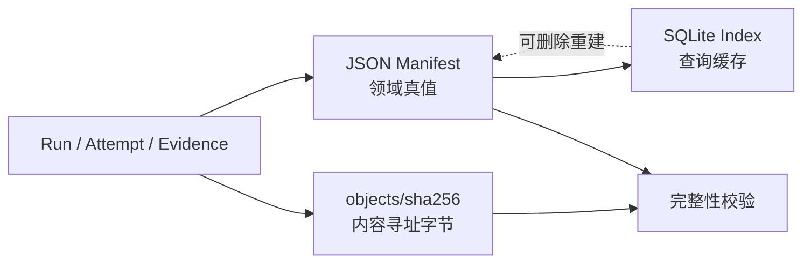

优势：

- 容易离线审计；
- 不依赖常驻数据库服务；
- artifact 可按哈希去重；
- SQLite 损坏后可以从 Manifest 重建；
- 适合作品集和单机研究系统。

## 32. ManifestEnvelope

源码：

[manifests.py](https://github.com/ranmaoxia0123/AgentSkill-Eval/blob/main/packages/experiment/agentskill_eval_experiment/storage/manifests.py)

结构可简化为：

```json
{
  "storage_schema_version": "ase/storage/v1",
  "model_name": "Run",
  "payload_sha256": "...",
  "semantic_sha256": "...",
  "payload": {}
}
```

两种哈希：

- `payload_sha256`：磁盘 payload 是否被修改；
- `semantic_sha256`：领域对象自身的语义指纹是否一致。

加载时会：

1. 解析 JSON；
2. 验证 payload 哈希；
3. 验证 model_name；
4. 用 Pydantic 重建对象；
5. 重新计算 semantic hash。

## 33. AtomicFileWriter

源码：

[atomic.py](https://github.com/ranmaoxia0123/AgentSkill-Eval/blob/main/packages/experiment/agentskill_eval_experiment/storage/atomic.py)

原子写入流程：

```text
创建同目录临时文件
-> 写入全部字节
-> flush
-> fsync(file)
-> os.replace(temp, target)
-> fsync(directory)
```

为什么临时文件必须和目标在同一目录：

- `os.replace` 在同一文件系统内才能保证原子替换语义；
- 跨文件系统移动可能退化为复制；
- 崩溃时可能看到半写文件。

为什么还要 `fsync(directory)`：

> 文件内容持久化不代表目录项变化已落盘。目录 fsync 用于提高 rename 后目标文件名在断电后的持久性。

## 34. 内容寻址存储

内容寻址意味着路径由内容哈希决定：

```text
objects/sha256/ab/abcdef...
```

同样的字节只有一个地址。

用途：

- 去重；
- 校验；
- artifact 引用；
- 审计包重放；
- 防止路径名冒充内容身份。

## 35. “不可变”应该怎样准确表达

项目中的不可变主要是应用协议：

- 对象使用 frozen model；
- 完成后的 snapshot 不允许覆盖；
- 发布目录已存在时拒绝写入；
- 文件有 SHA-256 sidecar；
- verify 会检查文件集合、大小和哈希。

它提供 tamper-evident，即篡改可检测。

它不自动提供：

- 作者身份认证；
- 外部可信时间戳；
- 防止仓库管理员重算所有哈希；
- 真实模型调用的第三方证明。

如果要加强，可以学习：

- Ed25519/minisign；
- Sigstore/cosign；
- GitHub Artifact Attestation；
- SLSA provenance；
- 远端 append-only transparency log。

---

> 下面继续解释 Trace、自动 Benchmark、统计评测和 Skill 优化闭环。

# 第九部分：Trace 与失败诊断

## 36. Trace 和日志有什么区别

普通日志主要服务于开发者排障，格式和语义可能不稳定。

Trace Event 是结构化执行事件，例如：

```json
{
  "kind": "tool.call",
  "timestamp": "...",
  "payload": {
    "tool": "run_command",
    "command": "pytest tests/test_cache.py"
  }
}
```

AgentSkill-Eval 希望统一以下事件：

- `runner.*`；
- `tool.*`；
- `command.*`；
- `file.*`；
- `test.*`；
- `mcp.*`；
- `retrieval.*`；
- `memory.*`；
- `judge.*`。

对应源码：

[trace_intelligence/core.py](https://github.com/ranmaoxia0123/AgentSkill-Eval/blob/main/packages/trace_intelligence/agentskill_eval_trace_intelligence/core.py)

## 37. 为什么要规范化 Trace

不同 Runner 的原始记录可能完全不同。

```text
Qwen Trace      ┐
Custom Process  ├-> Normalized Trace -> 统一诊断和报告
Mock Runner     ┘
```

规范化后的好处：

- 失败诊断不依赖具体 Runner；
- Dashboard 可以统一展示；
- v1/v2 可以比较工具序列；
- 新 Runner 只需实现 Adapter；
- 事件缺失可以显式标记。

## 38. Capability unavailable

如果 Runner 没有提供“Skill 是否被读取”事件，系统不应该猜测。

项目区分：

- Skill 被安装；
- Skill 被发现；
- Skill 文件被读取；
- Skill 被激活；
- Agent 行为遵循了 Skill。

当前 `skill-up` Adapter 主要能证明安装或缺失，不能直接证明模型真的遵循了 Skill，所以会写 `unavailable_reasons`。

这是良好的观测性原则：

> 未观测到，不等于没有发生；无法观测，也不能伪造为已发生。

## 39. 为什么不保存 Chain of Thought

项目保存：

- 工具调用；
- 命令；
- 文件变化；
- 测试事件；
- 最终输出；
- 可公开的过程摘要。

不保存或推断模型隐藏思维过程。

原因：

- Provider 通常不暴露真实隐藏推理；
- 模型生成的解释不一定等于真实因果过程；
- 隐藏推理可能包含敏感信息；
- 工程评测更应该依赖可验证动作。

## 40. 失败分类

典型失败分类：

| 类型 | 示例 | 应该优化什么 |
|---|---|---|
| Planning | 没有先定位失败测试 | Skill 流程 |
| Tool Selection | 使用错误工具 | Tool 选择策略 |
| Parameter | 路径、参数错误 | 参数检查 |
| Verification | 修改后没运行测试 | 验证清单 |
| Budget | 工具调用或轮数耗尽 | Runtime/Skill |
| Provider | API 错误 | 基础设施 |
| Grader Environment | 缺依赖 | Benchmark 环境 |

只有可归因于 Agent 行为并且执行有效的失败，才适合进入 Skill 优化。

---

# 第十部分：自动 Benchmark 生成

## 41. 为什么 Benchmark 是核心资产

没有高质量任务和 Oracle，评测平台再复杂也只是在精确地计算错误结果。

一个 Bug Fix Case 至少需要：

- 修复前代码；
- 清晰任务描述；
- Agent 看不到答案的工作目录；
- 确定性 grader；
- 来源 commit；
- 许可证和 provenance；
- 独立分组；
- 数据集 split。

## 42. 从 Git 历史重建 Case

源码：

[benchmark_gen/generator.py](https://github.com/ranmaoxia0123/AgentSkill-Eval/blob/main/packages/benchmark_gen/agentskill_eval_benchmark_gen/generator.py)

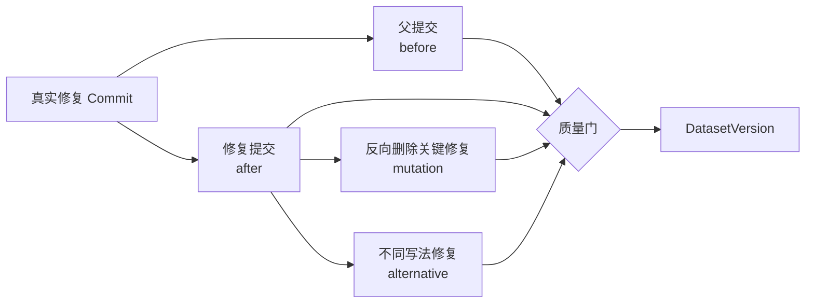

### 42.1 before-fail

在修复前版本执行 grader，必须稳定失败。

证明：

> Case 确实包含要修复的问题，而不是本来就通过。

### 42.2 after-pass

在历史修复后版本执行 grader，必须稳定通过。

证明：

> 上游修复确实解决了 grader 检查的问题。

### 42.3 mutation-fail

从修复后代码中删除或反向应用关键生产补丁，测试应重新失败。

证明：

> Grader 对关键修复逻辑敏感，不是无论代码怎样都通过。

### 42.4 alternative-pass

使用与历史补丁不同的正确修复方式，测试仍应通过。

证明：

> Grader 判断的是行为，而不是只接受唯一参考补丁。

四态验证可以概括为：

| 状态 | 期望 |
|---|---|
| before | FAIL |
| after | PASS |
| mutation | FAIL |
| alternative | PASS |

## 43. CommandVerifier

`CommandVerifier` 负责在受控环境中执行测试并保存证据。

关键设计：

- 命令数量预算；
- timeout；
- 固定 `PYTHONHASHSEED`；
- 禁止 pytest cache 修改 fixture；
- 尽量禁止网络；
- 独立 HOME；
- 保存 stdout/stderr 和退出码；
- 同一状态重复执行多次。

注意：使用 `sitecustomize.py` 覆盖 Python socket 不是强安全网络沙箱。它主要用于提高测试确定性，无法阻止恶意代码通过 subprocess、原生库或其他协议访问网络。

## 44. Benchmark 状态机

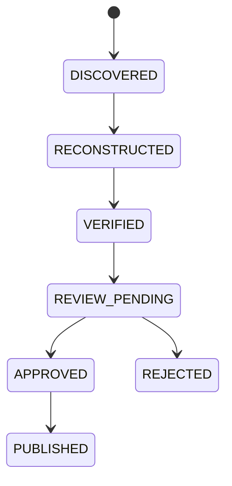

为什么需要人工 Review：

- 自动脚本不理解任务是否合理；
- 测试可能泄漏答案；
- 历史修复可能混入重构；
- 许可证和数据使用可能有风险；
- alternative repair 的独立性需要判断。

## 45. Dataset Split

完整 Skill 演化通常使用：

| Split | 用途 | Optimizer 可见性 |
|---|---|---|
| train | 分析失败、生成候选 | 可见 |
| validation_search | 自适应搜索和淘汰 | 可见结果 |
| regression_dev | 阻止候选破坏已知能力 | 开发门禁 |
| validation_confirm | 在独立数据上确认 | 对候选生成隔离 |
| locked_test | 一次性最终评测 | 严格隔离 |

## 46. 数据泄漏

常见泄漏：

- 同一缺陷家族跨 split；
- 同一个修复的轻微变体跨 split；
- 同一仓库 README 或 commit 信息泄漏答案；
- Optimizer 看到 locked grader；
- 根据 locked 结果继续改候选；
- 模型预训练中已经见过公开修复。

项目通过 provenance family、仓库/fork lineage 和 exposure zone 降低泄漏，但公开 Git 历史无法消除预训练污染风险。

## 47. 当前数据设计的真实边界

项目公开的一个 20-Case release 使用 5 个仓库，每个 split 4 个 Case，而且每个 split 只对应一个仓库。

这产生一个重要统计问题：

```text
validation_search 的差异
= Skill 差异？
+ cachetools 仓库特性？
+ Case 难度？

regression_dev 的差异
= Skill 差异？
+ boltons 仓库特性？
+ Case 难度？
```

仓库效应和 split 效应发生混淆。

改进方式：

- 每个 split 覆盖多个不同仓库；
- 以 repository 为第一层 cluster；
- 以 defect family 为第二层 cluster；
- repeat 只是同一 Case 内重复，不增加独立样本数；
- holdout 仓库在评测前保持私有或隔离。

---

# 第十一部分：配对统计

## 48. 三层聚合

项目统计不能直接把所有 Run 混在一起平均。

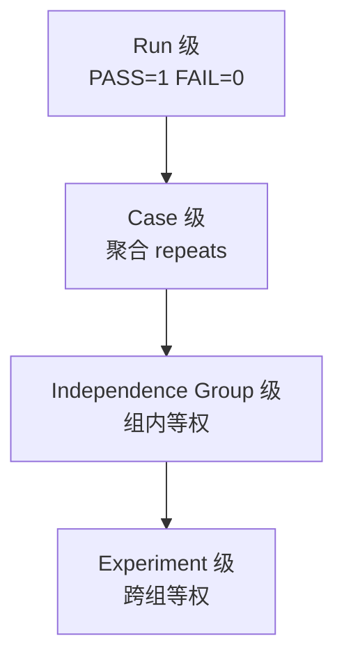

为什么：

- 同一 Case 的多次 repeat 不是多个独立任务；
- 同一缺陷家族中的多个 Case 可能高度相关；
- 某个仓库 Case 多，不应该自动获得更大权重。

## 49. Pass Rate

简化公式：

```text
CasePassRate(v, i)
  = mean(repeat result for variant v on case i)

GroupPassRate(v, g)
  = mean(CasePassRate(v, i) for i in group g)

PassRate(v)
  = mean(GroupPassRate(v, g))

AbsoluteGain
  = PassRate(treatment) - PassRate(control)
```

## 50. W/T/L

项目先对 repeats 聚合，再按阈值判断：

| Control | Treatment | 分类 |
|---|---|---|
| 未达到阈值 | 达到阈值 | WIN |
| 达到阈值 | 达到阈值 | TIE_POSITIVE |
| 未达到阈值 | 未达到阈值 | TIE_NEGATIVE |
| 达到阈值 | 未达到阈值 | LOSS |

示例：

| Case | Control | Treatment | 分类 |
|---|---:|---:|---|
| A | 0/3 | 2/3 | WIN |
| B | 3/3 | 3/3 | TIE_POSITIVE |
| C | 0/3 | 1/3 | TIE_NEGATIVE |
| D | 3/3 | 1/3 | LOSS |

W/T/L 比单个平均分更容易解释：

- Win 表示修好原本做不到的 Case；
- Loss 表示真实回归；
- Tie Negative 表示两版都无效；
- Tie Positive 可能暴露 ceiling effect。

## 51. INVALID 的两种口径

### 51.1 assignment-based

```text
PASS = 1
FAIL / INVALID / CANCELLED = 0
```

它回答：

> 把整个系统交付给用户时，最终成功概率是多少？

优点：保守地反映端到端交付。

缺点：基础设施稳定性会混入能力估计。

### 51.2 capability sensitivity

只保留两臂都得到有效 PASS/FAIL 的 Pair。

它回答：

> 在两边都有效执行的条件下，任务能力差异如何？

缺点：如果某个 Variant 更容易产生 INVALID，排除这些 Pair 可能产生选择偏差。

正确做法是同时报告两种口径和 invalid 原因，而不是只挑好看的数字。

## 52. Bootstrap

项目使用两级 cluster bootstrap：

1. 有放回抽样 independence group；
2. 在被抽中的 group 内有放回抽样 Case；
3. 计算 control、treatment 和 gain；
4. 重复多次；
5. 取 2.5% 和 97.5% 分位数。

伪代码：

```python
for _ in range(resamples):
    sampled_groups = sample_with_replacement(groups)
    effects = []

    for group in sampled_groups:
        sampled_cases = sample_with_replacement(group.cases)
        effects.append(mean(case.treatment - case.control))

    draws.append(mean(effects))

ci = quantile(draws, [0.025, 0.975])
```

## 53. 当前统计门槛的不足

代码默认 `min_independent_groups=2`，这不足以支撑稳定的 95% cluster bootstrap 推断。

原因：

- cluster 数太少；
- bootstrap 分布只有少量原始效果的重复组合；
- 同仓库 Case 可能相关；
- 模型结果还存在时间和 Provider 漂移。

更严谨的改进：

- 少于 10 个有效独立 cluster 时只标记 descriptive；
- 优先按 repository 聚类；
- 报告 effect size，不只报告是否过门；
- 二元 paired outcome 可补充 exact McNemar test；
- 对候选搜索后的结果做独立确认，避免 selection bias；
- 预先注册阈值，不看结果后调门槛。

## 54. Ceiling Effect

如果 baseline 已在 4/4 Case 上 100% 通过，任何新 Skill 都没有正向 Win 空间。

这种数据适合做 regression gate，不适合证明提升。

实验前应做 baseline screening：

- 过于简单：两臂都通过；
- 过于困难：两臂都失败或频繁 invalid；
- 合适难度：baseline 有失败，但任务仍可由流程改进解决。

推荐用于优化的数据，baseline 成功率可先控制在约 20%～70%，具体阈值需根据任务成本和样本量预注册。

---

# 第十二部分：Skill 优化

## 55. 优化闭环

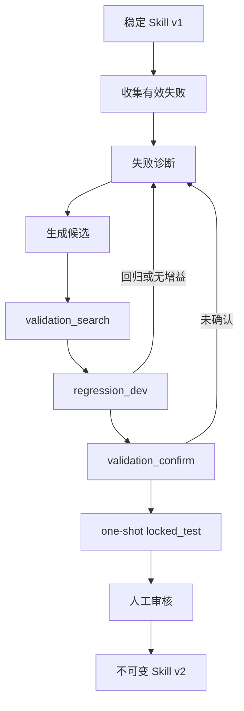

## 56. Failure Evidence Bundle

候选生成器不应该看到完整原始运行目录和 holdout 数据，只应看到经过审核、脱敏的失败证据。

Bundle 可以包含：

- Case 类型；
- Agent 最终结果；
- 已执行工具；
- 未执行的关键验证；
- 失败分类；
- 相关 Trace 摘要；
- 人工审核结果；
- base Skill 内容哈希。

为什么要脱敏和最小化：

- 防止 Secret 泄漏；
- 防止把测试答案放进 Skill；
- 限制 Optimizer 的可见范围；
- 形成明确的 train/holdout 边界。

## 57. 候选生成

候选可能来自：

- 原始 Skill；
- 人工修改；
- 规则 mutation；
- 随机对照 mutation；
- LLM proposal。

LLM proposal 不等于改进已经发生。它只生成待验证假设。

例如：

```text
失败证据：Agent 修改代码后没有运行回归测试

候选假设：
在 Skill 中增加“目标测试通过后必须运行相关回归测试”的检查点
```

## 58. BenchmarkGuidedSkillSearch

源码：

[search.py](https://github.com/ranmaoxia0123/AgentSkill-Eval/blob/main/packages/skill_optimizer/agentskill_eval_skill_optimizer/search.py)

`run()` 的主要步骤：

1. 读取 base Skill 和 manual Skill；
2. 加载 validation_search DatasetVersion；
3. 构建 Evaluator；
4. 计算 spec、Skill、Dataset 和 Evaluator 哈希；
5. 生成确定性 OptimizationJob ID；
6. 构造候选；
7. lint 候选；
8. 在子集上执行第一轮；
9. successive halving 淘汰；
10. 对晋级候选执行剩余 Case；
11. 进行 Pareto 和约束选择；
12. 冻结唯一 provisional winner。

## 59. Successive Halving

如果有很多候选，直接让每个候选跑完整数据集成本很高。

Successive Halving 的思想：

```text
第一轮：所有候选跑少量 Case
          |
          v
淘汰表现差的候选
          |
          v
第二轮：晋级候选跑更多 Case
          |
          v
保留少数候选
```

示例：

| 阶段 | 候选数 | 每候选 Case 数 | 总评测量 |
|---|---:|---:|---:|
| Round 1 | 8 | 2 | 16 |
| Round 2 | 4 | 4 | 16 |
| Final | 2 | 8 | 16 |

总计 48 次，而不是 8 × 8 = 64 次。

风险：

- 第一轮子集不代表总体；
- 随机波动会过早淘汰好候选；
- 搜索结果已经对 validation_search 过拟合。

所以搜索 winner 只能叫 provisional winner。

## 60. Pareto 选择

候选不只比较成功率，还可能比较：

- Token；
- 时延；
- 费用；
- Skill 长度；
- 回归数。

候选 A 在所有指标都不差于 B，且至少一个指标更好，则 A dominates B。

```text
A dominates B:
success_A >= success_B
cost_A <= cost_B
token_A <= token_B
并且至少一个严格更优
```

不被其他候选支配的集合叫 Pareto frontier。

## 61. Regression Gate

候选在 search 集上提升，不代表可以发布。

regression_dev 主要检查：

- `LOSS == 0` 或不超过预注册上限；
- invalid 不超过上限；
- Token overhead 不超过上限；
- 至少有一个正向 Win；
- winner pass rate 达到最低要求。

当前真实实验得到：

```text
base pass rate = 100%
winner pass rate = 100%
W/T/L = 0 / 4 / 0
```

结论：

- 没有回归；
- 也没有正向能力证据；
- 不应进入 confirmation；
- 系统正确阻止了 Promotion。

## 62. Independent Final Evaluation

源码：

[final_evaluation.py](https://github.com/ranmaoxia0123/AgentSkill-Eval/blob/main/packages/skill_optimizer/agentskill_eval_skill_optimizer/final_evaluation.py)

终评比较精确冻结的 base/winner：

- 不再生成新候选；
- 使用独立 split；
- 重新计算 W/T/L；
- 计算增益区间；
- 检查 Loss；
- 检查 Token overhead；
- 检查独立组数。

Decision：

| 决策 | 含义 |
|---|---|
| `REGRESSION` | Loss 或成本门失败 |
| `DESCRIPTIVE_ONLY` | 独立组不足 |
| `NOT_CONFIRMED` | 增益区间下界未过门 |
| `CONFIRMED` | 预注册门槛全部通过 |

## 63. Locked Test 和 Burn Rule

Locked test 的目标不是“文件名叫 locked”，而是：

- 候选在运行前不能根据其结果调整；
- 精确候选只允许消费一次；
- 结果不理想也必须保留；
- 看过结果后再改 Skill，必须使用新的独立测试版本。

项目通过 `O_EXCL` 创建 receipt，阻止同一 OptimizationJob 重复消费 locked test。

注意：

- 如果 locked 数据和 grader 已公开，隔离主要依赖流程，不是真正保密；
- 更强方案是独立私有仓库、独立评测服务或第三方托管。

## 64. Human Review

自动门全部通过后仍保留人工审核，原因包括：

- Skill 是否出现测试特化；
- 是否包含危险指令；
- 是否把实现答案硬编码进规则；
- 成本增加是否值得；
- 文字是否清晰、可维护；
- 发布声明是否与证据一致。

自动评测负责一致性，人负责价值判断和责任承担。

---

# 第十三部分：多场景架构

## 65. 为什么需要 Scenario Adapter

软件工程、MCP、RAG 的共同部分：

- Experiment；
- Variant；
- Runner；
- Trace；
- Evidence；
- Report；
- Promotion。

不同部分：

- 环境状态；
- Agent 动作；
- Grader；
- 专项指标。

因此项目使用统一 Scenario 协议，把差异放进 Adapter。

## 66. MCP Tool Evaluation

MCP 是 Model Context Protocol，用于标准化模型与外部工具/资源的交互。

MCP 任务可以评价：

- tool selection；
- parameter correctness；
- call sequence；
- recovery；
- side effect；
- confirmation；
- efficiency；
- safety。

例如“先查询用户，再修改记录”：

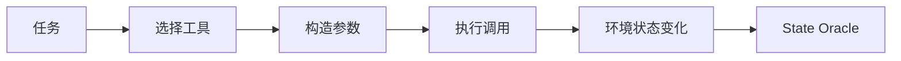

当前公开 MCP 结果主要是离线 deterministic Lab，不应描述为生产 MCP 平台。

## 67. Memory/RAG Evaluation

常见指标：

| 指标 | 含义 |
|---|---|
| Recall@K | 相关文档是否进入 Top-K |
| MRR | 第一个相关结果排名 |
| nDCG | 多级相关性的排序质量 |
| Citation Precision | 引用中有多少真的支持答案 |
| Citation Recall | 应引用证据有多少被覆盖 |
| Faithfulness | 答案是否忠于证据 |
| Memory Safety | 是否污染其他用户或会话 |

当前项目主要证明统一协议和确定性 grader，而不是大规模真实知识库效果。

## 68. Dashboard 为什么只读

只读 Dashboard 的安全价值：

- 展示层不能修改 Manifest；
- 不能从浏览器批准 SkillVersion；
- 不会因为 UI Bug 改变实验真值；
- 导入文件只在浏览器内解析；
- HTML 展示与执行控制面分离。

这是 Command Query Separation 的一种体现：

> 读模型负责展示，写操作留在受控 CLI 和状态机。

---

# 第十四部分：需要学习的架构技术

## 69. Ports and Adapters

也叫 Hexagonal Architecture。

核心思想：

- 领域核心定义 Port；
- 外部 CLI、Runner、Provider、存储实现 Adapter；
- 核心业务不依赖具体外部系统。

本项目映射：

| 架构角色 | 项目实现 |
|---|---|
| Domain | contracts、实验状态和规则 |
| Inbound Adapter | Typer CLI |
| Outbound Port | Runner/Evaluator 抽象 |
| Outbound Adapter | skill-up、Process、Mock |
| Persistence Adapter | LocalExperimentStore |

面试价值：

> 新增 Runner 时不修改统计和实验核心，只新增适配器并满足统一 Contract。

## 70. Domain-Driven Design

项目包含明显的领域建模：

- Experiment；
- Variant；
- PairBlock；
- Run；
- Attempt；
- DatasetVersion；
- SkillCandidate；
- PromotionWorkflow。

需要学习：

- Entity 与 Value Object；
- Aggregate；
- Invariant；
- Domain State；
- Repository；
- Domain Event。

不要夸大为完整 DDD。当前更准确的说法是：

> 使用领域模型和显式状态机组织复杂评测协议。

## 71. State Machine

学习重点：

- 状态集合；
- 合法迁移；
- 终态不可变；
- 幂等重放；
- 失败状态；
- 补偿与恢复；
- fencing token。

可以找一个非法迁移测试，解释系统如何拒绝：

```text
COMPLETED -> RUNNING
```

## 72. Repository Pattern

`LocalExperimentStore` 隐藏文件布局、Manifest 解析和 SQLite 索引细节。

上层调用：

```python
store.save_run(run)
store.load_run(experiment_id, run_id)
store.list_pair_blocks(experiment_id)
```

而不是在业务代码中到处拼路径和解析 JSON。

## 73. Content-Addressable Storage

需要理解：

- Git 为什么按内容哈希存对象；
- Docker image layer；
- Nix/Bazel cache；
- artifact 去重；
- 哈希不等于签名；
- collision 与 canonical serialization。

## 74. Async Subprocess

学习：

- `asyncio.create_subprocess_exec`；
- `wait_for` timeout；
- stdout/stderr pipe；
- cancellation；
- process group；
- SIGTERM/SIGKILL；
- 子进程泄漏；
- backpressure。

## 75. Schema-First Design

Pydantic + JSON Schema 的价值：

- CLI 输入先校验；
- 跨语言消费；
- 前后端共享结构；
- 版本化 schema；
- 拒绝未知字段；
- 文档可自动生成。

要理解 schema evolution：

- 新增可选字段通常向后兼容；
- 删除或改名可能破坏兼容；
- schema version 应参与证据记录；
- 老证据不能被新代码静默误读。

## 76. Observability

三类经典可观测性：

- Logs；
- Metrics；
- Traces。

Agent 系统还需要：

- Tool Trace；
- Token Usage；
- Cost；
- Model/Provider metadata；
- Skill activation evidence；
- terminal reason；
- capability unavailable。

## 77. CI/CD 和供应链

项目 CI 包含：

- Ruff；
- mypy；
- pytest；
- wheel/sdist；
- clean install；
- Vue typecheck；
- ESLint；
- Vitest；
- frontend build；
- Gitleaks。

建议继续学习：

- lockfile；
- reproducible build；
- SBOM；
- dependency pinning；
- artifact signing；
- branch protection；
- release provenance。

---

> 下面将这些知识转成可执行的源码阅读路线、练习任务和面试题库。

# 第十五部分：六周学习路线

## 78. 总体原则

学习顺序应该是：

```text
Agent 基础
-> 单次 Run
-> 配对实验
-> 证据存储
-> Benchmark
-> 统计
-> Skill 优化
-> 独立终评
```

不要一开始学习：

- 多 Agent 编排；
- 复杂向量数据库；
- Kubernetes；
- 强化学习；
- 大规模分布式调度。

这些不是理解当前项目的前置条件。

## 79. 第一周：Python 和 Agent 基础

目标：能自己实现一个最小 Tool-Calling Agent。

需要学习：

- Python dataclass、typing、Protocol；
- `asyncio`；
- subprocess；
- JSON/YAML；
- LLM messages；
- tool schema；
- max turns、timeout、Token budget；
- Agent loop。

练习：

1. 实现 `read_file` 和 `run_command` 两个工具；
2. 实现最多 5 轮的 Agent loop；
3. 为 timeout 和工具异常定义不同错误；
4. 保存每轮 action/observation；
5. 不使用 LLM Judge，用测试退出码判定成功。

验收：

- 能画出 Agent loop；
- 能解释模型和 Runtime 的边界；
- 能说清 Tool 和 Skill 的区别。

## 80. 第二周：领域模型和状态机

目标：理解实验对象为什么这样拆分。

需要学习：

- Pydantic；
- frozen model；
- UUIDv5；
- 状态机；
- invariant；
- Repository Pattern；
- 幂等性。

练习：

1. 手写简化版 `Experiment`、`Variant`、`Run`、`Attempt`；
2. 禁止 `COMPLETED -> RUNNING`；
3. 使用 UUIDv5 为 Case/Repeat 生成稳定 Run ID；
4. 重复执行 `plan()`，确认 ID 完全相同；
5. 修改 Variant 内容，确认 fingerprint 变化。

## 81. 第三周：Runner 和证据存储

目标：理解外部进程如何安全地接入领域核心。

需要学习：

- Adapter Pattern；
- Anti-Corruption Layer；
- 进程组；
- timeout/cancel；
- 临时目录；
- SHA-256；
- 原子 rename；
- fsync；
- 内容寻址存储。

练习：

1. 写一个 Fake Runner，从 stdin 读取 JSON，向 stdout 输出 JSON；
2. 写 Adapter 把内部 Request 转成外部协议；
3. 故意让 Runner 超时，验证被标为 INVALID；
4. 模拟写文件中途崩溃，确认目标 Manifest 不出现半写内容；
5. 修改 artifact 一个字节，确认 verify 失败。

## 82. 第四周：Benchmark 和统计

目标：能设计一个不容易自欺的评测。

需要学习：

- train/validation/test；
- data leakage；
- paired experiment；
- W/T/L；
- effect size；
- bootstrap；
- McNemar test；
- cluster；
- ceiling effect；
- selection bias。

练习：

1. 从一个小型 Git 项目选择真实修复 commit；
2. 构造 before-fail 和 after-pass；
3. 删除关键修复，验证 mutation-fail；
4. 写另一种正确实现，验证 alternative-pass；
5. 用 4 个 Case 手算 W/T/L；
6. 比较 assignment-based 和 capability 口径。

## 83. 第五周：Skill 搜索和发布门禁

目标：理解“候选更好”和“可以发布”不是一回事。

需要学习：

- failure-guided optimization；
- successive halving；
- Pareto frontier；
- regression testing；
- holdout；
- pre-registration；
- locked test；
- human-in-the-loop。

练习：

1. 从一个真实 FAIL 写出三个候选 Skill 修改；
2. 使用两个 Case 做第一轮筛选；
3. 给候选加入 Token 成本；
4. 构造一个 search 提升但 regression 出现 Loss 的候选；
5. 验证系统拒绝发布；
6. 写一份人工审核 checklist。

## 84. 第六周：面试表达和现场演示

目标：把复杂项目讲成一条清晰主线。

准备以下材料：

- 30 秒项目介绍；
- 2 分钟架构介绍；
- 5 分钟 Demo；
- 一张手绘架构图；
- 一个 PASS；
- 一个 FAIL；
- 一个 INVALID；
- 一个系统主动阻止发布的负结果；
- 两个当前局限和改进方案。

---

# 第十六部分：源码阅读顺序

## 85. 第 1 天：先看数据对象

阅读顺序：

1. [`base.py`](https://github.com/ranmaoxia0123/AgentSkill-Eval/blob/main/packages/contracts/agentskill_eval_contracts/base.py)
2. [`enums.py`](https://github.com/ranmaoxia0123/AgentSkill-Eval/blob/main/packages/contracts/agentskill_eval_contracts/enums.py)
3. [`snapshots.py`](https://github.com/ranmaoxia0123/AgentSkill-Eval/blob/main/packages/contracts/agentskill_eval_contracts/snapshots.py)
4. [`experiment.py`](https://github.com/ranmaoxia0123/AgentSkill-Eval/blob/main/packages/contracts/agentskill_eval_contracts/experiment.py)
5. [`run.py`](https://github.com/ranmaoxia0123/AgentSkill-Eval/blob/main/packages/contracts/agentskill_eval_contracts/run.py)

阅读问题：

- 哪些对象有身份，哪些只是值？
- 哪些字段参与哈希？
- 哪些字段不能为空？
- 状态约束在哪里执行？
- 为什么 ID 不应该参与某些语义哈希？

输出：

- 画出本手册第 12 节的 ER 图；
- 用一句话解释每个对象。

## 86. 第 2 天：读 Planner

阅读：

[`planning.py`](https://github.com/ranmaoxia0123/AgentSkill-Eval/blob/main/packages/experiment/agentskill_eval_experiment/planning.py)

重点函数：

- `LocalExperimentPlanner.build()`；
- `persist()`；
- `_block_seed()`；
- `_fingerprint()`；
- `_validate_case()`。

阅读方法：

```text
输入是什么？
-> Experiment + Variants + Runtime Specs + Cases

正常输出是什么？
-> PlannedExperiment

有哪些前置条件？
-> FROZEN、唯一 ID、预算足够

如何保证重跑一致？
-> UUIDv5 + fingerprint + 幂等 persist
```

## 87. 第 3 天：读 Store

阅读：

- [`storage/store.py`](https://github.com/ranmaoxia0123/AgentSkill-Eval/blob/main/packages/experiment/agentskill_eval_experiment/storage/store.py)
- [`storage/manifests.py`](https://github.com/ranmaoxia0123/AgentSkill-Eval/blob/main/packages/experiment/agentskill_eval_experiment/storage/manifests.py)
- [`storage/atomic.py`](https://github.com/ranmaoxia0123/AgentSkill-Eval/blob/main/packages/experiment/agentskill_eval_experiment/storage/atomic.py)
- [`storage/blobs.py`](https://github.com/ranmaoxia0123/AgentSkill-Eval/blob/main/packages/experiment/agentskill_eval_experiment/storage/blobs.py)

重点：

- 目录布局；
- Envelope；
- save/load；
- 原子写；
- lock；
- SQLite 索引；
- rebuild index。

现场题：

> 如果 SQLite 被删除，实验数据是否丢失？

回答：

> 不丢失。Manifest 和 Blob 是真值，SQLite 只是可重建查询索引。

## 88. 第 4 天：读 Runner Adapter

阅读：

- [`contracts.py`](https://github.com/ranmaoxia0123/AgentSkill-Eval/blob/main/packages/runner_adapters/agentskill_eval_runner_adapters/contracts.py)
- [`compiler.py`](https://github.com/ranmaoxia0123/AgentSkill-Eval/blob/main/packages/runner_adapters/agentskill_eval_runner_adapters/compiler.py)
- [`process.py`](https://github.com/ranmaoxia0123/AgentSkill-Eval/blob/main/packages/runner_adapters/agentskill_eval_runner_adapters/process.py)
- [`skill_up.py`](https://github.com/ranmaoxia0123/AgentSkill-Eval/blob/main/packages/runner_adapters/agentskill_eval_runner_adapters/skill_up.py)
- [`parser.py`](https://github.com/ranmaoxia0123/AgentSkill-Eval/blob/main/packages/runner_adapters/agentskill_eval_runner_adapters/parser.py)

重点问题：

- 内部 Request 如何变成外部 CLI 参数？
- baseline 如何证明没有安装 Skill？
- treatment 如何证明安装的是目标 Skill？
- 超时和取消如何终止进程树？
- Runner 字段缺失时如何表达？

## 89. 第 5 天：读 Executor

阅读：

[`execution.py`](https://github.com/ranmaoxia0123/AgentSkill-Eval/blob/main/packages/experiment/agentskill_eval_experiment/execution.py)

不要逐行硬啃 700 多行。先按职责折叠：

| 代码区域 | 关注点 |
|---|---|
| `execute()` 主循环 | PairBlock 和 order |
| request 构造 | 冻结输入如何进入 Runner |
| result archive | artifact 校验 |
| finalize result | PASS/FAIL |
| infra failure | INVALID |
| security evidence | Secret 扫描 |
| status helpers | 合法状态迁移 |
| measurement | Token/Latency/Cost |

输出：

- 自己画一次 Run 时序图；
- 找出“Run 最后才发布终态”的代码位置。

## 90. 第 6 天：读 Statistics

阅读：

[`statistics.py`](https://github.com/ranmaoxia0123/AgentSkill-Eval/blob/main/packages/experiment/agentskill_eval_experiment/statistics.py)

重点函数：

- `analyze()`；
- `_case_rates()`；
- `_grouped_pairs()`；
- `_point_estimate()`；
- `_bootstrap()`；
- `_case_comparisons()`；
- `_efficiency()`。

必须自己准备一个 4-Case 小数据，手算后再对照代码。

## 91. 第 7 天：读 Benchmark

阅读：

- [`spec.py`](https://github.com/ranmaoxia0123/AgentSkill-Eval/blob/main/packages/benchmark_gen/agentskill_eval_benchmark_gen/spec.py)
- [`git_source.py`](https://github.com/ranmaoxia0123/AgentSkill-Eval/blob/main/packages/benchmark_gen/agentskill_eval_benchmark_gen/git_source.py)
- [`generator.py`](https://github.com/ranmaoxia0123/AgentSkill-Eval/blob/main/packages/benchmark_gen/agentskill_eval_benchmark_gen/generator.py)
- [`split_audit.py`](https://github.com/ranmaoxia0123/AgentSkill-Eval/blob/main/packages/benchmark_gen/agentskill_eval_benchmark_gen/split_audit.py)

重点函数：

- `generate()`；
- `_reconstruct()`；
- `_verify()`；
- `_static_gates()`；
- `_deduplicate()`；
- `_assert_no_cross_split_sources()`；
- `publish()`。

## 92. 第 8～9 天：读 Optimizer

阅读：

- [`failure_bridge.py`](https://github.com/ranmaoxia0123/AgentSkill-Eval/blob/main/packages/skill_optimizer/agentskill_eval_skill_optimizer/failure_bridge.py)
- [`proposal.py`](https://github.com/ranmaoxia0123/AgentSkill-Eval/blob/main/packages/skill_optimizer/agentskill_eval_skill_optimizer/proposal.py)
- [`search.py`](https://github.com/ranmaoxia0123/AgentSkill-Eval/blob/main/packages/skill_optimizer/agentskill_eval_skill_optimizer/search.py)
- [`final_evaluation.py`](https://github.com/ranmaoxia0123/AgentSkill-Eval/blob/main/packages/skill_optimizer/agentskill_eval_skill_optimizer/final_evaluation.py)
- [`promotion.py`](https://github.com/ranmaoxia0123/AgentSkill-Eval/blob/main/packages/skill_optimizer/agentskill_eval_skill_optimizer/promotion.py)

用这条链串起来：

```text
Observed FAIL
-> FailureEvidenceBundle
-> Candidate Proposal
-> Search
-> Frozen Winner
-> Confirmation
-> Locked Test
-> Human Review
-> SkillVersion
```

## 93. 第 10 天：读测试而不是继续读实现

优先测试：

- `test_experiment_orchestration.py`；
- `test_storage.py`；
- `test_runner_adapters.py`；
- `test_statistics_reporting.py`；
- `test_automatic_benchmark_generation.py`；
- `test_skill_search.py`；
- `test_final_evaluation.py`；
- `test_budgeted_real_evolution_execution.py`。

测试是理解 invariant 的最快方式：

- 什么输入必须被拒绝？
- 哪些状态不能发生？
- 什么叫篡改？
- 哪些操作要求显式授权？

---

# 第十七部分：核心代码理解练习

## 94. 练习一：手写最小 Planner

要求：

- 2 个 Variant；
- 2 个 Case；
- 每个 Case 3 repeats；
- 固定 seed；
- 每个 PairBlock 随机顺序；
- 使用 UUIDv5；
- 输出 12 个 Run。

验收点：

```text
2 cases × 3 repeats × 2 variants = 12 runs
```

重复运行 Planner，所有 ID 和顺序必须相同。

## 95. 练习二：加入 INVALID

构造 Fake Runner：

- Case A 返回 PASS；
- Case B 返回 FAIL；
- Case C 超时；
- Case D 缺少 result.json。

期望：

| Case | 结果 |
|---|---|
| A | PASS |
| B | FAIL |
| C | INVALID/TIMEOUT |
| D | INVALID/MISSING_REPORT |

不要把 C、D 写成普通 FAIL。

## 96. 练习三：原子 Manifest

实现：

```python
def atomic_write(path: Path, content: bytes):
    temp = path.with_name(f".tmp-{uuid4()}.{path.name}")
    # open O_EXCL
    # write
    # flush + fsync
    # replace
    # fsync directory
```

测试：

- 正常写入；
- 临时文件已存在；
- commit 前崩溃；
- target 已存在；
- 内容哈希不匹配。

## 97. 练习四：计算 W/T/L

输入：

```python
control = {
    "A": [0, 0, 0],
    "B": [1, 1, 1],
    "C": [0, 0, 1],
    "D": [1, 1, 1],
}

treatment = {
    "A": [1, 1, 0],
    "B": [1, 1, 1],
    "C": [0, 0, 0],
    "D": [0, 0, 1],
}
```

阈值 0.5。

预期：

- A：WIN；
- B：TIE_POSITIVE；
- C：TIE_NEGATIVE；
- D：LOSS。

## 98. 练习五：设计一个真正有效的 Benchmark

选一个你熟悉的小仓库：

1. 找历史 Bug Fix commit；
2. 固定 before/after；
3. 写回归测试；
4. 保证 before-fail；
5. 保证 after-pass；
6. 删除关键补丁，保证 mutation-fail；
7. 写另一种修复，保证 alternative-pass；
8. 重复执行三次；
9. 记录许可证和 commit；
10. 检查任务描述没有泄漏答案。

## 99. 练习六：新增 Runner Adapter

目标：

- 外部 Runner 接收 stdin JSON；
- 输出 stdout JSON；
- 支持 timeout；
- 支持 structured result；
- 不支持 trace 时明确 capability unavailable。

不要修改 ExperimentAnalyzer。

这可以证明你真正理解了 Ports and Adapters。

---

# 第十八部分：面试题库

## 100. 基础概念题

### Q1：Agent 和普通 Chat Completion 的区别是什么？

答题要点：

- Chat Completion 主要是输入到输出；
- Agent 有多轮观察、决策和行动；
- Agent 能调用工具并改变环境；
- Runtime 负责循环、预算和状态；
- Agent 结果需要环境 Oracle 验证。

### Q2：Skill 和 Prompt 有什么区别？

答题要点：

- Prompt 常描述本次任务；
- Skill 是面向任务族的可复用方法；
- Skill 可版本化、评测和回归；
- 二者都可能进入上下文，但生命周期和评价对象不同。

### Q3：Tool 和 Skill 有什么区别？

答题要点：

- Tool 是动作能力；
- Skill 是使用能力的方法；
- Tool 决定“能做什么”；
- Skill 决定“怎样做得更稳定”。

### Q4：为什么 Agent 评测不能只看最终回答？

答题要点：

- 模型可能虚假宣称完成；
- 工具副作用可能错误；
- 文件或数据库状态才是真值；
- 过程 Trace 能解释失败；
- 应优先使用确定性 Oracle。

## 101. 实验设计题

### Q5：为什么使用配对实验？

答题要点：

- 控制 Case 难度；
- 同题比较 Skill 边际价值；
- 可以定位 Win 和 Loss；
- 支持 paired statistics。

### Q6：为什么随机化 control/treatment 的顺序？

答题要点：

- 降低缓存和时间漂移；
- 防止永远第二臂获益；
- 使用固定 seed 保持可复现。

### Q7：为什么要 repeats？

答题要点：

- 模型具有随机性；
- 单次结果方差大；
- repeats 估计同一 Case 的稳定成功率；
- repeats 不等于独立 Case，不能虚增样本量。

### Q8：为什么 INVALID 不能直接算 Skill FAIL？

答题要点：

- 原因不同；
- 会污染失败归因；
- Optimizer 可能用 Prompt 修网络故障；
- 主口径可以保守计 0，但优化输入必须隔离。

### Q9：如何减少模型版本漂移？

答题要点：

- 固定 provider、deployment 和模型名；
- 记录可获得的 model revision；
- 两臂尽量交错执行；
- 缩短实验时间窗；
- 记录 request ID 和 region；
- 无法冻结时明确 claim limit。

## 102. 架构设计题

### Q10：为什么有 Run 和 Attempt 两层？

答题要点：

- Run 是逻辑任务；
- Attempt 是物理执行；
- 支持重试、恢复和审计；
- 防止一次基础设施错误抹掉任务身份。

### Q11：为什么使用 Adapter？

答题要点：

- 隔离不同 Runner 协议；
- 内部保持统一 Request/Result；
- 新增 Runner 不影响统计核心；
- 外部变化只修改 Adapter。

### Q12：为什么用 UUIDv5？

答题要点：

- 从实验语义稳定派生 ID；
- 支持幂等；
- 重放时检测重复对象；
- UUIDv4 无法做到输入相同 ID 相同。

### Q13：为什么 SQLite 不是唯一真值？

答题要点：

- 实验需要离线审计；
- Manifest 更适合不可变发布；
- SQLite 是查询优化；
- 删除后可重建；
- 避免本地 MVP 依赖服务数据库。

### Q14：原子写为什么还需要 fsync？

答题要点：

- flush 只到用户态/内核缓存；
- fsync file 保证内容持久化；
- replace 提供原子可见；
- fsync directory 提高目录项持久性。

### Q15：哈希和数字签名有什么区别？

答题要点：

- 哈希证明内容一致；
- 任何人都能重算哈希；
- 签名绑定私钥持有者身份；
- 强证据发布需要哈希 + 签名 + 可信时间/来源。

## 103. Benchmark 题

### Q16：为什么需要 before-fail 和 after-pass？

答题要点：

- 证明问题真实存在；
- 证明历史修复有效；
- 防止选择本来就通过的 Case。

### Q17：mutation-fail 防什么？

答题要点：

- 防止 grader 对关键逻辑不敏感；
- 删除修复后必须重新失败；
- 类似 mutation testing。

### Q18：alternative-pass 防什么？

答题要点：

- 防止 grader 只接受参考补丁；
- 验证行为 Oracle，而不是 patch matching；
- 降低对唯一实现的过拟合。

### Q19：如何防止数据泄漏？

答题要点：

- 缺陷家族不能跨 split；
- 仓库/fork 按 exposure zone 隔离；
- Optimizer 只看 train failure；
- locked grader 不挂载到生成环境；
- 一次性 burn rule；
- 公开 Git 历史仍有预训练污染。

### Q20：当前每个 split 一个仓库有什么问题？

答题要点：

- repository effect 与 split effect 混淆；
- 4 个 defect group 仍共享仓库结构；
- cluster 数被高估；
- 应让每个 split 覆盖多个仓库并分层聚类。

## 104. 统计题

### Q21：为什么不能直接平均所有 Run？

答题要点：

- repeats 不独立；
- 同缺陷家族相关；
- Case 多的仓库会获得更大权重；
- 应先 Case，再 group，再 experiment。

### Q22：Absolute Gain 和 Relative Gain 有什么区别？

```text
Absolute Gain = treatment - control
Relative Gain = (treatment - control) / control
```

当 control 为 0 时 Relative Gain 无定义；秋招项目优先讲 Absolute Gain，更稳定直观。

### Q23：Bootstrap 的作用是什么？

答题要点：

- 用重抽样估计统计量的不确定性；
- 不要求简单参数分布；
- cluster bootstrap 保留组内相关性；
- cluster 太少时结果不可靠。

### Q24：为什么 2 个 independent group 不足？

答题要点：

- 原始独立信息太少；
- bootstrap 只是反复组合两个观测；
- CI 看似精确但信息量没有增加；
- 应标记描述性而非确认性。

### Q25：什么是 ceiling effect？

答题要点：

- baseline 已接近 100%；
- treatment 没有改进空间；
- 可以检查回归，不能证明增益；
- 优化前需要 baseline screening。

## 105. Skill 优化题

### Q26：为什么 search winner 不能直接发布？

答题要点：

- search 自适应观察验证集；
- winner 对 search 集产生选择偏差；
- 需要 regression 和独立 confirmation；
- 还需要 locked test 和人工审核。

### Q27：successive halving 的优缺点？

答题要点：

- 优点：节省候选评测成本；
- 缺点：早期小子集可能错误淘汰；
- 需要固定 seed、合理子集和独立终评。

### Q28：为什么要 Pareto，而不是只看成功率？

答题要点：

- Agent 成功可能通过无限 Token 和重试换来；
- 还要考虑成本、时延和 Skill 长度；
- Pareto 保留多目标非支配候选。

### Q29：locked test 为什么只能用一次？

答题要点：

- 看过结果后修改就等于训练；
- 防止反复试到偶然通过；
- 失败后应更换新的独立 DatasetVersion。

### Q30：这个项目为什么没有发布真实 v2？

推荐回答：

> 真实 search 找到了 provisional winner，但 regression 中 base 和 winner 都是 100%，结果为 0W/4T/0L。系统的最小正向 Win 门未通过，因此没有访问 confirmation 和 locked test。这说明门禁按预注册规则工作，但也暴露了数据存在 ceiling effect，后续应先进行 baseline screening 并扩展多仓库中等难度 Case。

## 106. 安全和工程题

### Q31：项目是生产级沙箱吗？

推荐回答：

> 不是。项目实现了独立目录、HOME、最小环境、符号链接检查、进程组终止和网络约束，但没有证明完整的容器、seccomp、cgroup 和强网络隔离。它适用于受控评测原型，不应用来运行任意恶意代码。

### Q32：如何防止 API Key 泄漏？

答题要点：

- 显式环境变量白名单；
- 不进入 argv；
- 不写 Manifest；
- 独立 HOME；
- 持久化前精确扫描；
- 命中后整批拒绝写入；
- 编码和分片泄漏仍需 DLP 加强。

### Q33：如何保证恢复执行不重复扣费？

答题要点：

- Run/Attempt 明确状态；
- 幂等 ID；
- lease/fencing；
- 终态不重跑；
- 不确定外部调用是否计费时不静默自动重试；
- Provider idempotency key 可进一步加强。

---

# 第十九部分：简历和项目表达

## 107. 30 秒介绍

> AgentSkill-Eval 是一个面向 Agent Skill 的配对评测与回归门禁框架。它冻结模型、任务、工具、环境和预算，只改变 Skill，通过同题多次执行比较 Skill 的边际价值。系统使用确定性 grader 判断最终状态，并保存 Runner Trace、PASS/FAIL/INVALID、Token、费用和内容寻址证据；还支持从真实 Git 历史构建 Bug Fix Benchmark、候选搜索和独立发布门禁。

## 108. 推荐简历描述

> **AgentSkill-Eval｜Agent Skill 配对评测与回归门禁框架**
>
> - 设计并实现控制变量配对评测引擎，冻结 Agent、模型、数据集与预算，支持随机化执行顺序、PASS/FAIL/INVALID 分类、Trace 诊断及内容寻址证据归档。
> - 从 5 个开源 Python 仓库重建 20 个历史 Bug Case，通过 before-fail、after-pass、mutation-fail 和 alternative-pass 共 240 次确定性校验验证 grader。
> - 接入 Qwen Code 与 DeepSeek，完成 48 次候选搜索和 16 次回归运行；识别候选 0W/4T/0L、无真实增益并自动阻断发布，配套 Python/TypeScript 自动化测试和 GitHub Actions CI。

## 109. 不要使用的表述

- “自动优化 Skill 并显著提升成功率”；
- “真实 Skill v2 已发布”；
- “证明 Skill 对代码任务普遍有效”；
- “生产级 Agent 平台”；
- “生产级安全沙箱”；
- “密码学不可篡改证据链”；
- “MCP/RAG 已在生产落地”。

## 110. 项目最值得讲的三个设计决策

### 决策一：FAIL 和 INVALID 分离

体现你理解评测信号污染。

### 决策二：Runner Adapter

体现你理解系统边界和可扩展架构。

### 决策三：search 与 locked 隔离

体现你理解选择偏差和可信发布。

## 111. 最值得讲的负结果

真实 regression 为 `0W/4T/0L`，系统拒绝 Promotion。

讲法：

> 我没有为了简历数字继续调整阈值，而是保留负结果。它证明门禁能够阻止没有正向证据的候选，同时让我发现 baseline 100% 的 ceiling effect，下一版会在实验前加入难度筛选。

这比虚构一个提升百分比更经得住追问。

---

# 第二十部分：术语表

| 术语 | 简明解释 |
|---|---|
| Agent | 模型驱动的观察、决策、行动循环 |
| Tool | Agent 可调用的外部能力 |
| Skill | 可复用的领域流程和约束 |
| Runtime | 维护 Agent 循环、预算和状态的执行系统 |
| Oracle | 判断任务成功与否的规则 |
| Grader | 执行 Oracle 并产生评分的组件 |
| Benchmark | 一组任务、环境和判定规则 |
| Case | 一道独立评测任务 |
| DatasetVersion | 内容和来源被冻结的数据集版本 |
| Variant | 实验中的一个比较臂 |
| Control | 基线臂 |
| Treatment | 处理臂 |
| PairBlock | 同 Case、同 repeat 下的多臂组合 |
| Run | 一次逻辑任务执行 |
| Attempt | Run 的一次物理尝试 |
| Trace | 结构化过程事件 |
| Artifact | 执行生成的文件或原始结果 |
| Manifest | 描述对象和完整性的结构化记录 |
| Content Addressing | 使用内容哈希作为对象地址 |
| Idempotency | 重复调用不产生额外语义变化 |
| Fingerprint | 输入和配置的稳定摘要 |
| FAIL | 有效执行但任务未完成 |
| INVALID | 无法支持能力判断的执行 |
| W/T/L | Win、Tie、Loss 配对分类 |
| Cluster | 共享相关性的独立分组 |
| Bootstrap | 通过重抽样估计不确定性 |
| Ceiling Effect | 基线过高导致没有提升空间 |
| Data Leakage | 训练或搜索过程获得留出集信息 |
| Successive Halving | 分轮增加预算并淘汰候选 |
| Pareto Frontier | 不被其他候选多目标支配的集合 |
| Regression Gate | 阻止候选破坏已有能力的门禁 |
| Confirmation | 在独立数据上确认搜索结果 |
| Locked Test | 一次性最终留出评测 |
| Burn Rule | locked 数据使用后不能继续用于同一候选迭代 |
| Promotion | 将候选发布为正式 SkillVersion |
| Tamper-Evident | 被修改后能够检测，但不保证无法修改 |

---

# 第二十一部分：最终自测清单

## 112. Agent 基础

- [ ] 能画出 Agent loop。
- [ ] 能区分 Prompt、Tool、Skill。
- [ ] 能解释 Memory 和 RAG。
- [ ] 能解释 Runtime 和 Model 的边界。
- [ ] 能说明为什么优先使用确定性 Oracle。

## 113. 核心架构

- [ ] 能画出 CLI、Planner、Executor、Adapter、Store、Analyzer。
- [ ] 能解释 Experiment、Variant、PairBlock、Run、Attempt。
- [ ] 能解释 UUIDv5 和 fingerprint。
- [ ] 能解释状态机和幂等恢复。
- [ ] 能解释 Adapter Pattern。

## 114. 评测方法

- [ ] 能解释配对实验。
- [ ] 能解释随机化执行顺序。
- [ ] 能区分 PASS、FAIL、INVALID。
- [ ] 能手算 W/T/L。
- [ ] 能解释 assignment-based 和 capability。
- [ ] 能解释 cluster bootstrap 的限制。

## 115. Benchmark

- [ ] 能解释四态验证。
- [ ] 能解释 mutation-fail。
- [ ] 能解释 alternative-pass。
- [ ] 能解释 split 和 data leakage。
- [ ] 能指出当前“一 split 一仓库”的混淆问题。

## 116. Skill 优化

- [ ] 能解释 failure evidence 到 candidate。
- [ ] 能解释 successive halving。
- [ ] 能解释 Pareto。
- [ ] 能解释 regression、confirmation、locked test。
- [ ] 能解释为什么真实 v2 尚未发布。

## 117. 工程边界

- [ ] 不把哈希说成数字签名。
- [ ] 不把隔离目录说成生产安全沙箱。
- [ ] 不把 simulated Demo 说成真实模型效果。
- [ ] 不把 4 个同仓库 Case 说成普遍结论。
- [ ] 能主动提出下一步改进。

---

# 第二十二部分：一页复习版

```text
题眼：
固定其他变量，只改变 Skill，用同题配对实验估计边际价值。

主链：
Spec -> Planner -> PairBlock/Run -> Runner Adapter -> Agent
-> Grader -> PASS/FAIL/INVALID -> Manifest/Trace -> Statistics
-> Failure Evidence -> Candidate Search -> Regression
-> Confirmation -> Locked Test -> Human Review -> SkillVersion

工程亮点：
显式状态机、UUIDv5 幂等、Adapter、防腐层、原子 Manifest、
内容寻址 Blob、结构化 Trace、预算门、Secret 扫描。

评测亮点：
可执行 Oracle、W/T/L、invalid 隔离、四态 Benchmark、
search/holdout 隔离、无正向证据时拒绝发布。

真实边界：
没有真实 Skill v2；样本小；一 split 一仓库；
min cluster 默认值偏低；locked 数据公开；不是强安全沙箱。

面试策略：
讲清设计决策、负结果和改进，不夸大平台成熟度。
```

---

# 第二十三部分：项目配图说明

手册中的 Mermaid 图用于源码学习和版本维护。最终还应额外生成以下适合展示的独立图稿：

1. `figure_1_system_architecture`：AgentSkill-Eval 五层系统架构；
2. `figure_2_paired_evaluation`：同题 control/treatment 配对实验；
3. `figure_3_skill_evolution`：失败驱动的 Skill v1 到 v2 门禁链；
4. `figure_4_evidence_lineage`：输入冻结、执行、判分、哈希和发布证据链。

图稿设计要求：

- 使用统一色板和字号；
- 不把 simulated 结果画成真实提升；
- 明确 provisional winner 和 published v2 的区别；
- 明确 PASS/FAIL 与 INVALID 的分流；
- 输出 SVG 和 PNG，方便放入 README、简历附件或答辩 PPT；
- 每张图只表达一个核心结论。

---

## 结语

真正理解这个项目，不是记住 84 个 CLI 命令，而是抓住四条主线：

1. Agent 如何执行；
2. 实验如何控制变量；
3. 结果如何被客观判定和保存；
4. 候选为什么必须经过独立门禁才能发布。

当你能脱离 README，从 `PairBlock`、`RunnerResult`、`ManifestEnvelope`、`CaseComparison` 和 `FinalDecision` 五个对象讲完整个系统时，才算真正具备把它写进简历并接受追问的能力。
