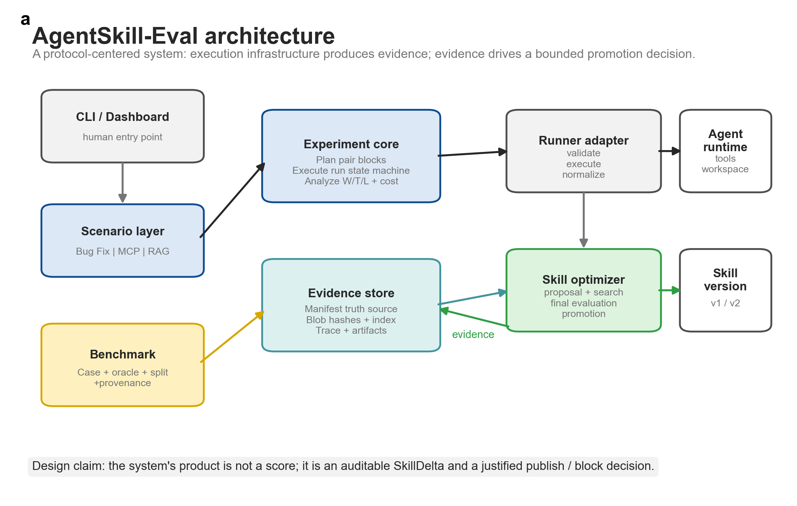

# AgentSkill-Eval 秋招资料

本目录汇总 AgentSkill-Eval 的学习、源码讲解和面试审视材料。

## 阅读顺序

1. `AgentSkill-Eval_通透理解.md`：先理解项目本质和因果评测边界。
2. `AgentSkill-Eval_一天速成版.md`：快速建立系统主链认知。
3. `AgentSkill-Eval_三天速成版.md`：按模块深入源码与实验协议。
4. `AgentSkill-Eval_秋招知识与源码讲解手册.md`：完整复习与面试准备。
5. `AgentSkill-Eval_面试官深度审视.md`：从项目定位、证据和产品完成度反向审查。

`figures/` 保留三组架构图的 SVG 源文件与 PNG 预览；PDF 导出件未重复收录。
