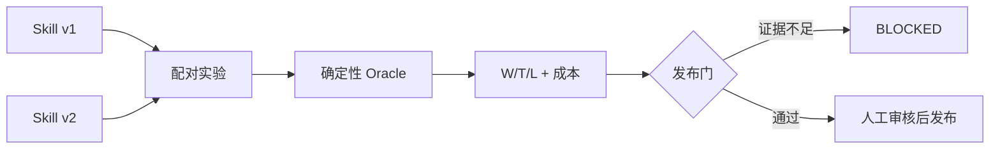

# AgentSkill-Eval：一天速成版

目标：一天后能把项目讲清楚、能读主链源码、能回答基础面试追问。

## 上午：先建立项目心智模型

### 1. 一句话定位

> 固定 Agent、模型、环境、任务和预算，只改变 Skill 版本；用同题配对和发布门禁判断 Skill 是否真的值得升级。

### 2. 必须背下来的术语

| 术语 | 一句话解释 |
|---|---|
| Agent | 能循环调用工具、观察环境并完成任务的系统 |
| Skill | 面向特定任务的结构化操作知识/流程约束 |
| Runner | 把外部 Agent CLI 统一接入评测系统的适配层 |
| Case | 一个可执行任务，带确定性 oracle |
| PairBlock | 同一个 Case 上的 control/treatment 对照单元 |
| Run | 某个 Variant 的一次执行 |
| Attempt | Run 的一次实际尝试，可用于重试与恢复 |
| FAIL | 有效执行但任务未完成 |
| INVALID | 基础设施/判分/证据异常，不能归因 Skill |
| WIN/TIE/LOSS | 同题 v1 与 v2 的方向性对比 |
| locked test | 只消费一次、不能再调参的最终数据 |

### 3. 把主流程画在纸上



## 中午：读四个关键文件

### 1. `planning.py`

看 `LocalExperimentPlanner.build()`。

理解四件事：

- Experiment 必须已冻结；
- 每个 Case 与 repeat 生成一个 PairBlock；
- 每个 Variant 在 PairBlock 中生成一个 Run；
- 执行顺序根据 seed 打乱，Run 指纹绑定 Case、grader、环境和预算。

### 2. `execution.py`

看 `LocalExperimentExecutor._execute_run()`。

理解状态：

```text
QUEUED -> LEASED -> PREPARING -> RUNNING -> GRADING -> ARCHIVING -> COMPLETED
```

理解为什么要有 `RunAttempt`：可以记录单次尝试、worker、fencing token，并在异常时保留证据。

### 3. `statistics.py`

看 `ExperimentAnalyzer.analyze()`。

理解：

```text
先在同一 Case 的 repeats 内聚合
再按 independence group 等权聚合
最后计算 AbsoluteGain、W/T/L、Token/Latency/Cost
```

### 4. `final_evaluation.py`

看 `reserve_locked_test()`。

理解 `O_CREAT | O_EXCL`：同一优化任务的 locked test receipt 只能创建一次，防止看了结果后继续调参并重跑。

## 下午：掌握三条最重要的工程原则

### 原则 1：只改变一个变量

若 v2 同时换了模型、提高了 Token 预算、加了工具，提升不能归因于 Skill。

### 原则 2：FAIL 不等于 INVALID

```text
FAIL：Agent 做错了
INVALID：系统没有形成可判断的执行
```

把两者混在一起会污染优化和统计。

### 原则 3：Search winner 不等于 v2

```text
train failure -> candidate
candidate -> validation_search
winner -> regression_dev
-> validation_confirm
-> locked_test
-> human review
-> release
```

## 傍晚：准备面试回答

### 问：为什么不直接看 v2 成功率？

答：不同题目难度不同，单独成功率可能只是 v2 跑到了更容易的任务。项目用同题配对，直接观察每个 Case 上 v2 是否把 v1 的失败变成成功。

### 问：项目的核心创新是什么？

答：不是新模型或新搜索算法，而是将 Skill 版本、数据暴露、配对增量和 Promotion 编码成一个可验证协议。系统能在数据泄漏、回归、成本过高或证据不足时拒绝发布。

### 问：这个项目最大的不足？

答：公开真实实验规模仍小；V2 的独立数据必须和候选生成数据隔离；本地 HOME 隔离不是恶意代码 Sandbox；当前更像研究型工程原型而不是多租户生产平台。

## 一天结束时必须能说清

```text
输入：v1、v2、冻结的数据集和 Runner
过程：同题配对 -> Oracle -> 证据归档 -> W/T/L 与成本
输出：解释 v2 是否可以 Promotion，或为什么被 BLOCKED
```

