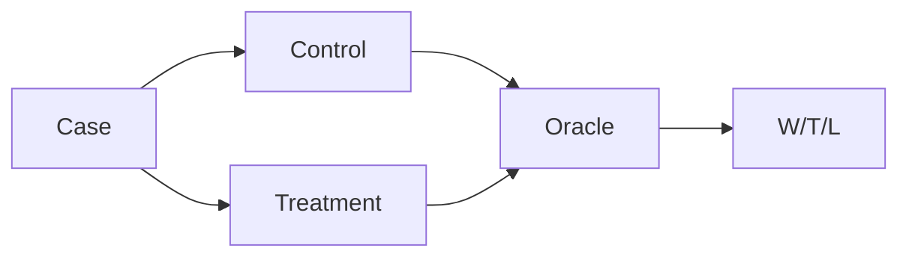
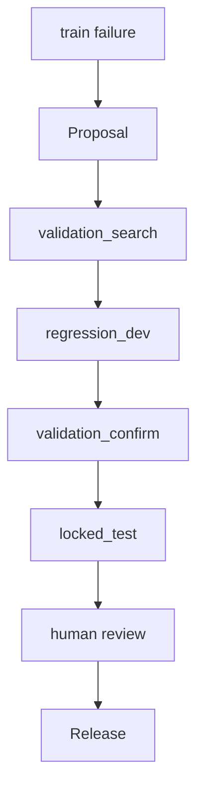

# AgentSkill-Eval：三天速成版

目标：三天后不仅能讲项目，还能根据源码解释设计权衡、复现实验主链并应对深挖。

## 第一天：Agent 与配对评测

### 上午：Agent 基础

学习：

- Agent loop：规划、工具调用、观察、再规划；
- Prompt、Skill、Tool、Memory/RAG、Runner 的边界；
- Coding Agent 的任务完成不等于自然语言说“完成”。

练习：

```text
任务：修一个 Python 测试失败
观察：Agent 必须读代码、改文件、运行测试
判分：以测试退出码和最终文件状态为准
```

### 下午：配对实验

学习：

- control/treatment；
- Case、repeat、random seed；
- Win、Tie、Loss；
- FAIL 与 INVALID；
- 为什么需要 deterministic oracle。

输出一张图：



阅读：

1. `packages/contracts/.../enums.py`
2. `packages/contracts/.../experiment.py`
3. `packages/contracts/.../run.py`
4. `packages/experiment/.../planning.py`

当天自测：

- 为什么一个 Case 中需要 repeat？
- 为什么不能比较两批不同的 Case？
- INVALID 为什么不能直接当 FAIL？

## 第二天：运行、证据、Benchmark 与统计

### 上午：Runner 与状态机

阅读：

1. `packages/runner_adapters/.../contracts.py`
2. `packages/runner_adapters/.../skill_up.py`
3. `packages/runner_adapters/.../process.py`
4. `packages/experiment/.../execution.py`

要掌握：

```text
QUEUED -> LEASED -> PREPARING -> RUNNING -> GRADING -> ARCHIVING -> COMPLETED
```

重点：

- 为什么 Runner 要做 Adapter；
- binary SHA-256 与版本检查解决什么问题；
- `RunAttempt`、lease 和 fencing token 的意义；
- isolated HOME 解决什么，又不能解决什么。

### 下午：证据与统计

阅读：

1. `storage/store.py`
2. `storage/atomic.py`
3. `statistics.py`
4. `benchmark_gen/.../dataset.py`

掌握：

- Manifest 是事实源，SQLite 是索引；
- Artifact/Trace/Measurement 如何用哈希绑定；
- 原子写的边界；
- 四态 Git Benchmark；
- group-aware 聚合与 bootstrap；
- Token/Latency/Cost 为什么必须一起报告。

当天自测：

- 哈希能否保证绝对不可篡改？
- 为什么同仓库 10 个 Case 不应比 1 个独立仓库权重更大？
- 为什么 2 个独立组的 CI 不能支撑强泛化结论？

## 第三天：Skill 演化、发布门禁与面试

### 上午：优化与数据隔离

阅读：

1. `skill_optimizer/.../proposal.py`
2. `skill_optimizer/.../search.py`
3. `skill_optimizer/.../execution_runtime.py`
4. `skill_optimizer/.../final_evaluation.py`
5. `skill_optimizer/.../promotion_workflow.py`

画出：



掌握：

- search 数据为什么不再是独立数据；
- 为什么 regression 数据不能被候选生成器读取；
- locked test 为什么只能消费一次；
- 什么是 parent Skill hash 与 evidence lineage；
- 为什么 `BLOCKED` 是正常且有价值的输出。

### 下午：模拟面试与项目收敛

准备四个故事：

1. **问题定义**：为什么 Agent Skill 不能只看成功率。
2. **架构设计**：为什么有 PairBlock、Run、Attempt、Manifest。
3. **失败复盘**：为什么 INVALID、数据污染和成本都必须进入决策。
4. **真实边界**：为什么不是生产 Sandbox，为什么真实 V2 要独立验证。

准备一个五分钟 Demo：

```text
1. 展示一个 Case 的 v1/v2 配对
2. 展示 deterministic grader
3. 展示一个 Trace 或 Artifact
4. 展示 W/T/L 与成本
5. 展示 Promotion 被拒绝或允许的理由
```

## 三天结束的能力验收

你应能：

- 用两分钟讲清项目；
- 用白板画出主要状态机；
- 解释 `planning.py` 为什么要生成稳定 ID 和指纹；
- 解释 `execution.py` 如何把异常变成证据；
- 解释 `statistics.py` 为什么按独立组加权；
- 解释 Candidate 为什么不能直接发布；
- 诚实说明系统的实验和安全边界。

