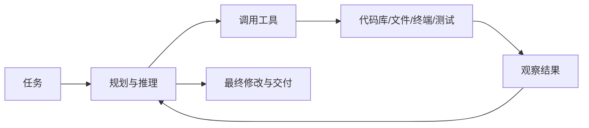
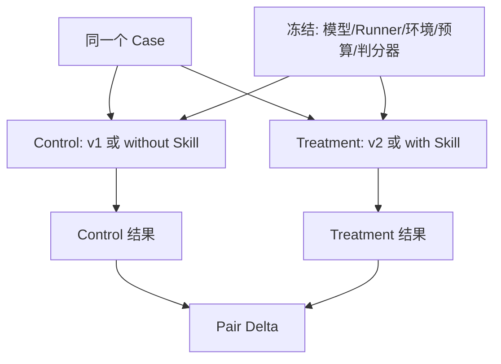
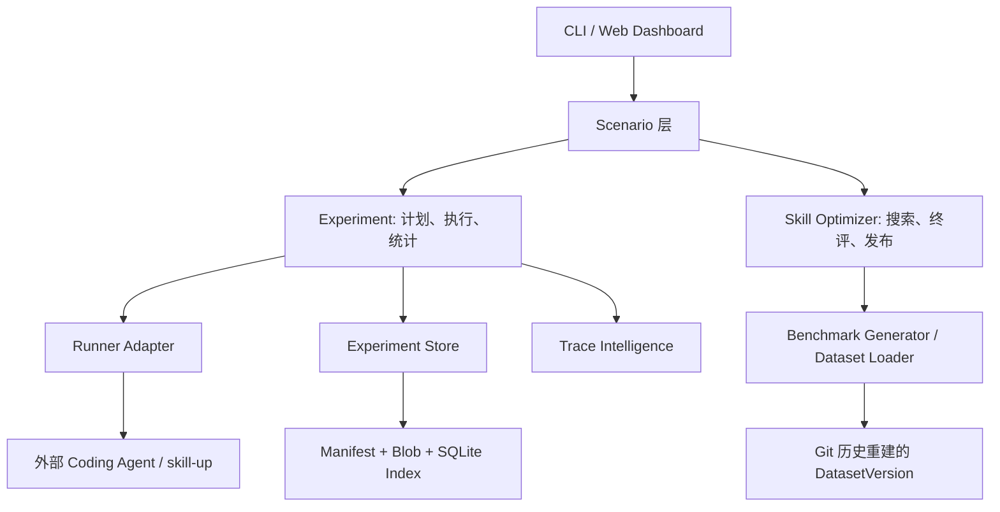
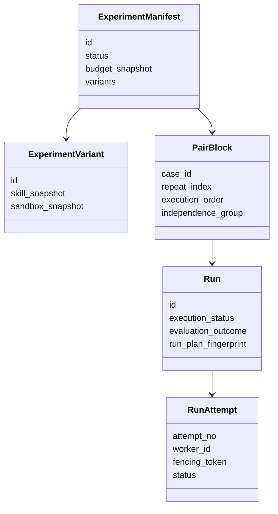
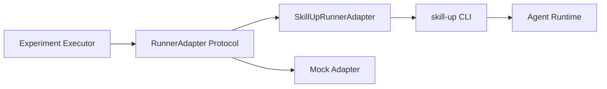
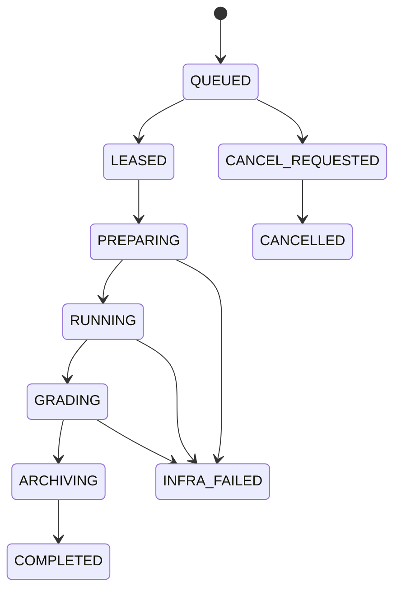
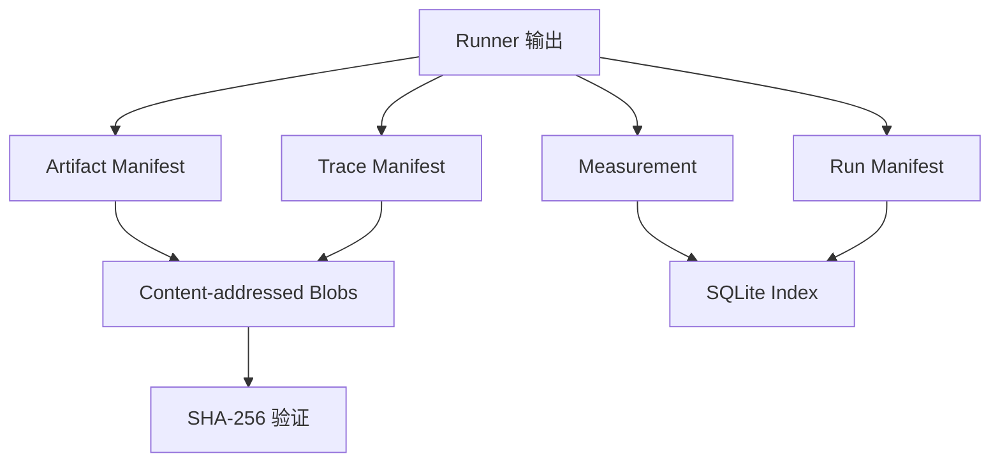
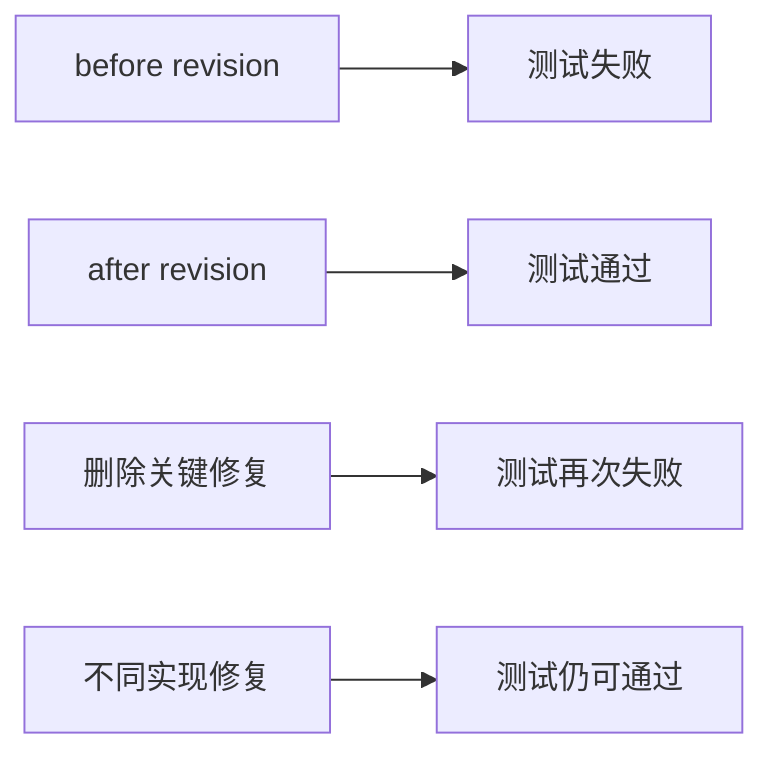
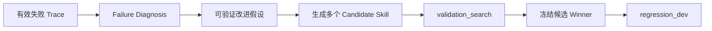
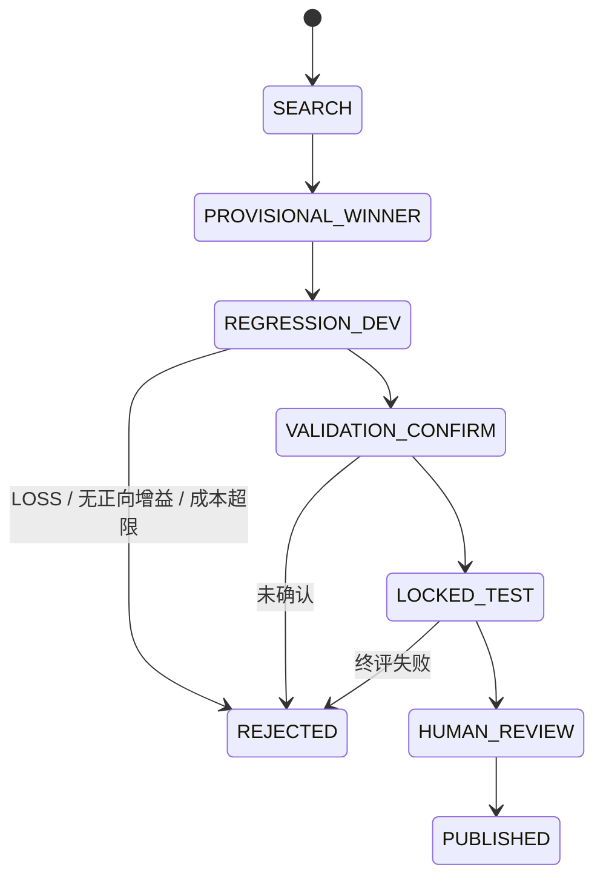

# AgentSkill-Eval 秋招知识与源码手册

> 目标读者：刚开始学习 AI Agent、希望把 AgentSkill-Eval 讲清楚并写进秋招简历的开发者。  
> 源码基线：`ranmaoxia0123/AgentSkill-Eval`，`main@67479ba`。  
> 阅读目标：能在面试中解释系统问题、核心对象、一次实验如何执行、为什么能拒绝错误发布，以及当前边界在哪里。

---

## 0. 先建立正确的项目定位

不要把它讲成“又一个 Agent 平台”或“自动优化 Prompt 的工具”。

更准确的描述是：

> AgentSkill-Eval 是一个面向 Agent Skill 演化的配对评测与发布门禁系统。它冻结 Agent、模型、环境、任务和预算，只改变 Skill 版本；用同题配对、确定性判分、证据归档和分阶段数据集判断新 Skill 是否值得发布。

它要回答的不是“Agent 这次做得好不好”，而是：

```text
Skill v2 的改善是否由 Skill 本身造成？
改善是否带来成本或回归？
结果是否来自没有参与调参的独立数据？
证据不足时，系统能否拒绝发布？
```

这四个问题就是项目的主线。

---

## 1. Agent 新人必须理解的基础

### 1.1 Agent 不是单轮问答

普通 LLM 调用近似为：

```text
输入 Prompt -> 模型生成文本 -> 判断文本
```

Coding Agent 更像一个闭环控制系统：



因此只看最终自然语言回答不够。必须记录：

- 是否选择了正确工具；
- 是否修改了正确文件；
- 是否运行了测试；
- 测试和最终工作区是否真的满足任务；
- 消耗了多少 Token、时间与费用。

### 1.2 Skill 是什么

本项目里的 Skill 可以理解为提供给 Agent 的结构化操作知识，例如：

```text
遇到 Python Bug：
1. 先定位相关测试与调用点
2. 复现失败
3. 做最小修改
4. 运行针对性测试
5. 再运行完整回归
```

Skill 不等于模型，也不等于工具。一个更完整的 Agent 系统是：

```text
Agent System =
    Model
  + System Prompt
  + Skill
  + Tools
  + Memory/RAG
  + Runner
  + Environment
```

若同时改模型、Prompt、工具、预算和 Skill，即使结果更好，也不能归因于 Skill。

### 1.3 控制变量与配对实验

项目采用“同题双跑”：



对同一题比较，能降低“题目难度不同”造成的干扰。一个 Case 的结果可被归为：

| Control | Treatment | 分类 | 说明 |
|---|---|---|---|
| 失败 | 成功 | `WIN` | v2 修复了 v1 无法完成的任务 |
| 成功 | 成功 | `TIE_POSITIVE` | 两者均可完成 |
| 失败 | 失败 | `TIE_NEGATIVE` | 没有回归，但也没有增益 |
| 成功 | 失败 | `LOSS` | v2 引入回归 |

### 1.4 FAIL 与 INVALID 的区别

这是理解项目的关键。

```text
FAIL    = Agent 完成了有效执行，但任务 Oracle 未通过
INVALID = Provider、Runner、超时、grader 环境或证据异常，无法判断 Agent 能力
```

把网络断连、Runner 崩溃算作 Skill 失败，会给优化器错误信号；把 INVALID 悄悄删除，又会夸大系统能力。因此项目同时报告：

- 保守交付口径：未通过的 FAIL/INVALID 都算作未交付；
- 能力敏感性口径：只分析双方均有效的 Pair；
- Invalid 比例：用于诊断基础设施可靠性。

---

## 2. 系统全貌

### 2.1 分层架构



| 层 | 目录 | 负责什么 |
|---|---|---|
| 契约层 | `packages/contracts/` | Pydantic 模型、枚举、状态转移、哈希 |
| 实验层 | `packages/experiment/` | 配对计划、运行状态机、统计、存储 |
| Runner 层 | `packages/runner_adapters/` | 隔离不同外部 Agent/CLI 的接口 |
| Benchmark 层 | `packages/benchmark_gen/` | 数据集 Manifest、Case、来源和完整性 |
| 优化层 | `packages/skill_optimizer/` | 候选生成、搜索、终评、Promotion |
| 场景层 | `packages/scenarios/` | Bug Fix、MCP、Memory/RAG 的统一入口 |
| 展示层 | `apps/cli/`、`apps/web/` | 命令行与本地证据查看 |

### 2.2 核心领域对象



学习时记住下面一句话：

> `Experiment` 定义要证明什么，`PairBlock` 定义同题比较，`Run` 定义一个版本的一次执行，`RunAttempt` 定义 Run 的一次具体尝试。

---

## 3. 实验编排：从冻结配置到 Run

源码入口：`packages/experiment/agentskill_eval_experiment/planning.py`。

### 3.1 `CaseExecutionSpec`

它把一个数据集 Case 变成可执行输入，包含：

- `runner_case_id`：交给 Runner 的 Case 名；
- `independence_group`：统计时用于避免同仓库/同缺陷重复加权；
- `case_sha256`、`grader_sha256`：保证题目与判分器未变；
- `platform_compiled_prompt_sha256`：保证平台拼接 Prompt 未变。

这说明项目不是只“保存 Case 文本”，而是把输入和判分器纳入实验指纹。

### 3.2 `VariantRuntimeSpec`

它描述某个 Variant 的运行环境：

```python
VariantRuntimeSpec(
    variant_id=...,
    engine={...},
    environment={...},
    skill_path=...,
    timeout_seconds=300,
    max_turns=10,
)
```

面试要点：

- `ExperimentVariant` 是“被比较的版本定义”；
- `VariantRuntimeSpec` 是“该版本如何在本地运行”；
- 两者必须一一对应，否则无法确认只有 Skill 变量不同。

### 3.3 `LocalExperimentPlanner.build`

核心逻辑可概括为：

```python
for case in cases:
    for repeat_index in range(repeats):
        block_id = uuid5(experiment.id, f"pair-block:{case.id}:{repeat_index}")
        order = deterministic_shuffle(variants, seed)
        for variant_id in order:
            run_id = uuid5(block_id, f"run:{variant_id}")
            fingerprint = hash(case + variant + runtime)
```

这里有四个工程点：

1. **实验必须先 FROZEN**：禁止边跑边修改规则。
2. **确定性 ID**：相同输入会生成相同 `PairBlock`/`Run` ID，有利于重试和幂等。
3. **随机执行顺序**：避免总是先运行某一版本带来的时间、缓存或配额偏差。
4. **RunPlanFingerprint**：把 Case、grader、prompt、engine、环境、MCP、预算、镜像摘要绑定。

### 3.4 `persist`

`planner.persist()` 在运行前：

```text
冻结 Case 源文件
冻结 Skill 目录
保存 Experiment Manifest
保存 Variant
保存 PairBlock
保存 QUEUED Run
```

这是实验可复现性的第一层：运行时不再直接依赖用户可能正在修改的原目录。

---

## 4. Runner：如何把外部 Agent 统一成可评测执行

源码入口：

- `packages/runner_adapters/.../contracts.py`
- `packages/runner_adapters/.../skill_up.py`
- `packages/runner_adapters/.../process.py`

### 4.1 为什么需要 Adapter

不同 Agent CLI 的命令、输出格式和 Trace 能力都不同。上层实验系统不应知道这些细节。



对上层而言，Adapter 只需实现：

```python
validate(request) -> ValidationReport
execute(request, event_sink) -> RunnerResult
```

### 4.2 `SkillUpRunnerAdapter.validate`

运行前会：

1. 验证二进制 SHA-256；
2. 编译 evaluation 配置；
3. 用 `--version` 确认固定版本；
4. 调用 `skill-up validate`；
5. 检查 Skill 是否被真正加载并输出 activation evidence。

这比“能启动 CLI 就直接跑”更严谨：Runner 版本变化本身可能改变实验结果。

### 4.3 独立 HOME 的作用与边界

Adapter 为每个 Run 创建独立的：

```text
HOME
XDG_CONFIG_HOME
XDG_CACHE_HOME
TMPDIR
```

优点：

- 减少不同 Run 的配置和缓存污染；
- 可安全落地非敏感 Agent 配置；
- 阻止路径穿越和符号链接逃逸。

但它**不是安全沙箱**。恶意 Agent 仍可能读取宿主绝对路径或进行网络访问。面试中必须诚实表述为“隔离运行配置与防误用”，不能称为“执行不可信代码的生产 Sandbox”。

### 4.4 Runner 生命周期



源码在 `LocalExperimentExecutor._execute_run()`：它为每次执行创建 `RunAttempt`，携带 `lease_generation` 和 `fencing_token`，再推进 `Run` 与 `Attempt` 状态。

这是一种简化的分布式任务执行思想：即使之后扩展为多 Worker，也可识别过期 Worker 写入。

---

## 5. 证据存储：为什么不只存一份结果 JSON

源码入口：

- `packages/experiment/.../storage/store.py`
- `packages/experiment/.../storage/atomic.py`
- `packages/experiment/.../storage/blobs.py`

### 5.1 Manifest 是事实源，SQLite 是索引



设计含义：

- JSON Manifest 是可以离线审计、重建索引的事实源；
- SQLite 只是查询加速层，不是唯一真相；
- Artifact 保存内容哈希、大小、媒体类型；
- Blob Store 以内容寻址去重。

### 5.2 原子文件写入

`AtomicFileWriter` 的方式：

```text
目标目录写临时文件
-> flush
-> fsync 文件
-> os.replace 原子替换
-> fsync 父目录
```

这降低了单文件写到一半崩溃时得到损坏 Manifest 的概率。

要知道其边界：单文件原子不等于多文件事务。一个 Run 的 history snapshot、candidate 内容和索引若分多次写，进程崩溃后仍可能留下跨文件不一致状态。因此后续改造应增加目录级提交标记与恢复测试。

### 5.3 密钥保护

`LocalExperimentExecutor` 使用 `ExactSecretScanner` 在 Artifact 持久化前扫描显式注入的 Secret，发现泄漏会中止归档。

边界同样要讲清：

- 能防止显式 Secret 原文直接写入证据；
- 不能防止 Base64、分段、加密外传；
- Agent 获得 Provider Key 后仍可能通过网络滥用。

---

## 6. Benchmark：如何从 Git 历史构造真实 Bug Fix Case

源码入口：

- `packages/benchmark_gen/.../dataset.py`
- `packages/benchmark_gen/.../generator.py`
- `packages/benchmark_gen/.../git_source.py`

### 6.1 数据集的组成

```text
dataset.yaml
metadata/<case>.yaml
cases/<case>.yaml
evals/
fixtures/
provenance/<case>.json
dataset-version.json
```

`DatasetLoader` 会验证：

- metadata 和 Case ID 一致；
- 每个 Case 有确定性 oracle；
- fixture、grader、provenance 的哈希与 `DatasetVersion` 一致；
- DatasetVersion 的 split 与 Case metadata 一致；
- source lineage 与 metadata 一致。

### 6.2 Git 四态验证

一个历史修复不应只检查“修复后测试通过”。更强的 Case 需要：



| 状态 | 证明什么 |
|---|---|
| before-fail | 题目确实暴露原缺陷 |
| after-pass | 官方修复解决问题 |
| mutation-fail | Oracle 对关键行为敏感 |
| alternative-pass | Oracle 不绑定唯一补丁写法 |

这比“从 Git 复制一个 issue”更接近高质量 Benchmark。

### 6.3 Split 与数据污染

数据按用途分为：

```text
train
validation_search
regression_dev
validation_confirm
locked_test
```

最重要的规则：

> Candidate Generator 看过的失败 Case 已经被用于学习，它不能再被当作独立验证或 locked test。

当前公开实验中的 Funcy Case 有过 split 语义风险。因此 V2 即使在该数据上成功，也应解释为“开发/训练拟合证据”，而非“独立泛化提升”。

---

## 7. 统计评测：如何从 Run 得到 Skill 增量

源码入口：`packages/experiment/agentskill_eval_experiment/statistics.py`。

### 7.1 两级聚合

先在同一 Case 的 repeats 内求通过率：

```text
case_pass_rate = mean(repeat outcomes)
```

再按 independence group 等权汇总，而不是让一个仓库中的大量相似 Case 放大权重：

```text
group_pass_rate = mean(case pass rates in group)
PassRate = mean(group pass rates)
AbsoluteGain = PassRate(treatment) - PassRate(control)
```

### 7.2 Bootstrap

默认 `AnalysisConfig` 包含：

```python
bootstrap_resamples = 10_000
bootstrap_seed = 2026
majority_threshold = 0.5
min_independent_groups = 2
```

Bootstrap 用重采样估计绝对增益和效率差的置信区间。

但新人最容易犯的错是：看到 95% CI 就认为结论牢靠。若只有 2 个独立组，统计模块虽可能 `inference_ready=true`，实际证据仍然很弱。真正想在简历中写“稳定提升”，应使用更多不同仓库/缺陷家族，建议至少 10 个以上独立组。

### 7.3 效率不能被忽略

统计结果还比较：

- Tokens；
- latency；
- micro-USD cost；
- cost per success。

这是 Agent 项目区别于普通分类模型评测的地方：成功率提升但 Token 增长 5 倍，通常不是无条件可发布的优化。

---

## 8. Skill 优化：从失败到候选

源码入口：

- `packages/skill_optimizer/.../proposal.py`
- `packages/skill_optimizer/.../search.py`
- `packages/skill_optimizer/.../execution_runtime.py`

### 8.1 优化不是“让 LLM 随便改 Prompt”

正确链路应是：



Candidate 需要保留：

- 父 Skill 的哈希；
- 生成依据；
- 修改内容；
- lint/compatibility 结果；
- 被哪些数据集与实验评测；
- search 选择理由。

### 8.2 Search 与 Promotion 不能混淆

`validation_search` 可以挑选候选，但它已经被优化器观察过，只能称为选择证据。

```text
Search winner != Published Skill v2
```

候选仍需经过独立回归、confirmation、locked test 和人工审核。

---

## 9. 独立终评与发布门禁

源码入口：

- `packages/skill_optimizer/.../final_evaluation.py`
- `packages/skill_optimizer/.../promotion_workflow.py`
- `packages/contracts/.../final_evaluation.py`

### 9.1 分阶段状态机



### 9.2 locked test 为什么只能运行一次

`FinalEvaluationStore.reserve_locked_test()` 使用 `O_CREAT | O_EXCL` 创建 receipt。

含义是：

```text
同一个 optimization job 已经消耗 locked_test
-> 不能用不同参数反复试
-> 不能看结果后继续调 Skill 再重跑同一份 locked 数据
```

这是防止“测试集调参”的简单工程机制。

### 9.3 Promotion 的正确心智模型

发布不是复制一个 Markdown 文件，而是形成 lineage：

```text
base Skill hash
-> candidate hash
-> search evidence
-> regression evidence
-> confirmation evidence
-> locked receipt
-> human review
-> immutable release manifest
```

一个真实工程价值在于：没有足够证据时，系统应产生可解释的 `BLOCKED`，而不是自动把新 Skill 覆盖旧版本。

---

## 10. 推荐源码阅读顺序

不要从 2,000 多行 CLI 开始。按“数据如何流动”阅读：

1. `packages/contracts/.../enums.py`：先理解状态。
2. `packages/contracts/.../experiment.py`、`run.py`：理解核心对象。
3. `packages/experiment/.../planning.py`：理解如何构造 PairBlock 与 Run。
4. `packages/experiment/.../execution.py`：理解真实运行状态机。
5. `packages/runner_adapters/.../contracts.py`、`skill_up.py`：理解外部 Agent 接入。
6. `packages/experiment/.../storage/store.py`：理解证据如何存。
7. `packages/experiment/.../statistics.py`：理解 W/T/L、CI、成本。
8. `packages/benchmark_gen/.../dataset.py`：理解 Case 与 split。
9. `packages/skill_optimizer/.../search.py`：理解候选选择。
10. `packages/skill_optimizer/.../final_evaluation.py`、`promotion_workflow.py`：理解发布拒绝机制。
11. `tests/integration/`：用测试反向理解真实用户路径。
12. 最后阅读 `apps/cli/.../main.py`，把命令映射回上述模块。

---

## 11. 面试高频题与回答框架

### Q1：为什么要配对，而不是直接比较两个版本平均分？

同题配对控制了题目难度；每个 Case 直接提供方向性证据。若 v2 只做了更简单的题，平均分提升没有意义。

### Q2：为什么区分 FAIL 和 INVALID？

FAIL 是任务能力失败，INVALID 是基础设施或证据失败。混在一起会让 Skill 优化器学到错误的“修复方向”，并使统计结论不可解释。

### Q3：为什么要有 locked test？

一旦数据被用于选候选或看结果，它就不再能提供独立泛化证据。locked test 限制一次消费，防止反复调参直到撞上好结果。

### Q4：哈希是否等于不可篡改？

不等于。当前实现是 content-addressed、tamper-evident：文件修改后可被检测。若攻击者拥有写权限且可重算全部哈希，仍可伪造新链。生产级不可抵赖还需要签名、远程存证或 CI provenance。

### Q5：当前项目最大的局限是什么？

公开实验规模较小，且数据 split 暴露必须严审；独立 HOME 不是安全 Sandbox；存储的单文件原子写不等于跨文件事务；MCP/RAG 是扩展实验而非成熟主线。

### Q6：与 LangSmith、Inspect、Braintrust 有什么不同？

这些工具覆盖通用 Trace、Eval 或执行基础设施。本项目聚焦“Skill 是版本变量”时的协议：同题配对、Dataset exposure、成本增量和证据驱动 Promotion。最合理的未来方向是接入它们作为 Trace/Runner 后端，而不是重复建设所有平台能力。

### Q7：为什么 `Run` 与 `RunAttempt` 要拆开？

`Run` 代表计划中的逻辑执行单元，`RunAttempt` 代表实际某次 Worker 尝试。拆开后才能记录重试、租约、Worker 和 fencing token，同时不改变原始 Run 的身份。

### Q8：为什么计划 ID 使用确定性 UUID？

相同的 Experiment、Case、repeat 和 variant 会得到相同 ID。这使重试具有幂等性，也能检测“已有同 ID 的 Run 但指纹不同”的不一致。

### Q9：为什么要随机化 PairBlock 中 Variant 的执行顺序？

始终先运行 v1 或 v2 可能受到缓存、速率限制、模型服务负载或预算剩余的系统性影响。用固定 seed 的随机顺序降低偏差，同时保持可重放。

### Q10：`RunPlanFingerprint` 应包含哪些变量？

至少包括 Case、grader、平台拼接 prompt、Skill snapshot、模型/engine、环境、MCP 配置、预算和镜像摘要。缺少任何会改变结果的变量，复现实验就可能在“看起来同一配置”下变成不同实验。

### Q11：为什么 Manifest 是事实源而 SQLite 只是索引？

Manifest 更易离线归档和完整性校验；SQLite 可由 Manifest 重建。若把数据库当唯一真相，数据库损坏或版本迁移会直接丢失审计能力。

### Q12：原子写解决了什么，没解决什么？

`os.replace` 与 `fsync` 解决单文件损坏和半写入；它不能让多个文件自动成为事务。多对象更新仍需要 commit marker、恢复逻辑或日志协议。

### Q13：为什么不用 LLM Judge 判定 Python Bug Fix？

测试、退出码和工作区状态是更低成本、更稳定、更可重放的 oracle。LLM Judge 适合无法用程序验证的开放任务，但不应取代已有确定性判分。

### Q14：为什么四态 Git 验证比 after-pass 更严格？

after-pass 只能说明官方补丁可通过；mutation-fail 验证 oracle 对关键修复敏感；alternative-pass 验证 oracle 不把官方补丁文本当唯一答案。

### Q15：为什么要按 independence group 聚合？

同一仓库或同一缺陷家族的 Case 通常相关。若直接按 Case 平均，拥有更多相似 Case 的仓库会被过度加权，使结果看似更稳定。

### Q16：如何解释“v2 成功率变高但 Token 增长 300%”？

它不是自动的成功。应预注册效率预算，报告 `cost per success`，并由 Promotion Gate 决定提升是否足以抵消成本；不同业务可设置不同阈值。

### Q17：为什么 search winner 不能直接发布？

search 是对多个候选的选择过程，winner 已经对 search 数据过拟合风险更高。需要未参与选择的 regression、confirmation 与 locked 数据做后续验证。

### Q18：locked test 已失败，能否改 Skill 后重新跑？

不能把同一份 locked 数据继续作为独立终评。失败后它已经被观察，后续修改必须使用新的独立 locked split，原结果永久保留在谱系中。

### Q19：当前的安全边界是什么？

它有路径校验、独立 HOME、二进制 pin、Secret 扫描和证据哈希，但没有 OS 级网络隔离、容器/虚拟机硬隔离或抗恶意 Agent 能力。因此属于可信本地实验保护，不是生产级不可信代码沙箱。

### Q20：如果删掉 80% 功能，最该留下什么？

留下 Python Bug Fix 主线的 `DatasetVersion -> PairBlock -> Runner Adapter -> deterministic oracle -> Evidence Store -> W/T/L + cost -> Promotion Gate`。MCP/RAG 和复杂展示可以后置，因为它们不是项目的因果闭环。

---

## 12. 你的学习路线

### 第一阶段：Agent 基础

- 理解 Agent loop、Tool calling、ReAct、上下文窗口、Token 成本。
- 动手写一个“读文件 -> 改文件 -> 跑测试”的简单 coding agent。
- 学会区分 Prompt、Skill、Tool、Memory 与 Runner。

### 第二阶段：评测基础

- 学习 deterministic oracle、unit test、golden file。
- 学习 control/treatment、paired experiment、repeat、randomization。
- 学习 precision/recall、置信区间、bootstrap、数据泄漏。

### 第三阶段：工程基础

- 学习 Pydantic 契约；
- 学习状态机、幂等、锁、fencing token；
- 学习 SHA-256、原子写入、内容寻址；
- 学习 subprocess、timeout、日志与资源配额。

### 第四阶段：项目主线

- 跑通一个小 Demo；
- 读一个 PairBlock 的所有 Manifest；
- 故意造成一次 grader 环境异常，理解 INVALID；
- 给 v1/v2 写一个最小对比；
- 用独立数据验证，而不是只看训练结果。

---

## 13. 秋招讲述模板

### 30 秒版本

> 我做了一个 Agent Skill 的配对评测与发布门禁系统。它固定模型、Agent、环境和预算，只改变 Skill 版本，通过同题双跑、确定性测试、Trace 和证据哈希判断 v2 是否真实提升；当结果缺少独立验证、出现回归或成本超限时，系统会拒绝发布。

### 2 分钟版本

> Coding Agent 的结果受模型、Prompt、工具、环境和 Skill 同时影响，所以仅看一次成功率无法证明 Skill 有效。我先将实验冻结为 PairBlock：同一个 Case 上运行 v1 和 v2，使用确定性 grader 给出 PASS、FAIL 或 INVALID。每个 Run 都记录指纹、Trace、Artifact、Token 和成本，并以 Manifest 与内容哈希归档。  
>
> 失败证据可用于生成候选 Skill，但候选只能先在 search 集选择；之后必须经过 regression、独立 confirmation、一次性 locked test 和人工审核。这样项目的价值不是自动生成 Skill，而是在证据不足时阻止一个看似更强、实际可能有回归或数据泄漏的版本被发布。

---

## 14. 最后要记住的原则

```text
Agent 评测的难点不是“跑一次”。
难点是让实验只改变一个变量，
让失败有正确归因，
让数据不会在优化中泄漏，
让结论能回到原始证据，
并让系统在证据不足时敢于拒绝发布。
```

---

## 15. 项目图稿

以下图稿以仓库已核验的模块与协议为依据，刻意不包含任何尚未冻结的 V2 性能数值。SVG 适合继续编辑，PDF 适合打印或投递，PNG 适合放入 Markdown、PPT 与简历附件。

### 图 1：系统架构


- [SVG](AgentSkill-Eval_项目图/figure_1_system_architecture.svg)
- [PDF](AgentSkill-Eval_项目图/figure_1_system_architecture.pdf)
- 结论：项目输出不是孤立分数，而是带证据的 `SkillDelta` 与可解释的发布/阻断决策。

### 图 2：配对评测协议


- [SVG](AgentSkill-Eval_项目图/figure_2_paired_skilldelta_protocol.svg)
- [PDF](AgentSkill-Eval_项目图/figure_2_paired_skilldelta_protocol.pdf)
- 结论：同题、同运行时的 control/treatment 才能将变化归因于 Skill；`INVALID` 不能伪装为任务失败。

### 图 3：数据暴露与发布门禁


- [SVG](AgentSkill-Eval_项目图/figure_3_exposure_aware_promotion_gate.svg)
- [PDF](AgentSkill-Eval_项目图/figure_3_exposure_aware_promotion_gate.pdf)
- 结论：能用于候选生成或搜索的数据不再是独立验证数据；search winner 必须经过回归、确认、locked test 与人工审核。

图稿复现命令：

```bash
.venv-nature-figures/bin/python scripts/generate_agentskill_eval_figures.py
```
