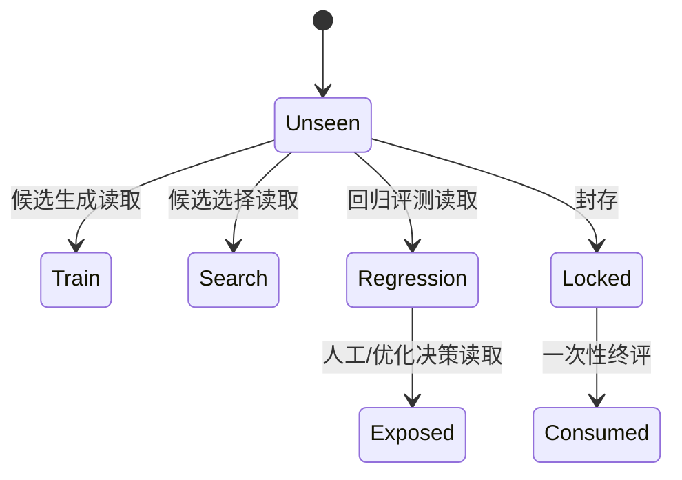

# AgentSkill-Eval：通透理解

## 1. 这个项目真正解决的不是“让 Agent 更聪明”

模型、Agent 框架、工具和 Prompt 都在快速迭代。团队真正缺的往往不是“再写一份 Skill”，而是回答：

> 这份 Skill 的变化，是否真的让 Agent 在真实任务上更可靠？

如果没有严格协议，任何一次成功都可能来自：

- 模型随机性；
- 更容易的数据；
- 更高 Token 预算；
- 额外工具；
- 已被看过的测试集；
- Runner 或判分器异常。

AgentSkill-Eval 的价值在于把这些替代解释排除或显式记录。

## 2. SkillDelta 才是项目的核心对象

不要把核心对象理解为 Prompt、Trace 或 Dashboard。

真正应被管理的是：

```text
SkillDelta =
  在冻结条件下，
  Skill v2 相对于 Skill v1，
  在同题任务上的质量变化、效率变化、回归变化，
  以及该结论所依赖的数据暴露谱系。
```

一份可信 SkillDelta 至少包含：

- v1/v2 的精确内容与哈希；
- 相同 Case 上的配对结果；
- PASS/FAIL/INVALID；
- Token、时延、费用；
- 数据集 split；
- 是否参与过候选生成；
- 置信区间与独立组规模；
- 是否存在 LOSS；
- Promotion 决策。

## 3. 数据治理比“候选生成”更难

候选生成可以交给大模型；真正困难的是防止优化器在看过数据后继续把同一份数据称为“验证集”。

因此数据集不是一个目录，而是一个有生命周期的对象：



一旦 Candidate Generator 看过 Case 的失败信息，它就不能回到 `validation_confirm` 或 `locked_test`。这不是文档约定，而应成为系统 invariant。

## 4. 负结果比漂亮数字更能证明工程能力

如果 V2 结果是：

```text
0 WIN / 4 TIE / 0 LOSS
```

正确结论不是“系统失败了”，而是：

> 在当前数据和预算下，没有证据表明 v2 相比 v1 带来正向增益，因此系统阻止发布。

这说明门禁在工作。一个会拒绝不可信结论的系统，比总能产生“提升”数字的系统更可信。

## 5. 不要把工程协议伪装成算法创新

项目没有提出新的大模型算法，也没有提出新的统计学定理。

它的价值在：

- 将配对评测预置为 Skill 演化协议；
- 将数据暴露状态纳入版本谱系；
- 将 FAIL/INVALID 分离；
- 将质量、成本与回归一起纳入决策；
- 将 Promotion 变成证据驱动、可拒绝的状态机。

这属于很有价值的工程与实验设计创新，但表达必须诚实。

## 6. 最终学习重点

你不需要试图背下所有 CLI 命令和所有模块。

真正需要掌握的是一条因果链：

```text
冻结变量
-> 同题执行
-> 确定性验收
-> 正确区分失败来源
-> 记录可重放证据
-> 在独立数据上比较 v1/v2
-> 根据质量、成本、回归与证据强度决定是否发布
```

掌握这条链，你既能解释项目，也拥有了构建 Agent Eval 系统最重要的工程判断。

