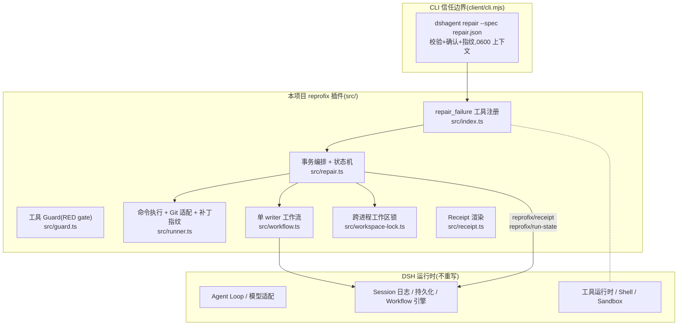
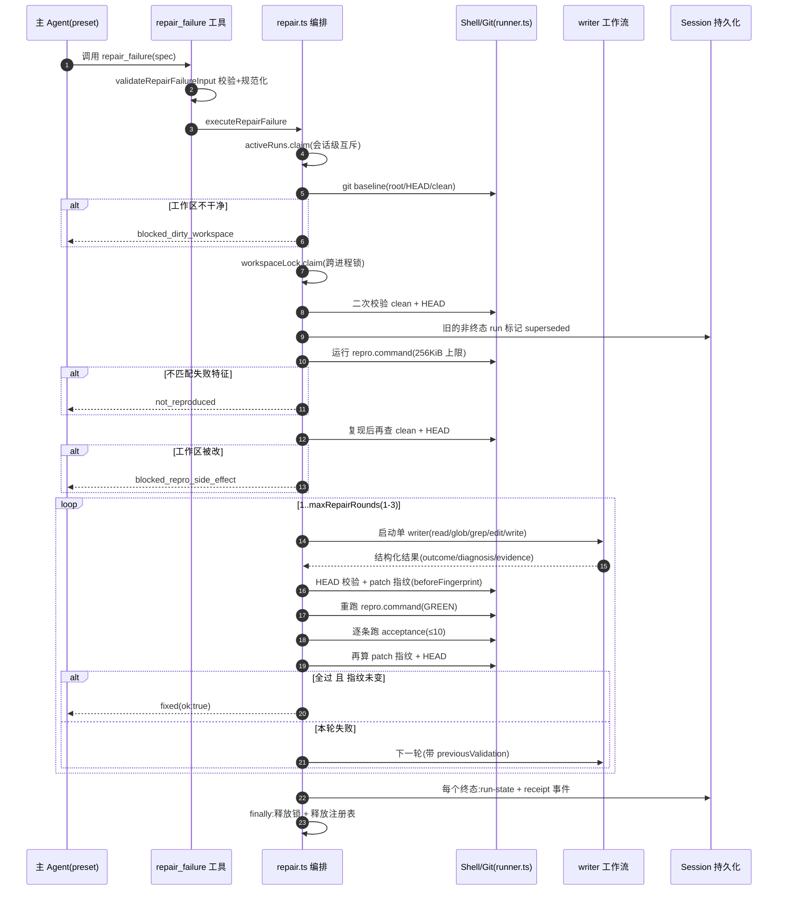
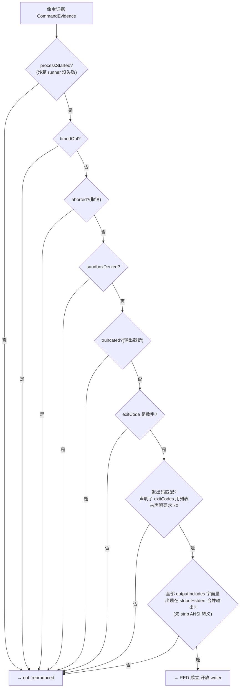
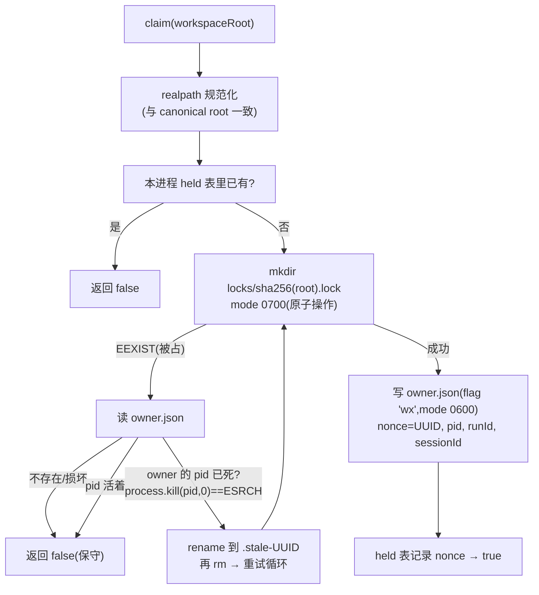

# dsh-coding-agent 面试复习笔记

> 用途:秋招面试复习。所有机制描述均对照真实源码(引用格式 `文件:行号`),
> 被追问时可以直接翻到对应代码讲。
> 图为 Mermaid + ASCII,在 GitHub / VS Code(装 Mermaid 插件)/ Typora 中可直接渲染。
> 本文件是个人复习材料,**不要**提交到公开仓库。

---

## 0. 电梯演讲(先背这个)

### 30 秒版

> 通用编码 Agent 的正确性依赖模型自觉:它可能没复现就改代码,声称"测试过了"
> 但没人重跑过。我的项目把它变成**可审计的执行合同**:先用代码验证声明的失败
> 真实复现(RED),才开放一个**没有 Shell 的唯一 writer** 改代码;改完由
> wrapper **亲自重跑**复现命令和全部验收命令,验证期间补丁指纹必须不变,
> 全过才返回 `fixed`。九种终态,每种都带证据(Receipt)落盘。
> 它跑在 DeepSeek Harness 上,我不重写 Agent Loop,只做合同层。

### 1 分钟版(在 30 秒版基础上追加)

> 技术上是个 TypeScript 插件:向 DSH 注册 `repair_failure` 工具,用工具 Guard
> 做 RED 前写入拒绝,用跨进程文件锁做同仓库互斥,用 SHA-256 补丁指纹做
> "验证期间补丁没被偷改"的校验,每个终态写 `reprofix/receipt` Session 事件。
> 14 个测试文件覆盖单元/集成/冒烟/真实 Git fixture,CI 跑 Linux/macOS/Windows
> 三平台。定位是无人值守场景(CI 自动修可复现故障)——人不在环路里,
> 信任锚必须是代码而不是模型。

---

## 1. 项目定位:信任锚问题

**一句话:交互式 Agent 的信任锚是"人",ReproFix 的信任锚是"代码"。**

```
┌─────────────────────────────────────────────────────────────────┐
│  Codex / Claude Code / Cursor(交互式)                          │
│                                                                 │
│  Agent 产出补丁 ──► 人看 diff ──► 人跑测试 ──► 人拍板           │
│                      ▲                                          │
│                      └── 信任锚 = 人                            │
│  适用:开发者日常编码,人始终在环路里                            │
├─────────────────────────────────────────────────────────────────┤
│  ReproFix(无人值守事务)                                       │
│                                                                 │
│  声明失败 ──► 代码验证 RED ──► 唯一 writer(无 Shell)          │
│       ──► 代码重跑全部验证 ──► 指纹/HEAD 校验 ──► fixed + 回执 │
│              ▲                                                  │
│              └── 信任锚 = 机械保证                              │
│  适用:CI 夜间批量修复、自动修可复现测试失败,没人看 diff        │
└─────────────────────────────────────────────────────────────────┘
```

**能力光谱(回答"为什么不直接 prompt 里写清楚"时画给面试官):**

```
信任强度   弱 ────────────────────────────────────────────► 强

  提示词约束          Agent 自带验证            执行合同(本项目)
  "请先跑测试"        云版 Codex 沙箱跑测试      RED gate + Guard 拦截
  概率遵守            模型决定跑什么/何时停      写入在 RED 前被硬拒
  无证据              结果模型自己汇报          wrapper 亲自重跑
  不可审计            无跨阶段不变性校验        指纹不变性 + Receipt
```

---

## 2. 全景架构与代码地图



### 所有权边界(面试高频:"你的代码到底在哪")

| DSH 提供(继承) | 本项目实现(你的贡献) |
| --- | --- |
| Agent Loop、模型适配、工具运行时 | `repair_failure` 工具 + 输入/输出 Schema |
| ALLOW/ASK/DENY、Sandbox、Shell | `repair.json` CLI 授权 + 输入指纹 |
| Session 日志、持久化、Workflow 引擎 | RED gate、单 writer、wrapper validation |
| 上下文压缩、Web UI | 工作区锁、状态机、Receipt |

### 代码地图(按讲解顺序)

| 文件 | 行数约 | 职责 | 面试关键词 |
| --- | --- | --- | --- |
| `src/domain.ts` | 460 | 类型 + 输入校验 + 匹配规则 + 指纹 | fail closed、canonical JSON |
| `src/repair.ts` | 400 | 事务编排、状态机、终态 | DI、finally、取消传播 |
| `src/guard.ts` | 80 | 工具门禁、活跃 run 注册表 | allowlist、双源状态校验 |
| `src/runner.ts` | 264 | Shell 调用、Git 适配、补丁指纹 | 原子 mkdir、长度前缀 |
| `src/workspace-lock.ts` | 143 | 跨进程文件锁 | nonce、stale 清理 |
| `src/workflow.ts` | 151 | 单 writer 工作流 | maxTotalAgents=1 |
| `src/receipt.ts` | — | Receipt → Markdown | 摘要不落全量 |
| `src/index.ts` | 209 | 插件入口:注册工具+挂 Guard | prepareWriter 检查 |

---

## 3. 完整执行流程(最重要的一节)

### 3.1 主时序图



### 3.2 状态机图

```mermaid
stateDiagram-v2
    [*] --> created : claim 成功
    created --> cancelled : signal.aborted
    created --> blocked_dirty_workspace : baseline 不干净
    created --> blocked_active_run : 锁被占
    created --> reproducing
    reproducing --> not_reproduced : 匹配失败
    reproducing --> cancelled : 中止
    reproducing --> blocked_repro_side_effect : 复现改了工作区
    reproducing --> reproduced : RED 匹配
    reproduced --> repairing : 开放 writer
    repairing --> repair_failed : writer 无有效补丁
    repairing --> cancelled : 中止
    repairing --> validating : writer 产出补丁
    validating --> fixed : 全部通过+指纹未变
    validating --> repairing : 还有剩余轮数
    validating --> validation_failed : 轮数耗尽
    validating --> cancelled : 中止
    created --> infrastructure_error : 本地服务异常
    reproducing --> infrastructure_error : Git/锁/Session 异常
    note right of fixed : 唯一返回 ok:true 的终态
```

非终态共 6 个:`created / reproducing / reproduced / repairing / validating / superseded`。
终态 9 个(见第 5 节)。

### 3.3 分阶段精讲(对照源码)

**阶段 0:claim 与基线(`repair.ts:225-235`)**
- `activeRuns.claim(sessionId, runId)`:同一 Session 同时只允许一个活跃 run,失败 → `blocked_active_run`。注意这是**会话级**的内存注册表,跨进程靠下面的文件锁。
- `git.baseline(cwd)`(`runner.ts:201-206`):三条 Git 命令——`rev-parse --show-toplevel`(再 `realpath` 得 canonical root,防止 symlink/相对路径绕过锁)、`rev-parse HEAD`、`status --porcelain=v1 -z --untracked-files=all`(`-z` NUL 分隔避免路径里特殊字符的解析歧义)。

**阶段 1:脏工作区拒绝(`repair.ts:237`)**
- tracked 或 untracked 任一改动都不行。为什么这么严:基线不是干净状态时,"补丁"无法定义——你分不清哪些改动是 writer 做的、哪些是历史遗留。

**阶段 2:文件锁 + 拿锁后二次校验(`repair.ts:238-253`)**
- `workspaceLock.claim` 成功后,**再查一次** clean + HEAD。为什么:拿锁本身要花时间,期间别的进程可能改了仓库(TOCTOU)。锁管"别人不能开始新 run",二次校验管"锁之前的尾巴"。

**阶段 3:superseded 处理(`repair.ts:255-267`)**
- 从 Session 事件里回放(fold)所有历史 run 状态,把**没有终态的旧 run**标记为 `superseded`。
- 为什么需要:进程如果中途崩溃,旧 run 永远停在 `repairing` 之类的非终态;新 run 启动时把它们的"账"结掉,防止 Guard 误以为还有活跃写入者(写入许可 `mayUseWriterTools` 依赖状态)。

**阶段 4:复现与 RED 匹配(`repair.ts:269-281`,`domain.ts:303-321`)**
- 详见 4.1。`matchesFailure` 要求:命令真实跑完(五条件)+ 退出码匹配 + **全部** outputIncludes 字面量出现在合并输出里(大小写敏感)。

**阶段 5:复现后副作用检查(`repair.ts:282-288`)**
- 复现命令如果改了工作区或动了 HEAD → `blocked_repro_side_effect`,不启动 writer。
- 细节(面试可能追问):**不自动恢复**这些改动——自动 `git checkout .` 属于破坏性操作,插件不做;返回状态让人处理。

**阶段 6:writer 工作流(`repair.ts:296-341`,`workflow.ts:82-143`)**
- 详见 4.3。writer 结束后:先查 HEAD(没被动)→ 算补丁摘要 → `changedFiles.length === 0` 直接 `repair_failed`(没改任何东西不算修复)。

**阶段 7:验证(`repair.ts:343-381`)**
- `beforeFingerprint` = writer 之后、验证之前算的指纹。
- wrapper 重跑 `repro.command` 判 GREEN(`matchesSuccess`,默认退出码 0)。
- 逐条跑 acceptance(最多 10 条),全部 `matchesSuccess` 才算过。
- 验证完**再算一次** `afterPatch` 指纹 + 再查一次 HEAD,任何变化 → `passed = false`。
- 为什么:测试命令本身可能有副作用(改文件、`git commit`),指纹校验就是抓"测试过程偷改补丁"。

**阶段 8:轮次与重试(`repair.ts:296, 382-385`)**
- 本轮失败且还有轮数 → 下一轮 writer 会拿到 `previousValidation`(上次失败的证据)和当前 `patch` 摘要,针对性修改。
- 轮数上限 3:防止无限烧 token;日志显示每轮 stopReason。

**终态与 finally(`repair.ts:210-223, 386-402`)**
- `finish()`:先 append 终态 run-state,再写 receipt;**两步持久化失败都只报 stderr 不抛**(不能因为"审计落盘失败"就把已经确定的结果改成 infrastructure_error)。
- `finally`:释放文件锁(try/catch 包裹,失败报 stderr)+ 释放内存注册表。**任何路径都走 finally**,包括 throw 之后。

---

## 4. 核心机制深挖

### 4.1 RED Gate:匹配规则与 fail closed

**`matchesFailure` 的前置门槛 `completedCommand`(`domain.ts:303-312`)——五条件全过才算"命令真实完成":**



**关键设计——fail closed(默认失败):**
- 每流输出上限 256 KiB(`MAX_OUTPUT_BYTES`),**截断本身即失败**,不用不完整输出推断结果。反面案例:截断恰好把"expected 4, received 3"截掉了,用不完整输出匹配会误判。
- ANSI 转义先剥掉再匹配(测试框架的彩色输出不干扰字面量匹配)。
- `outputIncludes` 必须非空(至少一条)——只看退出码太弱,退出码 1 可能是任何错误,字面量保证是"你声明的那个失败"。

### 4.2 Guard:工具门禁与双源状态校验

**允许的工具集合(`guard.ts:14-21`):**

| 主体 | 允许 | 说明 |
| --- | --- | --- |
| 普通 Agent(Run 前后) | `read` `glob` `grep` + `repair_failure` | 只读 + 发起事务 |
| writer(reproduced/repairing 态) | `read` `glob` `grep` `write` `edit` + `structured_output` | **无任何命令工具** |
| 其它一切(含 bash/pwsh/未知工具) | 拒绝 | 返回拒绝理由字符串 |

**判定流程(`guard.ts:56-79`):**

```
工具调用 exec
  ├─ 在 allowed(read/glob/grep/repair_failure)里? ──► 放行
  ├─ 调用者是 writer 且 mayUseWriterTools()?
  │    ├─ registry.current(agent) 解析活跃 run
  │    │    (writer 是子 Agent,顺 parentSession 找父会话的 run)
  │    ├─ 状态 ∈ {reproduced, repairing}?
  │    └─ 双重校验:内存 registry 状态 == Session 事件折叠出的持久化状态?
  │         └─ 是 → 在 writerAllowed 里? 是→放行 否→拒("commands are wrapper-owned")
  └─ 都不是 → 拒("exact reproduction is required for the current active run")
```

**面试深挖点——为什么"双源校验"(`mayUseWriterTools` 同时查内存和 Session 事件):**
内存注册表快但进程重启即失;Session 事件持久但可能被并发写。两者不一致说明有异常(如崩溃恢复中),此时**拒绝写入**——又是 fail closed。

**Guard 挂载位置:** `installGuard` 在插件 `apply()` 时全局调用(`index.ts:118`),但插件本身只被安装到 ReproFix Preset——`cordis.patch.yml` 故意留空,保证不会限制其他 DSH Agent。

### 4.3 单 Writer 工作流

**结构(`workflow.ts`):**
- DSH workflow 引擎启动脚本,`maxTotalAgents: 1` —— 引擎层面保证**最多启动一个 Agent**,不是提示词层面的"请你只派一个"。
- writer 的 prompt(`workflow.ts:30-46`)要点:声明"wrapper 已复现失败"、要求**最小补丁**(不做无关重构/格式化/依赖升级/公开 API 变更)、明确"你没有命令工具,只能 read/search/edit/write,结果走结构化输出通道"。
- 输入给 writer 的证据:task + 复现的 CommandEvidence(JSON)+ 重试时的 previousValidation + 当前 patch 摘要。
- 输出强 schema:`{outcome: patched|blocked, diagnosis, evidence[], residualRisks[]}`,运行时还有 `isWriterResult` 二次校验(不信任引擎的 schema 执行)。

**取消传播(`workflow.ts:108-117`):**
- 外部 signal abort → `run.cancel('repair_failure aborted')`,`once: true` + `abortForwarded` 防重复。
- `finally` 里 `run.dispose()`,dispose 失败与执行失败同时存在时抛 `AggregateError`——两个错误都不吞。

### 4.4 补丁指纹(算法细节,最容易被深挖)

**指纹的输入(`runner.ts:216-261`):**

```
SHA-256 摘要流:
┌────────────────────────────────────────────────────────────┐
│ 域分隔前缀 "reprofix.patch/v2\0"                          │  ← 防跨域拼接攻击
│ SHA-256( git diff --binary HEAD -- )                       │  ← tracked 改动全文
│ 对每个 untracked 文件(排序后):                          │
│   u32be(路径字节数) │ 路径 │ 类型(01文件/02符号链接)    │  ← 长度前缀
│   可执行位(01/00)   │ SHA-256(文件全文)                │  ← 防路径拼接歧义
└────────────────────────────────────────────────────────────┘
```

**为什么要这么讲究(提交历史里有对应 fix: "make patch fingerprints unambiguous"):**
- **长度前缀**:没有它,`("ab","c")` 和 `("a","bc")` 两个不同文件集合会拼出相同字节流 → 指纹碰撞。u32 大端长度让每段边界无歧义。
- **域前缀 v2**:防止把补丁字节流当其他类型数据伪造;版本号留升级空间。
- **untracked 逐文件哈希**:untracked 文件不在 `git diff` 里,必须单独进指纹,否则"新加一个恶意文件"检测不到。
- **符号链接特殊处理**:哈希的是链接目标(`readlink`),不是文件内容——防止用 symlink alias 逃逸。
- **可执行位也进指纹**:权限变化是真实变更。
- **binary 判定**:前 8000 字节含 NUL;binary 行数不计入 added(无意义)。

**两个用途:**
1. `beforeFingerprint`(验证前)vs `afterPatch`(验证后)比对 → 抓"测试过程偷改补丁"(`repair.ts:377`)。
2. Receipt 里存最终指纹 → 事后审计可复核。

**补丁分数(规模度量,非质量度量):** `added + deleted + 10×changedFiles + 50×manifestFiles + 100×binaryFiles`。manifest 文件(package.json、各语言 lockfile 等 11 种 basename)高加权——依赖变更是高风险信号。**明确说:它只描述规模,不证明最小性。**

### 4.5 跨进程工作区锁

**claim 算法(`workspace-lock.ts:70-123`):**



**面试深挖点:**
- **为什么 mkdir 是原子的**:目录创建在文件系统层面是原子 test-and-set,天然互斥,不需要 lock 文件 + read/write 的竞态处理。
- **nonce 的作用**:release 时(`workspace-lock.ts:125-141`)校验 `owner.nonce === 自己的 nonce && runId && sessionId` 全匹配才删——防止 A 超时后 B 拿到锁,A 缓醒过来把 B 的锁删了。
- **stale 清理用 rename 再 rm**:直接 rm 锁目录有竞态(删到一半别人 mkdir 成功);先 rename 成独一名字(`.stale-UUID`)把"锁"移走,再慢慢删。
- **为什么锁放 `$DSH_HOME/dsh-coding-agent/locks/` 而不放仓库里**:锁文件本身会成为 untracked 文件 → 污染"干净工作区"判定和补丁指纹!放外部目录一举两得。
- **局限(主动说)**:只覆盖共享同一 `DSH_HOME` 的进程;不同用户/不同 home/NFS 不在 V0.1 保证内。

### 4.6 Receipt 审计回执

- schema:`reprofix.receipt/v1`(`domain.ts:128-153`),记录 runId/toolCallId/状态/起止时间/输入指纹/baseline/复现证据/诊断/补丁/验证数组/工作流轮次/残余风险。
- **输出只落摘要不落全量**(`repair.ts:127-130` `receiptEvidence` 剔除 stdout/stderr/combinedOutput):保留 `outputDigest`(SHA-256)+ `outputTail`(末 4000 字符)。理由:① Receipt 会进 Session 持久化,全量输出可能巨大;② 输出里可能有敏感信息;③ digest 足够做"两次输出是否一致"的比对,tail 足够人看报错。
- 每个受控终态都尝试写;落盘失败降级 stderr,不改变已确定的业务终态。

### 4.7 输入校验与规范化(数字都在这)

`validateRepairFailureInput`(`domain.ts:251-293`):

| 项 | 限制 | 默认 |
| --- | --- | --- |
| `task` | ≤ 10000 字符 | — |
| `failureLog` | ≤ 20000 字符 | 无 |
| 每条 `outputIncludes` 字面量 | ≤ 2000 字符 | — |
| `timeoutMs`(repro/acceptance) | 1000–1800000(1s–30min) | 120000 |
| `acceptance` 条数 | ≤ 10 | 0 |
| `maxRepairRounds` | 1–3 | 1 |
| 命令字符串 | 禁 NUL(`\0`) | — |
| `failure.exitCodes` | 非空整数数组 | 任意非零 |
| `success.exitCodes` | 非空整数数组 | [0] |

**输入指纹 `repairInputFingerprint`(`domain.ts:368-379`)**:对 `{workspaceRoot, input}` 做 **canonical JSON** 后 SHA-256。canonical 化(`domain.ts:331-358`):对象键排序、`-0`→`0`、`NaN/Inf`→`null`、数组中 `undefined`→`null`(对象中则丢弃)。**为什么:同一逻辑输入不论字段顺序如何,指纹恒定,可跨进程/跨时间比对。** `failureLog` 在指纹里被替换成它自己的指纹——诊断文本变化不影响事务身份。

---

## 5. 九种终态速查

| 状态 | 触发点(源码) | 一句话 |
| --- | --- | --- |
| `fixed` | `repair.ts:381` | RED 成立+补丁过全部验证+指纹未变,唯一 ok:true |
| `not_reproduced` | `repair.ts:281` | 复现输出不匹配声明特征,writer 没启动 |
| `blocked_dirty_workspace` | `repair.ts:237` | 启动时工作区不干净,什么都没跑 |
| `blocked_repro_side_effect` | `repair.ts:287` | 复现命令改了工作区/HEAD,不启动 writer |
| `blocked_active_run` | `repair.ts:226,245` | 同 Session 已有活跃 run 或跨进程锁被占 |
| `repair_failed` | `repair.ts:317,328,341` | writer 异常/没产出补丁/补丁为空 |
| `validation_failed` | `repair.ts:336,377-385` | 有补丁但验证/HEAD/指纹任一不过,轮数耗尽 |
| `cancelled` | 各 abort 检查点 | 外部取消 |
| `infrastructure_error` | `repair.ts:386-388` | Git/锁/Session 等本地依赖异常(catch-all) |

**分类记忆法**:3 个 blocked(开始前拦下)+ 2 个业务失败(not_reproduced / repair_failed)+ 1 个验证失败 + fixed + cancelled + infrastructure_error。
**边界易混**:writer 之后 HEAD 变了是 `validation_failed`(有补丁了),复现阶段 HEAD 变了是 `blocked_repro_side_effect`(还没补丁)。

---

## 6. "为什么"系列设计决策(高频区)

### Q1 为什么 RED 前拒绝一切写入?

**答**:没有观察到失败之前,"修复"这个动作没有对象。如果允许先改,可能出现:模型改完代码后复现命令意外通过(或意外失败),你永远说不清补丁是修了 bug 还是掩盖了 bug。RED 前置把"因果链"钉死:先证明问题存在,才允许产生解法。实现上是 Guard 在工具层硬拦截(`guard.ts:77`),不是提示词请求。

### Q2 为什么 writer 没有 Shell?

**答**:三条理由。① **最小权限**:修复代码需要读和改文件,不需要执行任意命令——命令是 wrapper 独占的。② **可归因**:writer 有 Shell 的话,它可以跑 `git commit`、改测试文件、甚至重写验收命令的输入,补丁指纹就守不住了。③ **攻击面**:无 Shell 让 prompt injection 对 writer 的最大危害停留在"改错文件",而不能横向执行。Guard 的拒绝信息就写着 "commands are wrapper-owned"。

### Q3 为什么 GREEN 由插件重跑,而不是让 writer 跑给你看?

**答**:让 writer 自己跑测试再汇报,验证者是被验证者——它可以说"我跑了,过了"。插件用 `commandRunner` 亲自执行,证据是 wrapper 自己采的 `CommandEvidence`(退出码/耗时/输出摘要都是 runner 记录的,writer 无从伪造)。这是"who verifies"的核心:证据链的采集方必须独立于被评估方。

### Q4 为什么拒绝 dirty workspace?

**答**:干净基线是"补丁"的定义前提。工作区有既有改动时,`git diff HEAD` 混入了非 writer 的改动,指纹、增删行、变更文件全部失真,审计无从谈起。宁可拒绝也不猜。

### Q5 为什么截断/超时/取消一律算失败(fail closed)?

**答**:证据不完整时,唯一安全的解释是"不知道",而合同里"不知道"必须映射到失败。反面是 fail open:用截断的输出匹配 outputIncludes,字面量恰好被截掉 → 误判 not_reproduced;或恰好只留了匹配部分 → 误判 RED。五条件 `completedCommand` 就是把这个原则代码化。

### Q6 为什么验证前后各算一次补丁指纹?

**答**:验证命令(repro/acceptance)是调用方提供的真实 Shell 命令,可能有副作用——比如测试脚本自动 format 代码、写缓存文件进 tracked 区、甚至 commit。验证前后指纹一致才证明:**被验证的补丁 == 最终交付的补丁**。不一致 → `passed = false`,不能 fixed。

### Q7 为什么 failureLog 不参与 RED 判定?

**答**:failureLog 是历史文本,在别的机器、别的时间产生,无法证明"当前机器当前代码"有这个失败。只有本机复现命令的真实输出才是证据。failureLog 只进 writer 的诊断上下文(帮它定位),且在输入指纹里只以摘要形式存在,不构成事务身份。

### Q8 为什么 maxRepairRounds 上限 3?

**答**:多轮重试对"验证失败后针对性修补"有价值(第 2+ 轮 writer 能拿到 previousValidation 证据),但无上限重试在无人值守场景等于无限烧 token。1-3 是成本与收益的折中,默认 1(单发)。

### Q9 为什么命令不进模型 Prompt?

**答**:CLI 侧(`cli-runner.ts`/`client/cli.mjs`)对规范化输入和工作区算指纹后,经 `0600` 权限的临时上下文直接调 `repair_failure`——命令文本如果进 prompt,等于把"可信输入"降格成"模型可编辑内容",模型可以改验收命令。信任边界:调用方 → wrapper 直通,模型只能触发,不能定义。

### Q10 为什么 cordis.patch.yml 故意留空?

**答**:插件的 patch 配置如果非空,Guard 会作用于**所有**装了插件的 Agent。留空 + 只把插件挂到 ReproFix Preset,保证 ReproFix 的严格限制不会污染通用 DSHAgent 会话——两种模式互不干扰是产品原则。

### Q11 为什么锁放 $DSH_HOME 而不放仓库里?

**答**:锁文件放仓库内会变成 untracked 文件 → 直接触发 `blocked_dirty_workspace`、混入补丁指纹,自己挡自己。放 `$DSH_HOME/dsh-coding-agent/locks/sha256(root).lock` 与仓库隔离。

### Q12 为什么需要 superseded 状态?

**答**:崩溃恢复。进程死掉时活跃 run 停在非终态;Session 事件是持久的,新 run 启动时回放历史,把无终态的旧 run 标记 superseded(`repair.ts:255-267`),结清旧账,Guard 的写入许可判断才不会被僵尸 run 干扰。

### Q13 为什么 Receipt 只存摘要不存全量输出?

**答**:全量输出可能巨大(上限 256KiB×流×命令数)且含敏感信息;`outputDigest` 足够做一致性比对,`outputTail`(4000 字符)足够人看报错。持久化要考虑体积和隐私。

### Q14 为什么输出要 strip ANSI 再匹配?

**答**:测试框架普遍输出彩色转义序列,同一报错在不同 TTY 配置下字节不同。剥掉转义后做字面量匹配,结果才稳定(`domain.ts:171, 295-301`)。

---

## 7. 竞品与定位问答

### Q15 为什么不直接用 Codex / Claude Code / Cursor?

**30 秒标准答案:**

> 它们解决交互场景:人在环路里看 diff、拍板,信任锚是那个人。我针对无人值守场景:CI 里夜间批量修可复现故障,没有人看 diff,信任锚必须是代码。通用 Agent 的"跑过测试"是模型配合式的——它选择跑、它声称通过;ReproFix 是合同式的——RED 没匹配前写入被 Guard 硬拒,GREEN 由插件重跑,验证期间补丁指纹变了就不能报 fixed,每个终态有机器可读 Receipt。所以不是"又一个编码 Agent",是把"Agent 说修好了"变成可验证声明的基础设施。

### Q16 云版 Codex 也会在沙箱里跑测试,你有什么不同?

> 对,这恰好验证了"验证是终点"的方向。但它的保证是尽力而为:模型决定跑什么、何时停、怎么汇报;没有跨阶段的补丁不变性校验,结果也不是结构化合同。我要的是能放 CI 当门禁的确定性:九种终态只有 fixed 是 ok:true,管道能对 not_reproduced 和 validation_failed 做分支处理,每次运行留 Receipt 供审计。

### Q17 和 SWE-agent / OpenHands / Aider 的区别?

| 维度 | SWE-agent/OpenHands/Aider | ReproFix |
| --- | --- | --- |
| 目标 | 通用 SWE 任务/交互式结对 | 单一:修可复现故障 |
| 验证 | harness 引导 + 测试反馈循环(模型配合) | 工具层硬门禁(机械) |
| 写入时机 | 无 RED 前置约束 | RED 前 Guard 拒绝 |
| 输出 | 对话/diff | 9 终态合同 + Receipt |
| 场景 | 有人监督的 benchmark/开发 | 无人值守事务 |

要点:它们优化"能力",我优化"可信任度"。不冲突,可组合(它们的循环里可以内嵌我的合同)。

### Q18 为什么基于 DSH,不用 Claude Code hooks 或从零写?

> Hooks 完全能实现类似 Guard,这说明合同逻辑不绑定运行时。选 DSH 因为它把 Loop/沙箱/Session/Workflow/Preset 都开放成扩展点,我能干净地隔离两种模式而不碰全局;从零写等于重做基础设施,我的价值在合同层。核心逻辑(guard/状态机/指纹)运行时无关,换宿主主要重写 runner 适配。

### Q19 这项目有人用吗?(诚实策略)

> 目前没有外部用户,它是我的工程探索 + V0.1。demo 三个场景(not_reproduced/fixed/validation_failed)可一键复现。下一步最有价值的是评测数据:在一组真实可复现 bug 上对比 ReproFix 与纯 prompt 引导的误报率。(→ 引到你的改进计划,不回避)

---

## 8. 代码实现细节问答

### Q20 repair.ts 主函数 200+ 行,会不会太长?

> 承认权衡:这是一个线性事务脚本,步骤间共享大量上下文(context/checks/finally 的锁状态),拆成小函数要传一个巨大的 context 对象或做成类,可读性未必更好。辅助逻辑(notRun/toCheck/statusSummary/terminalResult)已拆出。如果重构,我会把"轮次循环"提出来——它是内聚性最强的一段。

### Q21 依赖注入怎么做的?为什么?

> `RepairDependencies` 接口(repair.ts:51-62)注入 commandRunner/git/activeRuns/workspaceLock/runWriter/now/runId/reportError,全部可替换。收益:① 测试不碰真 Shell/Git(14 个测试文件能快速跑);② 时间/UUID 可控(测 receipt 时间戳);③ runWriter 可注入假 writer 模拟各终态。`now?: () => Date` 这种"时钟注入"是测时间逻辑的标准手法。

### Q22 错误处理策略?

> 三层:① 业务异常进 catch → `infrastructure_error`(signal.aborted 则 cancelled),错误文本进 residualRisks;② finally 保证锁和注册表释放——锁释放失败只报 stderr 不抛(不能让清理失败掩盖业务结果);③ Receipt 落盘失败降级 stderr(`finish()` 里 try/catch)。原则:**终态一旦确定,不因审计写失败而改变**。

### Q23 取消(Cancellation)怎么处理的?

> AbortSignal 贯穿:编排里几乎每个 await 后都有 `signal.aborted` 检查(数一下 repair.ts 有 14 处);命令执行把 signal 传给 shell runner;writer 工作流注册 abort 监听转发 `run.cancel()`,`once:true` 防重复;验证循环里 `break` 后统一判 cancelled。取消优先于其它终态判定(aborted 时优先返回 cancelled)。

### Q24 测试怎么分层的?

| 层 | 文件 | 测什么 |
| --- | --- | --- |
| 单元 | domain/guard/runner/workflow/receipt/workspace-lock/cli | 匹配规则、指纹、锁竞态、Guard 判定 |
| 集成 | repair-failure.integration / golden-fixture | 真实 Git fixture 走完整事务 |
| 冒烟 | phase0 / dsh-preset | 插件加载、Preset 安装 |
| 客户端 | local-client / install-presets | CLI/跨平台/安装器 |

共 14 个文件;CI:Linux 全量(typecheck+test+build+integration+smoke+pack)+ macOS/Windows 跑 CLI/客户端/pack。

### Q25 并发安全做了什么?

> 四层:① 工具声明 `isConcurrencySafe: () => false`(index.ts:181),DSH 不并行调度它;② 会话级 ActiveRunRegistry.claim;③ 跨进程 FileWorkspaceLock(mkdir 原子 + nonce + stale 清理);④ 锁后二次校验 clean/HEAD 防 TOCTOU。

---

## 9. 安全性问答

### Q26 prompt injection 对 writer 有效吗?

> 危害被大幅压缩但不能归零。注入可以让 writer 改错文件、产出无效补丁——但这最多导致 repair_failed/validation_failed,合同不放过它。注入**不能**:让 writer 执行命令(无 Shell)、在 RED 前写入(Guard)、伪造 GREEN(wrapper 重跑)、偷改补丁不被发现(指纹)、commit/push(无 Shell)。最坏结果是"失败的修复",不是"失控的执行"。

### Q27 安全边界在哪/不在哪?(背 7 条)

在:writer 无 Shell、RED 前写入拒绝、指纹覆盖 tracked+untracked、同 DSH_HOME 跨进程互斥、命令不进 prompt。
不在(主动坦白):① repro/acceptance 是调用方提供的可信命令,插件不审查命令内容;② 复现副作用不自动恢复;③ 锁不覆盖不同用户/DSH_HOME/NFS;④ ignored 文件、仓库外文件、网络副作用不在指纹内;⑤ 原地执行,无 worktree/容器隔离(V0.2);⑥ Receipt 存命令明文,别把秘密写进命令;⑦ `prepareWriter` 只验证 provider 存在,不验证模型本身可信。

### Q28 为什么说"不是完整的命令隔离"?

> 因为 repro/acceptance 命令以调用方声明的真实 Shell 权限运行——它对工作区的副作用我们只能**检测**(side effect 检查+指纹),不能**阻止**(那需要容器/沙箱执行环境,V0.2 计划)。诚实划界比夸大更可信。

---

## 10. 弱点与诚实应对

### Q29 "我看你 30 个 commit 都在同一天,还是和 AI 协作的?"

> 对,主体开发集中在一两天,TRAE CLI 参与了编码——我把 AI 当结对程序员用,这本身是当代工程能力。但每个设计决策是我定的:为什么 RED 前置、为什么指纹要长度前缀、为什么锁用 mkdir 原子语义,这些我都能从零推演(然后现场白板画状态机/推指纹碰撞反例)。后续迭代(V0.2)会持续分批提交。
> **行动要求:白板推演回去必须练熟,这是本题的生死线。**

### Q30 没有评测数据怎么说?

> 目前只有三个 demo 场景的机械验证。我认为最有价值的下一步是量化:在 N 个真实可复现故障上跑 ReproFix vs 纯 prompt 基线,比误报 fixed 率和 not_reproduced 正确拦截率。(若已补数据,此处直接甩数字。)

### Q31 V0.1 缺口?

> 单次文本 CLI(无 JSONL/Session-id/resume)、原地执行(无隔离 worktree/容器)、未上 npm。都列在 Roadmap,属于有意识的分期,不是烂尾。

### Q32 DSH 那么小众,面试官不认识怎么办?

> 主动一句话交代:"DSH 是 DeepSeek 开源的 Agent 运行时,提供 Loop/沙箱/Session;我的贡献是它之上的合同层,guard/状态机/指纹与运行时无关,可移植。"把话题引回机制本身,不纠缠框架。

---

## 11. 速记卡

### 关键数字

| 数字 | 含义 |
| --- | --- |
| 256 KiB | 单流输出上限,截断即失败 |
| 4000 字符 | Receipt 保留的 outputTail |
| 10 条 | acceptance 上限 |
| 1–3 轮 | maxRepairRounds(默认 1) |
| 9 / 6 | 终态数 / 非终态数 |
| 120s / 1s–30min | 默认/允许超时范围 |
| 30s / 8 MiB | Git 命令超时/输出上限 |
| 8000 字节 | binary 采样窗口(查 NUL) |
| 10/50/100 | 补丁分数:文件/manifest/binary 加权 |
| 11 种 | manifest 文件名清单 |
| 14 / 3 | 测试文件数 / CI 平台数 |
| 0600 / 0700 | owner.json 权限 / 锁目录权限 |

### 术语一句话

- **canonical root**:realpath 后的 Git 仓库根,锁和基线的唯一键。
- **RED/GREEN**:声明的失败复现成立 / 修复后复现通过。
- **writer**:RED 后唯一的修改 Agent,无 Shell。
- **wrapper**:插件自身(命令执行与验证的持有者)。
- **fail closed**:证据不完整时一律按失败处理。
- **superseded**:崩溃遗留的无终态 run 被新 run 结清。
- **fingerprint**:canonical JSON 或补丁字节流的 SHA-256,带域分隔前缀。

### 一句话浓缩整个项目

> **用工具层门禁、wrapper 独占验证、密码学指纹和审计回执,把"编码 Agent 声称修好了"升级为九态可验证合同,使修复事务可以在无人值守环境安全运行。**

---

## 12. 反问环节可用的问题(体现视野)

1. 贵团队在 Agent 可靠性上更关注哪层——模型能力、验证机制还是审计链路?
2. CI 里自动修复类机器人目前的信任模型是怎样的,有没有想过合同化?
3. 团队怎么评估 Agent 产出的补丁——人工 review、测试门禁还是别的机制?

---

## 附:复习自测清单(面试前一天过一遍)

- [ ] 30 秒电梯演讲脱口而出
- [ ] 白板画状态机(9 终态 + 6 非终态,不看书)
- [ ] 手推"为什么指纹要长度前缀"(举出 ("ab","c") vs ("a","bc") 反例)
- [ ] 手推锁的 claim 流程(mkdir 原子性、nonce、stale 清理)
- [ ] 说清 five-condition completedCommand
- [ ] 说清 superseded 存在的理由
- [ ] Codex 对比题 30 秒版 + 两个追问
- [ ] 数字速记卡过一遍
