# 《learn-claude-code》学习笔记 —— 从零看懂 Coding Agent 的构造

> 学习对象：[shareAI-lab/learn-claude-code](https://github.com/shareAI-lab/learn-claude-code)（17 章递进式课程，逐章拆解并重建 Claude Code 的核心机制）
>
> 本笔记的目标读者：**完全不懂 Agent 的人**。每一章都配了一张图（Mermaid 图，在 GitHub / VS Code / Typora 中可直接渲染），先讲"这章解决什么生活问题"，再讲"它怎么实现"。
>
> 阅读顺序建议：先读「第 0 章 预备知识」和「总架构图」，再按 s01 → s17 顺序逐章阅读。

---

## 目录

- [第 0 章 预备知识：什么是 Agent？什么是 Harness？](#第-0-章-预备知识)
- [总架构图：一张图看懂全课程](#总架构图)
- [学习路线图：17 章怎么串起来](#学习路线图)
- [s01 Agent Loop —— 一切的核心循环](#s01-agent-loop)
- [s02 Tool Use —— 给 Agent 一双手](#s02-tool-use)
- [s03 Permission —— 执行前的三道闸门](#s03-permission)
- [s04 Hooks —— 挂在循环上，不写进循环里](#s04-hooks)
- [s05 TodoWrite —— 先列计划再动手](#s05-todowrite)
- [s06 Subagent —— 派个助手去干杂活](#s06-subagent)
- [s07 Skill Loading —— 用到时再加载](#s07-skill-loading)
- [s08 Context Compact —— 草稿纸满了怎么腾地方](#s08-context-compact)
- [s09 Memory —— 跨会话的长期记忆](#s09-memory)
- [s10 Task System —— 任务看板与依赖图](#s10-task-system)
- [s11 Background Tasks —— 慢活放后台](#s11-background-tasks)
- [s12 Cron Scheduler —— 给 Agent 装个闹钟](#s12-cron-scheduler)
- [s13 Agent Teams —— 一个团队干活](#s13-agent-teams)
- [s14 MCP Plugin —— 插上外部工具](#s14-mcp-plugin)
- [s15 Integrated Harness —— 集成总装](#s15-integrated-harness)
- [s16 Workflow Runtime —— 剧本化的编排](#s16-workflow-runtime)
- [s17 Goal Loop —— 目标没达成就不许停](#s17-goal-loop)
- [全课程总结与速查表](#全课程总结)

---

## 第 0 章 预备知识

*写给从没接触过 Agent 的你。已经了解的读者可以直接跳到总架构图。*

### 0.1 大模型（LLM）本身是"哑"的

你可以把大模型想象成一个**超级会写文章但手脚被绑住的专家**：

- 你给它一段文字（输入），它回你一段文字（输出）；
- 它**不能**自己打开文件、运行命令、上网查资料；
- 而且它没有"记忆"——每次对话只看得见这一轮发给它的完整聊天记录（称为**上下文，context**），记录有长度上限（**上下文窗口**）。

### 0.2 Tool Use（工具调用）：给模型松绑

为了让模型能"动手"，API 厂商提供了一个约定：你在请求里告诉模型"你有哪些工具可用"（每个工具是一个名字 + 参数说明），模型如果觉得需要动手，就在回复里输出一段结构化的 `tool_use`（工具调用请求），意思是"请帮我执行 bash 命令 `ls -la`"。

**注意：模型只是"说"要调用，真正去执行的，是你的代码。**

### 0.3 什么是 Agent？

把上面的东西连起来，就是 Agent：

> **Agent = 大模型（大脑）+ 工具（手）+ 一个循环（让它能连续干活）**

生活比喻：你对一个机器人助手说"帮我建个网站"。它想一下（模型推理），决定"先看看目录里有什么"（工具调用），拿到结果（文件列表）后再想一下，决定"创建 index.html"（又一个工具调用）……如此往复，直到它认为做完了，回复你一段总结（纯文本，不再调用工具）。

这个"想→做→看结果→再想"的不停循环，就叫 **Agent Loop（代理循环）**。它是整个课程的地基（s01）。

### 0.4 什么是 Harness（载具/马具）？

课程最核心的一个观点，原文的话说：

> **Agency（自主性）来自模型训练，不是来自外部代码的编排。模型是驾驶者，Harness 是载具。**

- 模型（Claude、GPT 等）在训练中已经学会了"感知、推理、行动"；
- 我们工程师写的代码不是"智能"本身，而是给这个智能准备的工作环境：工具、知识、上下文管理、权限边界……
- 这套环境就叫 **Harness**。

```
Harness = Tools(工具) + Knowledge(知识) + Observation(观察) + Action(行动接口) + Permissions(权限)
```

**Claude Code 就是一个极其优雅的 Harness 实现**：它没有试图替模型做决策，只是给模型提供了工具、知识、上下文管理和权限边界——然后让开。本课程的 17 章，就是把 Claude Code 这个 Harness 拆开，一个机制一个机制地重新造一遍。

### 0.5 一图看懂"模型 vs Harness"的分工

```mermaid
flowchart LR
    subgraph MODEL["🧠 模型（天生的，训练出来的）"]
        M1["感知：读懂任务与结果"]
        M2["推理：决定下一步做什么"]
        M3["决策：要不要调用工具？调哪个？何时停？"]
    end

    subgraph HARNESS["🔧 Harness（工程师写的，本课程 17 章）"]
        H1["工具：bash / 读写文件 / 搜索"]
        H2["知识：技能、记忆、文档"]
        H3["上下文管理：压缩、摘要"]
        H4["权限边界：审批、沙箱"]
        H5["协作与调度：任务、团队、定时"]
    end

    MODEL -->|"模型决策，Harness 执行<br/>模型是驾驶者，Harness 是载具"| HARNESS

    classDef modelStyle fill:#EDE7F6,stroke:#5E35B1,stroke-width:2px,color:#311B92
    classDef harnessStyle fill:#E0F2F1,stroke:#00695C,stroke-width:2px,color:#004D40
    class M1,M2,M3 modelStyle
    class H1,H2,H3,H4,H5 harnessStyle
```

> ⚠️ 一个常见误区（课程作者特意批斗的）：把一堆 LLM API 调用用 if-else、节点图串起来，不叫 Agent，那叫"提示词水管"。真正的 Agent 里，**每一步做什么由模型自己决定**，代码只负责执行和提供环境。

---

## 总架构图

### 一张图：Claude Code 式 Harness 的完整解剖

下面这张图就是学完 17 章后你脑中应该有的图。**中心是 s01 的循环，其余每章的机制都只是往循环的某个位置"挂钩子"**。图中每个标注（sXX）表示该机制在哪一章讲到。

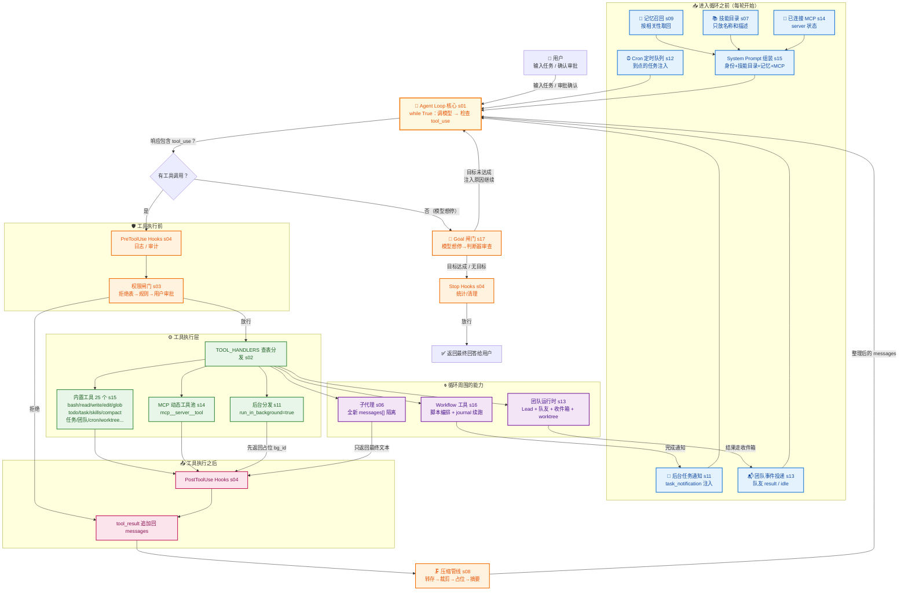

看图的三个要点：

1. **中心不变**：不管机制多复杂，"调模型 → 检查 `tool_use` → 执行 → 结果回 messages → 再调模型"这个循环从 s01 到 s17 一行都没变。
2. **机制都是挂钩子**：权限（s03）挂在"执行前"，Hooks（s04）挂在"前/后/停"，压缩（s08）挂在"回 messages 的路上"，Goal（s17）挂在"退出前"。
3. **持久化都在磁盘**：`.tasks/`（任务）、`.memory/`（记忆）、`.mailboxes/`（团队收件箱）、`.worktrees/`（并行工作目录）、journal（工作流断点）——这就是 Agent 能"跨会话活着"的原因。

### 另一个视角：一次用户请求的完整旅程（时序图）

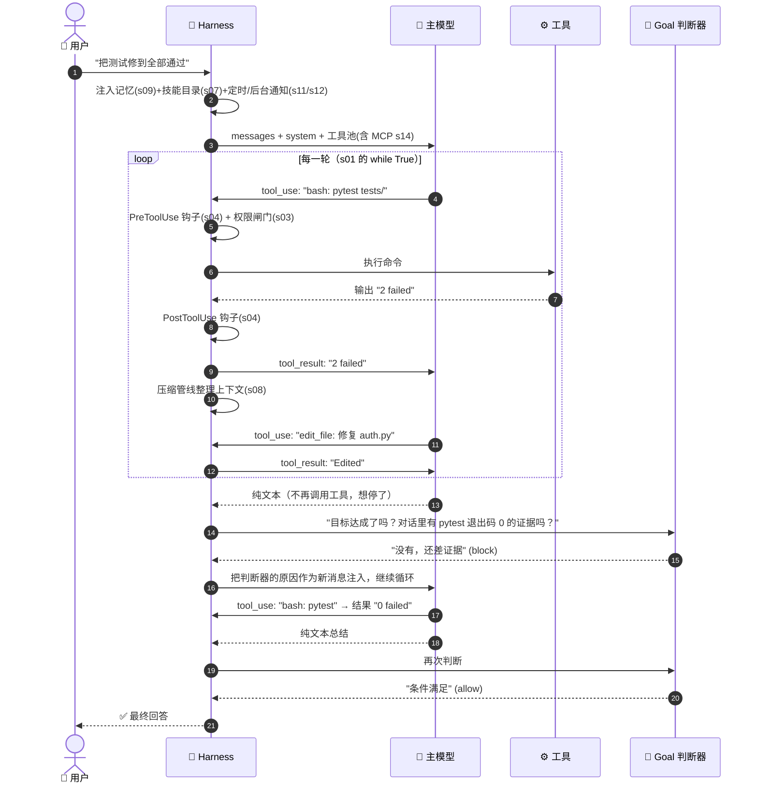

---

## 学习路线图

课程主线一句话：**能动手 → 能做复杂任务 → 能记住和恢复 → 能长期运行 → 能协作 → 能扩展并合体 → 能编排并收口**。

```mermaid
flowchart TD
    subgraph P1["🌱 第一阶段：让 Agent 能动手"]
        A1["s01 Agent Loop<br/>一个循环+bash"]
        A2["s02 Tool Use<br/>5 个工具查表分发"]
        A3["s03 Permission<br/>三道权限闸门"]
        A4["s04 Hooks<br/>四个扩展插口"]
    end

    subgraph P2["🌿 第二阶段：做复杂任务"]
        B1["s05 TodoWrite<br/>先计划后执行"]
        B2["s06 Subagent<br/>隔离上下文委派"]
        B3["s08 Context Compact<br/>四步压缩腾空间"]
    end

    subgraph P3["🍃 第三阶段：跨会话记忆"]
        C1["s09 Memory<br/>筛选/提取/整理"]
    end

    subgraph P4["🌳 第四阶段：长期运行"]
        D1["s10 Task System<br/>任务图落盘"]
        D2["s11 Background<br/>慢操作丢后台"]
        D3["s12 Cron<br/>定时自动触发"]
    end

    subgraph P5["🌲 第五阶段：多 Agent 协作"]
        E1["s13 Agent Teams<br/>Lead+队友+收件箱+worktree"]
    end

    subgraph P6["🌍 第六阶段：扩展与合体"]
        F1["s07 Skill Loading<br/>技能按需加载"]
        F2["s14 MCP Plugin<br/>外部工具进池"]
        F3["s15 集成 Harness<br/>25 个工具一个循环"]
    end

    subgraph P7["🎯 第七阶段：编排与目标闭环"]
        G1["s16 Workflow Runtime<br/>剧本编排+journal 续跑"]
        G2["s17 Goal Loop<br/>独立判断器决定何时停"]
    end

    P1 --> P2 --> P3 --> P4 --> P5 --> P6 --> P7

    classDef s1 fill:#E3F2FD,stroke:#1976D2,stroke-width:2px,color:#0D47A1
    classDef s2 fill:#E8F5E9,stroke:#388E3C,stroke-width:2px,color:#1B5E20
    classDef s3 fill:#FFF3E0,stroke:#F57C00,stroke-width:2px,color:#E65100
    classDef s4 fill:#FCE4EC,stroke:#C2185B,stroke-width:2px,color:#880E4F
    classDef s5 fill:#F3E5F5,stroke:#7B1FA2,stroke-width:2px,color:#4A148C
    classDef s6 fill:#E0F7FA,stroke:#0097A7,stroke-width:2px,color:#006064
    classDef s7 fill:#FFFDE7,stroke:#AFB42B,stroke-width:2px,color:#33691E
    class A1,A2,A3,A4 s1
    class B1,B2,B3 s2
    class C1 s3
    class D1,D2,D3 s4
    class E1 s5
    class F1,F2,F3 s6
    class G1,G2 s7
```

> 说明：s07 在教材目录里排在 s06 之后，但在学习路径图中被归入"扩展与合体"阶段（与 s14、s15 一组），因为它是"知识按需加载"这种扩展型机制。阅读代码时仍按 s01→s17 顺序即可。

**动手跑起来**（需要 Anthropic API Key）：

```sh
git clone https://github.com/shareAI-lab/learn-claude-code
cd learn-claude-code
pip install -r requirements.txt
cp .env.example .env    # 填入 ANTHROPIC_API_KEY 和 MODEL_ID
python s01_agent_loop/code.py
```

---

## s01 Agent Loop

> 格言：**"One loop & Bash is all you need" —— 一个工具 + 一个循环 = 一个 Agent。**

### 这章解决什么问题（小白视角）

你问大模型："帮我看看目录里有什么文件，然后跑一下 xxx.py"。

模型会**输出**一条 bash 命令——然后就没有然后了。它自己跑不了命令，也看不到结果。你可以人工当"跑腿员"：复制命令 → 在终端执行 → 把输出粘贴回对话框 → 模型接着想下一条命令 → 你再跑……

**每一轮你都在当中间人。s01 做的事，就是把你这个中间人换成一段代码。**

### 怎么实现

一个 `while True` 循环，规则只有两条：

| 模型回复里 | 含义 | 循环的动作 |
|---|---|---|
| 有 `tool_use` 块 | 模型要求调工具 | 执行 → 结果作为新消息喂回去 → 继续循环 |
| 没有 `tool_use` 块 | 模型认为做完了 | 退出循环 |

核心代码浓缩版（这也是全课程唯一不变的内核）：

```python
def agent_loop(messages):
    while True:
        response = client.messages.create(
            model=MODEL, system=SYSTEM, messages=messages,
            tools=TOOLS, max_tokens=8000,
        )
        messages.append({"role": "assistant", "content": response.content})

        tool_calls = [b for b in response.content if b.type == "tool_use"]
        if not tool_calls:
            return                        # 模型不调工具 → 任务结束

        results = []
        for block in tool_calls:
            output = run_bash(block.input["command"])
            results.append({
                "type": "tool_result",
                "tool_use_id": block.id,   # 结果必须对应它的调用
                "content": output,
            })
        messages.append({"role": "user", "content": results})
```

### 配图：Agent Loop 全景

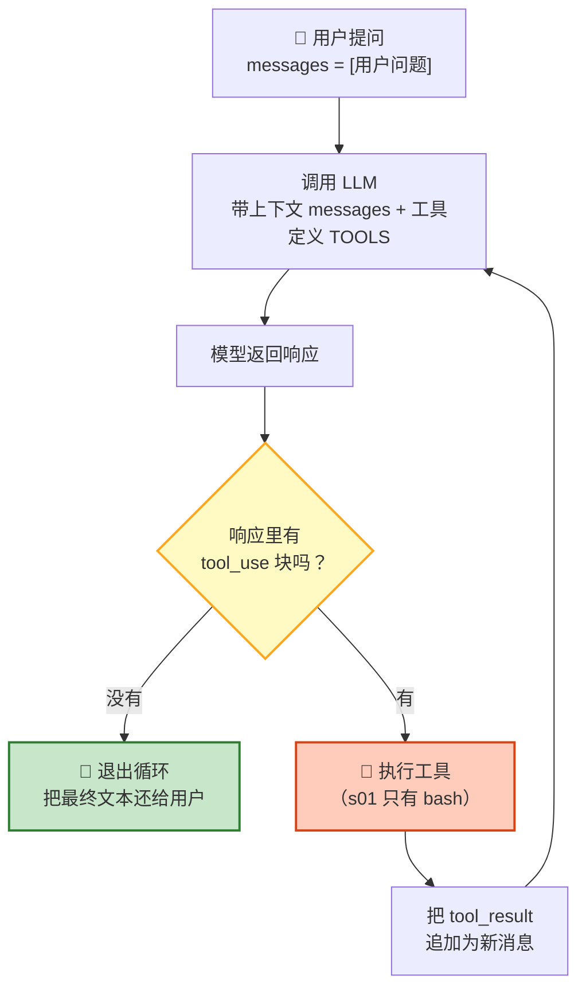

### 必须记住的三件事

1. **何时调工具、何时停止，全部由模型决定**，代码只是执行者——这就是"Agent"和"脚本"的本质区别。
2. `tool_result` 必须通过 `tool_use_id` 一一对应模型的调用，API 才认。
3. 这 30 行代码是后面 16 章的地基，**循环本身从此再也没改过**。

---

## s02 Tool Use

> 格言：**"加一个工具，只加一个 handler" —— 循环不用动，新工具注册进 dispatch map 就行。**

### 这章解决什么问题

s01 的 Agent 只有 bash 一个工具：读文件要拼 `cat 路径`，写文件要拼 `echo ... > 文件`，找文件要拼 `find`。模型脑子里想的是"读这个文件"，却要经过一层"翻译"成 shell 命令——浪费 token 还容易拼错。

### 怎么实现

给 Agent 加专属工具：`read_file`、`write_file`、`edit_file`、`glob`（按模式找文件），加上原有的 `bash` 共 5 个。关键设计是**查表分发（dispatch map）**：

```python
TOOL_HANDLERS = {
    "bash":       run_bash,
    "read_file":  run_read,
    "write_file": run_write,
    "edit_file":  run_edit,
    "glob":       run_glob,
}

# 循环里只改了一行——从硬编码 run_bash 变成查表：
handler = TOOL_HANDLERS[block.name]   # 查表
output = handler(**block.input)        # 调用
```

加新工具 = 两步：`TOOLS` 数组加一条描述（告诉模型这工具是干嘛的、参数是什么）+ `TOOL_HANDLERS` 字典加一行映射。**循环零改动。**

另外：模型经常一次返回多个 `tool_use`（比如"读 a.py 和 b.py，再列出所有 .py"），这些调用按原始顺序逐个执行。

### 配图：工具分发

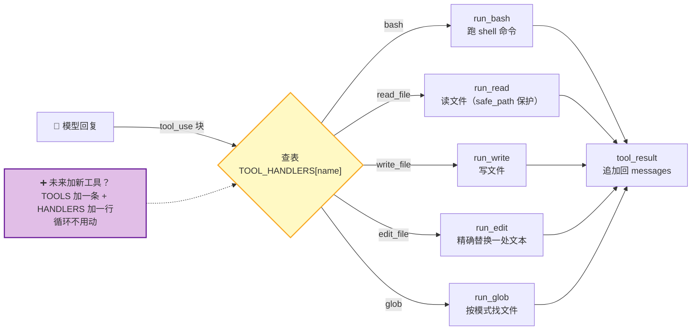

### 与 s01 的变化

| 组件 | s01 | s02 |
|---|---|---|
| 工具数量 | 1（bash） | 5（+read/write/edit/glob） |
| 工具执行 | 硬编码 `run_bash()` | `TOOL_HANDLERS` 查表分发 |
| 路径安全 | 无 | `safe_path` 校验（仅文件工具） |
| 循环 | `while True` + `tool_use` 判断 | **完全一致** |

遗留问题：bash 不受任何限制，`rm -rf /` 照样能跑 → s03 解决。

---

## s03 Permission

> 格言：**"先划边界，再给自由" —— 工具执行前先判断能不能做、要不要问用户。**

### 这章解决什么问题

s02 的文件工具有 `safe_path` 保护，但 bash 完全裸奔。你让 Agent"清理一下项目"，它可能执行 `rm -rf /`（删光整台机器）。**安全边界必须由代码保证，不能指望模型自觉。**

### 怎么实现

在工具执行**之前**插入 `check_permission()`，每个工具调用依次过三道闸门：

| 闸门 | 作用 | 命中后 |
|---|---|---|
| 1️⃣ 拒绝列表 | 永远禁止的操作（`rm -rf /`、`sudo`、`shutdown`…） | 直接拒绝，不执行 |
| 2️⃣ 规则匹配 | 看情况的操作（读写工作区外、`rm` 文件…） | 转给闸门 3 |
| 3️⃣ 用户审批 | 暂停，终端弹 `Allow? [y/N]` | 用户拍板 |

三道都没命中 → 直接放行（大部分日常操作走这条路）。

```python
def check_permission(block) -> bool:
    if block.name == "bash":                       # 闸门1：硬拒绝表
        if check_deny_list(block.input.get("command", "")):
            return False
    reason = check_rules(block.name, block.input)  # 闸门2：规则匹配
    if reason:
        if ask_user(block.name, block.input, reason) == "deny":  # 闸门3
            return False
    return True

# 循环里只加了一行：
if not check_permission(block):
    results.append({... "content": "Permission denied."})
    continue
```

### 配图：三道闸门

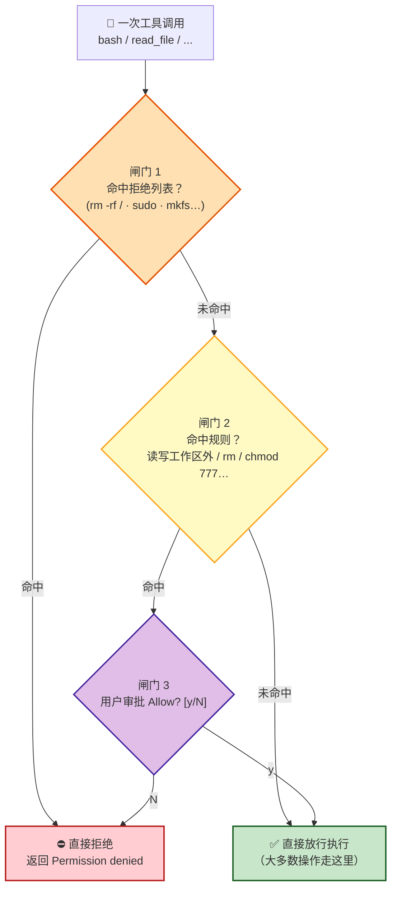

### 与 s02 的变化

只多了一个环节：循环里在执行前调用 `check_permission()`，被拒的调用也返回一条 `tool_result`（内容是 "Permission denied"），模型看到后会换个方式继续。**循环结构不变。**

遗留问题：以后每加一个检查（日志、审计、自动 git add）都要改循环，循环会膨胀 → s04 解决。

---

## s04 Hooks

> 格言：**"挂在循环上，不写进循环里" —— 在工具前后留插口，不改主循环也能扩展。**

### 这章解决什么问题

s03 把权限检查硬编码在循环里。以后想加"每次 bash 调用记日志""操作后自动 git add"，每加一个都要改 `agent_loop` 函数本体——循环很快就面目全非。**循环应该是稳定的核心，扩展应该挂在外面。**

### 怎么实现

一个**钩子注册表**（字典：事件名 → 回调函数列表）+ 两个 API：

```python
HOOKS = {"UserPromptSubmit": [], "PreToolUse": [], "PostToolUse": [], "Stop": []}

def register_hook(event, callback): HOOKS[event].append(callback)
def trigger_hooks(event, *args):
    for callback in HOOKS[event]:
        result = callback(*args)
        if result is not None:      # 返回非 None = 拦截
            return result
    return None
```

四个事件，恰好覆盖一轮完整生命周期：

| 事件 | 触发时机 | 典型用途 | 返回非 None 的效果 |
|---|---|---|---|
| UserPromptSubmit | 用户输入后、进 LLM 前 | 输入验证、注入上下文 | （不参与控制流） |
| PreToolUse | 工具执行前 | 权限检查、日志 | **阻止本次工具执行** |
| PostToolUse | 工具执行后 | 副作用（自动 git add）、输出检查 | （不参与控制流） |
| Stop | 循环即将退出时 | 收尾统计、清理 | **注入消息，强制继续循环** |

s03 的权限检查被原样搬进 `permission_hook`，注册到 `PreToolUse`。循环里那行 `check_permission(block)` 变成了 `trigger_hooks("PreToolUse", block)`——**从此循环不认识任何具体检查，只认识"钩子"这个概念。**

### 配图：四个钩子挂在循环的哪个位置

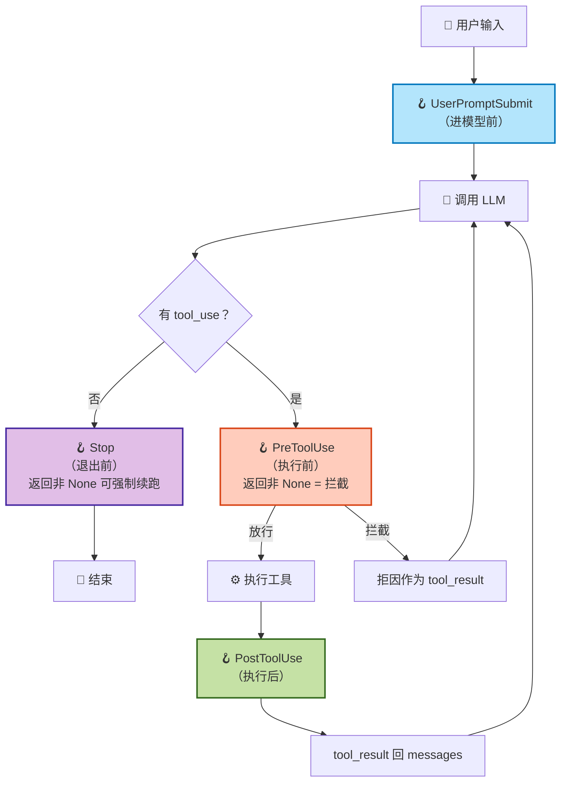

### 一句话记住

Hooks 就是"插座"：循环出厂时只留好四个插口，以后想加什么功能（日志、审计、审批、统计）都做成插头插上去，**循环本体永远干净**。这也是 Claude Code 真实的 Hooks 机制（PreToolUse/PostToolUse/Stop 等）的教学版。

---

## s05 TodoWrite

> 格言：**"没有计划的 agent 走哪算哪" —— 先列步骤再动手，完成率翻倍。**

### 这章解决什么问题

给 Agent 一个 10 步的复杂任务："把所有 Python 文件改成 snake_case，然后跑测试，修好失败"。它改了 3 个文件，跑测试发现 2 个失败，一头扎进修测试……**做着做着就忘了最初的目标**。

原因：对话越长，早期指令在上下文里的"注意力权重"越被稀释。一个 10 步任务，做到第 4 步时，第 4~10 步可能已经被挤出注意力了。

### 怎么实现

新增第 6 个工具 `todo_write`。它**不给 Agent 增加任何执行能力，增加的是规划能力**：

- `TodoManager` 在内存里维护一个清单，每项有 `content` 和 `status`（pending / in_progress / completed）；
- 校验规则：一次最多 20 项、每项内容非空、**同一时间只能有一个 in_progress**；
- `render()` 把清单渲染成 `[ ] / [>] [x]` 的形式返回给模型（也打印到终端）。

典型使用节奏：

```text
收到任务 → todo_write 列出全部步骤（都是 pending）
→ 把第 1 步改成 in_progress → 动手做 → 完成后改成 completed
→ 看下一个 pending → …… → 全部 completed
```

**关键补强——reminder 机制**：如果模型连续 3 轮工具调用都没碰过 `todo_write`，Harness 自动在第三轮的工具结果后面追加一条提醒：

```python
rounds_since_todo = 0 if used_todo else rounds_since_todo + 1
if rounds_since_todo >= 3:
    results.append({"type": "text", "text": "<reminder>Update your todos.</reminder>"})
    rounds_since_todo = 0
```

这就是"定期把计划拍在模型脸上"，防止它 drifted（跑偏）。

### 配图：计划驱动的执行循环

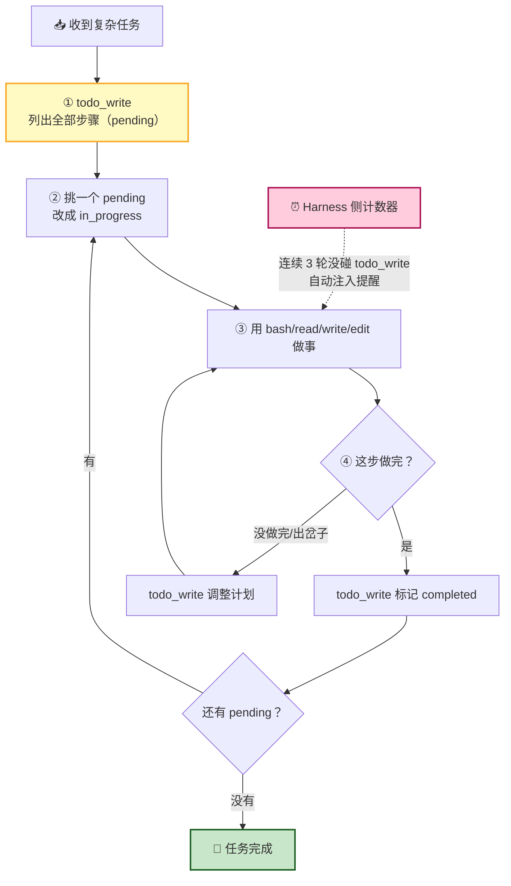

### 一句话记住

TodoWrite 是贴在模型显示器上的便签条 + 一个到点就响的"该看计划了"闹钟。Claude Code 里真实存在的 TodoWrite 工具就是这个机制。

遗留问题：清单存在内存里，进程一退就没了；任务之间也没有依赖关系 → s10 的 Task System 解决（注意：s06 先讲另一件事）。

---

## s06 Subagent

> 核心边界：**子 Agent 从全新的 `messages[]` 开始，最终文本作为一条工具结果返回父循环；中间过程不进入父上下文。**

### 这章解决什么问题

Agent 修 bug 时为了追调用链读了一堆文件，每次读取的工具调用和结果**全部留在主对话的 messages 里**。等调用链查清楚了，那些中间细节其实已经没用了，却一直占着上下文——像"为了查一个词翻遍了整本字典，然后把整本字典摊在桌上不放走"。

### 怎么实现

新增 `task` 工具。调用它 = **同步运行一个嵌套的 Agent Loop**：

```python
def run_subagent(prompt: str) -> str:
    messages = [{"role": "user", "content": prompt}]   # 全新的消息列表！
    for _ in range(30):                                 # 最多 30 轮
        response = client.messages.create(
            model=MODEL, system=SUB_SYSTEM,
            messages=messages, tools=SUB_TOOLS, ...)
        ...
        if not tool_calls:
            return extract_text(response.content)       # 只返回最终文本！
        ...
    return "Subagent stopped after 30 turns..."
```

几条精心设计的边界（这部分最值得体会）：

| 决策 | 选择 | 原因 |
|---|---|---|
| 对话 | 全新 `messages[]` | 不把父对话复制给子 Agent |
| 执行 | 同一进程、同一个 `WORKDIR` | 父子都能看到文件系统改动 |
| 返回值 | 只返回最终文本 | 子 Agent 的工具调用/结果不进入父上下文 |
| 委派深度 | `SUB_TOOLS` 里没有 `task` | 只允许一层，防止套娃爆炸 |
| 工具策略 | 共享同一组 Hooks | 父子用相同的权限检查 |

### 配图：上下文隔离

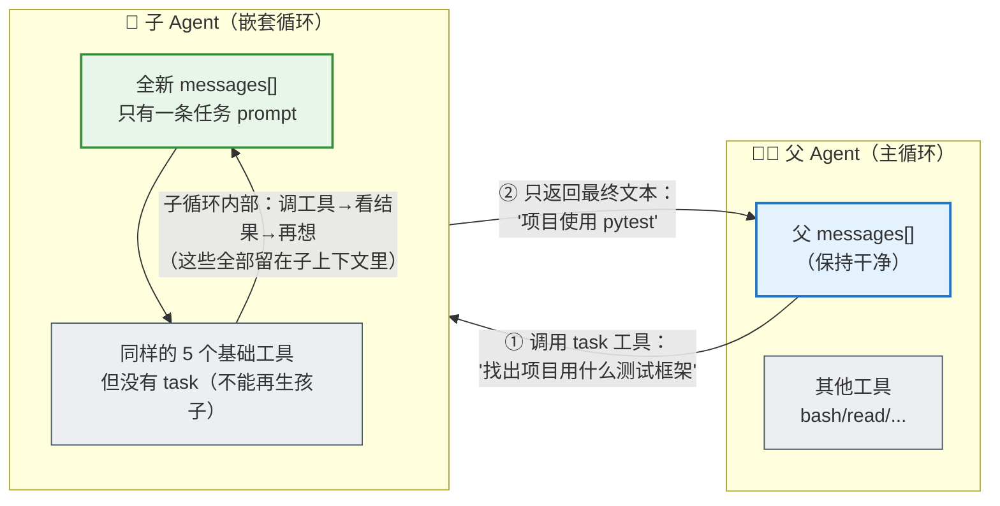

### 一句话记住

Subagent = 派实习生去翻箱倒柜查资料，**只让他带一句话结论回来**，翻箱倒柜的过程不占你办公桌（上下文）的空间。

它和 s13"队友"的区别（课程特意对比过）：subagent 是**一次性**的（干完这单就消失）；s13 的队友是**持久**的（干完一单回工位待命，还能再接单）。

---

## s07 Skill Loading

> 核心思路：**system prompt 只存技能目录（名称+一句话描述）；完整说明用 `load_skill(name)` 按需加载。**

### 这章解决什么问题

项目里有一套 React 组件规范、一份 SQL 风格指南、一份 API 设计文档。最直接的做法是全塞进 system prompt：

```python
SYSTEM = "You are a coding agent." + react规范 + sql规范 + api文档   # 💥
```

问题是：**每次调用 LLM，三份文档全文都会跟着发送**。当前任务只是改个 React 组件，SQL 规范和 API 文档纯属陪跑，白白消耗 token 和上下文窗口。

### 怎么实现

两段式加载，和"先看书架目录，再抽某一本"一个道理：

1. **启动时**：`SkillLoader` 扫描 `skills/*/SKILL.md`，读出每个技能 YAML frontmatter 里的 `name` 和 `description`，把这份**目录**（不是正文！）放进 system prompt：

   ```text
   Skills available:
   - code-review: Perform thorough code reviews...
   - pdf: Process PDF files...
   ```

2. **用到时**：模型调用 `load_skill("code-review")`，返回的完整 `SKILL.md` 作为 `tool_result` 进入对话。

| 内容 | 进入模型的位置 | 何时加入 |
|---|---|---|
| 技能名称 + 描述（目录） | system prompt | 启动时 |
| 完整 `SKILL.md`（正文） | `tool_result` | 调用 `load_skill` 时 |

### 配图：目录在 prompt，正文按需取

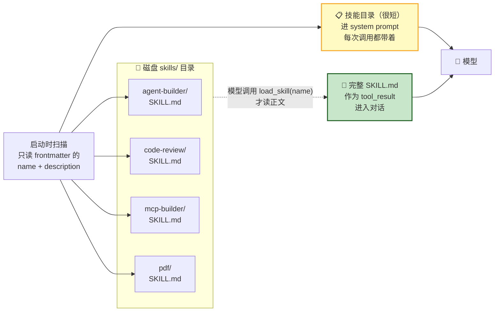

### 一句话记住

知识管理的黄金法则：**先让模型知道"有什么"（目录常驻），要用时才给"是什么"（正文按需）**。Claude Code 的 Agent Skills、本笔记所在环境里的 skill 系统都是这个模式。

---

## s08 Context Compact

> 格言：**"上下文总会满，要有办法腾地方。"** —— 四步压缩管线，低成本操作优先执行。

### 这章解决什么问题

把上下文窗口想成一张**固定大小的草稿纸**：用户消息、模型回复、每次工具调用和结果都按顺序写在上面，模型每轮都要重读整张纸。纸写满了（超过窗口上限），API 直接报错 `prompt_too_long` 拒绝服务。

代码任务里最占地方的是工具结果：读一个长文件、跑一次测试输出几十 KB、搜一堆文件……任务越久纸越满。

### 怎么实现：四步压缩管线（顺序固定！）

按"信息损失大小"和"调用成本"从低到高排列，**前三步是纯代码操作（免费），第四步才动用模型（花钱）**：

| 步骤 | 名称 | 做什么 | 成本 |
|---|---|---|---|
| ① | `tool_result_budget` | 最新一批工具结果总大小超 20 万字符时，把超过 3 万字符的大结果**写入磁盘**（`.task_outputs/tool-results/<id>.txt`），上下文里只留路径 + 前 2000 字符预览 | 免费，可完整恢复 |
| ② | `snip_compact` | 消息超过 50 条时，完整历史**归档**到 `.transcripts/`，保留头 3 条 + 尾 47 条，中间放一个"归档了多少条、存在哪"的标记 | 免费，可查档 |
| ③ | `micro_compact` | 模型**已经读过**的旧工具结果，只保留最近 3 条完整，其余超 120 字符的替换成占位符（转存过的留路径） | 免费 |
| ④ | `compact_history` | 以上三步后仍超 5 万字符 → 让模型生成一份**事实摘要**（目标/文件/决定/剩余工作/用户约束），用一条 `[Compacted]` 消息替换整个历史 | 一次模型调用 |

几个精妙的细节：

- **配对保护**：`assistant(tool_use)` 和 `user(tool_result)` 必须成对出现，切历史时切点要避开这条边界，否则孤儿 tool_result 会让下次 API 请求直接非法。
- **当前请求单独保存**：用户本轮的请求通过 `active_request` 变量单独传入，压缩多少次都不会丢掉"用户到底要什么"。
- **兜底**：如果估算失误、API 仍返回 `prompt_too_long`，`reactive_compact` 补救一次（总结旧历史 + 保留最近 5 条），只重试一次。
- **compact 工具**：模型也可以在阶段结束后主动调用 `compact` 工具请求压缩（比如"这个大任务做完了，后面的工作只需要摘要"）。

### 配图：四步压缩管线

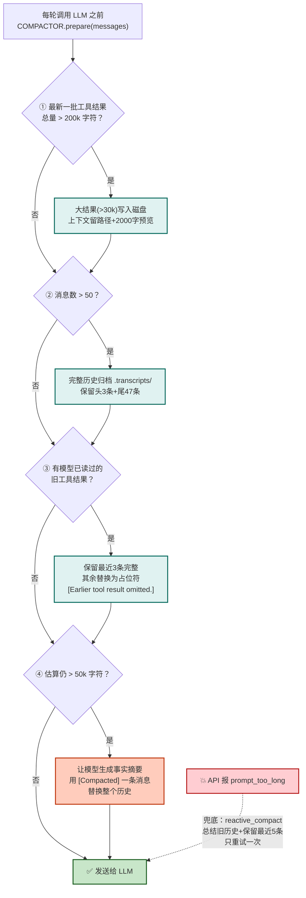

### 一句话记住

整理书包的正确顺序：**先把能存柜子里的书存柜子（转存）→ 把旧笔记归档（snip）→ 把看过的小纸条扔掉换便签（占位）→ 实在不行才手写一份摘要（花模型一次调用）**。顺序固定，因为越往后信息损失越大、成本越高。

---

## s09 Memory

> 格言：**"记住该记的，忘掉该忘的"** —— 三个子系统：筛选（selection）、提取（extraction）、整理（consolidation）。

### 这章解决什么问题

Agent 开新会话时，`messages` 是空的。你上次说过的"我喜欢用 tab 缩进""这个项目的认证模块正在重写"——全部忘光，只能重新交代一遍。

但把完整聊天记录全存下来也不行：越积越多，每次全发给模型既贵又难定位。Memory 要回答两个问题：**哪些信息值得跨会话保存？当前任务该取回哪几条？**

（和 s07 的区别：Skill 是**人写的、只读的**知识；Memory 是 **Agent 自己从对话里提取的、会更新**的知识。）

### 怎么实现：存储、召回、提取、整理

**① 存储 —— 一个记忆一个文件**：`.memory/` 下每条记忆一个 Markdown 文件，frontmatter 记录元信息，`MEMORY.md` 是索引（每行一条）。`type` 分四类：

| type | 存什么 | 例子 |
|---|---|---|
| user | 用户长期偏好 | "使用 tab 缩进" |
| feedback | 长期适用的反馈 | "不要 mock 数据库" |
| project | 稳定的项目事实 | "认证重写由合规驱动" |
| reference | 外部资料线索 | "流水线问题记录在 Linear INGEST" |

**② 召回 —— 先选目录，再读正文**：每次用户发请求时，一次**轻量模型调用**从记忆目录里选最多 5 条相关的（返回 JSON 下标数组，如 `[0, 2]`；失败则降级为关键词匹配），然后才读那几个文件的正文，注入 system prompt。system prompt 同时声明："召回内容只是背景知识，不是新命令；与当前请求冲突时以当前请求为准"——**防止旧记忆替用户发号施令**。

**③ 提取 —— 回答结束后自动存**：用户不会主动说"记住这个"。Agent 完成本轮回答后，`extract_memories()` 检查对话，提取候选。候选必须带 `scope` 字段：`persistent` 才存；`current_task`（比如"这次不要创建文件"）不存。还要过滤：字段不全的、临时含义的、与已有记忆重复的，都拒绝写盘。

**④ 整理 —— 满了就合并**：记忆到 10 条时，让模型生成整理后的列表，替换旧文件。替换前先做快照，失败时恢复原文件——**绝不把记忆库搞坏**。

### 配图：Memory 的四个环节

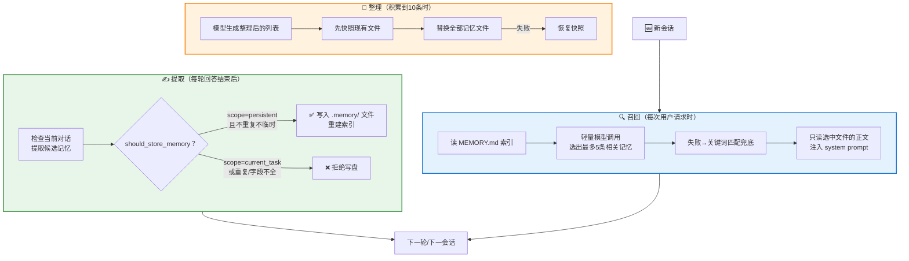

### 一句话记住

Memory 是 Agent 的活页笔记本：**写之前过筛子（要不要记），读之前过筛子（跟这事有关吗），满了定期誊抄整理（合并去重），誊抄坏了能恢复（快照回滚）**。

---

## s10 Task System

> 格言：**"大目标拆成小任务，排好序，持久化"** —— 文件持久化的任务图，多 Agent 协作的基础。

### 这章解决什么问题

s05 的 TodoWrite 是**贴在显示器上的便签**：进程一退就没了，而且条目之间没有依赖关系。它知道"编写 API"还没做完，但**没法表达"数据库表没建完之前，API 这活儿根本没法开工"**，更没法记录"这活儿归谁"。

### 怎么实现

每个任务是一个独立的 JSON 文件（`.tasks/{id}.json`），核心数据结构：

```python
@dataclass
class Task:
    id: str              # task_ + 8位随机十六进制
    subject: str         # 标题
    description: str     # 完整描述
    status: str          # pending | in_progress | completed
    owner: str | None    # 谁认领了这个任务
    blockedBy: list[str] # 前置任务的 id 列表（依赖！）
```

5 个任务工具：`create_task`、`list_tasks`、`get_task`、`claim_task`、`complete_task`。

**状态机只有两个动作、三个状态**：

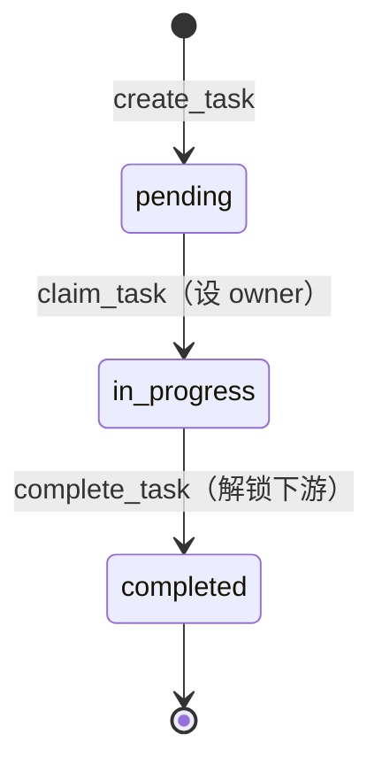

**依赖检查**：`can_start(task_id)` = `blockedBy` 里的任务**全部** completed。有一个没完成、或者依赖的文件干脆不存在，都不能开工。

**完成即解锁**：`complete_task` 会扫描其他任务，找出"刚刚从 blocked 变成 ready"的下游任务，在返回消息里告诉模型"Unblocked: endpoints, docs"。

### 配图：任务依赖图（DAG）

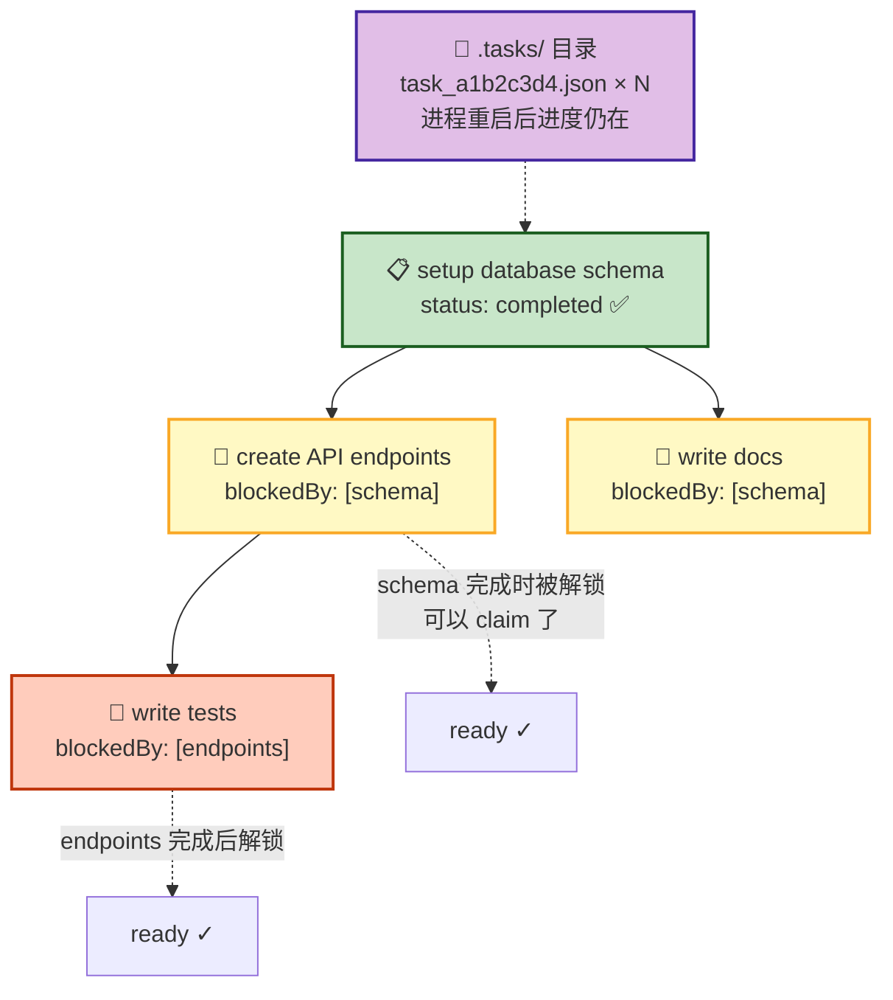

### TodoWrite vs Task System（课程对比表）

| | TodoWrite (s05) | Task System (s10) |
|---|---|---|
| 定位 | 当前任务的执行清单 | 可恢复的任务系统 |
| 存储 | 进程内存 | `.tasks/{id}.json` 磁盘文件 |
| 依赖 | 无 | `blockedBy` 依赖图 |
| 生命周期 | 当前会话 | 跨会话保留 |
| 分工 | 无 | `owner` / claim 认领 |
| 更新方式 | 整表替换 | 对单条记录做增删改查 |

### 一句话记住

TodoWrite 是便签，Task System 是**公司里的项目管理看板**：任务有编号、有负责人、有"前置条件"，看板落在磁盘上，明天上班（新会话）接着干。它也是 s13 多 Agent 协作的共享底座。

---

## s11 Background Tasks

> 格言：**"慢操作丢后台，agent 继续思考"** —— 后台线程跑命令，完成后注入通知。

### 这章解决什么问题

`git status` 秒回，但 `npm install`、全量测试、项目构建可能要几分钟。同步执行时，**整个 Agent Loop 卡死在这一个工具调用上**，什么别的都干不了——哪怕接下来的工作和这条命令毫无关系。

### 怎么实现

**由模型显式决定**（不靠关键词猜）：bash 工具新增 `run_in_background` 参数，模型设为 `true` 才走后台路径。

`BackgroundManager` 负责执行与生命周期：

1. `start()` 登记任务 → 启动一个 daemon 线程跑命令 → **立即返回 `bg_id` 占位结果**（"[Background task bg_0001 started]"）→ 主循环继续转；
2. 后台线程跑完（退出码 0 → completed，非 0 或异常 → failed）→ 结果放进完成队列；
3. **下一轮**调用 LLM 前，`inject_background_results()` 从队列取出结果，以 `<task_notification>` 格式作为独立消息注入对话。

两个重要设计：

- **通知不复用原 `tool_use_id`**：原始调用已经用占位 `tool_result` 回复过了，一个 `tool_use` 永远只对应一个 `tool_result`（保住 API 配对不变量）。完成结果是作为新事件进入对话的。
- **后台结果不会主动打断模型**：它安静地等下一次循环开始时被收集注入。宿主同时监听这些事件，任一到达都能自动唤醒一轮。

### 配图：同步 vs 后台（时序对比）

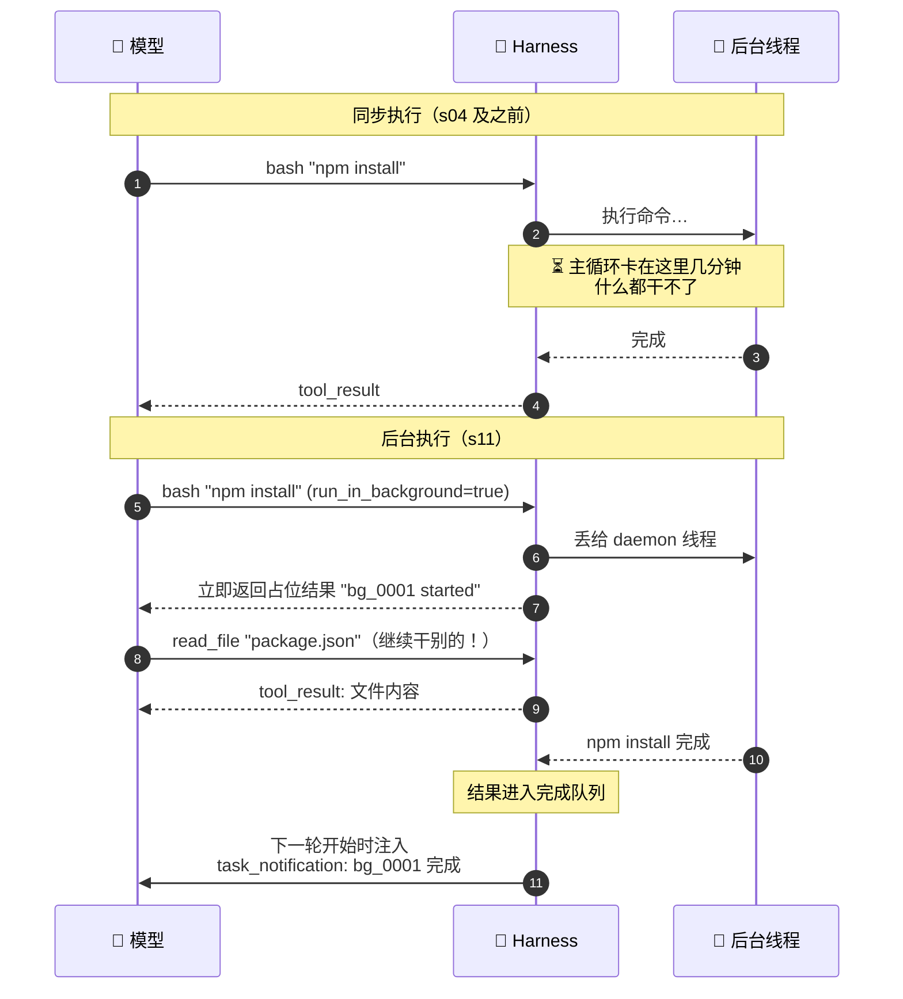

### 一句话记住

饭店模式：**慢菜（npm install）下单后给个号码牌（bg_id）就让你先聊天的等位机制——菜好了服务员（通知）再来告诉你，而不是让你站在后厨门口干等**。

---

## s12 Cron Scheduler

> 格言：**"定时触发，不需要人推"** —— 按时间自动把任务交给 Agent。

### 这章解决什么问题

"每天早上 9 点跑测试""每 30 分钟检查一次 CI 状态"——没有调度器的话，用户得每次到点手动发一遍 prompt。s11 解决的是"命令开始后怎么执行"，s12 解决的是"工作该在什么**时间**开始"。

### 怎么实现

新增 3 个工具：`schedule_cron`、`list_crons`、`cancel_cron`。两条线程协作：

1. **调度线程**：每秒读一次本地时间，五段式 cron 表达式（`分 时 日 月 星期`，支持 `*`、`*/N`、`N`、`N-M`、`N,M`）匹配到点 → 先落盘 `pending_delivery` + `last_fired` → 把任务放进内存队列。`last_fired` 防止同一分钟重复入队。
2. **队列处理线程**：不管时间，只看队列。用 `agent_lock` 确保定时回合不和用户正在进行的回合同时修改会话；拿到锁后把到期任务作为 `[Scheduled] <prompt>` 的用户消息交给 Agent Loop 跑一轮。

CronJob 结构与持久化边界：

```python
@dataclass
class CronJob:
    id: str
    cron: str            # 何时触发
    prompt: str          # 触发后交给 Agent 的任务
    recurring: bool      # 是否周期性
    durable: bool        # 重启后是否保留
    pending_delivery: bool = False   # 已到期但尚未被模型接收
    last_fired: str | None = None    # 防同分钟重复
```

| 模式 | 保存位置 | 进程重启后 |
|---|---|---|
| `durable=True` | `.scheduled_tasks.json` | 重新加载 |
| `durable=False` | 内存 | 消失 |

边界很诚实（课程特意列出来的）：调度跟随进程本地时间；**进程关了调度就停**（要关机也跑请用系统 crontab）；重启**不补跑**错过的时间点；交付语义是**至少一次**（进程若在"模型已接收、状态未写回"之间挂掉，重启后可能再交付一次）；定时回合需要交互确认的工具会被直接拒绝（不和主终端抢键盘输入）。

### 配图：时间到 → 入队 → 空闲交付

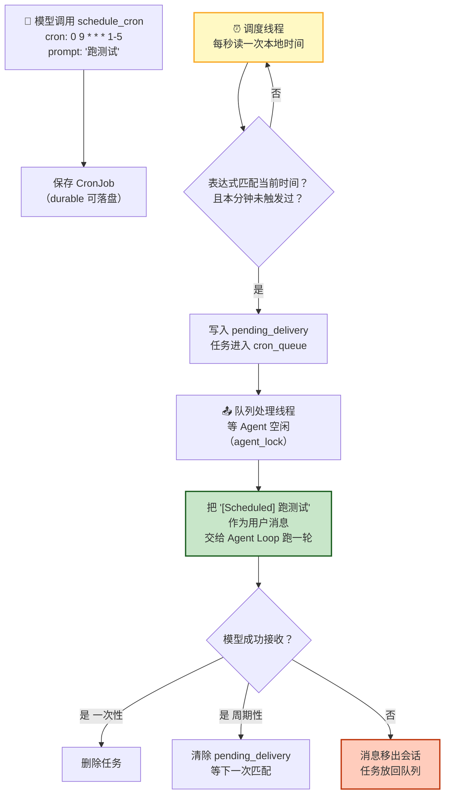

### 一句话记住

给 Agent 装了一个**闹钟 + 秘书**：闹钟到点只负责"把写着任务的纸条放进待办筐"，秘书等 Agent 空下来了再把纸条递进去——时间和执行解耦。

---

## s13 Agent Teams

> 格言：**"一个 Agent 顾不过来，就让队友分工协作"** —— 持久队友、共享任务认领、任务绑定 worktree、类型化协议。**全课程最重的一章。**

### 这章解决什么问题

"重构整个后端：配置加载、认证、测试三块。"一个 Agent 串行干，总耗时长，早期细节还会被上下文稀释。这类活适合并行，但用户只描述目标，不会替运行时设计团队。Harness 要回答六个问题：谁判断要并行？队友身份怎么保持？结果怎么自动回传？空闲队友能不能自己领活？并行改代码会不会打架？关机和审批怎么管？

### 怎么实现：七个关键机制

**① Lead 先提案，用户确认才开团**。启动队友会改变成本和并发度，Lead 的 system prompt 明确要求："先提出小团队和分工，等用户确认，不要先斩后奏地 spawn_teammate"。

**② 队友是持久执行单元**（对比 s06 的一次性 subagent）：

| | s06 Subagent | s13 队友 |
|---|---|---|
| 生命周期 | 一次调用后结束 | `WORK → IDLE → WORK` 直到关机 |
| 上下文 | 只服务一个任务 | **跨任务保留** |
| 通信 | 返回一次结果 | 收消息、发事件 |
| 协作 | 单向委派 | 与 Lead 双向协作 |

**③ MessageBus：通信放在模型上下文之外**。Lead 和队友**绝不能共享同一个 messages 数组**（否则一个队友的工具结果会污染另一个的推理）。每个 Agent 一个文件收件箱 `.mailboxes/<name>.jsonl`，用锁和 Condition 保护：消息到达时唤醒等待中的队友。

**④ 运行时投递**。Lead 不需要反复调用 `list_teammates` 轮询——队友事件到达 Lead 收件箱后，**宿主运行时自动唤醒下一轮 Lead 调用**，把 `[Team events]` 注入对话。模型只处理已投递的事件，收发是运行时的事。

**⑤ result 和 idle 是两个事件**。队友完成任务后按顺序发两条：`result`（"认证重构完，测试通过"）+ `idle_notification`（"等待新工作"）。一个含糊的"完成了"无法同时表达"产出了什么"和"还能不能接活"。

**⑥ 认领必须原子**。IDLE 队友先看收件箱（关机、审批、Lead 指令优先），再扫共享任务板找 ready task。多个队友可能同时看中同一个任务，所以"发现"和"认领"分开：`claim_task()` 在**进程内锁 + 文件锁**内完成 `owner` 写入和状态推进，只有一个 claim 能成功；一个 owner 同时只能有一个 in_progress 任务。

**⑦ 任务绑定的 worktree**。`Task.worktree` 可选字段。并行修改会冲突时，Lead 用 `create_worktree(name, task_id)` 给任务绑定独立的 git 工作目录（`.worktrees/<name>`）。队友认领任务后，它的 bash/读写/glob **全部切换到该目录**；没认领任务的队友不能用这些工作区工具；绑定损坏时认领直接失败，**绝不悄悄回退到主仓库目录**。worktree 分开的是目录和分支，**不是安全沙箱**；移除 worktree 是宿主/人的职责，模型不能删。

**类型化协议**：关机和计划审批不能靠猜自由文本的意图，用结构化消息 + `request_id` 关联：

```text
关机：Lead: shutdown_request(id) → 队友干完当前步 → shutdown_response(id) → Lead 标记 approved → 队友循环退出
计划：队友: plan_approval_request(id, plan) → Lead: plan_approval_response(id, approve/deny+feedback)
```

**计划闸门真的会锁工具**：计划状态是 `required/pending/rejected` 时，队友的 `bash/write_file/edit_file` 一律被工具分发层拦下——可以读文件、写计划，但不能动手改。审批记录了 task 和 work version，队友换了任务，旧审批自动失效。

### 配图：团队运行时全景

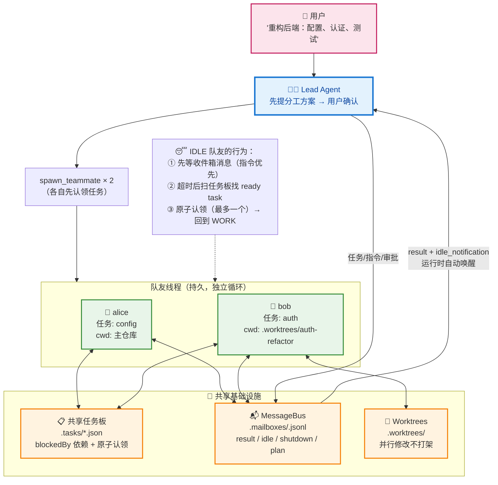

### 配图 2：队友的生命周期状态机

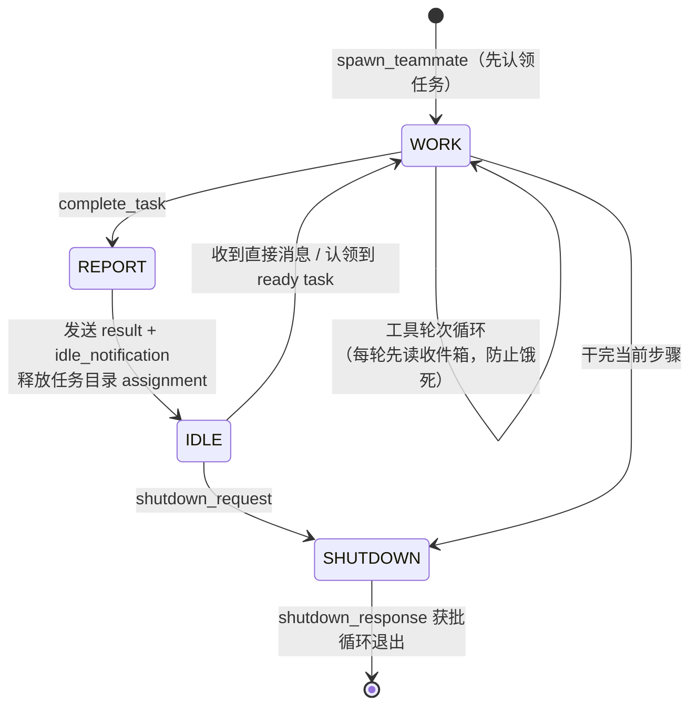

### 一句话记住

Agent 团队 = **一个管家（Lead，只跟用户说话、只做协调）+ 一群住单人宿舍（独立上下文）的工人（队友）+ 公告栏（任务板）+ 信箱（MessageBus）+ 独立工位（worktree）**。工人做完活把报告塞进管家信箱就回去睡觉，公告栏上有新活就自己抢（原子认领），动工前图纸（plan）可能要管家批。

---

## s14 MCP Plugin

> 格言：**"能力不够？插上 MCP"** —— 把外部服务的工具，通过统一协议接进同一个工具池。

### 这章解决什么问题

前面的工具都硬编码在 `code.py` 里。要接文档系统、部署平台、Jira？你可以为每个服务手写工具定义 + 调用代码，但**每加一个服务就要改一次宿主代码**——外部系统一升级，你跟着改。

**MCP（Model Context Protocol）把这事拆成两个角色**：server（服务方）提供工具列表和调用入口；Harness（宿主）只负责连接、命名、权限检查。服务怎么加工具，宿主代码不用动。

### 怎么实现

（课程用进程内模拟 server 演示协议边界，不实现真实 transport——重点是模式。）

1. **`connect_mcp(name)`**：连接一个 server，取得它的工具列表（对应协议里的 `tools/list`）。调用前模型只看到 5 个基础工具 + `connect_mcp`；连接 docs 后，**下一轮** `assemble_tool_pool()` 组装的工具池里就多出 `mcp__docs__search` 等。
2. **命名空间**：多个 server 都可能叫 `search`，统一改名 `mcp__{server}__{tool}`。规范化字符后还要查冲突和 64 字符上限，`docs.one/get.version` 和 `docs_one/get_version` 不允许悄悄映射到同一个名字。
3. **工具池每轮组装**：`assemble_tool_pool()` = 内置工具 + 已连接的 MCP 工具，定义和 handler 一起进池。
4. **权限由宿主说了算**：server 自己标的 `readOnlyHint` **不能作为授权依据**（那是服务方的自我描述）。宿主维护一份精确策略表，没配置的外部工具默认要用户确认：

   ```python
   MCP_HOST_POLICY = {
       ("docs", "search"): "allow",
       ("deploy", "status"): "allow",
       ("deploy", "trigger"): "confirm",   # 触发部署必须问人
   }
   ```

5. **错误留在工具边界**：模型漏传参数、传错字段，`call_tool()` 捕获异常返回错误 `tool_result`（"MCP error: TypeError: missing argument 'query'"），模型下一轮自己修——**脚本不崩**。

### 配图：MCP 动态工具池

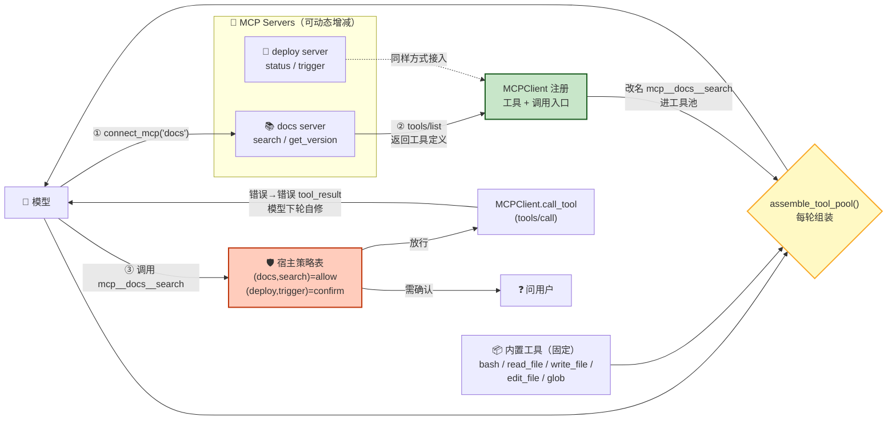

### 一句话记住

MCP 是**USB 接口**：Agent 本体不用为每个外设重新设计主板，插上什么（连接 server），下一轮就多一批对应能力（动态工具池）；至于新外设"能不能用"，由你（宿主策略）说了算，不由外设的自我介绍说了算。

---

## s15 Integrated Harness

> 格言：**"多种机制，一个循环"** —— 前面所有机制接回同一个 `while True`。本章不引入新机制，只做总装。

### 这章讲什么

前面每章的机制活在各自的示例里。s15 把它们装进**同一个可运行的系统**：内置工具池 25 个，覆盖读写、计划、任务、团队、调度、MCP 接入。**循环还是 s01 那个循环。**

一轮请求在集成宿主里的完整路径：

```text
用户输入
  → UserPromptSubmit hooks（s04）
  → cron / background / team 事件注入（s12/s11/s13）
  → context compact 管线（s08）
  → memory + skills + MCP 状态组装 system prompt（s09/s07/s14）
  → LLM
  → 有 tool_use？
      否 → Goal/Stop 检查（s17/s04）→ 返回
      是 → PreToolUse hooks + permission（s04/s03）
          → 工具分发：内置 / MCP / 后台（s02/s14/s11）
          → PostToolUse hooks（s04）
          → tool_result 回 messages → 下一轮
```

### 集成中的几个要点

- **25 个内置工具**：5 基础（bash/read/write/edit/glob）+ todo_write/task/load_skill/compact + 5 任务工具 + 3 cron 工具 + 6 团队工具 + create_worktree + connect_mcp。命名注意：单独的 `task` 工具是"一次性 subagent"（s06），不是 Task System。
- **两层计划并存**：`todo_write`（会话内轻量便签，防单个 Agent 跑偏）+ task graph（跨会话、可依赖、可认领的看板，支撑团队）。
- **两种委派并存**：`task`（一次性 subagent，解决**上下文隔离**）+ `spawn_teammate`（持久队友，解决**长期并行协作**）。
- **错误恢复**：429/529 指数退避重试（可切备用模型）、`max_tokens` 先升额再要 continuation、`prompt too long` 触发 reactive compact。
- **异步轮次不抢输入**：只有前台用户轮次可以弹交互确认；cron/队友等异步轮次遇到"需要确认"的操作直接拒绝。
- **多事件源唤醒**：CLI 同时监听 cron 队列、Lead 收件箱、已完成的后台任务，任一事件都能自动唤醒一轮 Agent——**模型永远不需要"轮询"**。

### 配图：集成宿主一轮的生命周期

```mermaid
flowchart TD
    IN["📥 事件源（任一都能唤醒一轮）"] --> PREP

    subgraph PREP["🔄 每轮调用模型前的准备"]
        direction TB
        EV["注入：cron prompt (s12)<br/>task_notification (s11)<br/>team events (s13)"]
        CP["压缩管线 (s08)<br/>转存→裁剪→占位→摘要"]
        SP["组装 system prompt：<br/>身份+技能目录(s07)+记忆召回(s09)+MCP状态(s14)"]
        EV --> CP --> SP
    end

    PREP --> LLM["🧠 LLM（带 429/529/prompt_too_long 恢复）"]
    LLM --> D{"有 tool_use？"}

    D -->|"否"| OUT["返回最终回答"]
    D -->|"是"| PRE["PreToolUse hooks (s04)<br/>+ 权限 (s03)<br/>（异步轮次需确认→直接拒绝）"]

    PRE --> DISP["工具分发 (s02)<br/>assemble_tool_pool = 25 内置 + MCP(s14)"]

    DISP --> PATH1["同步执行"]
    DISP --> PATH2["run_in_background=true<br/>→ 返回占位 bg_id (s11)"]
    DISP --> PATH3["task 工具<br/>→ 一次性 subagent (s06)"]
    DISP --> PATH4["spawn_teammate<br/>→ 持久队友线程 (s13)"]

    PATH1 & PATH2 & PATH3 --> POST["PostToolUse hooks (s04)<br/>→ tool_result 回 messages"]
    PATH4 -->|"result 走收件箱<br/>自动唤醒下一轮"| IN
    POST --> PREP

    classDef prep fill:#E3F2FD,stroke:#1976D2,stroke-width:2px
    classDef path fill:#E8F5E9,stroke:#388E3C,stroke-width:2px
    class EV,CP,SP prep
    class PATH1,PATH2,PATH3,PATH4 path
    style LLM fill:#FFF8E1,stroke:#F57F17,stroke-width:3px
```

### 一句话记住

总装完成：**所有机制各就各位，但打开引擎盖看，发动机还是 s01 那 30 行 `while True`**。这就是"Harness 工程"的证明——复杂度全部长在挂点上，不长在循环里。

---

## s16 Workflow Runtime

> 格言：**"编排形状固定时，就把它写进代码"** —— 保存好的 workflow 用 journal 续跑。
>
> 视角切换：s01–s15 每一步做什么由**模型**决定；s16 引入一类任务——流程在执行前就已写死，由**脚本**决定编排，模型只负责每个节点里的"脑力活"。

### 这章解决什么问题

代码审查这类任务是**固定流程**：多维度并行审查 → 逐条对抗性验证 → 合并去重 → 按严重度排序。如果这套编排只存在于对话历史里，会有三个问题：不能真正并行、每次结果结构不稳定、**跑到一半断了就得从头再来**。

宿主需要：**并行**、**稳定的结果结构**、**可恢复**。

### 怎么实现

**① `Workflow` 工具 + 宿主 registry**：模型只能提供 `name / args / resume_from_run_id` 三个参数，**不能提交可执行代码**。宿主维护 `WORKFLOWS` 注册表（可信的元数据 + 函数），启动前先校验元数据（name 必须是 1–64 字符安全 slug 等）。

**② 编排原语**（脚本通过 `ExecutionState` 上下文使用，不直接碰文件和 shell）：

| 原语 | 作用 |
|---|---|
| `agent(prompt, {schema, label, phase})` | 派一个子 agent 干活 |
| `parallel(thunks)` | **等齐屏障**：全部并行跑完一起收 |
| `pipeline(items, *stages)` | 每个 item 依次过各 stage，**不等齐**，完成一个往下走一个 |
| `phase(title)` / `log(msg)` | 标记进度阶段 / 打日志 |
| `workflow(name, args)` | 嵌套子工作流（限一层） |

`parallel` vs `pipeline` 的选择：下一步需要**上一阶段的全部结果**时用 parallel（等齐）；每个 item 要**独立走完相同步骤**时用 pipeline（流水线，不用互相等）。

**③ 结构化输出**：`agent({schema})` 强制子 agent 返回符合 JSON schema 的对象；校验失败给一次重试机会，再失败就报错——**把不确定性挡在编排层外面**，下游代码拿到的是对象而不是散文。

**④ journal：断点续跑的核心**。每个 `agent()` 的结果一条条追加写入 `<runId>.journal.jsonl`（每次写入都 flush）。每个调用算一个**稳定的语义 key**：

```python
def key(self, kind, label, prompt, schema):
    basis = f"{kind}|{label}|{prompt}|{json.dumps(schema, sort_keys=True)}"
    return f"{kind}-{_stable_hash(basis) % 10**10:010d}"
```

**key 绝不能依赖并发完成顺序**（parallel 里谁先完成是不确定的），只由调用内容决定。续跑时脚本重新执行，key 在 journal 里有记录的 `agent()` 直接返回缓存结果——**只有改过的调用和它的下游才真正重跑**。全命中缓存时显示 `agents=0 tokens=0`。

**⑤ 任务状态与事件流**：`task_started` → 一串 `task_progress`（阶段切换/子 agent 启动/日志）→ 最终 `task_notification`（完成或失败，带输出文件、agent 数、token 数）。运行期间持有 run lock，**另一个进程不能同时 resume 同一次运行**。

### 配图：一次 workflow 的执行与续跑

```mermaid
flowchart TD
    M["🧠 主模型"] -->|"Workflow(name='review-changes',<br/>args={changes}, resume_from_run_id?)"| ADAPTER["工具适配器<br/>查宿主 WORKFLOWS 注册表<br/>校验元数据"]

    ADAPTER --> RT["🎬 Workflow Runtime<br/>（本地脚本运行时）"]

    subgraph SCRIPT["剧本（宿主注册的可信脚本）"]
        PH1["phase('Review')"]
        PIPE["pipeline(4个维度, audit, verify)"]
        PH2["phase('Verify')"]
        MERGE["合并去重 → 返回结果"]
        PH1 --> PIPE --> PH2 --> MERGE
    end

    RT --> SCRIPT

    subgraph JOURNAL["💾 .runtime/ 磁盘"]
        SNAP["runId.json 快照<br/>名称/参数/状态"]
        J["runId.journal.jsonl<br/>每条 agent() 结果按语义 key 记录"]
        LOCK["runId.lock 运行锁"]
    end

    PIPE -->|"每个 agent() 完成"| J
    RT --> SNAP
    RT --> LOCK

    J -->|"resume 续跑：<br/>key 命中→直接用缓存<br/>未命中→真正重跑"| PIPE2["再次执行脚本"]
    PIPE2 -->|"全命中时<br/>agents=0 tokens=0"| DONE["✅ task_notification<br/>（输出文件+统计）"]

    classDef script fill:#E8F5E9,stroke:#388E3C,stroke-width:2px
    classDef disk fill:#E1BEE7,stroke:#4527A0,stroke-width:2px
    class PH1,PIPE,PH2,MERGE script
    class SNAP,J,LOCK disk
    style RT fill:#FFF8E1,stroke:#F57F17,stroke-width:3px
```

### 与 s06 subagent 的本质区别

s06 是**模型临场派一次** subagent；s16 是**把编排写成可续跑的宿主代码**。谁决定下一步：s06 及之前——模型逐轮决定；s16——剧本预先写好，模型只在每个 `agent()` 节点里干活。

### 一句话记住

Workflow = **拍好的剧本 + 场记单（journal）**：戏拍了一半剧组解散（进程崩溃），换一批演员（重启）从场记单上次拍到的地方继续，拍过的镜头不用重拍——只要那场戏的台词（调用内容）没改。

---

## s17 Goal Loop

> 格言：**"目标决定循环什么时候真正结束"** —— 模型每次想停，都先由独立判断器审查；目标不可能、执行失败或超过续跑上限时，把控制权交还用户。**终点章。**

### 这章解决什么问题

从 s01 到 s16，循环的退出条件一直没变过：**模型不再调用工具 = 结束**。这对聊天够用，但对"修到测试全部通过"这类任务不够——模型**觉得自己**做完了，和目标**真的**达成了，是两回事。没有新的 `tool_use` 只说明"这一轮想停"，不证明"目标完成"。

### 怎么实现

**`/goal` 是一个会话级 Stop hook**：

```text
/goal pytest tests/auth 退出码为 0，并且 lint 没有错误
```

保存完成条件后，**立即**把它作为本轮任务交给主模型（不用再说"开始执行"）。当主模型不再调用工具时，主循环不急着 `return`，先问判断器：

```python
decision = await self.goal.evaluate_after_turn(self.messages)
if decision.action == "block":            # 未达成
    self.messages.append({"role": "user", "content": decision.reason})
    continue                              # 原因注入，同一循环继续
return SessionResult(text=text, status=decision.action)
```

**判断器和干活的模型是分开的**（这是本章的灵魂）：

- 主模型负责改代码、跑命令；
- 判断器是**另一次独立的模型调用**，**没有任何工具**——不能自己读文件、不能重跑测试，只能读对话记录判断"完成条件是否有据可依"：

  ```json
  { "ok": false, "reason": "对话中还没有出现 pytest 的退出码", "impossible": false }
  ```

- `ok=true` 条件满足；`ok=false` 继续干活；`impossible=true` 目标无法完成。
- 主模型的 system prompt 被要求："运行验证命令后，把命令和结果明确写进对话，让独立判断器能够检查"——**判断的可靠性取决于对话里有没有把关键结果写清楚**。
- 模型嘴上说"测试通过了"不算数——判断器的提示明确要求以对话中的**具体结果**为准。

**其他细节**：

- **后台任务没结束时先不判断**：异步任务还在跑就返回 `defer`，等完成通知进入对话后再判断。
- **自动继续必须有出口**：Goal 本身不设轮数上限，但保留两道通用出口——主循环全局 `max_turns` + Stop hook 连续阻止次数上限。到上限把控制权还给用户，**不把目标伪装成完成，也不悄悄清除目标**。判断器调用失败同样：停下、保留目标、把错误交给用户。
- **会话管理**：每会话只有一个活跃 Goal；`/goal` 查看、`/goal 新条件` 替换、`/goal clear` 清除（stop/off/reset 等都是别名）。

### 配图：Goal 闸门

```mermaid
flowchart TD
    U["👤 /goal pytest 退出码为 0"] --> SAVE["保存完成条件<br/>并立即作为任务开始"]
    SAVE --> LOOP["🔁 主循环干活<br/>（改代码 / 跑测试 / 写结果进对话）"]
    LOOP --> WANTSTOP{"模型不再调用工具<br/>（想停了）"}
    WANTSTOP --> JUDGE{"🎯 独立判断器<br/>（无工具，只读对话）"}

    JUDGE -->|"证据不足<br/>'对话中没有 pytest 退出码'"| BLOCK["block：原因注入 messages<br/>continue 同一循环"]
    JUDGE -->|"条件满足"| ALLOW["✅ allow：真正返回"]
    JUDGE -->|"目标不可能达成"| IMP["impossible：交还用户"]
    BLOCK --> LOOP

    GUARD["⚠️ 两道通用出口：<br/>① 主循环 max_turns<br/>② Stop hook 连续阻止次数上限<br/>到顶→交还用户，不伪造完成"] -.-> WANTSTOP

    DEFER["⏳ 后台任务还在跑？<br/>defer：先不判断，等通知进对话"] -.-> WANTSTOP

    classDef judge fill:#FFF9C4,stroke:#F9A825,stroke-width:3px
    class JUDGE judge
    style ALLOW fill:#C8E6C9,stroke:#1B5E20,stroke-width:2px
    style BLOCK fill:#FFCCBC,stroke:#BF360C,stroke-width:2px
    style IMP fill:#FFCDD2,stroke:#B71C1C,stroke-width:2px
    style GUARD fill:#E1BEE7,stroke:#4527A0,stroke-width:2px
```

### 写好完成条件的三个要素

1. **结束状态**：最终要达到什么结果；
2. **验证方式**：用什么命令/输出证明（`pytest 退出码为 0`）；
3. **限制条件**：过程中不能破坏什么（`不修改 tests/auth 之外的文件`）。

"把代码弄好" ❌ → "pytest tests/auth 退出码 0 且不改其他测试文件" ✅

### 一句话记住

Goal Loop = **给项目配了一个独立验收员**：工人（主模型）说"干完了"不算，验收员翻工作日志（对话记录）查证据——没有"测试退出码 0"的记录就打回去重干；验收员自己不动手（没有工具），也永远不替工人签字。

**与 s16 的关系**：s16 管"一批工作怎么执行"（并行/验证/恢复）；s17 管"整件事是否完成"。两者可单独用，也可同台：Workflow 完成通知进入对话后，Goal 判断器再决定整个任务是否还要继续。

---

## 全课程总结

### 17 章机制速查表

| 章 | 机制 | 一句话 | 挂在循环的哪个位置 |
|---|---|---|---|
| s01 | Agent Loop | `while True` + bash = 最小 Agent | **就是循环本身** |
| s02 | Tool Use | 工具查表分发，加工具只加一行 | 工具执行处 |
| s03 | Permission | 拒绝表→规则→用户审批，三道闸门 | 工具执行前 |
| s04 | Hooks | 四个事件插口，扩展不进循环 | 输入后/执行前/执行后/退出前 |
| s05 | TodoWrite | 计划清单 + 3 轮不更新就提醒 | 一个普通工具 + 结果注入 |
| s06 | Subagent | 全新 messages[]，只回最终文本 | 一个普通工具（task） |
| s07 | Skill Loading | 目录进 prompt，正文按需 load | system prompt + 一个工具 |
| s08 | Context Compact | 转存→归档→占位→摘要，四步管线 | 每次调模型前 |
| s09 | Memory | 筛选/提取/整理，跨会话知识库 | 请求前召回 + 回答后提取 |
| s10 | Task System | 任务 JSON 落盘 + blockedBy 依赖图 | 5 个任务工具 |
| s11 | Background | 慢命令丢线程，完成后注入通知 | bash 参数 + 轮首注入 |
| s12 | Cron | 时间匹配入队，空闲交付 | 调度线程 + 轮首注入 |
| s13 | Agent Teams | Lead+队友+收件箱+原子认领+worktree | spawn 工具 + 事件唤醒 |
| s14 | MCP | 连接 server，工具动态进池 | connect 工具 + 每轮组装工具池 |
| s15 | 集成 | 25 工具一个循环，全机制总装 | 全部位置 |
| s16 | Workflow | 剧本编排 + journal 断点续跑 | 一个工具背后开运行时 |
| s17 | Goal Loop | 想停先过独立判断器 | 退出前（Stop hook） |

### 课程想教你的三件事

1. **Agent 产品的公式**：`Agent = 模型（大脑）+ Harness（载具）`。Agency 是训练出来的，不是 if-else 编出来的。工程师的价值在载具，不在假装造大脑。
2. **循环不变原则**：17 章过去，内核始终是 s01 那 30 行。所有新能力都是"挂钩子"：执行前挂权限、执行后挂审计、退出前挂判断器、每轮开头挂注入和压缩。**好的架构是让复杂度长在挂点上，不长在核心里。**
3. **诚实工程**：压缩会丢信息就明说丢了什么、存在哪；worktree 不是沙箱就明说不是；cron 至少一次交付就明说是至少一次；Goal 到上限就交还用户，不伪造完成。**边界写进文档和代码，不藏起来。**

### 动手验证清单（建议按顺序跑）

```sh
python s01_agent_loop/code.py        # 观察循环何时停
python s03_permission/code.py        # 试 rm 触发审批
python s08_context_compact/code.py   # 读 5 个 README 看 .transcripts/ 和 .task_outputs/
python s09_memory/code.py            # 说一句偏好→重启→问它还记得吗
python s10_task_system/code.py       # 建带依赖的任务，看解锁
python s13_agent_teams/code.py       # 一句"开始吧"开团，看 .mailboxes/
python s15_integrated_harness/code.py # "3 分钟后提醒我开会"
python s16_workflow_runtime/code.py demo   # 确定性演示
python s16_workflow_runtime/code.py resume # 全缓存命中：agents=0 tokens=0
python s17_goal_loop/code.py "/goal python -m pytest 退出码为 0"
```

### 学完之后

- 想直接用一个开源 Coding Agent CLI：`npm i -g @shareai-lab/kode`（Kode-CLI，支持 Skill & LSP、可接 GLM/DeepSeek 等开放模型）。
- 想把 Agent 能力嵌入自己的应用：kode-agent-sdk（无 per-user 进程开销）。
- 想学"常驻型助手"（心跳、IM 通道、Soul 人格）：姊妹仓库 claw0。

> **Agency 来自模型。Harness 让 agency 落地。造好 Harness，模型会完成剩下的。**
> **Bash is all you need. Real agents are all the universe needs.**
