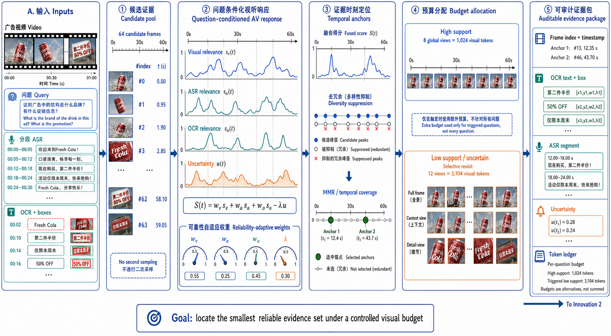

# 视频问答专利研究归档

本目录保存视频问答答案可靠性保障方案的正式申请初稿、查新材料、敌对审查记录与技术图。旧版草案、第三方全文和 OA 压缩包未重复收录。

## 当前申请稿

- [正式申请文件（Markdown）](application/一种视频问答的答案可靠性保障方法、验证器训练方法、装置、电子设备及存储介质_20260817135947.md)
- [正式申请文件（Word）](application/一种视频问答的答案可靠性保障方法、验证器训练方法、装置、电子设备及存储介质_20260817135947.docx)
- [V2.1 起草基准](application/新申请初稿V2.1_说明书全文_20260817.md)

## 目录

| 目录 | 内容 |
|---|---|
| [`application/`](application/) | 正式申请初稿、Word 版本与 V2.1 起草基准 |
| [`prior-art/`](prior-art/) | 2026 论文检索与专利创新方案 |
| [`audit/`](audit/) | 材料清单、驳回逻辑、模拟审查、查新与申请策略 |
| [`figures/`](figures/) | 证据定位、验证器训练与推理闭环技术图 |

## 当前结论

- 论文全流程直接写入独立权利要求，存在明显的组合与堆叠驳回风险。
- 当前可辩护核心是：以最小破坏反事实证据对训练声明－证据支持度验证器，并由同一评分约束补看触发与候选答案采纳。
- MMR、阈值门控、多尺度裁剪和场景适配不宜单独作为创造性锚点。
- 当前查新为 Web 级审计，不替代 CNIPA 或代理机构正式检索。

## 公开边界

本归档不包含身份证明、签章材料、代理委托文件、第三方专利全文和未脱敏运行数据。专利申请前公开技术方案可能影响部分法域的新颖性判断，正式公开与申请顺序应由代理人确认。
