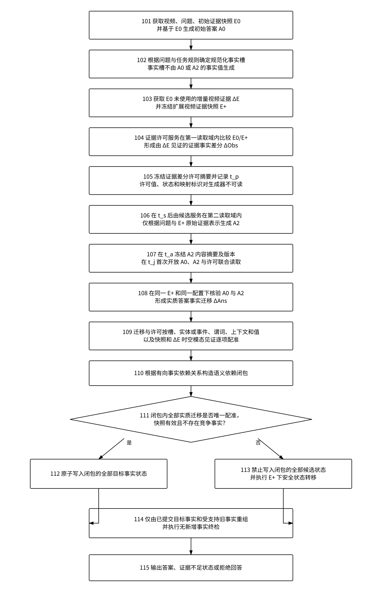
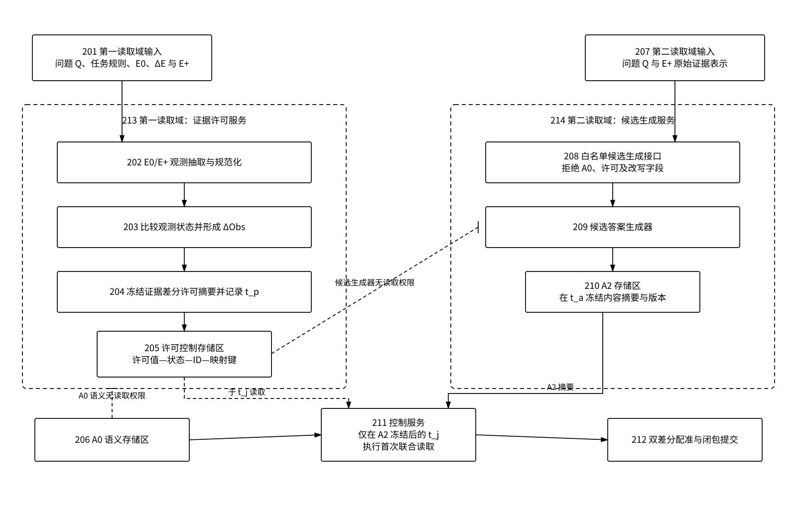
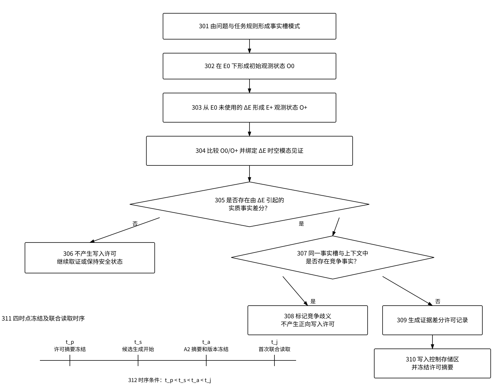
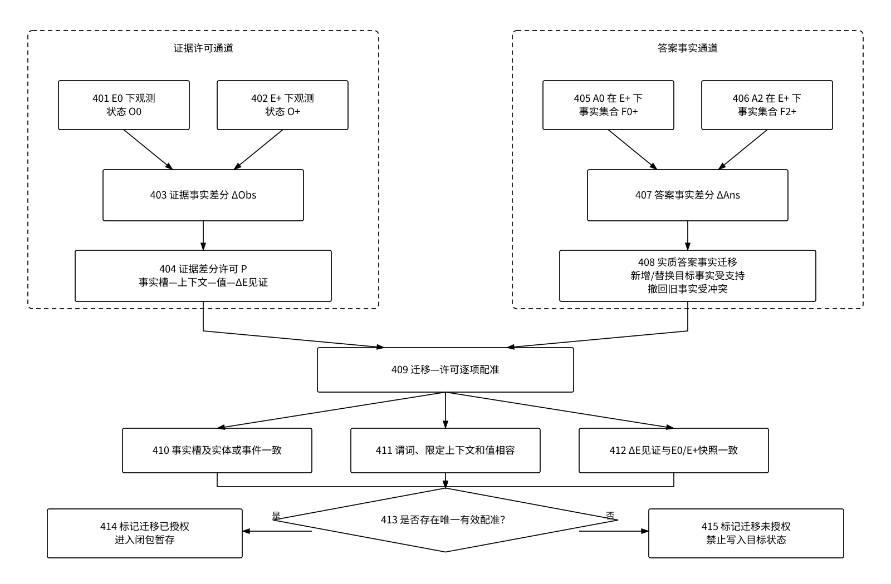
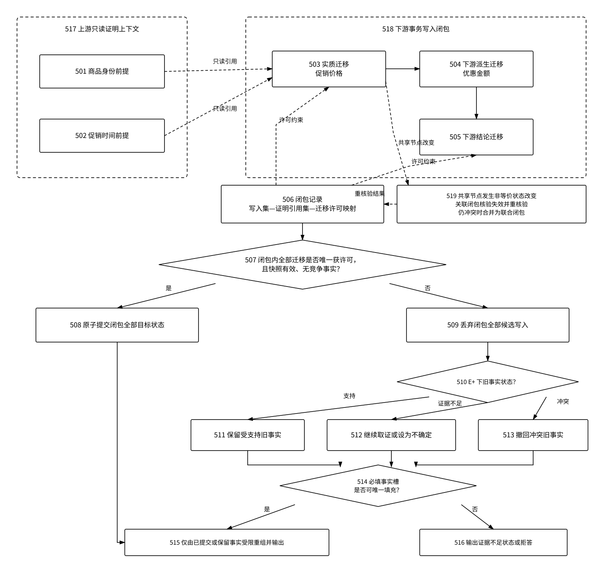
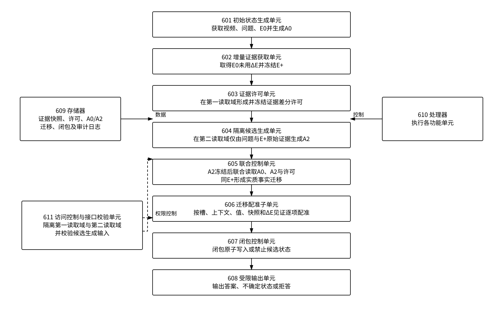
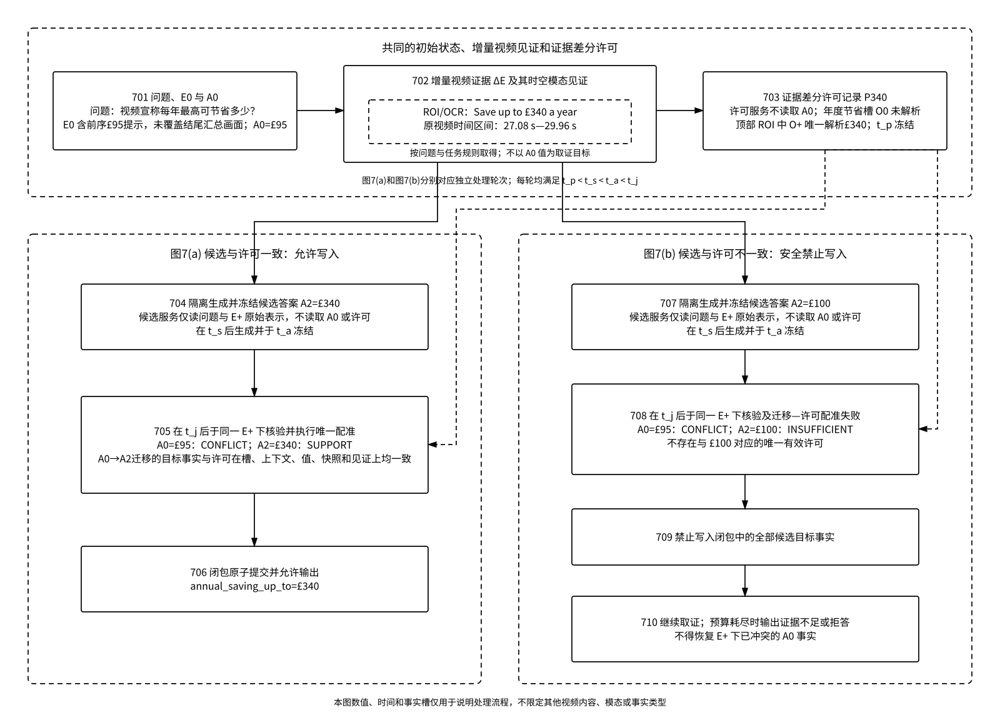

# 一种基于视频证据双差分许可的视频问答答案更新控制方法、装置、设备及存储介质

## 摘要

本发明公开一种视频问答答案更新控制方法。证据许可服务在不读取初始答案及候选事实值的第一读取域中，根据初始证据 E0 与未用增量证据 ΔE 形成并冻结许可；候选生成服务在不读取初始答案和许可的第二读取域中，根据问题与扩展证据 E+ 原始表示独立生成 A2。仅在二者依次冻结后开放联合读取，在同一 E+ 下形成 A0 至 A2 事实迁移，并按事实槽、上下文、值、快照及 ΔE 见证与许可唯一配准。闭包内全部迁移配准且无竞争事实时原子写入，否则全部禁写并输出受支持、不确定或拒答状态，从而减少中间事实状态污染造成的虚假一致和无增量证据支撑的答案更新。

摘要附图：图1。

---

## 权利要求书

### 一、方法权利要求

**1.** 一种基于视频证据双差分许可的视频问答答案更新控制方法，其特征在于，包括：

获取视频、针对所述视频的问题、初始视频证据快照 E0 以及基于 E0 生成的初始答案 A0，并根据所述问题和预设任务规则确定至少一个规范化事实槽及其事实槽模式；

从所述视频中取得相对于 E0 未使用的增量视频证据 ΔE，并冻结由 E0 和 ΔE 构成的扩展视频证据快照 E+；

通过证据许可服务，按照相同的事实槽模式和规范化配置确定所述规范化事实槽在 E0 和 E+ 下的规范化观测状态，并在所述规范化观测状态之间存在由 ΔE 导致的实质事实差分时，生成证据差分许可记录，所述证据差分许可记录至少关联事实槽、经消歧实体或事件、谓词、限定上下文、规范化事实值或状态目标、E0/E+ 快照标识以及属于 ΔE 的时空模态见证；其中，在与答案事实状态有关的数据访问范围内，所述证据许可服务的可读数据域包括所述问题、预设任务规则、E0、ΔE 和 E+，且不包括 A0、任一候选答案及由 A0 或所述候选答案导出的事实值，并且不以 A0 或所述候选答案的事实值作为证据检索、事实抽取、事实归一化或证据选择目标；所述证据许可服务无存储 A0 的初始答案存储区和存储候选答案的候选答案存储区的读取权限；

将所述证据差分许可记录写入控制存储区，冻结许可记录摘要并记录许可冻结时点 t_p；

在 t_p 之后通过候选生成服务开始生成候选答案并记录生成开始时点 t_s；其中，在与答案事实状态有关的数据访问范围内，所述候选生成服务的可读数据域包括所述问题和 E+ 的原始视频证据表示，且不包括 A0 的语义内容、由 A0 导出的改写指令以及所述证据差分许可记录，所述候选生成服务无所述初始答案存储区和所述控制存储区的读取权限，并且在候选答案 A2 冻结之前，控制服务不得向所述候选生成服务的输入接口、共享缓存或消息队列写入或转发所述证据差分许可记录中的字段；

冻结由所述候选生成服务生成的候选答案 A2 的内容摘要和版本并记录候选冻结时点 t_a，在 t_a 之后才允许控制服务联合读取 A0、A2 和所述证据差分许可记录，并记录首次联合读取时点 t_j，其中 t_p<t_s<t_a<t_j；

由所述控制服务按照相同的 E+、相同的事实槽模式和相同的核验配置，将 A0 和 A2 分别转换为规范化答案事实，核验各规范化答案事实在 E+ 下的支持状态，并形成 A0 至 A2 的实质答案事实迁移；

将每一实质答案事实迁移与证据差分许可记录按事实槽、经消歧实体或事件、谓词、限定上下文、规范化事实值、E0/E+ 快照以及 ΔE 时空模态见证进行配准；其中，对于每一实质答案事实迁移，存在唯一一条上下文相容且快照有效的许可记录，且同一许可记录不授权两个相互不相容的目标事实；新增迁移或替换迁移的目标事实在 E+ 下处于支持状态，撤回迁移的旧事实在 E+ 下处于冲突状态；

根据预定义的有向事实依赖关系，从所述实质答案事实迁移对应的目标事实或目标状态沿表示受影响方向的依赖边构造语义依赖闭包；以及

仅在所述语义依赖闭包中的全部实质答案事实迁移均完成所述配准、所引用的 E+ 快照和许可记录均有效、且同一事实槽和限定上下文中不存在达到竞争条件的非等价目标事实时，将所述语义依赖闭包的目标事实状态作为一个事务原子写入可输出状态集合；否则禁止写入所述语义依赖闭包中的全部候选目标事实状态，并依据 E+ 下旧事实的支持状态、证据不足状态或冲突状态生成保留、不确定、撤回或拒绝回答输出，且任何在 E+ 下处于冲突状态的事实均不得进入所述可输出状态集合。

**2.** 根据权利要求1所述的方法，其特征在于，每个视频证据单元包括视频标识、源片段标识、帧号或时间区间、证据模态和内容摘要；对于图像区域、画面文字或标识类证据，还包括区域坐标；所述增量视频证据 ΔE 至少满足下列一项：其源片段标识不属于 E0 已使用源片段标识集合；其原始时间覆盖范围与 E0 已使用的各原始时间区间均不重叠；或者其区域视图包含不属于 E0 实际输入像素集合的原始像素区域，或以 E0 未达到而所述区域视图达到的预设有效空间分辨率呈现所述区域；仅改变裁剪参数、编码格式或预处理而未增加原始区域覆盖或有效空间分辨率，不视为增量视频证据。

**3.** 根据权利要求1所述的方法，其特征在于，事实槽模式至少包括主体类型、谓词类型、值类型、单位类型、限定字段、槽基数规则、允许证据模态和归一化规则；规范化观测状态至少包括未解析状态、唯一解析状态、竞争歧义状态、冲突状态、仅质量提高状态和观测异常状态；事实槽模式由问题和任务规则确定，不由 A0 或 A2 的事实值生成。

**4.** 根据权利要求3所述的方法，其特征在于，证据差分许可记录还包括许可类型、增量证据标识集合、竞争组标识、许可生成时间、记录摘要和快照版本；许可类型至少包括事实值写入许可和事实冲突许可，所述事实冲突许可由不读取 A0 事实值的证据许可服务依据 E+ 下的确定事实或显式否定事实形成，并在 A2 冻结后用于判断是否授权对应旧事实的撤回；竞争歧义状态、仅质量提高状态、未解析状态或观测异常状态不产生事实值写入许可。

**5.** 根据权利要求1所述的方法，其特征在于，所述证据许可服务、候选生成服务和控制服务采用不同服务账户、不同访问控制列表或不同进程地址空间；候选生成接口采用输入字段白名单并拒绝初始答案、旧事实元组、许可标识、许可规范化值、许可观测状态、竞争组标识和迁移映射键；审计日志保存所述四个时点及各服务的输入摘要。

**6.** 根据权利要求3所述的方法，其特征在于，针对槽基数为一且限定上下文相同的事实槽，将规范化值不同的观测划分至同一竞争组；仅当一个值簇满足预设证据质量和适用条件且不存在达到竞争条件的非等价值簇时，生成事实值写入许可；原价和促销价、不同说话人、不同事件阶段或不同适用时间对应的观测因限定字段不同而划分至不同上下文。

**7.** 根据权利要求1所述的方法，其特征在于，A0 与 A2 的规范化答案事实采用由事件标识、主体角色和谓词构成的主映射键进行映射，事实值和限定字段用于确定迁移类型；迁移类型包括新增、替换、撤回、不确定化、保持和等价压缩，其中新增、替换和撤回属于实质答案事实迁移，保持和等价压缩不消耗事实值写入许可。

**8.** 根据权利要求1所述的方法，其特征在于，A0 与 A2 在 E+ 下的核验结果采用相互排他的支持状态、证据不足状态、冲突状态和异常状态；异常状态不参与闭包提交；A0 与 A2 的核验记录均保存相同的 E+ 快照标识、核验配置标识、事实槽模式标识和状态判定规则标识。

**9.** 根据权利要求1所述的方法，其特征在于，当目标事实由两个以上上游事实确定性计算得到时，建立派生许可记录，所述派生许可记录包括全部上游证据差分许可标识、确定性运算符、输入单位、单位换算规则、舍入规则和 E+ 快照标识；仅在全部上游许可有效且计算结果与目标事实一致时，允许所述派生许可记录授权对应迁移。

**10.** 根据权利要求1所述的方法，其特征在于，若有向依赖边 X→Y 表示事实 Y 的成立依赖事实 X，则从实质答案事实迁移沿出边方向确定需要共同写入或共同不写入的下游事实作为状态写入集合，并沿入边方向确定核验所需的上游事实作为只读证明引用集合；所述只读证明引用集合不因被引用而成为回滚对象；依赖边限制为预设的实体、属性、数量、时间或因果关系，并受事件消歧、时间相容条件和节点数量上限约束。

**11.** 根据权利要求10所述的方法，其特征在于，当第一语义依赖闭包的状态写入集合与第二语义依赖闭包的证明引用集合包含同一规范化事实映射键，所述规范化事实映射键至少包括事实槽、经消歧实体或事件、谓词和限定上下文，且第一语义依赖闭包针对所述规范化事实映射键存在拟写入的非等价目标事实状态时，在第一语义依赖闭包完成提交或其拟写入被禁止后，将第二语义依赖闭包的核验结果及其暂存目标事实状态标记为失效并重新核验；重新核验后仍存在写入—引用冲突时，将两个语义依赖闭包合并为联合闭包。

**12.** 根据权利要求1所述的方法，其特征在于，当语义依赖闭包被禁止写入时：若旧事实在 E+ 下处于支持状态，则保留所述旧事实；若旧事实处于证据不足状态且仍有取证预算，则继续取得增量视频证据，建立新的 ΔE 和 E+ 版本，将基于旧 E+ 的许可记录、A2 版本、核验结果、迁移配准关系和暂存闭包标记为失效，并依次重新执行许可生成、候选生成、联合核验和闭包门禁；若取证预算耗尽，则将对应事实槽设为不确定状态；若旧事实处于冲突状态且不存在受支持替代事实，则撤回所述旧事实；必填事实槽无法被唯一受支持事实填充时输出证据不足状态或拒绝回答，且不恢复 E+ 下已经处于冲突状态的 A0 事实。

**13.** 根据权利要求1所述的方法，其特征在于，生成最终答案时，重组器的输入仅包括所述可输出状态集合中的事实标识、事实值和对应证据标识；将重组结果再次转换为输出事实集合，当存在不能映射至所述可输出状态集合的新增事实时，删除所述新增事实并重新重组，重新重组后仍存在新增事实时输出结构化事实集合、证据不足状态或拒绝回答。

**14.** 根据权利要求1所述的方法，其特征在于，对用于形成证据差分许可记录的见证证据执行匹配反事实核验：从 E+ 中移除所述见证证据，并分别加入与所述见证证据模态相同、时间位置近似、分辨率满足匹配条件且在与许可生成相同的事实槽模式和规范化配置下经预核验不支持目标事实的多个非见证证据集合，形成与 E+ 具有相同输入预算的多个反事实证据快照；当目标事实在各反事实证据快照下均不能保持所述证据差分许可记录中的目标观测状态时，确定所述见证证据满足差分必要性条件。

**15.** 根据权利要求1所述的方法，其特征在于，记录问题标识、E0/E+ 快照摘要、增量证据标识、事实槽模式、证据差分许可、候选生成输入摘要、A2 内容摘要、联合读取时间、答案事实迁移、迁移—许可配准关系、依赖闭包、提交或禁止写入动作以及原因代码；当 E+ 内容、规范化规则或许可见证发生变化时，将对应许可及其已暂存迁移标记为失效并触发重新核验。

### 二、装置、设备和存储介质权利要求

**16.** 一种基于视频证据双差分许可的视频问答答案更新控制装置，其特征在于，包括：

- 初始状态生成单元，用于形成 E0 和 A0；
- 增量证据获取单元，用于取得 E0 未使用的 ΔE 并冻结 E+；
- 证据许可单元，用于在第一读取域中形成并冻结证据差分许可记录，所述第一读取域包括问题、任务规则、E0、ΔE 和 E+，且不包括 A0、A2 及其派生事实值；
- 隔离候选生成单元，用于在第二读取域中基于问题和 E+ 原始视频证据表示生成并冻结 A2，所述第二读取域不包括 A0 和证据差分许可记录；
- 联合控制单元，用于在许可记录和 A2 依次冻结后联合读取 A0、A2 和证据差分许可记录，并依据记录的 t_p<t_s<t_a<t_j 时序，在同一 E+ 下形成答案事实迁移并执行迁移—许可配准；
- 闭包控制单元，用于在闭包内全部迁移均配准成功时原子写入目标事实状态，否则禁止写入全部候选目标事实状态；以及
- 受限输出单元，用于基于所述可输出状态集合重组最终答案，并删除不能映射至所述可输出状态集合的新增事实，或者输出结构化事实集合、证据不足状态或拒绝回答状态；

所述装置被配置为执行权利要求1至15任一项所述的方法。

**17.** 一种电子设备，包括处理器和存储器，所述存储器中存储有计算机程序，其特征在于，所述计算机程序被所述处理器执行时，实现权利要求1至15任一项所述的方法。

**18.** 一种计算机可读存储介质，其上存储有计算机程序，其特征在于，所述计算机程序被处理器执行时，实现权利要求1至15任一项所述的方法。

---

## 说明书

### 一、技术领域

本发明涉及视频处理、计算机视觉、语音处理、自然语言处理以及计算机状态一致性控制技术领域，尤其涉及一种通过视频证据观测差分和答案事实差分的隔离形成、唯一配准及闭包事务提交，对视频问答答案进行更新控制的方法、装置、电子设备和存储介质。

### 二、背景技术

视频问答系统通常从视频帧、局部图像区域、画面文字、语音文本或者前述内容的组合中取得证据，再由多模态模型生成答案。受视频时长、采样帧数量、视觉输入预算、文字尺寸、遮挡、声画不同步和证据分散等因素影响，首次提供给模型的证据可能没有覆盖问题所需的决定性事实。

现有处理方式已经能够在答案置信信息不足时更新候选区域、重新选择视频帧并迭代回答，也能够将初始答案再次输入模型进行验证、增删或重述。另有系统能够在证据变化后更新旧问题的答案、在相同上下文下以不同方式取得进一步答案并比较其与原答案的一致性，或者通过多条视频推理路径形成候选答案和证据对后再融合。上述手段能够增加可用证据或者修正答案，但直接组合时仍存在以下计算机状态控制问题：

1. 根据初始答案或候选答案中的值检索增量证据时，检索目标会受到待验证结论影响，容易形成候选值反向驱动的事后选证；
2. 将证据抽取通道已经归一化的事实值、许可状态或竞争消歧结果送入候选生成器时，候选答案可能直接复述该中间状态，后续一致性判断不能区分独立一致与信息泄漏造成的虚假一致；
3. 仅判断“证据增加了”和“答案改变了”不能保证两种变化对应同一事实槽、同一实体或事件、同一限定上下文和同一增量视频见证；
4. 对相互依赖的多项事实逐项写入时，可能出现部分事实更新成功、部分事实更新失败的内部不一致；
5. 更新失败后机械恢复初始答案全文，可能重新输出在扩展证据下已经受到冲突的旧事实；
6. 自然语言重组器还可能在已经完成事实校验后引入不在许可状态集合中的新断言。

因此，需要一种能够使证据差分许可和候选答案在相互隔离的事实状态读取域中形成，并仅在二者冻结后执行同证据配准和事务写入的视频问答答案更新机制。

### 三、发明要解决的技术问题

本发明要解决的核心技术问题是：同一视频中取得增量证据后，如何在候选答案生成前阻断初始事实、候选事实与控制许可之间的交叉污染，并使每一实质答案变化只能由对应的增量视频证据事实差分授权。

本发明还解决以下问题：

1. 如何用可检查的数据读取域和冻结时点实现“独立生成”，而非仅依赖提示词声明；
2. 如何使 A0 与 A2 在相同 E+、相同事实模式和相同核验配置下形成可比较的答案事实状态；
3. 如何处理同一事实槽中的竞争值、证据许可抽取错误和陈旧快照；
4. 如何区分需共同提交或回退的下游状态与仅供核验的上游证明上下文；
5. 如何在闭包失败、旧事实冲突或核心事实缺失时进入确定的安全状态；
6. 如何防止最终文本重组阶段复活失效事实或新增未经许可的事实。

### 四、术语、符号及数据结构

#### 4.1 基本符号

1. **视频 V**：被处理的原始视频及其音轨。
2. **问题 Q**：针对视频 V 的自然语言问题或结构化查询。
3. **初始视频证据快照 E0**：生成 A0 前已经选取并标记为已使用的帧、局部区域、OCR 文本、ASR 片段或其他证据单元的不可变集合。
4. **初始答案 A0**：基于 Q 与 E0 生成的答案。
5. **增量视频证据 ΔE**：从同一视频 V 取得，且其源片段标识不属于 E0 已使用源片段标识集合，或者其原始时间覆盖与 E0 已使用的各原始时间区间均不重叠，或者其区域视图包含不属于 E0 实际输入像素集合的原始像素区域或达到 E0 未达到的预设有效空间分辨率的证据单元。
6. **扩展视频证据快照 E+**：将 E0 和 ΔE 合并、去重并冻结得到的证据快照。
7. **候选答案 A2**：在许可记录冻结之后，由候选生成服务仅根据 Q 和 E+ 的原始证据表示生成并冻结的答案。
8. **证据差分 ΔObs**：同一事实槽在 E0 与 E+ 下的规范化观测状态差异。
9. **答案事实差分 ΔAns**：A0 与 A2 在同一 E+ 下规范化、核验并映射后得到的实质事实迁移。

#### 4.2 视频证据单元

每个视频证据单元 EvidenceUnit 至少包含：

~~~text
video_id
source_span_id
frame_index 或 time_range
modality
content_digest
used_in_E0
~~~

对于图像局部区域、画面文字、标识或人物区域，还可以包含：

~~~text
source_frame_id
region_view_id
bbox = (x, y, width, height)
crop_scale
ocr_raw_text
~~~

对于语音证据，还可以包含说话人标识、ASR 原始文本以及起止时间。ΔE 的源片段标识应不属于 E0 已使用源片段标识集合，或者其原始时间覆盖应与 E0 已使用的各原始时间区间均不重叠；对于区域视图，只有包含不属于 E0 实际输入像素集合的原始像素区域，或者以 E0 未达到而所述区域视图达到的预设有效空间分辨率呈现所述区域，才视为增量视频证据。仅改变裁剪参数、编码格式或预处理而未增加原始区域覆盖或有效空间分辨率，不视为增量视频证据。

本说明书所称有效空间分辨率，由对应原始像素区域经视频解码、裁切和缩放后实际输入事实抽取器的有效像素数量及最短边像素数表征；预设阈值由任务规则按照事实槽和允许证据模态给定，并记录于事实槽模式或证据采集配置中。

#### 4.3 事实槽模式

事实槽模式 SlotSchema 可以包括：

~~~text
slot_schema_id
subject_type
predicate_type
value_type
unit_type
qualifier_schema
cardinality_rule
allowed_modalities
normalization_rule_id
exclusivity_rule_id
required_flag
~~~

例如，问题“视频中商品显示的限时价格是多少”可形成商品身份、价格类型、数值、货币单位和适用时间字段。事实槽模式由 Q 和预设任务规则确定，不得根据 A0 或 A2 中已经出现的“99元”“79元”等事实值反向生成。

#### 4.4 规范化观测状态

证据许可服务采用同一 SlotSchema 和同一规范化配置，分别在 E0 和 E+ 下形成规范化观测状态。观测状态至少包括：

- UNRESOLVED：未解析出满足模式的事实；
- RESOLVED：唯一解析出规范化事实；
- AMBIGUOUS：同一上下文存在达到竞争条件的非等价事实；
- CONFLICT：增量证据形成确定事实或显式否定，与原状态不相容；
- QUALITY_ONLY：仅改善清晰度或识别质量，尚未形成实质事实差分；
- ERROR：抽取、归一化或快照读取异常。

实质事实差分至少包括由未解析到唯一解析、由旧值到不相容新值、由旧事实到显式冲突状态。单纯画质提高、重复取得相同事实或者仍处于竞争歧义，不产生事实值写入许可。

上述规范化观测状态用于描述视频证据抽取与归一化的结果；本说明书后述的支持状态、证据不足状态、冲突状态和异常状态用于描述答案事实在 E+ 下的核验结果，二者属于不同状态域。同名的冲突状态或异常状态分别按照其所在状态域解释，不相互替代。

本说明书所称“与答案事实状态有关的数据访问范围”是指答案事实控制平面，包括答案存储区、由答案抽取或归一化得到的事实状态、支持或冲突判定、许可记录、竞争组、迁移映射键以及提交建议；其不把 E+ 的原始视频证据表示视为已经形成的答案事实状态。因而，候选生成服务可以从原始帧、OCR 原始字符串或 ASR 原始片段中独立识别事实，但不能读取另一服务已经抽取、归一化或判定出的事实值和控制结论。

#### 4.5 第一读取域与证据差分许可

证据许可服务的第一读取域 R_p 包括：

~~~text
Q、任务规则、E0、ΔE、E+、SlotSchema、规范化配置
~~~

在与答案事实状态有关的数据访问范围内，R_p 不包括：

~~~text
A0、A2、由 A0/A2 抽取的事实值、候选改写指令、候选事实嵌入
~~~

该服务也不以 A0 或 A2 的事实值作为视频检索关键词、相似度目标、事实抽取目标、归一化候选集合或者证据选择条件。

证据差分许可记录 EvidenceDeltaPermit 至少包括：

~~~text
permit_id
permit_type
slot_schema_id
entity_or_event_id
predicate
qualifiers
old_observation_state
target_value_or_state
E0_snapshot_id
Eplus_snapshot_id
delta_evidence_ids
witness_time_or_frame
witness_modality
witness_region_or_asr_span
competition_group_id
normalization_rule_id
permit_digest
permit_status
~~~

许可类型可以包括事实值写入许可、事实冲突许可和派生许可。许可记录只是写入控制凭据，不直接作为候选生成内容。

#### 4.6 第二读取域与候选答案

候选生成服务的第二读取域 R_g 包括 Q 和 E+ 的原始视频证据表示，例如原始帧、局部区域、未经许可服务归一化的 OCR 字符串、ASR 原始文本及对应时间戳。

在与答案事实状态有关的数据访问范围内，R_g 不包括：

~~~text
A0 的语义内容
由 A0 导出的改写指令
EvidenceDeltaPermit 及其 permit_id
许可归一化值和观测状态
竞争组与迁移映射键
提交或禁止写入建议
~~~

“许可不可见”并非隐藏视频本身。候选生成服务仍可从 E+ 原始证据中独立识别事实，但不能读取证据许可服务已经得出的机器结论。

#### 4.7 控制存储区、冻结摘要与四个时点

证据差分许可生成后写入候选生成服务无读取权限的控制存储区，计算许可记录摘要并记录许可冻结时点 t_p。候选生成只能在 t_p 后开始，记录生成开始时点 t_s；A2 生成完成后冻结其内容摘要、版本和输入载荷摘要，记录 t_a；控制服务首次同时读取 A0、A2 与许可的时点记为 t_j。

系统必须满足：

~~~text
t_p < t_s < t_a < t_j
~~~

在 t_a 之前，控制服务不得通过提示词、共享缓存、消息队列、工具调用参数或其他旁路把许可事实值传给候选生成服务；在 t_j 之前，也不得用 A2 事实值重算或者重选许可见证。快照、配置或许可内容一旦改变，应产生新摘要和新版本。

许可记录的冻结不将其变成后续裁决的排他输入。在 t_j 之后，控制服务仍直接读取冻结版本的 A0、A2，并在 E+ 的原始视频证据表示下分别核验二者；许可记录用于约束允许发生的事实迁移，而不替代 A0、A2 或 E+。由此，冻结步骤限制的是信息流和版本变化，而不是删除联合核验所需的源数据。

#### 4.8 同 E+ 的答案事实与迁移

A2 冻结后，控制服务使用相同 E+、相同 SlotSchema、相同证据排序和输入预算、相同核验配置，分别将 A0 与 A2 转换为规范化答案事实 F0+ 与 F2+。每项事实的核验状态为 SUPPORT、INSUFFICIENT、CONFLICT 或 ERROR，四种状态相互排斥。

答案事实采用由事件标识、主体角色和谓词组成的主映射键，事实值和限定字段用于确定迁移类型。迁移类型包括：

- 新增：A0 无对应事实，A2 增加目标事实；
- 替换：同一主映射键下由旧值迁移为不相容新值；
- 撤回：A0 旧事实在 E+ 下冲突且不再输出；
- 不确定化：事实由确定状态转为证据不足状态；
- 保持：新旧事实等价；
- 等价压缩：仅表达方式或冗余程度变化。

新增、替换和撤回属于实质答案事实迁移。保持和等价压缩不消耗事实值写入许可；不确定化按照安全状态机处理，不得被伪装成无声删除。

#### 4.9 迁移—许可唯一配准

每项实质答案事实迁移至少按照以下字段与许可记录配准：

~~~text
slot_schema_id
entity_or_event_id
predicate
qualifiers
normalized_value_or_state
E0_snapshot_id
Eplus_snapshot_id
delta_evidence_witness
permit_status
~~~

新增和替换的目标事实必须在 E+ 下处于 SUPPORT，撤回的旧事实必须在 E+ 下处于 CONFLICT。每项迁移必须存在唯一、上下文相容且快照有效的许可；一个许可不得授权两个互不相容的目标事实。无匹配、多匹配、值不相容、上下文错配、见证不属于 ΔE 或快照过期均视为配准失败。

#### 4.10 竞争组与派生许可

对于基数为一且限定上下文相同的事实槽，将不同规范化值划入同一竞争组。只有一个值簇满足证据质量和适用条件且不存在达到竞争条件的非等价值簇时，才形成事实值写入许可。原价与促销价、不同说话人、不同事件阶段和不同适用时间通过限定字段区分，不应错误合并。

目标事实由多个上游事实确定性计算得到时，可以形成派生许可。派生许可必须记录全部上游许可、运算符、单位换算、舍入规则和 E+ 快照。任一上游许可无效、输入单位不相容或者结果不一致时，派生许可无效。

#### 4.11 有向依赖闭包的双域

预定义有向边 X→Y 表示事实 Y 的成立依赖事实 X。从实质变化节点沿出边方向取得受影响下游事实，构成状态写入集合 W；沿入边方向取得核验所需上游事实，构成只读证明引用集合 R。

W 中的事实共同提交或共同禁止写入；R 中的事实仅参加证明，不因被引用而自动成为回滚对象。依赖边限定为预设的实体、属性、数量、时间或因果关系，并受实体或事件消歧、时间相容、关系白名单、最大跳数和节点数量上限约束，避免闭包无边界扩张。

当闭包 B 的状态写入集合与闭包 A 的证明引用集合包含同一规范化事实映射键，并且 B 针对该映射键存在拟写入的非等价目标事实状态时，B 完成提交或其拟写入被禁止后必须使 A 的核验结果及其暂存目标事实状态失效并重核验；仍存在写入—引用冲突时，将两个闭包合并为联合闭包。

### 五、发明内容

#### 5.1 单一发明构思

本发明的单一发明构思是：先由不能读取答案事实状态的证据许可服务形成“视频证据允许发生什么变化”，再由不能读取初始答案和许可状态的候选生成服务形成“候选答案实际发生什么变化”；二者分别冻结后，才由控制服务在同一 E+ 下逐项配准，并将配准结果作为语义依赖闭包能否写入的唯一事务门禁。

因此，增量取证、双读取域隔离、四时点冻结、同证据复评、差分配准和闭包原子写入不是互不相关的模块。前一步产生的快照、摘要、事实槽和许可标识直接成为后一步的输入约束与写入条件，任何一项缺失都会使系统不能判断候选变化是否真正由本轮增量视频证据授权。

#### 5.2 总体步骤

本方法可以包括以下步骤：

1. 获取 V、Q、E0 和 A0，并由 Q 与任务规则形成 SlotSchema；
2. 从同一视频取得 E0 未使用的 ΔE，冻结 E+=E0∪ΔE；
3. 由证据许可服务在 R_p 中比较 E0/E+ 观测状态，形成带 ΔE 时空模态见证的许可；
4. 冻结许可摘要并记录 t_p；
5. 在 t_p 后由候选生成服务在 R_g 中开始生成 A2，记录 t_s；
6. 冻结 A2 内容、版本与载荷摘要，记录 t_a；
7. 在 t_a 后才由控制服务联合读取 A0、A2 与许可，记录 t_j；
8. 在相同 E+ 和核验配置下形成 F0+、F2+ 与 ΔAns；
9. 对每项实质迁移执行唯一许可配准；
10. 构造有向依赖闭包，全部满足门禁时原子写入，否则全部禁止写入；
11. 按 E+ 下仍受支持的事实或者不确定状态生成输出，并执行无新增事实终检。

#### 5.3 原子写入门禁

对于任一闭包 K，仅当以下条件同时满足时允许提交：

~~~text
SnapshotValid(K)
AND AllSubstantiveMigrationsUniquelyMatched(K)
AND AllTargetFactsSupportedUnderSameEplus(K)
AND AllWithdrawalOldFactsConflictedUnderSameEplus(K)
AND NoNonEquivalentCompetition(K)
AND DependencyClosureComplete(K)
~~~

任一条件失败时，候选目标事实均不得部分写入。禁止写入不等于固定回到 A0，而是按照 E+ 下最后仍受支持的事实状态进入安全分支。

#### 5.4 失败状态机

| E+ 下事实状态及预算 | 输出或控制动作 |
|---|---|
| 旧事实仍处于 SUPPORT | 保留旧事实 |
| 旧事实为 INSUFFICIENT 且仍有取证预算 | 继续取得未覆盖证据并生成新快照 |
| 旧事实为 INSUFFICIENT 且预算耗尽 | 将对应事实槽设为不确定 |
| 旧事实为 CONFLICT，存在唯一受支持替代事实且获许可 | 提交替代事实 |
| 旧事实为 CONFLICT，不存在受支持替代事实 | 撤回旧事实 |
| 非核心附加事实失效 | 撤回该事实，保留其余受支持事实 |
| 核心必填事实无法由唯一受支持事实填充 | 输出证据不足状态或拒绝回答 |
| 核验或快照异常 | 禁止提交并记录异常，不使用异常分数择优 |

状态机不复活在 E+ 下已经冲突的 A0 事实。

#### 5.5 受限重组

最终重组器只读取可输出状态集合中的事实标识、事实值和证据标识。自然语言结果生成后，再次抽取输出事实并与允许集合比对。不能映射到允许集合的事实先删除并重新重组；仍存在新增事实时，输出结构化事实、证据不足状态或者拒绝回答。

#### 5.6 技术效果

本发明至少能够产生以下由技术流程直接带来的效果：

1. 第一读取域不包含答案事实值，降低候选值反向控制视频检索和证据选择的风险；
2. 第二读取域不包含初始答案和许可状态，减少候选生成器复述控制中间值造成的虚假一致；
3. 许可摘要、A2 摘要和四个时点使双通道隔离可由系统日志核验；
4. 同一 E+ 下的双答案核验消除 E0/E+ 不同证据口径造成的比较偏差；
5. 事实槽、上下文、值、快照和 ΔE 见证的唯一配准，阻断与本轮新增证据无关的答案迁移；
6. 竞争组和派生许可避免多值歧义或无完整计算血缘的事实被写入；
7. 下游状态写入集合与上游证明引用集合的双域闭包，减少局部事务退化为整份答案回滚；
8. 闭包原子写入避免依赖事实只更新一部分产生内部矛盾；
9. 安全状态机和无新增终检避免复活失效事实或者在重组阶段引入新幻觉。

### 六、附图说明

图1为视频问答答案更新控制的总体处理流程图；

图2为证据许可服务的第一读取域、候选生成服务的第二读取域以及控制服务的数据隔离结构图；

图3为许可摘要冻结、候选生成开始、候选摘要及版本冻结和首次联合读取的四时点时序图；

图4为证据事实差分与答案事实迁移的唯一配准示意图；

图5为语义依赖闭包的状态写入集合、证明引用集合、跨闭包失效传播及失败状态转移图；

图6为视频问答答案更新控制装置的模块结构图；

图7为金额事实槽的许可替换及安全禁止写入的具体实施例示意图。

#### 6.1 附图标记说明

- 图1：101表示视频、问题、E0和A0的初始状态；102表示规范化事实槽；103表示ΔE和E+；104表示第一读取域内的证据事实差分；105表示许可摘要冻结；106表示第二读取域内的隔离候选生成；107表示A2冻结及首次联合读取；108表示答案事实迁移；109表示迁移—许可配准；110表示有向语义依赖闭包；111表示闭包接受判断；112表示原子写入；113表示禁止写入；114表示受限重组和无新增事实终检；115表示输出。
- 图2：201表示第一读取域输入；202表示E0/E+观测抽取与规范化；203表示证据事实差分；204表示许可摘要冻结；205表示许可控制存储区；206表示A0语义存储区；207表示第二读取域输入；208表示白名单候选生成接口；209表示候选答案生成器；210表示A2存储区；211表示控制服务；212表示双差分配准与闭包提交；213表示第一读取域；214表示第二读取域。
- 图3：301表示事实槽模式；302表示E0下观测状态O0；303表示E+下观测状态O+；304表示观测比较和ΔE见证绑定；305表示实质事实差分判断；306表示不产生写入许可的安全分支；307表示竞争事实判断；308表示竞争歧义状态；309表示证据差分许可记录；310表示控制存储及许可摘要冻结；311表示四时点轴；312表示t_p<t_s<t_a<t_j的时序条件。
- 图4：401和402分别表示O0与O+；403表示证据事实差分；404表示证据差分许可；405和406分别表示A0与A2在E+下的事实集合；407表示答案事实差分；408表示实质答案事实迁移；409表示逐项配准；410至412表示事实槽及实体或事件、谓词及限定上下文和值、快照及ΔE见证的配准条件；413表示唯一有效配准判断；414和415分别表示迁移已授权和未授权状态。
- 图5：501和502表示上游只读证明前提；503至505表示状态写入集合中的实质迁移及下游迁移；506表示闭包记录；507表示闭包接受判断；508和509分别表示原子提交和丢弃候选写入；510表示E+下旧事实状态判断；511至513表示保留、继续取证或不确定化、撤回的安全状态；514表示必填事实槽判断；515和516表示输出分支；517和518分别表示上游只读证明上下文与下游事务写入闭包；519表示共享节点改变后的核验失效、重核验和闭包合并。
- 图6：601表示初始状态生成单元；602表示增量证据获取单元；603表示证据许可单元；604表示隔离候选生成单元；605表示联合控制单元；606表示迁移配准子单元；607表示闭包控制单元；608表示受限输出单元；609表示存储器；610表示处理器；611表示访问控制与接口校验单元。
- 图7：701表示问题、E0和A0的初始状态；702表示增量视频证据及其时空模态见证；703表示证据差分许可记录；704表示与许可目标值一致的隔离候选答案；705表示同一E+下的核验及迁移—许可唯一配准；706表示闭包原子提交和允许输出的目标事实；707表示与许可目标值不一致的隔离候选答案；708表示同一E+下的核验及迁移—许可配准失败；709表示闭包禁止写入；710表示继续取证、证据不足或拒绝回答的安全输出。

### 七、具体实施方式

以下实施方式用于说明本发明，而非限定模型种类、部署形式或视频内容类型。

#### 7.1 建立证据索引、E0 和 A0

如图1所示，系统对视频 V 建立可回溯证据索引。完整帧记录视频标识、帧号和时间戳；局部区域记录源帧、坐标和裁切参数；OCR 记录原始字符串、源区域和时间；ASR 记录原始文本、说话人以及起止时间。

系统在预设输入预算内选取 E0，并将每个实际送入初始答案生成器的 EvidenceUnit 标记为 used_in_E0=true。系统基于 Q 和 E0 生成 A0。A0 保存于初始答案存储区，证据许可服务的账户没有该存储区的读取权限。

#### 7.2 根据问题形成事实槽

系统仅根据 Q 和预设任务规则构造 SlotSchema。例如：

- 价格问题：商品、价格类型、金额、货币单位、适用时段；
- 人物动作问题：人物、动作、对象、时间窗；
- 原因问题：前因事件、结果事件、时间先后和因果关系；
- 数量问题：对象、计数范围、去重规则和单位；
- 品牌问题：商品实体、品牌谓词、文字或标识模态。

问题为“商品显示的限时价格是多少”时，可生成：

~~~text
subject_type = product
predicate_type = price_of
value_type = decimal
unit_type = CNY
qualifiers = {product_id, price_type, applicable_time}
cardinality = one_value_per_context
allowed_modalities = {frame_roi, OCR, ASR}
~~~

该步骤不读取 A0，所以不会因为 A0 恰好包含“99元”而把“99”作为取证目标。

#### 7.3 获取 E0 未覆盖的 ΔE

当必填槽未解析、存在证据不足或需要补齐预定义模态时，系统从同一视频取得 ΔE。候选证据至少满足下列条件之一：

~~~text
source_span_id 不属于 UsedSourceSpans(E0)
或 raw_time_range 与 UsedRawTimeRanges(E0) 中各区间均不重合
或 region_view 包含不属于 InputPixelSet(E0) 的原始像素区域
或 region_view 达到 E0 对应区域未达到的预设有效空间分辨率
~~~

仅改变裁剪参数、编码格式或预处理而未增加原始区域覆盖或有效空间分辨率，不构成新的 ΔE。补证可由问题相关度、时间邻近度、目标模态、画面质量或预定义区域类型驱动，但不能使用 A0 或尚未冻结的 A2 中的事实值作为搜索词、相似度正样本或 OCR 候选字典。取得 ΔE 后，系统冻结 E+ 的内容清单、顺序、输入预算和摘要。

#### 7.4 证据许可服务形成许可

证据许可服务在相同 SlotSchema 和规范化配置下计算 O0=Observe(E0) 与 O+=Observe(E+)。对于数值 OCR，可核对原始字符串、单位、区域、价格类型和适用时间；对于 ASR，可核对说话人、时间段和所指对象；对于动作，可核对主体跟踪标识、动作类别和时间窗。

例如，E0 未覆盖价格区域，O0 为 UNRESOLVED；ΔE 中 11.2 秒的新局部区域含有“限时79元”，O+ 为：

~~~text
RESOLVED(
  entity=product_1,
  predicate=price_of,
  qualifiers={price_type=promotion, applicable_time=t11},
  value=79,
  unit=CNY
)
~~~

若该值唯一且见证属于 ΔE，则生成事实值写入许可。若 ΔE 只使画面更清晰但仍无法解析，则记录 QUALITY_ONLY；若同一上下文出现两个不能消歧的清晰值，则记录 AMBIGUOUS；后二者均不产生正向写入许可。

许可写入 control_permit_store，计算 permit_digest 并记录 t_p。许可写入后只读；补充证据或者修改归一化配置时必须建立新 E+ 版本和新许可。

#### 7.5 三服务隔离实现

如图2所示，一种实施例采用三个服务账户和三个受访问控制的存储区：

1. permit_service：读取 Q、任务规则、E0、ΔE、E+ 与 SlotSchema；写入 control_permit_store；不能读取 A0_store 或 A2_store；
2. candidate_service：读取 Q 与 raw_Eplus_store；写入 A2_store；不能读取 A0_store 或 control_permit_store；
3. control_service：在 A2 冻结前只读取摘要状态和时点；A2 冻结后才可联合读取 A0、A2、许可和同 E+ 核验结果。

候选生成接口采用输入字段白名单，例如：

~~~json
{
  "question_id": "q_001",
  "question": "视频中商品显示的限时价格是多少",
  "evidence_snapshot_id": "Eplus_hash",
  "raw_evidence_unit_ids": ["frame_112", "roi_112_price", "asr_110_118"],
  "generation_config_id": "gen_cfg_01"
}
~~~

接口拒绝：

~~~text
initial_answer
old_fact_tuple
rewrite_instruction
permit_id
permit_target_value
permit_observation_state
competition_group_id
migration_mapping_key
commit_recommendation
~~~

本发明的贡献不在于训练新的生成模型、事实抽取模型或核验模型，而在于前述模型或规则组件之间的视频证据状态控制关系。采用人工智能模型实现时，证据许可服务的输入至少包括 SlotSchema、E0/E+ 中带视频标识和时空位置的原始帧、区域、OCR 或 ASR 证据单元，输出为带事实槽、实体或事件、谓词、限定字段、规范化观测状态和见证证据标识的许可记录；候选生成服务的输入仅为问题、E+ 快照标识及 E+ 的原始视频证据表示，输出为候选答案 A2 及其内容摘要；核验器的输入为 A0 或 A2 中的规范化答案事实、相同的 E+ 原始视频证据表示、SlotSchema 和核验配置，输出为 SUPPORT、INSUFFICIENT、CONFLICT 或 ERROR 中的一个状态以及所引用的证据标识。由此，视频输入、事实状态输出和后续迁移控制之间具有可复现的数据对应关系；上述模型可以采用所属领域已知的视觉语言模型、OCR、ASR、分类器或规则引擎实现，而不改变双读取域、冻结时序和闭包写入门禁。

隔离还可以由不同进程地址空间、能力令牌、数据库行列权限、消息主题白名单或者可信执行环境实现。复用同一基础模型时，应使用相互独立的无状态调用实例，且不得复用包含许可或 A0 事实状态的会话缓存。

#### 7.6 四时点和联合读取

如图3所示，控制器执行下列顺序：

~~~text
1. FreezePermit()       -> t_p，保存 permit_digest
2. StartCandidate()     -> t_s，断言 t_p < t_s
3. FreezeCandidate()   -> t_a，保存 A2_digest、版本和输入摘要
4. GrantJointRead()     -> t_j，断言 t_a < t_j
~~~

因此：

~~~text
t_p < t_s < t_a < t_j
~~~

如果日志表明 candidate_service 在 t_a 前读取了许可存储、permit_service 在任一时点读取了答案事实值，或者 control_service 在 t_a 前将许可事实值注入候选输入，则本轮 A2 和许可均标记为不满足隔离条件，不得用于闭包提交。

#### 7.7 同 E+ 复评 A0 和 A2

A2 冻结后，control_service 使用相同 E+ 快照、事实槽、核验器版本、输入预算和阈值配置，分别抽取并核验 A0 与 A2 的规范化答案事实。

一种互斥状态判定顺序为：

~~~text
if verifier_error:
    state = ERROR
elif contradiction_condition_met:
    state = CONFLICT
elif support_condition_met:
    state = SUPPORT
else:
    state = INSUFFICIENT
~~~

系统不拿 A0 在 E0 下的分数与 A2 在 E+ 下的分数直接比较。相对提升裕量可以作为附加筛选条件，但不能替代目标事实绝对受支持、旧事实撤回需受冲突以及许可配准条件。

#### 7.8 形成答案事实迁移

系统用 (event_id, subject_role, predicate) 作为主映射键，用 value 和 qualifiers 判断变化。

示例：

~~~text
F0+ = (product_1, price_of, 99, {price_type=promotion}, CONFLICT)
F2+ = (product_1, price_of, 79, {price_type=promotion}, SUPPORT)
ΔAns = REPLACE(99 -> 79)
~~~

一对多或多对一文本表达先拆分为原子事实，再依据主映射键建立映射。仅语序、同义表达和冗余压缩不构成实质迁移。无法稳定映射的事实进入待复核状态，不直接写入。

#### 7.9 唯一许可配准

如图4所示，对 REPLACE(99→79)，有效许可至少应满足：

~~~text
slot = promotion_price
entity = product_1
predicate = price_of
qualifiers.price_type = promotion
target_value = 79 CNY
witness 属于 ΔE
snapshot = 当前 E0/E+
permit_status = VALID
~~~

下列情形均配准失败：

- 许可为 79 元但 A2 为 59 元；
- 许可属于另一商品或另一事件；
- 许可为原价 79 元而 A2 表示促销价 79 元；
- 许可见证来自 E0 已使用证据而非 ΔE；
- 同一迁移匹配多条未消歧许可；
- 同一许可试图授权 79 元和 59 元两个互不相容目标；
- E+、SlotSchema 或归一化规则版本发生变化。

#### 7.10 撤回与冲突许可

撤回不是“新证据没有再次提到旧事实”。只有证据许可服务在不读取 A0 值的前提下，依据 E+ 中的确定事实或显式否定形成事实冲突许可，并且 A0 旧事实在同 E+ 下被核验为 CONFLICT，才允许撤回。

持续证据不足仅能触发继续取证或者不确定化，不能静默删除。核心必填槽的旧事实冲突且没有受支持替代事实时输出证据不足或拒答；非核心事实失效时可以只撤回该事实。

#### 7.11 派生许可

问题同时要求“促销价和优惠额”，A2 输出“促销价79元，优惠20元”。若优惠额由“原价99元−促销价79元”得到，则优惠额的派生许可包含：

~~~text
upstream_permits = {original_price_99_permit, promo_price_79_permit}
operator = subtraction
unit_rule = CNY - CNY -> CNY
rounding_rule = exact_integer
result = 20 CNY
snapshot = current E+
~~~

缺少任一上游许可、上游许可失效或计算结果不一致时，优惠额迁移不能提交。

#### 7.12 闭包构造与跨闭包传播

如图5所示，假设：

~~~text
促销阶段 -> 促销价
原价 -> 优惠额
促销价 -> 优惠额
~~~

促销价发生替换时，系统沿出边将优惠额纳入状态写入集合 W；沿入边将促销阶段纳入证明引用集合 R。促销阶段只用于判断“79元是否为该阶段促销价”，不会仅因被引用而随促销价一起回滚。

当另一闭包 B 改变促销阶段，且该事实位于闭包 A 的证明引用集合中时，B 完成提交或禁止写入后，A 的核验缓存立即失效。A 重新核验；若两个闭包仍互相写入和引用同一事实，则合并为联合闭包后再做一次全有或全无判断。

#### 7.13 匹配反事实核验

为检查见证证据 w 是否确实带来许可中的事实差分，系统从 E+ 中移除 w，并分别加入多个满足以下条件的非见证证据：

- 与 w 模态相同；
- 时间位置相近；
- 分辨率、帧数或输入令牌预算相近；
- 经预核验不支持目标事实。

所述预核验采用与许可生成相同的 SlotSchema 和规范化配置，各匹配反事实快照与 E+ 保持相同输入预算。若目标事实只在包含 w 的 E+ 中保持许可目标状态，而在多个匹配反事实快照中均不能保持该状态，则 w 满足差分必要性条件。该反事实核验可以作为附加门禁，不要求对每项事实迁移都执行。

#### 7.14 输出重组和终检

闭包通过后，系统只把 committed_fact_ids、normalized_values 和 evidence_ids 交给重组器，不把被拒绝的候选文本整体交给重组器。重组结果再次转换为事实集合。

若抽取到的事实不能映射到允许集合，则删除该事实并重组一次。第二次仍出现未经允许的新事实时，停止自然语言生成，改为输出结构化事实、证据不足状态或拒绝回答。

#### 7.15 审计、失效和重放

审计日志至少记录：

~~~text
question_id
E0_digest
deltaE_ids
Eplus_digest
slot_schema_id
normalization_config_id
permit_digest 和 t_p
candidate_input_digest 和 t_s
A2_digest、A2_version 和 t_a
first_joint_read_time t_j
F0+、F2+、ΔAns
migration_permit_matches
closure_write_set 和 proof_reference_set
commit_or_reject_action
reason_codes
~~~

当 E+ 内容、证据顺序、输入预算、规范化规则、许可见证或 A2 版本发生变化时，关联许可、A2 版本、核验结果、迁移配准关系和暂存闭包全部失效，并依次重新执行许可生成、候选生成、联合核验和闭包门禁。每一新的 E+ 版本作为独立处理轮次，分别生成并记录新的 t_p、t_s、t_a 和 t_j，且仍满足 t_p<t_s<t_a<t_j。对已记录的冻结快照、冻结候选内容、许可记录和配置进行重放时，应得到相同的迁移配准结果和提交动作。

#### 7.16 处理伪代码

~~~text
E0 = SelectInitialEvidence(video, question)
A0 = GenerateInitialAnswer(question, E0)

schemas = DeriveSlotSchemas(question, task_rules)
deltaE = AcquireUnusedEvidence(
    video=video,
    schemas=schemas,
    query_features=QuestionAndTaskFeatures(question, task_rules),
    exclude=UsedEvidence(E0),
    candidate_value_blind=True,
    forbid_answer_state_reads=True,
)
Eplus = FreezeSnapshot(E0, deltaE)

with ReadDomain(question, task_rules, E0, deltaE, Eplus):
    AssertCannotRead(A0_store, A2_store)
    O0 = ObserveAndNormalize(E0, schemas)
    Oplus = ObserveAndNormalize(Eplus, schemas)
    permits = BuildDeltaPermits(O0, Oplus, deltaE)
permit_digest, t_p = FreezePermitStore(permits)

with ReadDomain(question, RawEvidence(Eplus)):
    AssertCannotRead(A0_store, permit_store)
    AssertWhitelistedCandidatePayload()
    AssertNoWritesFromControl(
        target=candidate_service,
        forbidden_fields=PermitDerivedFields,
        until=CandidateFreezeEvent,
    )
    t_s = StartCandidateAfter(t_p)
    A2 = GenerateCandidate(question, RawEvidence(Eplus))
A2_digest, t_a = FreezeCandidate(A2)

Assert(t_p < t_s < t_a)
t_j = GrantJointReadAfter(t_a)
Assert(t_a < t_j)

F0plus = NormalizeAndVerify(A0, Eplus, schemas, same_config=True)
F2plus = NormalizeAndVerify(A2, Eplus, schemas, same_config=True)
migrations = BuildAnswerFactMigrations(F0plus, F2plus)

for migration in Substantive(migrations):
    migration.permit = UniqueMatch(
        migration,
        permits,
        keys=[
            slot, entity_or_event, predicate, qualifiers,
            normalized_value_or_state, snapshots, deltaE_witness
        ],
    )

closures = BuildDirectedClosures(
    migrations,
    outgoing_as_write_set=True,
    incoming_as_read_only_proof_set=True,
)

for closure in closures:
    Stage(closure)
    if AllGateConditionsSatisfied(closure):
        AtomicCommit(closure.write_set)
    else:
        RejectAllCandidateWrites(closure.write_set)
        ApplySafeStateUnderEplus(closure)

allowed = CommittedFactsAndSupportedOldFacts()
return RenderThenRejectNewFacts(allowed)
~~~

### 八、完整示例

#### 示例一：两通道独立一致，允许替换

问题为“视频中商品显示的限时价格是多少”。E0 没有覆盖价格区域，A0 输出“99元”。permit_service 根据问题形成价格槽，从 11.2 秒取得 E0 未用的局部区域；原始 OCR 为“限时79元”，形成由 UNRESOLVED 到 promotion_price=79 CNY 的许可。许可在 t_p 冻结且不传给 candidate_service。

candidate_service 在 t_s 后仅查看 Q 与 E+ 原始证据，生成“限时价格是79元”，并在 t_a 冻结。control_service 在 t_j 后发现 A0 的99元在 E+ 下冲突、A2 的79元受支持，且 99→79 与唯一许可的槽、实体、价格类型、值、见证和快照一致，因此闭包原子提交79元。

#### 示例二：候选值错误，禁止写入

许可为 promotion_price=79元，A2 却生成“59元”。即使 A2 其他内容正确或整体评分较高，目标值仍与许可不匹配，59元不得写入。A0 的99元若已在 E+ 下冲突，也不得恢复；系统继续取证，预算耗尽后输出证据不足。

#### 示例三：许可通道抽取错误，隔离暴露不一致

E+ 原始画面实际为“79元”，permit_service 的 OCR 错误形成“59元”许可。candidate_service 不能读取许可值，直接查看原始画面后生成“79元”。两条独立通道不一致，配准失败并触发重新取证、提高分辨率核验或输出不确定状态。

若把许可值提前传给 candidate_service，A2 可能复述“59元”，系统会误把共同错误当作相互验证。本发明用相互隔离的读取域和四时点日志暴露该错误。

#### 示例四：同一上下文存在竞争值

同一商品同一促销时段内，两个清晰区域分别显示79元和59元，且无法根据对象、价格类型或时间消歧。permit_service 将两者放入同一竞争组并标记 AMBIGUOUS，不生成事实值写入许可。无论 A2 输出哪个值，均不得提交。

#### 示例五：不同限定字段的合法多值

同一画面显示“原价99元，限时79元”。两个数值的 price_type 不同，所以不属于同一竞争上下文。问题询问限时价格时，79元许可可以授权 A2 的79元迁移；99元作为原价事实保留，不被错误判为竞争值。

#### 示例六：依赖闭包不完整

A2 将促销价改为79元并新增“优惠20元”。促销价有直接许可；优惠额需要原价99元、促销价79元以及减法血缘。若原价事实缺少有效上游许可或在 E+ 下未获支持，优惠额没有有效派生许可。二者处于同一状态写入闭包时，整个闭包不提交，避免只写入价格或只写入优惠额。

#### 示例七：旧答案冲突而候选答案也无证据

A0 表示“最终价格为199元”。ΔE 明确标注“199元为满减门槛金额，并非最终成交价”；A2 推测最终价格为99元，但视频没有最终成交价证据。A0 在 E+ 下冲突，A2 的99元不受支持且无许可，因此不得替换，也不得恢复A0。最终价格是核心必填槽，取证预算耗尽后系统输出证据不足或拒答。

#### 示例八：跨闭包共享证明失效

在同一 E+ 处理轮次中，闭包 A 的候选结论“优惠20元”暂存时把当前可输出状态中的“促销价79元”作为只读证明；闭包 B 针对同一规范化事实映射键已取得将促销价替换为69元的有效许可并形成拟写入状态。B 完成提交后，A 的核验结果和暂存目标事实状态立即失效，并以69元重新计算优惠额；若优惠额随之变为30元且两个闭包仍存在写入—引用冲突，则 A 与 B 合并为联合闭包，只有价格与优惠额均获得有效许可时才共同写入。若 B 的拟写入被禁止，A 也按照当前可输出状态重新核验，不直接使用 B 的暂存目标事实。

#### 示例九：重组器试图新增事实

允许集合仅含“促销价79元”，重组器却输出“促销价79元，今天全场最低”。终检抽取出未经允许的“全场最低”事实，删除并重组；若再次出现，系统只输出结构化字段“促销价：79元”及其证据，不输出额外断言。

#### 示例十：语音时间事件及前置条件的闭包提交

问题为“视频中的抢购活动何时开始，参加前需要做什么”。E0 仅覆盖画面文字“明日开抢”，A0 推测为“明晚八点开始，无需预约”。随后取得 E0 未使用的 18.4 秒至 20.1 秒语音片段作为 ΔE，ASR 原始内容为“明天上午十点开抢，记得提前预约”。permit_service 在不读取 A0 的情况下，将所述语音片段分别绑定至同一抢购事件的 `start_time=明天10:00` 和 `prerequisite=提前预约` 两个事实槽，并形成带 ASR 时间区间见证的许可后冻结。

candidate_service 仅根据问题和 E+ 原始视频证据生成“明天上午十点开始，需要提前预约”并冻结。control_service 在 t_j 后将 A0 和 A2 放在同一 E+ 下复核，形成开始时间替换和参加前置条件新增两项迁移。由于“提前预约”依赖于同一抢购事件，二者被纳入同一状态写入闭包；仅当两个迁移均与对应许可唯一配准时共同写入。若 ASR 说话人、活动对象或“明天”的日期基准无法消歧，则许可保持竞争歧义或证据不足状态，整个闭包不写入，避免只输出时间而遗漏适用条件。

#### 示例十一：金额事实槽的许可替换及安全禁止写入

如图7所示，在一段节能服务广告视频中，问题为“视频宣称通过多项节能措施每年最高可节省多少”。E0 包含前序画面的“Save up to £95”局部金额提示，但未覆盖视频结尾的汇总画面，A0 将所述局部金额错误作为整体年度最高节省金额并回答“£95”。系统按照问题和任务规则，从同一视频中取得 E0 未使用的 27.08 秒至 29.96 秒结尾片段作为 ΔE；所述片段的顶部画面文字区域显示“Save up to £340 a year”，并记录原始时间区间、区域坐标和 OCR 原始字符串。

证据许可服务在不读取 A0 的情况下，将问题对应的事实槽规范化为 `annual_saving_up_to`。由于 E0 中的“£95”缺少年度限定字段，不能填充所述 `annual_saving_up_to` 事实槽，因而所述事实槽在 E0 下为未解析状态；在 E+ 下，结合顶部画面文字区域和年度语境，所述事实槽由 ΔE 唯一解析为 `340 GBP`，因此生成并冻结以所述时间区间和画面文字区域为见证的证据差分许可记录。候选生成服务仅根据问题和 E+ 原始视频证据表示生成并冻结 A2，不读取 A0 或所述许可记录。图7(a)和图7(b)分别表示两个独立处理轮次，每一轮次均重新生成并冻结一个 A2 版本，并满足 t_p<t_s<t_a<t_j。

在图7(a)所示分支中，A2 输出“每年最高可节省£340”。控制服务在同一 E+ 下核验得到 A0 的£95处于冲突状态、A2 的£340处于支持状态，且对应迁移与许可的事实槽、限定上下文、值、快照和 ΔE 见证唯一一致，因而将目标事实作为闭包事务原子写入并输出。

在图7(b)所示分支中，A2 错误输出“每年最高可节省£100”。A2 的£100在 E+ 下证据不足，且不存在以£100为目标值的唯一有效许可，迁移—许可配准失败，闭包中的候选目标事实全部禁止写入。由于 A0 的£95在 E+ 下已经冲突，系统也不恢复 A0，而是在仍有预算时继续取证，或者在预算耗尽时输出证据不足状态或拒绝回答。本实施例中的金额、时间和事实槽仅用于说明处理流程，不限定其他视频内容、证据模态或事实类型。

### 九、装置实施方式

如图6所示，视频问答答案更新控制装置可部署于同一电子设备，也可由网络连接的多个服务组成。装置至少包括初始状态生成单元、增量证据获取单元、证据许可单元、隔离候选生成单元、联合控制单元、闭包控制单元和受限输出单元。

证据许可单元与隔离候选生成单元使用不同读取域；联合控制单元维护 t_p、t_s、t_a、t_j 以及许可和候选摘要；闭包控制单元维护状态写入集合、证明引用集合和事务日志。各单元可由处理器执行存储器中的程序实现，也可以由专用硬件、容器化服务或者其组合实现。

电子设备可以包括处理器、存储器、网络接口和视频解码器。存储器保存证据索引、E0/E+ 快照、SlotSchema、许可记录、A0/A2 版本、核验状态、事实迁移、依赖闭包和审计日志。

### 十、其他实施方式

1. 本发明不限定具体视觉编码模型、生成模型、OCR、ASR、事实抽取器或核验器；
2. 两个隔离服务可以使用不同模型，也可以使用同一模型的无状态实例，只要读取权限、输入载荷和中间缓存满足隔离要求；
3. E0 与 ΔE 可以包含一种或多种视频模态，但许可见证必须回溯至同一视频的具体帧、区域或语音时间段；
4. 规范化值可以为数值、文本、实体、枚举、时间区间、空间关系、动作关系或布尔状态；
5. 闭包可以是一跳或多跳，并由关系白名单、时间窗、最大跳数和节点上限保持稀疏；
6. 最终输出可以为自然语言、结构化字段、语音或者供下游程序读取的状态对象；
7. 支持状态可由规则、分类器、概率模型或其组合确定，但 A0 与 A2 必须使用相同 E+ 与相同核验配置；
8. 绝对支持阈值、相对提升裕量、令牌预算、继续取证次数和匹配反事实可以作为不同实施例的附加门禁；
9. 在必须响应的产品协议中，可以输出结构化的证据不足状态，而不是生成看似完整但无证据支持的答案。

---

## 附图

### 图1：视频问答答案更新控制总体流程图

### 图2：第一读取域与第二读取域的数据隔离结构图

### 图3：许可冻结、候选冻结及联合读取时序图

### 图4：证据事实差分与答案事实差分逐项配准示意图

### 图5：语义依赖闭包原子提交、跨闭包失效和失败状态转移图

### 图6：视频问答答案更新控制装置模块图

### 图7：金额事实槽的许可替换及安全禁止写入具体实施例示意图

