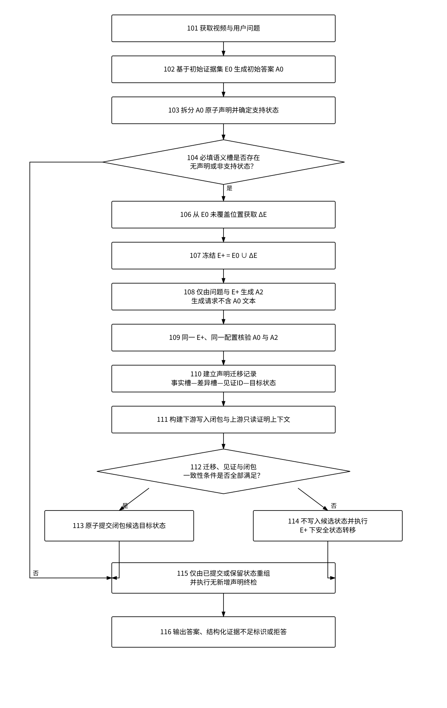
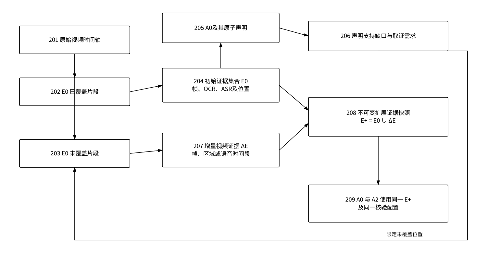
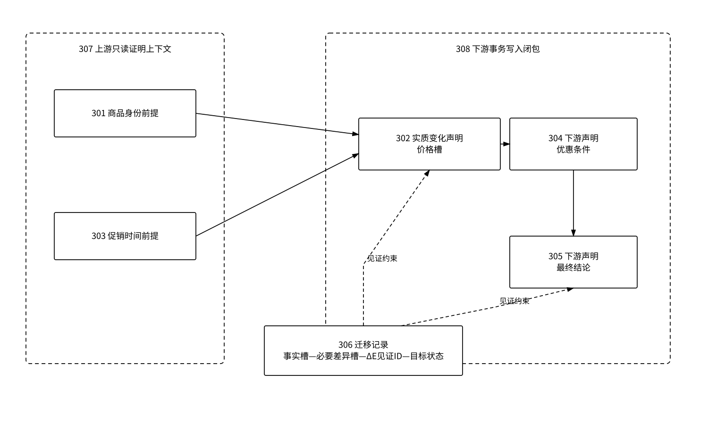
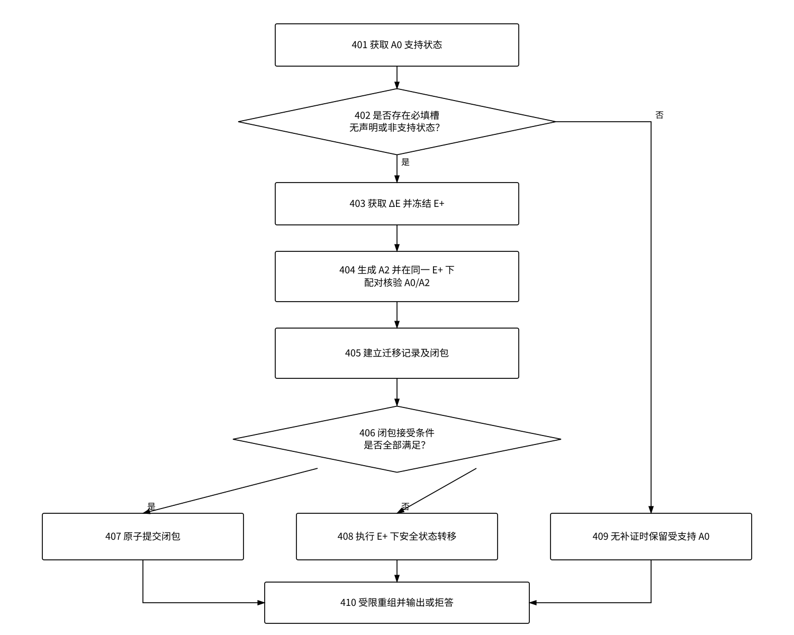
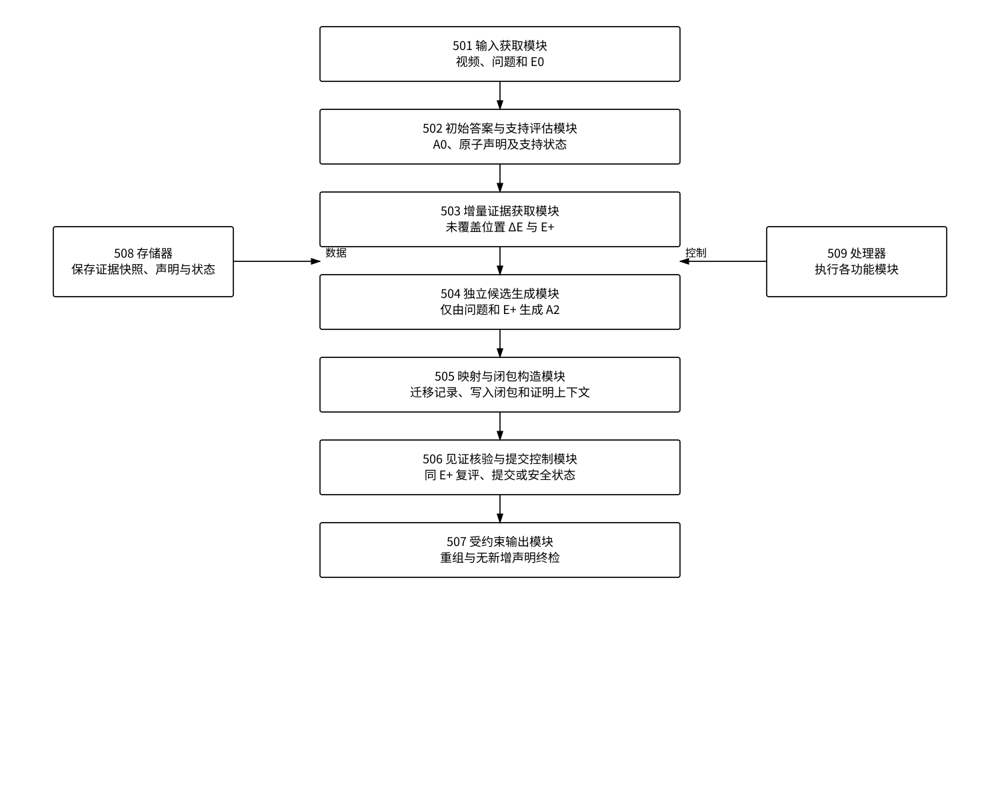

# 一种基于增量视频证据与声明依赖闭包的视频问答答案更新控制方法、装置、设备及存储介质

## 摘要

本发明公开一种视频问答答案更新控制方法。基于初始证据E0生成初始答案A0；当问题必填语义槽缺少受支持声明时，从同一视频中E0未覆盖位置取得增量证据ΔE并形成E+。仅以问题和E+生成不接收A0文本的候选答案A2，并在同一E+和同一核验定义下核验A0与A2。将新旧答案映射为原子声明迁移，以本轮ΔE见证必要差异，依据有向声明依赖构造写入闭包和只读证明上下文。闭包内迁移全部成立时原子提交，否则按E+下支持状态继续取证、保留、撤回或拒答。最终答案仅由已提交或保留的受支持声明重组，并经无新增声明终检。本发明避免不同证据口径导致的不可比更新，并避免失败回退时复活失效旧声明。

摘要附图：图1。

## 权利要求书

### 一、方法权利要求

**1.** 一种视频问答的答案更新控制方法，其特征在于，包括：

获取视频和针对所述视频的用户问题，确定初始视频证据集合 E0，并基于 E0 生成初始答案 A0；

将 A0 拆解为原子声明，并基于原子声明与 E0 的对应关系确定各原子声明的支持状态；所述支持状态包括相互排他的支持状态、证据不足状态和冲突状态；从所述用户问题确定问题必填语义槽，当任一问题必填语义槽没有对应原子声明，或者对应原子声明不处于支持状态时，确定未覆盖证据需求；

根据所述未覆盖证据需求，从所述视频中获取源片段或覆盖位置不属于 E0 的增量视频证据 ΔE，并将 E0 和 ΔE 合并为扩展证据集合 E+；

以用户问题和 E+ 的标识及证据单元作为候选答案生成请求的正面输入载荷生成候选答案 A2，所述输入载荷不包含 A0 的文本，也不包含由 A0 生成的验证问题、改写指令、润色指令或候选答案文本；

分别将 A0 和 A2 拆解为原子声明，建立 A0 原子声明与 A2 原子声明之间的声明映射；针对每一实质变化声明建立迁移记录，所述迁移记录至少包括规范化事实槽、必要差异证据槽、ΔE 见证证据标识和候选目标状态；基于所述迁移记录和预定义的有向声明依赖关系，从实质变化声明确定受影响声明闭包以及用于核验所述受影响声明闭包的只读证明上下文；

在相同的 E+ 和相同的声明核验定义下，分别确定所述受影响声明闭包所涉及的声明映射中每一对已映射 A0 原子声明和 A2 原子声明、以及未匹配 A0 原子声明或未匹配 A2 原子声明的支持状态，并以共同的规范化事实槽关联已映射声明的核验结果；以及针对每一迁移记录，从 ΔE 中确定覆盖所述必要差异证据槽的见证证据，所述见证证据至少包括视频帧位置或时间区间和证据模态，对于画面文字或标识类见证还包括图像区域；

当所述受影响声明闭包内的每一迁移记录均满足预设迁移条件、每一必要差异证据槽均具有所述见证证据、所述受影响声明闭包内同一规范化事实槽不存在非等价候选目标状态、且所述证明上下文不存在冲突状态时，将所述受影响声明闭包中的全部候选目标状态作为一个事务原子提交；其中，所述预设迁移条件至少包括：新增迁移对应的 A2 原子声明在 E+ 下处于支持状态；替换迁移对应的 A2 原子声明在 E+ 下处于支持状态，且对应的 A0 原子声明在 E+ 下处于冲突状态，或者所述 A0 原子声明处于证据不足状态、新旧槽值互斥且 ΔE 正向支持候选槽值；撤回迁移对应的 A0 原子声明在 E+ 下处于冲突状态；当所述受影响声明闭包中的任一迁移记录不满足前述条件时，不写入该受影响声明闭包中的任一候选目标状态；

当不写入候选目标状态时，按照预设状态转移次序处理：在仍有取证预算时继续获取视频证据；在不继续取证时，保留在 E+ 下处于支持状态的旧声明，对处于证据不足状态的旧声明输出证据不足标识，对处于冲突状态且不存在受支持替代声明的旧声明撤回；当任一问题必填语义槽无法由受支持声明唯一填充时，按照预设输出协议输出证据不足标识或拒绝回答；当声明核验未得到可用结果且取证预算耗尽时，将对应问题必填语义槽视为不能由受支持声明唯一填充，并按照所述预设输出协议输出证据不足标识或拒绝回答；其中，不恢复输出在 E+ 下已处于证据不足状态或冲突状态且映射至问题必填语义槽的 A0 原子声明；以及

仅基于彼此不存在规范化事实槽冲突的已提交候选目标状态和保留的受支持旧状态生成最终答案，并在输出前核验最终答案未引入所述已提交候选目标状态和保留的受支持旧状态之外的新声明。

**2.** 根据权利要求1所述的方法，其特征在于，所述声明映射以原子声明的事件标识、主体角色和谓词槽构成的规范化事实槽作为主映射键，并以时间范围相容关系作为映射约束；原子声明的客体值或属性值不作为主映射键而用于确定迁移类型；所述声明映射包括一对一映射、一对多映射、多对一映射和未匹配映射。

**3.** 根据权利要求2所述的方法，其特征在于，所述声明迁移类型包括：规范化事实槽相同而客体值或属性值非等价的替换；仅在 A2 中出现的新增；仅在 A0 中出现的撤回；规范化事实槽和值均等价的保持；以及规范化事实槽和值均等价而表达合并的等价压缩；其中，替换、新增和撤回属于实质变化声明。

**4.** 根据权利要求1所述的方法，其特征在于，所述有向声明依赖关系包括属性依赖、数量依赖、时间依赖和因果依赖中的至少一种；若边 X→Y 表示声明 Y 的成立依赖声明 X，则从实质变化声明沿出边方向确定下游受影响声明作为状态写入集合，并沿入边方向确定上游声明作为只读证明上下文，所述只读证明上下文构成证明引用集合且不因被引用而成为回滚对象。

**5.** 根据权利要求4所述的方法，其特征在于，仅在依赖边两端的原子声明对应同一经消歧事件标识、依赖边属于预设关系类型、置信信息达到预设条件并满足预设时间关系时，将依赖边用于构造受影响声明闭包；当闭包节点数量超过预设上限、事件不能消歧或核验发生异常时，禁止提交所述闭包并进入权利要求1所述状态转移次序。

**6.** 根据权利要求3所述的方法，其特征在于，所述预设迁移条件包括：新增声明处于支持状态且其必要差异证据槽具有来自 ΔE 的支持见证；替换声明处于支持状态，且对应旧声明处于冲突状态，或者对应旧声明处于证据不足状态、新旧槽值互斥且 ΔE 正向支持候选槽值；撤回声明具有来自 ΔE 的冲突见证；保持声明对应的旧声明在 E+ 下处于支持状态；等价压缩声明在 E+ 下处于支持状态。

**7.** 根据权利要求1所述的方法，其特征在于，对 A0 和 A2 的核验记录均包括相同的扩展证据集合标识和验证器配置标识；支持度经预设且互斥的状态判定规则映射为支持状态、证据不足状态或冲突状态；核验异常记为异常状态，不作为支持状态参与提交，并触发禁止提交和安全状态转移；候选目标状态的提交等级包括候选声明支持度满足预设绝对支持条件，且可选地包括候选声明相对于对应旧声明在 E+ 下满足预设提升关系。

**8.** 根据权利要求1所述的方法，其特征在于，所述见证证据记录包括证据标识、视频标识、初始证据或增量证据来源标识、帧号或时间区间、证据模态和与必要差异证据槽的对应关系；对于画面文字或标识类证据，还记录图像区域；实质变化声明的必要差异证据槽仅由本轮 ΔE 中的证据单元覆盖。

**9.** 根据权利要求4所述的方法，其特征在于，当第一受影响声明闭包的状态写入集合与第二受影响声明闭包的证明引用集合包含同一规范化事实槽，且第一受影响声明闭包对该事实槽作出非等价状态改变时，在第一受影响声明闭包处理后，使用改变后的事实槽状态重新核验第二受影响声明闭包；重新核验后仍存在非等价候选目标状态或证明上下文冲突状态时，将两个受影响声明闭包合并为联合闭包，并仅在联合闭包整体满足权利要求1所述提交条件时提交。

**10.** 根据权利要求1所述的方法，其特征在于，当处于冲突状态且不存在受支持替代声明的旧原子声明仅对应非必填语义槽时，撤回该旧原子声明并保留其他受支持声明；当任一必填语义槽在取证预算耗尽后仍没有对应受支持声明，或者存在多个相互冲突的受支持声明时，在系统输出协议允许结构化不充分结果时输出证据不足标识，在所述输出协议不允许结构化不充分结果时拒绝回答。

**11.** 根据权利要求1所述的方法，其特征在于，生成最终答案时采用受约束结构化重组过程，所述过程的输入仅包括已提交或保留的原子声明标识、声明文本和对应证据标识；将生成的最终答案再次拆解为输出原子声明，并在任一输出原子声明无法映射到已提交或保留的原子声明时，先删除该输出原子声明并重新执行结构化重组；若重新执行结构化重组后仍存在无法映射的输出原子声明，则回到 E+ 下最后一个仍受支持的状态，或者在问题必填语义槽无法填充时拒绝回答。

**12.** 根据权利要求1所述的方法，其特征在于，所述初始视频证据集合通过候选视频帧的问题相关度和候选视频帧相对于已选视频帧的最大视觉相似度确定；所述增量视频证据的候选位置排除初始视频证据集合已覆盖的原始视频时间段或源片段，所述增量视频证据包括新增完整帧、带位置画面文字、带时间段语音文本和局部区域视图中的至少一种。

**13.** 根据权利要求8所述的方法，其特征在于，以同模态、近似时间位置、满足分辨率和输入令牌数量匹配条件且经核验不支持实质变化声明的非见证证据集合替换所述见证证据集合；当替换前后的支持度差达到预设必要性条件时，将所述见证证据确定为所述实质变化声明的必要见证。

**14.** 根据权利要求1所述的方法，其特征在于，在证据获取、声明核验和闭包更新过程中记录视频标识、证据集合标识、原子声明标识、声明映射、迁移记录、依赖边类型、见证证据、支持状态、闭包标识、状态写入集合、证明引用集合、提交或不提交动作及原因代码中的至少一项。

### 二、装置、设备和存储介质权利要求

**15.** 一种视频问答的答案更新控制装置，其特征在于，包括：初始证据与初始答案生成单元、证据缺口确定单元、增量证据获取单元、候选答案生成单元、同证据声明核验单元、迁移记录与闭包构造单元、闭包状态控制单元以及受限重组单元；所述各单元被配置为执行权利要求1至14任一项所述的方法。

**16.** 一种电子设备，包括处理器和存储器，所述存储器中存储有计算机程序，其特征在于，所述计算机程序被所述处理器执行时，实现权利要求1至14任一项所述的方法。

**17.** 一种计算机可读存储介质，其上存储有计算机程序，其特征在于，所述计算机程序被处理器执行时，实现权利要求1至14任一项所述的方法。

## 说明书

### 一、技术领域

本发明涉及视频处理、计算机视觉、语音处理和自然语言处理技术领域，尤其涉及一种通过同一视频内的增量证据、声明—视频证据核验和依赖闭包状态控制更新视频问答答案的方法、装置、电子设备和存储介质。

### 二、背景技术

高信息密度视频中的文字、数量、人物、动作、时间或因果关系可能只出现在少数帧或短时语音片段中。受输入预算限制，首次回答所使用的帧、画面文字或语音文本可能不能覆盖全部决定性证据。

已有视频问答方案可以在答案置信信息较低时更新候选区域、重选视频帧并迭代生成答案；也可以对初始答案执行验证或修正；还可以生成多候选答案并评分，或者使用跨模态对齐、区域表征和约束解码。此类方案仍可能使初始答案和候选答案基于不同证据集合获得状态，导致结果不可比；也可能只按整体答案评价而未对具体事实变化建立新增证据依据；候选答案失败时若整体恢复初始答案，则会重新输出已被扩展证据否定或未支持的旧事实。

因此，需要将补证、候选生成、同证据核验、声明变化控制和输出约束组织为连续的声明—证据状态控制过程。

### 三、发明要解决的技术问题

本发明至少解决以下相互关联的问题：

1. 初始视频证据未覆盖决定性事实时，如何从同一视频获得可回溯且区别于初始覆盖位置的增量证据；
2. 如何使候选答案不受初始答案文本的直接改写约束，并在相同扩展证据口径下比较新旧答案；
3. 如何避免整体评分掩盖新增、替换、撤回等具体事实变化缺少必要证据；
4. 如何对依赖声明进行局部一致更新，而不将只读证明前提误作回滚对象；
5. 如何在更新失败时避免恢复当前证据快照下已失效的旧声明；
6. 如何阻止最终自然语言重组阶段引入未经核验的新事实。

### 四、术语和数据结构

1. **初始视频证据集合 E0**：首次生成 A0 前，在预设输入预算内从原始视频取得的视频帧、区域、画面文字或带时间段语音文本。
2. **增量视频证据 ΔE**：识别出证据缺口后从同一原始视频取得，且其源片段或覆盖位置不属于 E0 已覆盖范围的证据。
3. **扩展证据集合 E+**：E0 与 ΔE 合并形成的不可变证据快照；A0 与 A2 的比较使用相同 E+ 标识、内容和核验配置。
4. **原子声明**：可由视频证据分别判定为支持、证据不足或冲突的最小事实语义单元。
5. **支持度与支持状态**：支持度为核验器在一个证据快照下输出的数值或等级依据；支持度经预设且相互排他的规则映射为支持、证据不足或冲突状态。异常状态表示核验没有得到可用结果，不属于前述三种状态。
6. **规范化事实槽**：由事件标识、主体角色和谓词槽组成的、用于映射新旧原子声明的键。
7. **必要差异证据槽**：为判定一个实质变化是否成立而相对于保持状态需要由视频证据覆盖的语义槽。例如价格替换至少包括候选价格数值、单位和价格语境；时间替换包括候选时间范围和事件关联。
8. **迁移记录**：针对一个实质变化声明保存规范化事实槽、必要差异证据槽、ΔE 见证证据标识、旧状态、候选目标状态和处理结果的结构化记录。
9. **受影响声明闭包**：从实质变化声明沿预定义出边方向取得、需要共同写入或不写入的下游声明集合。
10. **证明上下文**：核验闭包时需要读取的上游声明及证据；其为只读集合，不因被引用而自动回滚。
11. **候选目标状态**：就一个闭包拟写入的新增、替换、撤回或等价压缩后的结构化状态；证据不足和异常状态不构成可提交的事实目标状态。
12. **提交条件**：闭包内每个迁移记录均符合迁移条件、必要差异证据槽均有 ΔE 见证、无同一事实槽非等价候选目标状态且证明上下文无冲突状态的合取条件。
13. **问题必填语义槽**：由问题类型确定、最终答案需要由受支持声明填充的实体、属性、数量及单位、时间、地点或因果槽。

一种可实施的数据结构如下：

| 记录 | 主要字段 | 用途 |
|---|---|---|
| `EvidenceUnit` | `evidence_id`、`video_id`、`origin`、`modality`、`source_span_id`、`frame_id/time_range`、`bbox` | 区分 E0 与 ΔE 并回溯时空位置 |
| `EvidenceSnapshot` | `snapshot_id`、`video_id`、`initial_ids`、`incremental_ids`、`verifier_config_id` | 固定 E+ 核验口径 |
| `ClaimNode` | `claim_id`、`answer_id`、`event_id`、`subject_role`、`predicate`、`value`、`required_slots` | 表示可单独核验的声明 |
| `MigrationRecord` | `fact_slot`、`transition_type`、`necessary_difference_slots`、`delta_witness_ids`、`old_state`、`target_state` | 串联变化、见证和提交判定 |
| `DependencyEdge` | `source_claim_id`、`target_claim_id`、`relation_type`、`event_id`、`confidence` | 表示有向依赖 |
| `ClosureRecord` | `closure_id`、`write_set`、`proof_read_set`、`migration_ids`、`status` | 分离写入对象、证明上下文和迁移记录 |

### 五、发明内容

#### 5.1 单一发明构思

本发明的单一发明构思为：**增量视频证据条件下的声明事务状态控制**。

声明支持缺口限定 ΔE 的获取；E0 与 ΔE 形成唯一 E+ 快照；A2 通过不含 A0 的请求载荷独立生成；A0/A2 在相同 E+ 下进行映射和核验；每项变化通过迁移记录绑定 ΔE 见证；迁移记录和有向依赖关系共同决定闭包提交；最终文本仅由提交或保留状态重组。各步骤围绕相同证据快照、事实槽和状态连续传递数据。

#### 5.2 总体流程

```text
视频 V + 问题 Q → E0 → A0 → 必填槽缺口
                              ↓
                   未覆盖位置获取 ΔE
                              ↓
                        E+ = E0 ∪ ΔE
                       ↙                 ↘
             A0 在 E+ 下核验     payload(Q,E+) → A2 → E+ 下核验
                       ↘                 ↙
           声明映射 → 迁移记录（槽/差异槽/见证/目标）
                                      ↓
                    闭包 + 证明上下文 + 提交条件
                           ↙                     ↘
                      原子提交                安全状态转移
                                      ↓
                     受限重组 + 无新增声明终检 → 输出
```

#### 5.3 技术效果

1. 同一 E+ 快照和核验配置使 A0/A2 的状态可比较；
2. 迁移记录要求每项变化的必要差异证据槽具有 ΔE 见证，避免整体评分掩盖局部无证据变化；
3. 下游闭包和上游证明上下文分离，使相关状态一致更新并限制回滚范围；
4. 状态机不复活 E+ 下已失效的旧声明；
5. 受限重组与终检阻止输出阶段重新引入未经核验的事实。

上述效果不表示已经取得特定准确率、时延或其他实验数值，也不保证任意模型或数据集上的固定增益。

### 六、附图说明

图1为总体流程图；

图2为 E0、ΔE 和 E+ 证据快照关系图；

图3为下游受影响声明闭包与上游证明上下文双域图；

图4为提交、继续取证、保留、证据不足、撤回和拒答的状态转移图；

图5为答案更新控制装置结构图。











### 七、具体实施方式

#### 实施方式一：初始证据、缺口和同视频增量取证

系统建立带原始位置的多模态视频索引：视频帧记录帧号和时间戳，OCR 记录文本、帧号、时间戳和区域，ASR 记录文本和起止时间。E0 可在预设视图或视觉令牌预算内形成。一个可选的初始帧选择分数为：

```text
MMR(f) = λ·Rel(q,f) - (1-λ)·max Sim(f,s), s∈S
```

其中 `Rel` 为问题相关度，`Sim` 为视觉相似度，S 为已选帧集合。生成 A0 后，系统依据问题确定必填槽并判定：必填槽无原子声明，或有原子声明但状态为证据不足、冲突或异常时，均形成未覆盖证据需求。系统从同一原始视频选择 ΔE，并按 `source_span_id` 或原始时间范围排除 E0 已覆盖片段。

#### 实施方式二：A2 请求载荷和同 E+ 核验

为 E+ 建立 `snapshot_id`。候选生成请求的正面载荷可表示为：

```text
payload = {
  question: Q,
  evidence_snapshot_id: Eplus.snapshot_id,
  evidence_units: [frame/OCR/ASR units in Eplus]
}
```

该载荷不包括 `initial_answer`、由 A0 生成的验证问题、改写提示、润色提示或候选答案草稿。A0 与 A2 均以相同 E+ 内容、证据顺序、输入预算和验证器配置核验；若快照或配置不一致，则不执行相对状态比较和替换。

#### 实施方式三：声明映射、迁移记录和双域闭包

每项原子声明包括事件、主体角色、谓词和值。系统在同一视频内进行事件和主体消歧，再按 `(event_id, subject_role, predicate)` 映射 A0/A2。值不作为主映射键，而用于判定替换等迁移类型。

对每一实质变化创建迁移记录。例如，A0“商品 P1 的优惠价格为199元”与 A2“商品 P1 的优惠价格为99元”映射到 `(促销事件E7, 商品P1, price_of)`，记录的必要差异证据槽为“候选数值99、货币单位、促销价格语境”，`delta_witness_ids` 指向 OCR 区域和 ASR 时间段，候选目标状态为“以99元替换199元”。商品身份和促销对象等基础身份槽如在 E0 与 E+ 下均已获支持，可以沿用 E0 的证据；只有使该迁移与保持状态不同的必要差异证据槽必须由 ΔE 见证覆盖。

边 X→Y 表示 Y 的成立依赖 X。从实质变化声明沿出边形成状态写入集合；沿入边形成只读证明上下文。仅在边两端事件相同、满足时间关系并达到关系抽取置信条件时，接受属性、数量、时间和因果等预设边。一种保守实现限制为一跳且最多三个节点；超限或不能消歧时禁止提交。

#### 实施方式四：状态、见证和提交判定

支持状态为相互排他的三态：支持、证据不足和冲突。核验不能得到可用结果时记为异常状态，异常状态不被当作证据不足或支持处理，而是禁止闭包提交并进入安全状态分支。

一种可选的状态判定实现为：核验器针对同一原子声明汇总支持分数 `support_score` 和冲突分数 `conflict_score`；若核验器发生超时、输入不完整或未产生可用分数，则输出异常状态；否则按固定优先次序判定，先在 `conflict_score ≥ θ_c` 时输出冲突状态，再在 `support_score ≥ θ_s` 时输出支持状态，其余输出证据不足状态。A0 与 A2 使用相同的阈值、优先次序和核验器配置，由此保证四种输出互斥。

系统依据迁移类型确定必要差异证据槽。新增或替换需要候选值的正向支持；撤回需要旧值的直接冲突见证，单纯证据不足不触发静默删除。闭包中的每条迁移记录均应满足状态、见证和一致性条件；任意一条失败即不写入整个闭包的候选目标状态。

#### 实施方式五：安全状态机

| 当前条件 | 闭包动作 | 输出动作 |
|---|---|---|
| 全部迁移记录成立、差异槽均有 ΔE 见证且无冲突 | 原子提交候选目标状态 | 使用已提交声明 |
| 任一迁移记录失败或核验异常 | 不写入闭包 | 进入安全分支 |
| 候选失败且旧声明在 E+ 下支持 | 不提交候选 | 保留旧声明 |
| 旧声明证据不足且仍有预算 | 不提交 | 继续取证 |
| 旧声明证据不足且预算耗尽 | 不提交 | 输出证据不足标识；必填槽不能填充时拒答 |
| 旧声明冲突且无受支持替代 | 撤回旧声明 | 非必填槽局部撤回；必填槽不能填充时拒答 |

回退目标不是固定 A0 全文，而是 E+ 下最后一个仍受支持且与已提交闭包无事实槽冲突的结构化状态。

#### 实施方式六：跨闭包传播和冲突撤回

每个闭包记录状态写入集合 W 和证明引用集合 R。当闭包 B 的 W 与闭包 A 的 R 含同一规范化事实槽，即 `W_B ∩ R_A ≠ ∅`，且 B 对该槽作出非等价状态改变时，A 的证明前提失效。系统在处理 B 后以改变后的事实槽状态重新核验 A；若仍有非等价候选目标状态或证明上下文冲突，则将 A、B 合并为联合闭包，只有整体满足提交条件时才提交。

例如，A 的“商品价格为99元”依赖 B 的“促销有效时间为12秒至15秒”。若 B 因 ΔE 表明促销时间改为20秒至23秒，系统重新核验 A；若价格见证不在新时间段内，则不允许 A 保持原状态。若 ΔE 显示“199元”是满减门槛而非最终价格，且没有受支持最终价格替代值，则撤回“最终价格为199元”；若最终价格为必填槽，系统输出证据不足标识或拒答。

#### 实施方式七：受限重组和终检

系统把已提交候选声明和保留的受支持旧声明纳入允许输出集合 `C_allow`。重组器仅可读取 `C_allow` 的声明文本、槽值和证据标识。重组输出再次拆解为 `C_out`；若任一输出声明不能映射至 `C_allow`，先删除该语句并重新重组；若重组后仍存在无法映射的输出声明，则回到 E+ 下最后一个仍受支持状态，或在必填槽无法填充时拒答。

#### 实施方式八：处理伪代码

```text
E0 = SelectInitialEvidence(video, question)
A0 = GenerateAnswer(question, E0)
C0 = ParseClaims(A0)
state0 = Verify(C0, E0)

if not HasRequiredSlotGap(C0, state0, question):
    allowed = SupportedClaims(C0, state0)
    return FinalNoNewClaimCheck(ConstrainedRender(allowed), allowed)

deltaE = AcquireIncrementalEvidence(video, need, exclude=Coverage(E0))
Eplus = FreezeSnapshot(E0, deltaE)
A2 = GenerateAnswer(payload={question, Eplus}, initial_answer_text=None)
C0plus, C2 = ParseClaims(A0), ParseClaims(A2)
old, new = Verify(C0plus, Eplus), Verify(C2, Eplus)
records = BuildMigrationRecords(AlignClaims(C0plus, C2), deltaE)

for closure in BuildAffectedClosures(records):
    if CommitConditionsMet(closure, records, old, new, deltaE):
        AtomicCommit(closure)
    else:
        RejectAllCandidateWritesIn(closure)
        ApplySafeState(closure, old)

RevalidateClosuresWhoseProofContextChanged()
allowed = CommittedOrSupportedClaims()
if not RequiredSlotsUniquelyFilled(allowed, question):
    return InsufficientOrAbstain()
answer = ConstrainedRender(allowed)
return FinalNoNewClaimCheck(answer, allowed)
```

### 八、完整示例

#### 示例一：由 ΔE 见证的价格替换

问题为“视频中商品显示的优惠价格是多少”。E0 中的商品身份、促销对象和远景画面支持商品 P1 的身份，但未显示可辨价格。A0 为“优惠价格是199元”，价格必填槽有声明但为证据不足，触发 ΔE。第12.4秒的 ΔE OCR 区域为“限时99元”，同一时间段 ASR 为“现在只要九十九元”。A2 请求载荷仅含 Q、E+ 标识和 E+ 证据单元，不含 A0 或由 A0 生成的提示，生成“优惠价格是99元”。

迁移记录以 `(促销事件E7, 商品P1, price_of)` 为规范化事实槽，必要差异证据槽为数值99、货币单位和价格语境，见证标识为 OCR 区域和 ASR 时间段；商品身份槽沿用 E0 的受支持证据。A0 价格在 E+ 下为冲突，A2 价格为支持，迁移记录闭合后原子提交“99元”。

#### 示例二：附加声明不闭合时局部不写入

问题为“视频介绍了产品的什么特点”。A0 为“该产品防水”，A2 为“该产品防水，售价99元”。E+ 支持“防水”，但“99元”仅来自缺少货币单位和价格语境的孤立数字。防水保持记录满足条件，价格新增记录缺少必要差异证据槽见证，不写入价格闭包。价格不是必填槽，最终输出“该产品具有防水特点”。

#### 示例三：旧值冲突、候选值证据不足时拒答

问题为“视频中商品的最终价格是多少”。A0 为“199元”，A2 为“99元”。ΔE 明确显示“满199减100”，由此可知“199元”为门槛金额而非最终价格，故 A0 的“最终价格199元”在 E+ 下为冲突；但 ΔE 没有给出最终成交价，A2 的“最终价格99元”为证据不足。替换记录不满足候选支持条件，且旧声明没有可保留状态；系统撤回旧声明。最终价格是必填槽，取证预算耗尽后输出证据不足标识或拒答，不恢复 A0。

### 九、装置实施方式

所述装置可以包括视频证据索引、初始答案生成、证据缺口确定、增量证据获取、候选答案生成、同证据声明核验、迁移记录与闭包构造、闭包状态控制和受限重组单元。所述单元可由同一处理器或通过网络连接的多个处理器执行；存储器保存视频索引、证据快照、原子声明、迁移记录、依赖边和决策记录。

### 十、其他实施方式

1. 本发明不限定答案生成模型、视觉编码模型、OCR 模型、ASR 模型或声明核验模型；
2. E0 与 ΔE 可以包含一种或多种视频证据模态，但实质变化的见证能够回溯到同一原始视频；
3. 闭包可以是一跳或多跳，实施时可通过关系类型、置信条件、时间范围和节点上限保持稀疏；
4. 支持状态可以由离散分类、概率、能量值或其组合确定，但状态判定规则相互排他，A0 与 A2 在相同 E+ 和相同核验定义下比较；
5. 当产品要求必须回答时，可以输出结构化证据不足标识而非自然语言拒答；
6. 最终答案可以是文本、结构化槽值、语音或其他由已提交或保留声明确定的输出形式。
