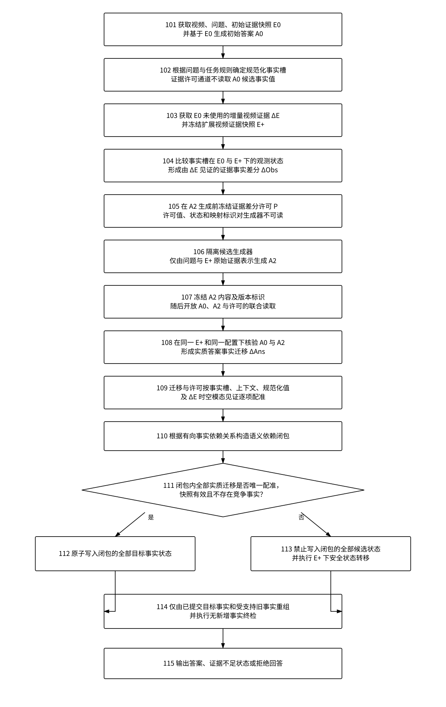
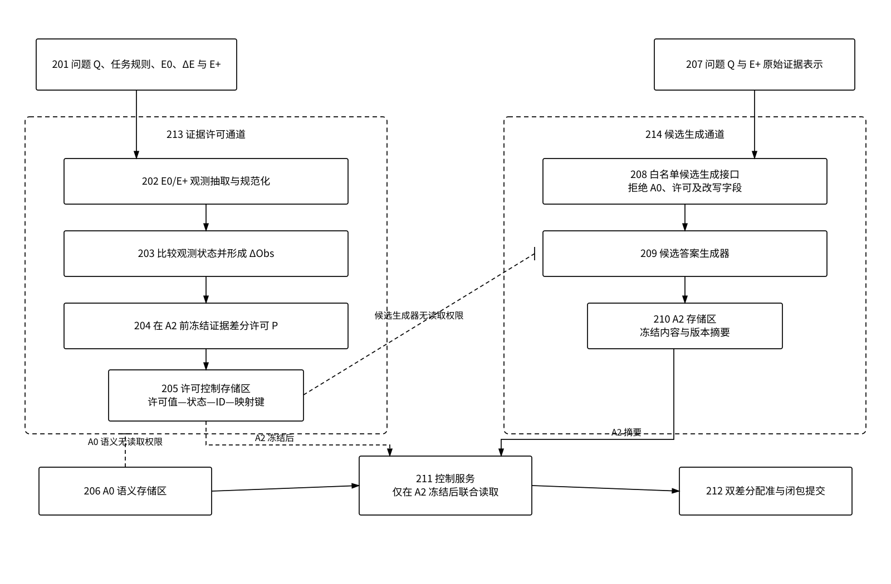
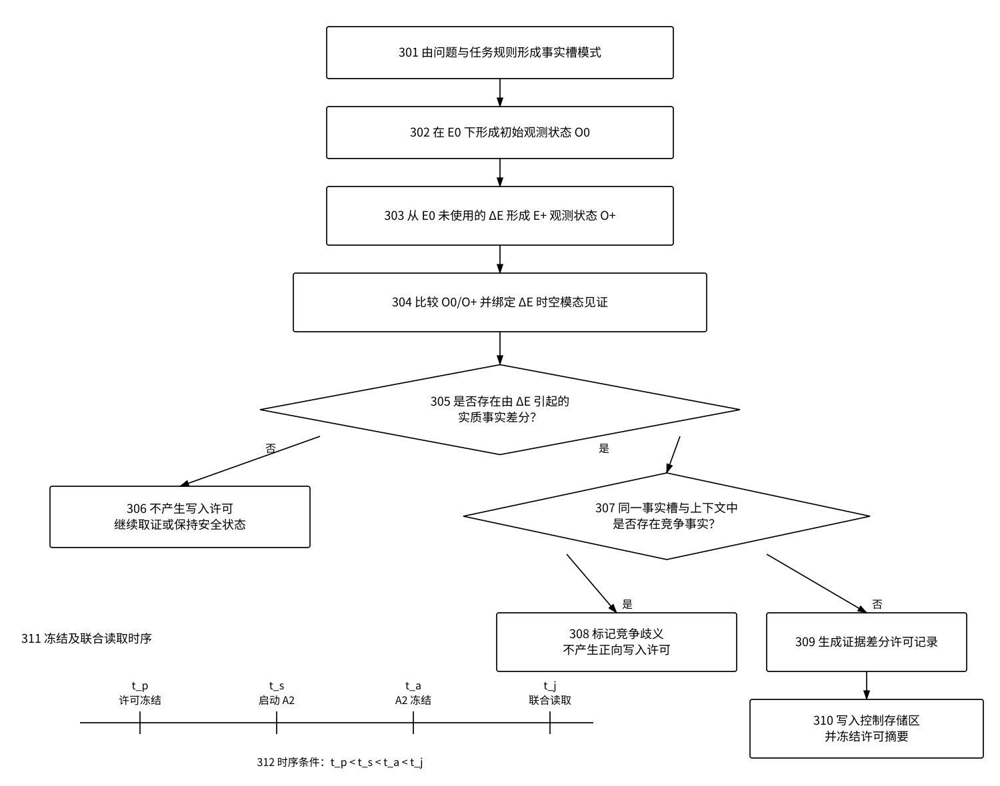
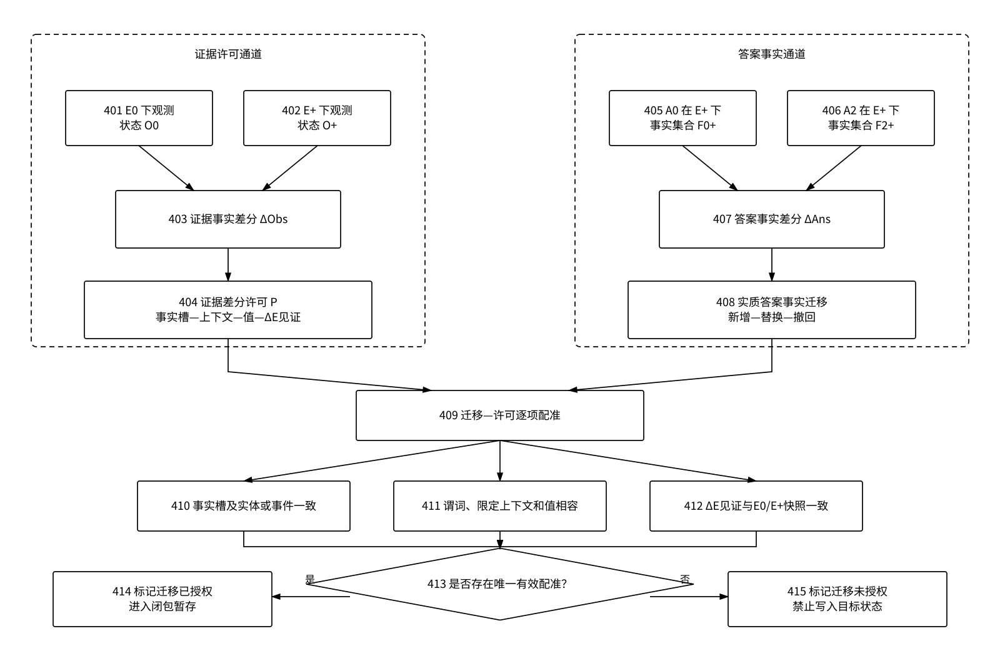
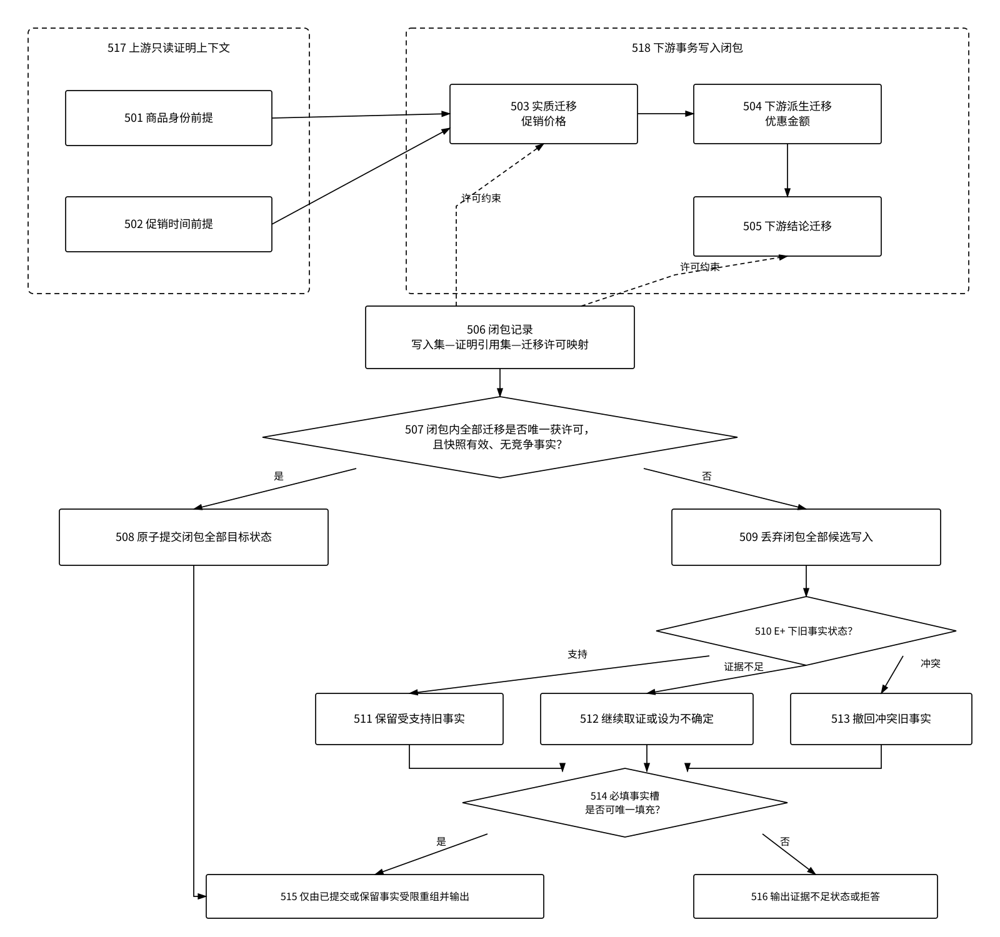
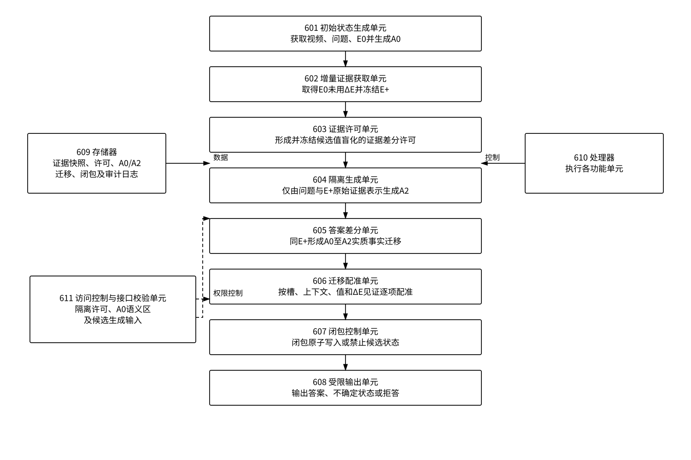

# 一种基于视频证据双差分许可的视频问答答案更新控制方法、装置、设备及存储介质

> 版本：V4.5 查新后重写初稿  
> 日期：2026-08-23  
> 定位：代理人讨论和后续定稿用 Markdown 初稿；不覆盖 V4—V4.4 历史版本。  
> 说明：本文不主张任何尚未冻结的准确率或性能数值；正式递交前需由专利代理人复核权利要求用语、在先公开和检索结果。

## 摘要

本发明公开一种基于视频证据双差分许可的视频问答答案更新控制方法。系统从同一视频取得初始证据 E0 和未使用的增量证据 ΔE，形成 E+。证据许可通道在不读取 A0 或候选事实值的条件下比较 E0/E+ 观测状态，并在 A2 生成前冻结许可；候选生成器仅读取问题与 E+ 原始证据，不能读取 A0 及许可。系统在同一 E+ 下形成 A0→A2 事实迁移，并与许可按事实槽、上下文、规范化值和 ΔE 见证逐项配准。仅当依赖闭包内全部迁移配准成功且无竞争事实时原子写入，否则禁止写入并输出受支持状态、不确定状态或拒答。本发明阻断候选值反向选证、许可泄漏造成的虚假一致及无增量证据支撑的答案更新。

摘要附图：图1。

---

## 权利要求书

### 一、方法权利要求

**1.** 一种基于视频证据差分与答案事实差分配准的视频问答答案更新控制方法，其特征在于，包括：

获取视频、针对所述视频的问题、初始视频证据快照 E0 以及基于所述初始视频证据快照 E0 生成的初始答案 A0；

根据所述问题和预设任务规则确定至少一个规范化事实槽，并由证据许可通道在不读取所述初始答案 A0 的候选事实值的条件下，确定所述规范化事实槽在所述初始视频证据快照 E0 下的初始观测状态；

针对所述规范化事实槽，从所述视频中取得源证据单元不属于所述初始视频证据快照 E0 已使用证据单元的增量视频证据 ΔE，并冻结由所述初始视频证据快照 E0 与所述增量视频证据 ΔE 构成的扩展视频证据快照 E+；

由所述证据许可通道，按照相同的事实槽模式和规范化配置，分别确定所述规范化事实槽在 E0 与 E+ 下的规范化观测状态；当 E0 下的规范化观测状态与 E+ 下由所述增量视频证据 ΔE 形成的规范化观测状态之间存在实质事实差分时，生成证据差分许可记录，所述证据差分许可记录至少关联事实槽标识、旧观测状态、新观测状态、规范化事实值或状态目标、E0/E+ 快照标识以及属于所述增量视频证据 ΔE 的时空模态见证；其中，生成所述证据差分许可记录时，不以 A0 或候选答案的候选事实值作为证据检索、事实抽取、事实归一化或证据选择的目标；

在生成候选答案前冻结所述证据差分许可记录，并将所述证据差分许可记录保存于候选答案生成器无读取权限的控制存储区，或者通过不向所述候选答案生成器输出许可字段的单向数据接口，使所述证据差分许可记录中的规范化事实值、观测状态、许可标识、竞争组标识和迁移映射标识在候选答案冻结前不能被所述候选答案生成器读取；

在所述证据差分许可记录冻结后，构造包含所述问题和 E+ 的原始视频证据表示的候选生成输入载荷，并由所述候选答案生成器基于所述候选生成输入载荷生成候选答案 A2；所述候选生成输入载荷不包含 A0 的语义内容、由 A0 导出的改写指令以及所述证据差分许可记录；生成 A2 后冻结 A2 的内容及版本标识；

在 A2 冻结后，按照相同的 E+、相同的事实槽模式和相同的核验配置，分别将 A0 与 A2 转换为规范化答案事实并核验各规范化答案事实在 E+ 下的支持状态，进而确定 A0 至 A2 的实质答案事实迁移，所述实质答案事实迁移至少包括新增迁移、替换迁移或撤回迁移；

将每一实质答案事实迁移与所述证据差分许可记录进行配准，所述配准至少包括事实槽、经消歧实体或事件、谓词、限定上下文、规范化值、E0/E+ 快照以及增量视频证据时空模态见证的一致性判断，并要求新增迁移或替换迁移的目标事实在 E+ 下处于支持状态，撤回迁移的旧事实在 E+ 下处于冲突状态；其中，每一实质答案事实迁移至多由一个与其上下文相容的证据差分许可记录直接授权，且同一证据差分许可记录不得授权两个相互不相容的目标事实；

根据预定义的有向事实依赖关系，从所述实质答案事实迁移对应的事实槽沿表示受影响方向的依赖边构造语义依赖闭包；

仅在所述语义依赖闭包中的全部实质答案事实迁移分别与有效的证据差分许可记录配准成功、所引用的 E+ 快照仍有效、且同一事实槽和限定上下文中不存在达到竞争条件的非等价目标事实时，将所述语义依赖闭包中的目标事实状态作为一个事务原子写入可输出状态集合；当任一实质答案事实迁移未配准成功、许可记录失效、存在非等价竞争事实或闭包不完整时，禁止写入所述语义依赖闭包中的全部候选目标事实状态；以及

基于所述可输出状态集合以及 E+ 下仍处于支持状态的旧事实状态生成最终答案；对于被禁止写入且不存在 E+ 下受支持旧事实状态的必填事实槽，输出证据不足状态或拒绝回答。

**2.** 根据权利要求1所述的方法，其特征在于，每个视频证据单元包括视频标识、源片段标识、帧号或时间区间、证据模态和内容摘要；对于图像区域、画面文字或标识类证据，还包括区域坐标；所述增量视频证据 ΔE 的源片段标识、原始时间覆盖范围或区域视图标识不属于 E0 的已使用证据单元集合。

**3.** 根据权利要求1所述的方法，其特征在于，所述事实槽模式至少包括主体类型、谓词类型、值类型、单位类型、限定字段、槽基数规则、允许证据模态和归一化规则；所述初始观测状态和扩展观测状态至少包括未解析、唯一解析、竞争歧义和冲突状态；所述事实槽模式由问题和任务规则确定，不由 A0 或 A2 的候选事实值生成。

**4.** 根据权利要求3所述的方法，其特征在于，所述证据差分许可记录还包括许可类型、增量证据标识集合、竞争组标识、许可生成时间、许可摘要值和快照版本；所述许可类型至少包括事实值写入许可和事实冲突许可，所述事实冲突许可由不读取 A0 候选事实值的证据许可通道依据 E+ 下的确定事实或显式否定事实形成，并在 A2 冻结后用于判断是否授权对应旧事实的撤回；竞争歧义状态、仅清晰度提高而未解析出规范化事实值的状态以及证据不足状态不产生事实值写入许可。

**5.** 根据权利要求1所述的方法，其特征在于，候选答案生成器与证据许可通道通过以下至少一种方式隔离：采用具有不同访问控制列表的存储区、不同服务账户、不同进程地址空间、仅允许预设字段通过的应用程序接口或候选生成输入模式校验；并记录许可冻结时间 `t_p`、候选生成开始时间 `t_s`、候选冻结时间 `t_a` 和控制服务首次联合读取时间 `t_j`，且满足 `t_p<t_s<t_a<t_j`。

**6.** 根据权利要求3所述的方法，其特征在于，针对槽基数为一且限定上下文相同的事实槽，将规范化值不同的观测划分至同一竞争组；仅当一个值簇满足预设证据质量和适用条件且不存在达到竞争条件的非等价值簇时，生成事实值写入许可；原价和促销价、不同说话人、不同事件阶段或不同适用时间对应的事实观测因限定字段不同而划分至不同上下文。

**7.** 根据权利要求1所述的方法，其特征在于，A0 与 A2 的规范化答案事实采用由事件标识、主体角色和谓词构成的主映射键进行映射，事实值和限定字段用于确定迁移类型；所述迁移类型还包括保持迁移、不确定化迁移和等价压缩，其中保持迁移和等价压缩不构成实质答案事实迁移，不消耗事实值写入许可。

**8.** 根据权利要求1所述的方法，其特征在于，A0 与 A2 在 E+ 下的核验结果采用相互排他的支持状态、证据不足状态、冲突状态和异常状态；新增迁移要求 A2 的新增事实在 E+ 下处于支持状态，替换迁移要求 A2 的目标事实在 E+ 下处于支持状态且 A0 的对应旧事实与所配准许可的新事实不相容或在 E+ 下处于冲突状态，撤回迁移要求 A0 的对应旧事实在 E+ 下受到所配准许可的确定事实或显式否定事实冲突；异常状态不参与提交。

**9.** 根据权利要求1所述的方法，其特征在于，当一个目标事实由两个以上上游事实确定性计算得到时，为所述目标事实建立派生许可记录，所述派生许可记录包括全部上游证据差分许可标识、确定性运算符、输入单位、单位换算规则、舍入规则和 E+ 快照标识；仅在全部上游许可有效且计算结果与答案事实迁移的目标值一致时，允许所述派生许可记录授权对应迁移。

**10.** 根据权利要求1所述的方法，其特征在于，若有向依赖边 `X→Y` 表示事实 Y 的成立依赖事实 X，则从实质答案事实迁移沿出边方向确定需要共同写入或共同不写入的下游事实作为状态写入集合，并沿入边方向确定核验所需的上游事实作为只读证明引用集合；所述只读证明引用集合不因被引用而自动成为回滚对象；依赖边限制为预设的实体、属性、数量、时间或因果关系，并受事件消歧、时间相容条件和节点数量上限约束。

**11.** 根据权利要求10所述的方法，其特征在于，当第一语义依赖闭包的状态写入集合与第二语义依赖闭包的证明引用集合包含同一事实槽，且第一语义依赖闭包对该事实槽执行非等价状态改变时，在第一语义依赖闭包提交或禁止写入后使第二语义依赖闭包的核验结果失效并重新核验；重新核验后仍存在写入—引用冲突时，将两个语义依赖闭包合并为联合闭包。

**12.** 根据权利要求1所述的方法，其特征在于，当闭包禁止写入时：若旧事实在 E+ 下处于支持状态，则保留所述旧事实；若旧事实处于证据不足状态且仍有取证预算，则继续取得增量视频证据；若取证预算耗尽，则将对应事实槽设为不确定状态；若旧事实处于冲突状态且不存在受支持替代事实，则撤回所述旧事实；非必填事实槽被撤回时保留其他受支持事实，必填事实槽无法被唯一受支持事实填充时输出证据不足状态或拒绝回答，并且不恢复 E+ 下已经处于冲突状态的 A0 事实。

**13.** 根据权利要求1所述的方法，其特征在于，生成最终答案时，重组器的输入仅包括所述可输出状态集合中的事实标识、事实值和对应证据标识；将重组结果再次转换为输出事实集合，当输出事实集合中存在不能映射至所述可输出状态集合的新增事实时，删除所述新增事实并重新重组，重新重组后仍存在新增事实时输出结构化事实集合、证据不足状态或拒绝回答。

**14.** 根据权利要求1所述的方法，其特征在于，对用于形成证据差分许可记录的见证证据执行匹配反事实核验：从 E+ 中移除所述见证证据，并分别加入与所述见证证据模态相同、时间位置近似、分辨率和输入预算满足匹配条件且经预核验不支持目标事实的多个非见证证据集合，形成多个反事实证据快照；当所述目标事实在各反事实证据快照下均不能保持所述证据差分许可记录中的目标观测状态时，确定所述见证证据满足差分必要性条件。

**15.** 根据权利要求1所述的方法，其特征在于，记录问题标识、E0/E+ 快照摘要、增量证据标识、事实槽模式、证据差分许可、候选生成输入摘要、A2 内容摘要、联合读取时间、答案事实迁移、迁移—许可配准关系、依赖闭包、提交或禁止写入动作以及原因代码；当 E+ 内容、规范化规则或许可见证发生变化时，将对应许可及其已暂存迁移标记为失效并触发重新核验。

### 二、装置、设备和存储介质权利要求

**16.** 一种基于视频证据双差分许可的视频问答答案更新控制装置，其特征在于，包括：

- 初始状态生成单元，用于获取视频和问题、形成初始视频证据快照 E0 并生成初始答案 A0；
- 增量证据获取单元，用于从同一视频中取得 E0 未使用的增量视频证据 ΔE 并冻结扩展视频证据快照 E+；
- 证据许可单元，用于在不读取 A0 或 A2 候选事实值的条件下比较 E0 与 E+ 的规范化观测状态，生成并冻结证据差分许可记录；
- 隔离生成单元，用于使候选答案生成器读取问题和 E+ 的原始视频证据表示而不能读取 A0 语义内容及所述证据差分许可记录，并生成候选答案 A2；
- 答案差分单元，用于在同一 E+ 下形成 A0 至 A2 的实质答案事实迁移；
- 迁移配准单元，用于按事实槽、上下文、规范化值和增量视频证据见证配准所述实质答案事实迁移与证据差分许可记录；以及
- 闭包控制单元，用于在语义依赖闭包内全部实质答案事实迁移配准成功时原子写入目标事实状态，并在任一迁移未配准成功时禁止写入该闭包的全部候选目标事实状态；

所述各单元被配置为执行权利要求1至15任一项所述的方法。

**17.** 一种电子设备，包括处理器和存储器，所述存储器中存储有计算机程序，其特征在于，所述计算机程序被所述处理器执行时，实现权利要求1至15任一项所述的方法。

**18.** 一种计算机可读存储介质，其上存储有计算机程序，其特征在于，所述计算机程序被处理器执行时，实现权利要求1至15任一项所述的方法。

---

## 说明书

### 一、技术领域

本发明涉及视频处理、计算机视觉、语音处理、自然语言处理以及计算机状态一致性控制技术领域，尤其涉及一种通过增量视频证据观测差分和新旧答案事实差分的隔离生成、配准及事务提交，对视频问答答案进行更新控制的方法、装置、电子设备和存储介质。

### 二、背景技术

视频问答系统通常从视频帧、局部区域、画面文字、语音文本或其组合中取得证据，再由多模态模型生成答案。受视频时长、帧采样数量、视觉令牌预算、文字尺寸、声画不同步等因素影响，首次输入的证据可能没有覆盖问题所要求的决定性事实。

现有技术已经能够在回答置信信息不足时更新候选区域、重新选择视频帧并再次回答，也能够把初始答案输入模型进行验证和改写；另有问答系统能够在证据发生变化时重新生成旧问题的答案，或者比较先后两个答案的差异。将生成结果中的实体和值与外部证据进行匹配、对不匹配内容执行阻断，以及按声明状态进行回退，也分别属于已有技术方向。

然而，将上述手段直接串联仍可能产生以下计算机状态更新问题：

1. 如果根据初始答案或候选答案中的值检索和筛选增量证据，系统容易只找到与候选值表面一致的片段，形成候选值反向驱动的事后证据；
2. 如果把已归一化的证据结论、目标值或许可状态直接送入候选生成器，候选答案可能只是复述该中间结论，后续“一致性验证”不能证明两条处理通道独立得出相同事实；
3. 如果仅分别计算证据变化和答案变化，而不建立两者在事实槽、上下文、值和视频时空见证上的强制映射，答案仍可能变化到增量证据没有新增或改变的事实状态；
4. 如果相互依赖的多个事实被逐项写入，可能出现一部分迁移成功、一部分迁移失败的内部不一致状态；
5. 如果更新失败时机械恢复 A0 全文，可能重新输出已经被 E+ 冲突的旧事实。

因此，需要一种不依赖候选值形成证据许可、又不把许可结论泄漏给候选生成器，并将证据状态差分与答案状态差分绑定为同一写入条件的视频问答答案更新控制机制。

### 三、发明要解决的技术问题

本发明拟解决的核心技术问题是：如何在同一视频内新增证据后，使系统答案只能迁移到由该新增证据独立形成的事实状态，同时阻止候选值反向选证、控制许可对候选生成过程产生目标值提示，以及相互依赖事实的部分写入。

进一步地，本发明还解决：

1. 如何区分候选生成器可读取的原始视频证据与不得读取的证据许可中间状态；
2. 如何使 A0 与 A2 在相同扩展证据快照和相同核验定义下可比较；
3. 如何在出现竞争值、陈旧许可、抽取错误或闭包不完整时进入确定的安全状态；
4. 如何在最终文本重组阶段阻止未经许可的新事实重新出现。

### 四、术语、符号及数据结构

#### 4.1 基本符号

1. **视频 V**：被问答系统处理的原始视频及其音轨。
2. **问题 Q**：针对视频 V 的自然语言问题或结构化查询。
3. **初始视频证据快照 E0**：生成 A0 前已经选取并标记为已使用的帧、局部区域、OCR 文本、ASR 片段或其他视频证据单元的不可变集合。
4. **初始答案 A0**：基于 Q 和 E0 生成的答案。
5. **增量视频证据 ΔE**：在 E0 之后从同一视频 V 取得、且源片段、原始时间覆盖或区域视图不属于 E0 已使用集合的证据单元。
6. **扩展视频证据快照 E+**：由 E0 与 ΔE 合并并冻结的证据快照。
7. **候选答案 A2**：证据差分许可冻结之后，仅根据 Q 和 E+ 的原始证据表示生成的候选答案；A2 的输入不含 A0 语义内容及证据差分许可。

#### 4.2 原始证据表示与控制许可的区别

候选答案生成器可以读取 E+ 中的原始或常规预处理证据，例如原始视频帧、裁切图像、未经许可通道归一化的 OCR 字符串、ASR 文本及其时间戳。候选答案生成器不能读取证据许可通道形成的以下中间控制字段：

- 归一化目标值；
- E0/E+ 观测状态变化；
- 许可类型和许可标识；
- 竞争组及消歧结论；
- 与答案事实迁移的映射键；
- 提交或禁止写入建议。

因此，“许可不可见”不表示向候选生成器隐藏视频本身，而是禁止把证据通道的机器结论作为候选答案的目标提示。

#### 4.3 事实槽模式

事实槽模式 `SlotSchema` 可包括：

```text
slot_schema_id
subject_type
predicate_type
value_type
unit_type
qualifier_schema
cardinality_rule
allowed_modalities
normalization_rule_id
exclusivity_rule_id
```

例如，问题“视频中商品显示的限时价格是多少”可产生：

```text
subject_type = product
predicate_type = price_of
value_type = decimal
unit_type = CNY
qualifier_schema = {price_type, applicable_time, product_id}
cardinality_rule = one_value_per_context
allowed_modalities = {frame_roi, OCR, ASR}
```

事实槽模式根据 Q 和预设任务规则形成，不能根据 A0 中出现的“99元”等候选值反向生成。

#### 4.4 规范化观测状态与证据事实差分

对事实槽 `s`，证据许可通道分别计算：

```text
O0(s) = ObserveAndNormalize(s, E0)
O+(s) = ObserveAndNormalize(s, E+)
```

观测状态至少包括：

- `UNRESOLVED`：无法解析出满足模式的事实；
- `RESOLVED(f)`：唯一解析为规范化事实 `f`；
- `AMBIGUOUS({f1,f2,...})`：同一上下文存在达到竞争条件的非等价事实；
- `CONFLICT(f)`：证据明确否定或使事实 `f` 不适用；
- `QUALITY_ONLY`：证据更清晰但仍不能解析出事实值。

证据事实差分不是简单的像素差异或集合增量，而是：

```text
ΔObs(s) = Transition(O0(s), O+(s), WitnessΔE(s))
```

其中 `WitnessΔE(s)` 必须指向 ΔE 中使观测状态发生实质变化的帧、区域、OCR 或 ASR 证据。

#### 4.5 证据差分许可记录

一种可实施的 `EvidenceDeltaPermit` 如下：

```json
{
  "permit_id": "P_price_001",
  "slot_schema_id": "product.promo_price",
  "context_key": "video_8/product_1/limited_offer/t11",
  "old_observation_state": "UNRESOLVED",
  "new_observation_state": "RESOLVED",
  "normalized_fact": {
    "subject": "product_1",
    "predicate": "price_of",
    "value": 79,
    "unit": "CNY",
    "qualifiers": {"price_type": "limited_offer"}
  },
  "delta_witness_ids": ["frame_11.2_roi_07"],
  "old_snapshot_id": "E0_hash",
  "new_snapshot_id": "Eplus_hash",
  "competition_group_id": "CG_price_01",
  "permit_type": "VALUE_WRITE",
  "answer_value_blind": true,
  "generator_hidden": true,
  "created_before_A2": true,
  "record_digest": "digest_value"
}
```

只有由 ΔE 直接形成、在同一上下文不存在竞争事实且快照有效的记录，才能作为有效写入许可。`AMBIGUOUS`、`QUALITY_ONLY` 或 `UNRESOLVED` 记录可以保存用于审计和状态机控制，但不能授权正向事实值写入。

#### 4.6 答案事实差分

A2 冻结以后，系统才允许控制服务联合读取 A0、A2 和证据差分许可。A0 与 A2 均在 E+ 下转换为规范化事实：

```text
F0+ = NormalizeAndVerify(A0, E+, verifier_config)
F2+ = NormalizeAndVerify(A2, E+, verifier_config)
ΔAns = MapMaterialMigrations(F0+, F2+)
```

答案事实迁移包括：

- 新增：`∅ → f_new`；
- 替换：`f_old → f_new`；
- 撤回：`f_old → ∅`；
- 不确定化：`f_old/f_new → uncertain`；
- 保持：`f → f`；
- 等价压缩：多个等价表达合并但事实元组不变。

新增、替换和撤回为实质答案事实迁移；保持和等价压缩不消耗事实值写入许可。

#### 4.7 迁移—许可配准

实质迁移 `m` 与许可 `p` 的配准可表示为：

```text
Match(m,p) =
    PermitFrozenBeforeA2(p)
    ∧ GeneratorCannotRead(p)
    ∧ SnapshotEqual(m,p,E+)
    ∧ SameSlot(m,p)
    ∧ SameEntityOrEvent(m,p)
    ∧ SamePredicate(m,p)
    ∧ CompatibleQualifiers(m,p)
    ∧ ValueCompatible(Target(m),Fact(p))
    ∧ WitnessOrigin(p) ⊆ ΔE
    ∧ TransitionCondition(m,p,E+)
```

对于撤回迁移，`ValueCompatible` 表示许可事实与旧事实在同一单值上下文中不相容，或者许可包含对旧事实的显式否定；单纯“没有找到旧事实”不足以授权撤回。

#### 4.8 语义依赖闭包

有向边 `X→Y` 表示事实 Y 的成立依赖事实 X。系统从实质迁移节点沿出边方向取得需要共同写入的下游节点，形成状态写入集合；沿入边方向取得核验所需前提，形成只读证明引用集合。闭包提交条件为：

```text
Commit(K) = SnapshotValid(K)
            ∧ NoCompetingFact(K)
            ∧ ∀m∈MaterialMigrations(K), ∃!p Match(m,p)
```

符号 `∃!` 表示每项实质迁移存在唯一相容的直接许可。任一迁移不满足时，整个闭包不写入。

### 五、发明内容

#### 5.1 单一发明构思

本发明的单一发明构思是：

> **由候选值不可见的增量视频证据通道预先形成证据事实差分许可，由不读取该许可及 A0 的候选生成通道独立形成答案事实差分，再以两类差分的逐项配准结果作为答案状态写入的必要条件。**

证据抽取、候选生成、事实核验和事务控制并非相互独立的并列模块。证据通道输出的许可记录同时决定候选生成前的隔离边界、候选生成后的迁移配准对象以及闭包提交条件；删除任何一项都会破坏两个独立通道之间的交叉校验关系。

#### 5.2 总体处理流程

```text
视频 V + 问题 Q
        │
        ├── E0 ──> A0
        │
        └── 按 Q 的事实槽从同视频取得未用 ΔE ──> 冻结 E+
                                      │
                    ┌─────────────────┴─────────────────┐
                    │                                   │
             证据许可通道                         候选生成通道
       O0/O+ 比较得到 ΔObs                   仅 Q + E+ 原始表示
       不读取 A0/A2 候选值                    不读取 A0/许可
                    │                                   │
          冻结 EvidenceDeltaPermit                   冻结 A2
                    └─────────────────┬─────────────────┘
                                      │
                     同 E+ 形成 ΔAns(A0,A2)
                                      │
                  ΔAns 与许可按槽/上下文/值/见证配准
                                      │
                  闭包全通过原子提交；否则全部禁写
                                      │
                        安全状态 + 受限输出
```

#### 5.3 证据许可通道

证据许可通道只接收 Q、任务规则、E0、ΔE 和 E+。该通道没有读取 A0 语义记录和候选答案记录的权限。其处理步骤包括：

1. 根据 Q 建立事实槽模式；
2. 在 E0 下确定事实槽观测状态；
3. 从同一视频取得 E0 未用的 ΔE；
4. 在相同模式下计算 E+ 观测状态；
5. 确定状态变化是否由 ΔE 见证；
6. 对值、单位、实体、事件和限定上下文进行归一化；
7. 构造竞争组并判断是否唯一解析；
8. 生成许可、禁止写入记录或继续取证状态；
9. 冻结记录摘要和快照版本。

#### 5.4 候选生成通道

候选生成接口采用字段白名单，输入可表示为：

```json
{
  "question": "Q",
  "evidence_snapshot_id": "Eplus_hash",
  "raw_evidence_units": ["frame", "roi", "ocr_raw", "asr_raw"]
}
```

接口拒绝以下字段：

```text
initial_answer
old_fact_tuple
permit_id
normalized_permit_value
resolution_state
competition_group_id
migration_mapping_key
rewrite_instruction
```

候选答案生成器可以从 E+ 的原始证据独立识别出与许可相同的事实，但不能通过读取许可而直接复制目标值。

#### 5.5 冻结和联合读取时序

一种实现要求：

```text
t_freeze_permit < t_start_A2 < t_freeze_A2 < t_joint_read
```

在 `t_joint_read` 之前：

- 证据许可服务不能读取 A0/A2 的候选事实值；
- 候选生成服务不能读取许可记录及 A0 语义内容；
- 控制服务不能提前把许可值写入候选生成请求。

在 A2 内容摘要冻结后，控制服务才获得 A0、A2、许可和 E+ 核验结果的联合读取权限。

#### 5.6 写入状态机

| 条件 | 状态动作 |
|---|---|
| A2 新事实与唯一有效许可完全配准，闭包完整 | 原子提交目标状态 |
| A2 新事实与许可值不一致 | 禁止写入 A2 目标值 |
| 许可正确但 A2 未形成对应迁移 | 不消耗许可；保留安全状态 |
| 许可抽取错误而 A2 独立得到另一值 | 因双通道不一致而禁止写入，并触发许可复核 |
| 同一上下文存在多个竞争值 | 不产生正向写入许可，继续取证或输出不确定 |
| A2 未替换但 E+ 明确冲突 A0 | 不机械恢复 A0；撤回、继续取证或拒答 |
| 许可快照陈旧或见证被撤销 | 使许可及依赖迁移失效，重新核验 |
| 闭包中任一实质迁移没有唯一许可 | 整个闭包不提交 |

#### 5.7 技术效果

本发明至少产生以下可由流程直接推导的技术效果：

1. 证据许可通道不读取候选值，降低候选值反向驱动视频片段检索和证据选择的风险；
2. 许可字段不进入候选生成器，使候选答案与许可的一致不再仅由中间目标值泄漏造成；
3. 答案事实迁移只有与增量证据事实差分逐项配准才能写入，阻断与 ΔE 无关的新增或替换；
4. 同 E+ 复评避免以 E0 下的旧分数与 E+ 下的新分数直接比较；
5. 闭包原子提交避免依赖事实只写入一部分形成内部矛盾；
6. 许可快照和见证血缘使每次写入可以回溯至视频帧、区域或语音时间段；
7. 安全状态机避免在 A2 失败时复活已经被 E+ 冲突的 A0 事实。

上述技术效果不表示已经取得特定准确率、拦截率、时延或令牌节省比例。

### 六、附图说明

图1为本发明视频问答答案更新控制总体流程图；

图2为证据许可通道与候选生成通道的数据隔离结构图；

图3为证据差分许可生成和冻结时序图；

图4为证据事实差分与答案事实差分逐项配准示意图；

图5为语义依赖闭包原子提交和失败状态转移图；

图6为视频问答答案更新控制装置的模块结构图。

### 七、具体实施方式

#### 实施方式一：视频证据索引、E0 和 A0

系统对视频建立可回溯证据索引。完整帧记录视频标识、帧号和时间戳；局部区域记录源帧、区域坐标和裁切参数；OCR 记录原始字符串、置信信息、源区域和时间；ASR 记录原始文本、说话人标识以及起止时间。

系统在预设输入预算内选择 E0。E0 中每个送入初始答案生成器的证据单元都被标记为 `used=true`。系统基于 Q 和 E0 生成 A0，但证据许可服务不能读取 A0 的文本、事实元组或嵌入表示。

#### 实施方式二：事实槽和增量证据获取

系统仅根据 Q 和任务规则建立事实槽。例如，价格问题建立商品身份、价格类型、金额、货币单位和适用时段等字段；人物动作问题建立人物、动作、对象和时间窗；原因问题建立前因事件、结果事件和时间先后约束。

如果 E0 下的必填槽为 `UNRESOLVED`、`QUALITY_ONLY` 或存在证据不足，系统从同一视频取得 ΔE。候选位置需要满足：

```text
source_span_id ∉ UsedSourceSpans(E0)
或 raw_time_range 与 E0 已用原始区间不重合
或 region_view_id 为 E0 未使用的新区域视图
```

ΔE 可以包括新增完整帧、局部高分辨率区域、带区域的 OCR 结果、带说话人和时间段的 ASR 结果。补证算法可以使用问题相关度、时间邻近度或模态缺口，但不得使用 A0 中的候选值作为检索关键词或相似度目标。

#### 实施方式三：按模态形成规范化观测

不同事实类型可以采用不同的确定性或半确定性规则：

- 数值 OCR：要求字符串、单位、区域和价格类型字段相容；
- ASR 数值：要求时间段、说话人和所指对象相容；
- 品牌或实体：要求实体名称与 Logo/包装区域或语音指代相容；
- 动作属性：要求主体跟踪标识、动作类别和时间窗相容；
- 时间事实：要求起止时间、事件标识和顺序关系相容；
- 派生数量：要求全部输入事实已有许可，并记录运算符和单位规则。

模型分数可以作为证据质量条件之一，但不能替代事实槽、上下文、规范化值和证据来源的结构化记录。

#### 实施方式四：竞争值和许可生成

系统按 `context_key` 和事实槽基数构造竞争组。若同一商品同一促销阶段的两个高质量 OCR 结果分别为“79元”和“59元”，且无法通过价格类型、时间或对象消歧，则记录 `AMBIGUOUS`，不产生写入许可。

若同一画面同时存在“原价99元”和“限时79元”，由于 `price_type` 不同，二者进入不同上下文；问题询问促销价时，只有“限时79元”可形成对应许可。

许可生成后写入只允许控制服务读取的存储区，并计算记录摘要。若后续增加证据、改变归一化规则或撤销见证，原摘要不再匹配，许可自动失效。

#### 实施方式五：候选生成隔离

一种实施例采用三个服务账户：

1. `permit_service`：读取 Q、任务规则、E0、ΔE 和 E+，写入许可存储区，不能读取 A0/A2 存储区；
2. `candidate_service`：读取 Q 和 E+ 原始证据存储区，写入 A2 存储区，不能读取 A0 和许可存储区；
3. `control_service`：在 A2 冻结前只读取时间和摘要状态，在 A2 冻结后获得 A0、A2、许可和核验结果的联合读取权限。

另一实施例可以在同一进程中使用独立内存区和字段白名单实现。只要能证明许可值、状态和映射键在 A2 冻结前没有进入候选生成上下文，即属于本发明的隔离实现。

#### 实施方式六：同 E+ 规范化与核验

A2 冻结后，系统在同一 E+、同一证据排序、同一输入预算和同一核验配置下分别处理 A0 与 A2。每项事实输出支持、证据不足、冲突或异常状态。

一种互斥判定顺序为：核验异常时输出异常状态；否则当冲突分数达到冲突条件时输出冲突；否则当支持分数达到支持条件时输出支持；其余输出证据不足。A0 和 A2 采用同一判定顺序和阈值配置。

#### 实施方式七：双差分配准

系统以 `(event_id, subject_role, predicate)` 为主映射键对齐 A0/A2 事实，以值和限定字段判断迁移类型。对于迁移 `A0:99元→A2:79元`，只有存在以下许可才可提交：

```text
slot = promo_price
entity = product_1
qualifier.price_type = limited_offer
value = 79 CNY
witness ∈ ΔE
snapshot = current E+
```

如果许可值为79元而 A2 为59元，则 `ValueCompatible=false`。如果许可为另一商品的79元，则 `SameEntityOrEvent=false`。如果许可为原价79元而迁移为促销价79元，则 `CompatibleQualifiers=false`。上述任一情况均禁止写入。

#### 实施方式八：依赖闭包与跨闭包失效

例如，事实 `促销价=79元` 依赖 `促销阶段=t11`，事实 `优惠额=20元` 同时依赖 `原价=99元` 和 `促销价=79元`。系统从被改变事实沿出边取得受影响下游事实。

如果价格迁移有许可而优惠额缺少上游原价许可或确定性计算血缘，则整个闭包不提交，避免只更新价格或只更新优惠额造成内部状态不一致。

闭包 B 的状态写入集合与闭包 A 的证明引用集合相交时，B 提交或禁止写入都会使 A 的旧核验结果失效。系统重新核验 A；无法消除写入—引用冲突时合并闭包。

#### 实施方式九：安全状态和输出

闭包被禁止写入后，系统不是固定恢复 A0 全文，而是按 E+ 下的事实状态处理：

- 旧事实仍受支持：保留旧事实；
- 旧事实证据不足且仍有预算：继续取证；
- 旧事实证据不足且预算耗尽：输出不确定；
- 旧事实被冲突且无受支持替代：撤回；
- 核心必填槽无唯一受支持事实：结构化输出证据不足或拒答；
- 非核心附加事实失效：仅撤回该事实并保留其他受支持内容。

重组器只读取已提交目标事实和保留的受支持旧事实。输出后再次抽取事实；出现不在允许集合中的事实时删除并重组，仍不能通过时输出结构化结果或拒答。

#### 实施方式十：处理伪代码

```text
E0 = SelectInitialEvidence(video, question)
A0 = GenerateInitialAnswer(question, E0)

schemas = DeriveSlotSchemas(question, task_rules)       # 不读取 A0 候选值
O0 = ObserveAndNormalize(E0, schemas)
deltaE = AcquireUnusedEvidence(video, schemas, O0, exclude=Used(E0))
Eplus = FreezeSnapshot(E0, deltaE)
Oplus = ObserveAndNormalize(Eplus, schemas)

permits = BuildDeltaPermits(
    old_observation=O0,
    new_observation=Oplus,
    witnesses=deltaE,
    candidate_value_blind=True,
)
FreezeInControlStore(permits)

payload = WhitelistPayload(question, RawEvidence(Eplus))
AssertRejectedFields(payload, [A0, permits, rewrite_instruction])
A2 = GenerateCandidate(payload)
FreezeCandidate(A2)

GrantJointReadAfterCandidateFreeze()
F0 = NormalizeAndVerify(A0, Eplus, same_config=True)
F2 = NormalizeAndVerify(A2, Eplus, same_config=True)
migrations = BuildAnswerDelta(F0, F2)

for migration in migrations:
    migration.permit = UniqueMatch(
        migration,
        permits,
        keys=[slot, entity, predicate, qualifiers, value, witness, snapshot],
    )

for closure in BuildDirectedDependencyClosures(migrations):
    Stage(closure)
    if SnapshotValid(Eplus) and NoCompetition(closure) and AllUniquelyMatched(closure):
        AtomicCommit(closure)
    else:
        RejectAllCandidateWrites(closure)
        ApplySafeStateUnderEplus(closure)

allowed = CommittedAndSupportedFacts()
return RenderAndCheckNoNewFacts(allowed)
```

### 八、完整示例

#### 示例一：双通道一致，允许价格替换

问题为“视频中商品显示的限时价格是多少”。E0 没有覆盖价格区域，A0 输出“99元”。证据许可通道根据问题的价格槽从11.2秒取得 E0 未用的局部区域，原始 OCR 为“限时79元”，形成：

```text
UNRESOLVED → RESOLVED(product_1, promo_price, 79, CNY)
```

许可在 A2 前冻结，但不传给候选生成器。A2 从 Q 和 E+ 原始证据独立生成“79元”。A0 与 A2 在 E+ 下形成 `99→79` 的替换迁移，该迁移与许可的事实槽、商品、价格类型、数值、单位、见证和快照全部相同，闭包原子提交79元。

#### 示例二：候选值错误，禁止写入

许可仍为 `promo_price=79元`，A2 却生成“59元”。即使 A2 的整体答案支持分数较高，迁移也因规范化值不匹配而不能写入。A0 的99元若在 E+ 下被冲突，也不恢复；系统继续取证或输出证据不足。

#### 示例三：许可通道抽取错误，隔离避免虚假一致

原始 E+ 画面实际为“79元”，但许可通道 OCR 错误形成“59元”。由于候选生成器不能读取许可值，A2 直接查看原始区域后生成“79元”。许可和答案两条通道不一致，系统禁止写入并触发高分辨率 OCR 或人工复核。若许可值直接送入生成器，A2 可能照抄“59元”并产生虚假的一致，本实施例避免该相关错误。

#### 示例四：同上下文竞争值，不产生写入许可

同一商品同一促销时段内，两个清晰区域分别显示79元和59元，且无法根据商品、价格类型或时间消歧。系统将两者放入同一竞争组并标记 `AMBIGUOUS`。无论 A2 输出哪个数值，都不产生事实值写入许可；系统继续取证或输出“当前证据无法确定”。

#### 示例五：不同限定字段的合法多值

同一画面显示“原价99元，限时79元”。两个值的价格类型不同，因此不属于同一竞争上下文。问题询问限时价格时，79元许可可与 A2 的79元迁移配准；99元不会被错误视为竞争值。

#### 示例六：依赖闭包不完整，整体不提交

A2 将促销价改为79元并新增“优惠20元”。促销价有直接许可；优惠20元需要原价99元和促销价79元两个上游许可以及减法运算血缘。若原价99元没有有效许可，则优惠额迁移未获授权。二者处于同一依赖闭包时，整个闭包不提交，避免部分写入。

#### 示例七：旧答案冲突而候选答案不足时拒答

A0 表示“最终价格为199元”。ΔE 仅表明“满199减100”，证明199元是门槛金额而非最终价格；A2 推测最终价格为99元，但没有最终成交价证据。A0 在 E+ 下冲突，A2 目标值没有对应许可，因此替换失败。系统撤回199元且不恢复 A0；最终价格为必填槽，取证预算耗尽后输出证据不足或拒答。

### 九、装置实施方式

所述装置可以部署在同一计算设备上，也可以由通过网络连接的多个服务实现。证据许可单元、候选生成单元和控制单元分别使用独立服务账户和访问权限。存储器保存视频证据索引、E0/E+ 快照、事实槽模式、许可记录、A0/A2 版本、答案事实迁移、依赖闭包及审计日志。

### 十、其他实施方式

1. 本发明不限定具体视觉编码模型、答案生成模型、OCR、ASR、事实抽取器或核验器；
2. 证据许可通道和候选生成通道可以使用不同模型，也可以复用同一模型的无状态实例，但其输入、存储权限和中间状态必须按前述方式隔离；
3. E0 与 ΔE 可以包含一种或多种视频证据模态，但许可见证必须能够回溯至同一视频；
4. 规范化值可以为数值、文本、实体、枚举、时间区间、空间关系、动作关系或布尔状态；
5. 依赖闭包可以限制为一跳或多跳，并可通过关系白名单、时间窗、置信条件和节点上限保持稀疏；
6. 最终答案可以为自然语言文本、结构化字段、语音或由可输出状态集合确定的其他机器输出；
7. 支持状态可以由规则、分类器、概率模型或其组合确定，但 A0 与 A2 必须使用相同 E+ 和相同核验配置；
8. 当产品协议要求必须响应时，可以输出结构化证据不足状态而不是自然语言拒答。

---

## 附图

### 图1：视频问答答案更新控制总体流程图



### 图2：证据许可通道与候选生成通道的数据隔离结构图



### 图3：证据差分许可生成和冻结时序图



### 图4：证据事实差分与答案事实差分逐项配准示意图



### 图5：语义依赖闭包原子提交和失败状态转移图



### 图6：视频问答答案更新控制装置模块图



可编辑 Mermaid 源文件、SVG 正图、PNG 预览和重绘脚本统一保存在 `figures_v4_5/` 目录。

---

## 递交前内部检查项（正式申请稿删除）

1. 用 CNIPA 或商业数据库继续检索“双差分配准、隐藏控制许可、事实迁移授权、隔离生成”等组合关系；
2. 由代理人核对旧申请 202610425757.8 的公开范围、公开日、申请人和新申请策略；
3. 复核权利要求1是否完整保留：候选值盲化、许可先冻结、许可对生成器不可见、A2不读A0、同E+形成答案差分、逐项配准、闭包禁部分写入；
4. 补一个最小可运行原型，至少保存许可冻结时间、候选输入字段、A2摘要、联合读取时间和配准失败原因；
5. 最小验证至少覆盖示例一至示例七，尤其比较“许可值可见”和“许可值不可见”两种输入；
6. 不使用 Full-7844 旧实验数字证明本机制，不写尚未取得的准确率或拦截率；
7. 正式提交版删除本检查项、版本提示和工作稿说明，并按代理人要求转换权利要求格式及附图。
