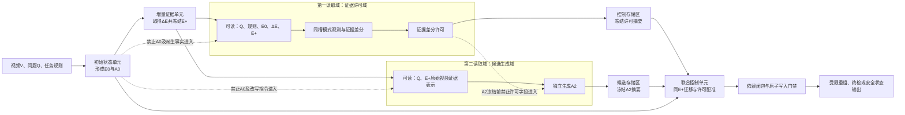
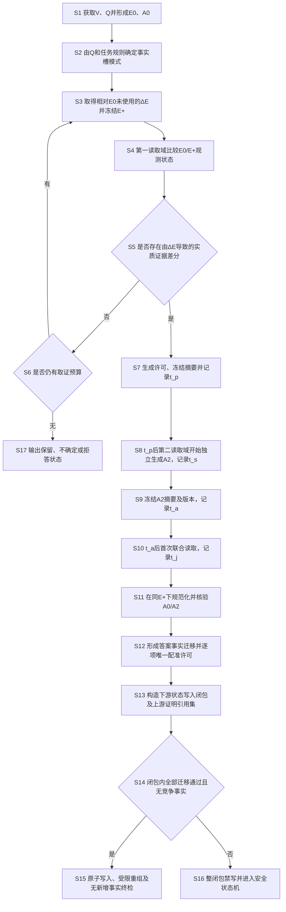

# 技术交底书

## 交底书基本信息

| 项目 | 内容 |
| --- | --- |
| 发明名称 | 一种基于视频证据双差分许可的视频问答答案更新控制方法、装置、设备及存储介质 |
| 发明类型 | 发明专利 |
| 技术领域 | 视频处理、计算机视觉、语音处理、自然语言处理及计算机状态一致性控制 |
| 技术联系人 | 待申请人确认 |
| 发明人 | 待申请人结合实际贡献确认 |
| 申请人 | 待权属核验后填写 |
| 版本用途 | 由 V4.6 技术终稿合并形成的代理人技术交底底稿 |

## 注意事项

1. 本交底书用于使专利代理师完整理解发明构思、实现方式和可替换实施方式，不等同于最终向国家知识产权局提交的说明书或权利要求书。
2. 本交底书的公开程度以本领域普通技术人员不需付出创造性劳动即可实施为准；代理师提出技术疑问时，发明人应结合实际设计补充并确认。
3. 文中的 E0、A0、ΔE、E+ 和 A2 均为技术对象标识：E0 为初始视频证据快照，A0 为基于 E0 生成的初始答案，ΔE 为相对于 E0 未使用的增量视频证据，E+ 为由 E0 和 ΔE 构成并冻结的扩展视频证据快照，A2 为在隔离条件下基于问题与 E+ 独立生成的候选答案。
4. 本发明不以某一种特定大模型、视觉编码器、OCR 引擎或 ASR 引擎为必要条件。能够按本文限定形成证据观测状态、候选答案事实和事务写入控制的软硬件组合均可实施。
5. 本交底书中的对比文件及公开链接用于说明已知技术边界。正式递交前仍应由代理机构以申请日为界完成官方数据库全文检索、著录项目核验和权属/优先权判断。

# 一、技术背景与现有技术

## 1.1 应用背景

视频问答系统需要根据视频画面、局部图像区域、画面文字、语音片段或上述信息的组合回答问题。长视频采样、视觉输入预算、文字尺寸、遮挡、声画错位和决定性证据分散等因素，会使首次输入模型的证据没有覆盖问题所需事实。例如，初始抽帧只显示商品原价“99元”，后续未覆盖片段才显示限定时段内的促销价“79元”。

已知方案通常采用“答案置信度不足后补帧并重新回答”或“把初始答案再次输入模型进行自验证和改写”。这些手段能增加信息或修改答案，但没有解决更新控制链中的事实状态污染：生成通道如果读取了初始答案、证据通道已归一化的许可值或提交建议，就可能直接复述该中间状态；随后再判断候选答案与证据结论是否一致，得到的可能是信息泄漏造成的虚假一致，而非两个独立技术过程的相互验证。

## 1.2 主要现有技术

本轮技术检索以 Google Patents、arXiv 公开页及可公开访问的专利著录/全文镜像为阅读入口，检索词包括“视频问答 低置信 重新选帧”“初始答案 自验证 改写”“video question answering evidence state”“evidence witness rollback”“视频证据 答案更新”。以下仅概括与本发明控制链直接相关的公开内容；正式法律查新仍以国家知识产权局官方数据库和申请日前公开日核验为准。

### 1.2.1 迭代式多模态视频问答

[CN121388101A](https://patents.google.com/patent/CN121388101A/zh) 涉及迭代式多模态视频问答，已公开根据回答置信信息更新候选区域、重新选择视频帧并继续迭代的总体路线。该技术说明“低置信触发补充视觉信息并重答”本身不宜作为本发明的主要创造性支点。

其不足在于：没有把增量视频证据形成的事实差分与候选答案形成的事实差分置于两个相互隔离的读取域内；没有先冻结不读取 A0/A2 的证据差分许可，再冻结不读取 A0/许可的候选答案；也没有在同一扩展证据快照下按事实槽、实体或事件、谓词、上下文、目标值、快照和增量见证进行唯一配准及闭包事务写入。

### 1.2.2 基于初始答案的自验证和改写

[CN117744802A](https://patents.google.com/patent/CN117744802A/zh) 涉及将初始答案用于生成验证内容，并根据验证结果对初始答案进行增、删或重述。该路线可降低部分答案错误，但其候选输出直接继承初始答案文本或语义状态。

其不足在于：初始答案中的错误事实可能进入候选生成上下文；当验证提示或中间事实值被候选模型读取时，无法证明新答案是依据视频原始证据独立得出；对整段自然语言进行修改还可能掩盖其中某一条声明缺少增量证据见证，或者误删 A0 中仍然受到支持的事实。

### 1.2.3 相关在先申请及同领域既有公开

[CN121962369A](https://k-knowledge.kr/srch/read.jsp?id=285866743) 是与本项目技术领域相关的在先申请，其公开内容涉及广告视频问答中的关键帧、语音、全局/局部表征、检索增强和初始答案校验等路线。该案申请人为湖南大学；其与本次申请的发明人贡献、职务发明归属、优先权关系及其他权利联系尚待单独核验，确切权利要求、申请日、公开日及法律状态以国家知识产权局官方案卷为准。

该既有方案与本发明均属于视频问答，但技术控制关系不同：既有方案主要在已有证据及初始答案基础上完成校验或改写；本发明要求证据许可服务不得读取初始答案及候选事实值，候选生成服务不得读取初始答案和许可记录，并通过许可冻结、候选冻结、首次联合读取的受控时序实现机器可检查的数据隔离。本发明还增加同 E+ 双答案事实核验、双差分唯一配准、依赖闭包原子提交以及禁止复活失效声明等机制。

### 1.2.4 证据状态、见证和回退类公开

[Omni-Decision](https://arxiv.org/abs/2607.11433) 已涉及结构化证据状态、证据获取、验证、修复和确定性提交等上位概念；[PBRC](https://arxiv.org/abs/2604.15558) 涉及答案或信念变化应由外部证据见证、否则采用保守回退的原则。因此，“建立证据状态”“变化需要见证”或“失败回退”不宜脱离本发明的完整控制链单独作为创新点。

本发明与上述公开的主要差异在于：将同一视频中的证据观测差分和 A0→A2 的答案事实差分分别在受访问控制的数据域中形成；用四个可审计时点证明两者冻结前不存在事实状态交叉读取；仅在二者冻结后执行同 E+ 的逐事实迁移、增量见证唯一配准和闭包级原子写入；最后只允许由已写入事实集合重组输出。

## 1.3 现有技术的共同缺陷

1. **候选值反向选证。** 使用 A0 或候选事实值作为检索词、归一化候选或证据选择目标，容易使待验证结论反向影响增量证据。
2. **中间状态泄漏。** 候选生成器读取证据抽取通道的规范化值、许可状态、竞争消歧结果或提交建议后，可能机械复述，从而制造虚假一致。
3. **证据变化与答案变化没有逐项对应。** 仅证明“增加了证据”和“答案改变了”，不能证明变化属于同一事实槽、同一实体或事件、同一限定上下文和同一增量视频见证。
4. **比较口径不一致。** 用 A0 在 E0 下的分数与 A2 在 E+ 下的分数比较，会天然偏向取得更多证据的 A2。
5. **多事实部分写入。** 价格、折扣额、适用时间等相互依赖事实若逐项写入，会形成内部不一致的混合状态。
6. **失败后错误复活。** 更新失败时机械恢复 A0 全文，会重新输出在 E+ 下已经被明确冲突的旧事实。
7. **文本重组新增幻觉。** 即使事实核验通过，自然语言重组器仍可能加入未获许可的新断言。

# 二、本发明要解决的技术问题

本发明要解决的核心技术问题是：在同一视频中取得增量证据后，如何在候选答案生成前阻断初始答案事实、候选答案事实与证据许可状态之间的交叉污染，并使每一项实质答案变化只能由对应的增量视频证据事实差分授权。

围绕该核心问题，还要解决：

1. 如何以服务权限、输入字段白名单、存储区访问控制和冻结时点，使“独立生成”成为机器可检查的技术约束，而不是仅靠提示词声明；
2. 如何让 A0 与 A2 在相同 E+、相同事实槽模式和相同核验配置下形成可比较的支持状态；
3. 如何处理同一事实槽中的多个竞争值、许可抽取错误、陈旧快照和重复许可；
4. 如何区分需要共同提交或共同禁写的下游事实与仅供核验的上游证明上下文；
5. 如何在闭包失败、旧事实冲突、取证预算耗尽或核心槽缺失时输出确定的安全状态；
6. 如何防止最终语言重组阶段复活失效事实或新增未经写入控制的事实。

# 三、本发明的详细技术方案

## 3.1 技术对象、状态和总体约束

**场景与参与者。** 本发明用于视频问答答案更新场景。视频证据采集与索引组件提供原始帧、局部区域、OCR 和 ASR 片段；证据许可服务只判断视频证据观测是否发生可授权的实质变化；候选生成服务只依据问题和扩展视频证据生成候选答案；控制服务在两侧结果冻结后执行联合核验、迁移配准和状态写入。

**标题对象如何进入系统。** “视频证据双差分许可”由一次答案更新任务启动：系统接收视频 V 和问题 Q，先建立初始证据快照 E0 与初始答案 A0，再取得未覆盖增量证据 ΔE 并冻结 E+；同一 E+ 分别进入证据许可域和候选生成域。前者输出证据侧写入许可，后者输出候选侧待写事实，二者均冻结后才进入联合控制域。

**高频术语的场景定义。** “读取域”是服务在答案事实控制平面被允许读取的数据集合；“冻结”是对证据、许可或候选内容计算摘要并固定版本，后续变化必须产生新版本；“事实槽”是由问题和任务规则预先确定的结构化事实位置；“见证”是属于 ΔE 且能定位到视频时间、帧、区域或语音区间的许可依据；“闭包”是需要共同写入或共同禁写的相互依赖事实集合。

### 3.1.1 视频证据对象

每个视频证据单元至少包括：视频标识、源片段标识、帧号或原始时间区间、证据模态、内容摘要和是否已用于 E0 的标记。图像区域类证据还可包括原始帧标识、区域坐标、裁切倍率和有效空间分辨率；OCR 证据还可包括原始字符串及其区域；ASR 证据还可包括说话人、原始文本和起止时间。

ΔE 至少满足以下条件之一：

- 源片段标识不属于 E0 已使用源片段标识集合；
- 原始时间覆盖范围与 E0 已使用的各原始时间区间均不重叠；
- 区域视图含有 E0 实际输入像素集合之外的原始区域；
- 同一原始区域在 ΔE 中达到 E0 未达到的预设有效空间分辨率。

仅改变编码格式、插值方式或预处理参数，而没有增加原始区域覆盖或达到新的有效分辨率，不认定为 ΔE。E0 与 ΔE 合并、去重并冻结形成 E+，E+ 具有不可变快照标识和内容摘要。

### 3.1.2 事实槽模式

系统根据问题 Q 和预设任务规则确定规范化事实槽模式，而不得根据 A0 或 A2 中出现的具体值反向生成模式。事实槽模式至少可包括：主体类型、谓词类型、值类型、单位类型、限定字段、槽基数、允许证据模态、归一化规则、互斥规则和是否必填。

例如，对“视频中商品显示的限时价格是多少”建立：商品实体、`limited_price` 谓词、货币数值、人民币单位、活动时段限定、单值基数和允许 OCR/画面/语音证据。具体的“99”或“79”不得成为事先的检索或事实抽取目标。

### 3.1.3 两类状态域

证据许可服务在 E0 和 E+ 下分别形成规范化观测状态，包括：未解析、唯一解析、竞争歧义、冲突、仅质量提高和处理异常。答案核验服务则判断 A0/A2 的规范化事实在 E+ 下是支持、证据不足、冲突或异常。两类状态分别描述“视频证据抽取结果”和“答案事实是否被 E+ 支持”，不得互相替代。

### 3.1.4 双差分

第一差分是证据观测差分：同一事实槽在 E0 与 E+ 下的规范化观测状态发生由 ΔE 导致的实质变化。第二差分是答案事实差分：A0 与 A2 在同一 E+ 下规范化、核验和映射后形成的新增、替换或撤回等实质迁移。

许可不是“答案正确”的泛化分数，而是由第一差分形成的、针对特定事实槽和目标事实状态的写入凭据；候选答案也不因整体分数较高而自动获得写入权。只有与第二差分逐项唯一配准的许可，才能授权对应闭包的写入。

## 3.2 系统组成及数据隔离结构

系统至少包括以下功能模块：

1. **初始状态生成单元**：形成 E0 和 A0，并记录 E0 已使用证据标识集合。
2. **增量证据获取单元**：从同一视频中取得相对于 E0 未使用的 ΔE，冻结 E+。
3. **证据许可服务**：在第一读取域中比较 E0/E+ 的规范化观测状态，生成并冻结证据差分许可。
4. **候选生成服务**：在第二读取域中基于 Q 与 E+ 原始视频证据表示独立生成并冻结 A2。
5. **控制服务**：在许可和 A2 均冻结后首次联合读取 A0、A2 和许可，在同 E+ 下完成事实迁移、唯一配准和门禁判断。
6. **闭包控制单元**：构造状态写入集合和证明引用集合，完成闭包原子提交、禁写、失效传播和必要的联合重核验。
7. **受限输出单元**：仅用已进入可输出状态集合的事实重组自然语言；终检发现新增事实时删除并重组，仍失败则输出结构化事实、不确定或拒答状态。

在一种实现中，证据许可服务、候选生成服务和控制服务分别使用不同服务账户、不同访问控制列表或不同进程地址空间。候选生成接口采用字段白名单，拒绝初始答案、旧事实元组、许可标识、许可归一化值、竞争组和提交建议。逻辑隔离、进程隔离、容器隔离或专用硬件隔离均可采用，只要能够证明相同的数据禁止关系。

## 3.3 模块功能说明

### 3.3.1 初始状态生成单元

该单元建立 E0、A0 及 E0 已使用证据标识集合，为增量证据判定提供基准，并把 A0 存入证据许可服务和候选生成服务均无读取权限的初始答案存储区。其下游是增量证据获取单元和联合控制单元。

### 3.3.2 增量证据获取单元

该单元依据源片段、原始时间覆盖、像素区域覆盖或有效空间分辨率判定 ΔE，将 E0 与 ΔE 合并、去重后形成不可变 E+。同一 E+ 同时提供给证据许可服务和候选生成服务，避免两侧使用不同证据版本。

### 3.3.3 证据许可服务

该服务在第一读取域内按同一事实槽模式比较 E0/E+ 的规范化观测，只在 ΔE 导致实质事实差分时生成许可；它不能读取 A0、A2 或其派生事实值。许可写入控制存储区并先于候选生成冻结，为后续迁移提供证据侧写入凭据。

### 3.3.4 候选生成服务

该服务在第二读取域内仅读取 Q 和 E+ 的原始视频证据表示，不读取 A0、改写指令或许可字段，独立生成并冻结 A2。其输出是待联合核验的候选事实来源，而不是直接可写入答案。

### 3.3.5 联合控制单元

该单元仅在许可和 A2 均冻结后联合读取 A0、A2 与许可，在相同 E+、事实槽模式和核验配置下形成答案事实迁移，并把每项迁移与许可逐项唯一配准。其配准结果直接送入闭包控制单元。

### 3.3.6 闭包控制单元

该单元依据预定义稀疏有向事实依赖关系构造下游状态写入集合和上游证明引用集合。全部迁移通过且没有竞争事实时原子写入；任一失败时整闭包禁写，并负责共享节点失效传播、重核验或闭包合并。

### 3.3.7 受限输出单元

该单元只读取已进入可输出状态集合的事实，完成自然语言重组，并把重组结果再次解析为事实执行无新增事实终检。发现未获写入的事实时删除并重组；仍失败则输出结构化事实、不确定状态或拒绝回答。

以下数据结构和内部判定用于实现上述模块。

### 3.3.8 证据差分许可记录

证据差分许可记录可包括：

| 字段 | 技术含义 |
| --- | --- |
| permit_id / permit_type | 许可标识及事实值写入、事实冲突或派生许可类型 |
| slot_schema_id | 规范化事实槽模式标识 |
| entity_or_event_id | 经消歧的实体或事件 |
| predicate / qualifiers | 谓词及时间、对象、阶段、说话人等限定上下文 |
| old_observation_state | E0 下观测状态 |
| target_value_or_state | E+ 下目标事实值或目标状态 |
| E0_snapshot_id / Eplus_snapshot_id | 两个不可变证据快照标识 |
| delta_evidence_ids | 属于 ΔE 的见证证据标识集合 |
| witness_time_or_frame | 时间区间或帧号 |
| witness_modality | 画面、OCR、ASR 或组合模态 |
| witness_region_or_asr_span | 图像区域坐标或语音时间段 |
| competition_group_id | 同一事实槽和上下文中的竞争值分组 |
| rule_id / digest / status | 归一化规则、记录摘要和有效状态 |

许可记录只是一项写入控制凭据，不作为候选生成内容。竞争歧义、仅质量提高、未解析或处理异常不产生事实值写入许可。对于撤回，许可服务可以生成事实冲突许可，但仍不得读取 A0 的具体事实值；该许可应依据 E+ 中唯一确定事实或显式否定事实形成，并在 A2 冻结后才与旧事实迁移匹配。

### 3.3.9 候选答案及其冻结记录

候选生成服务的输入仅含 Q、E+ 原始帧/区域、未经许可服务归一化的 OCR 原始字符串、ASR 原始片段及必要的通用提示模板。候选记录至少保存输入载荷摘要、E+ 快照标识、模型和推理配置、A2 内容摘要、候选版本以及候选冻结时点。输入载荷中不得出现 A0 的文本或语义表示、A0 派生的改写指令、许可记录或许可服务得出的事实值与状态。

### 3.3.10 同 E+ 的答案事实核验

在 A2 冻结后，控制服务按照相同的 E+、事实槽模式、归一化规则和核验配置，分别将 A0 与 A2 转换为规范化答案事实，并判断每项事实的支持、证据不足、冲突或异常状态。这样避免用 `A0|E0` 与 `A2|E+` 比较造成输入不对称。

A0 与 A2 可采用一对一、一对多、多对一或未匹配的声明映射。主映射键至少可由事件标识、主体角色和谓词组成，事实值及限定字段用于判断新增、替换、撤回、不确定化、保持或等价压缩。保持和等价压缩不消耗事实值写入许可；新增、替换和撤回属于实质迁移。

### 3.3.11 迁移—许可唯一配准

每一实质迁移必须与一条且仅一条上下文相容、快照有效的许可记录配准。配准至少比较：事实槽、经消歧实体或事件、谓词、限定上下文、规范化目标值或目标状态、E0/E+ 快照标识以及 ΔE 时空模态见证。

同一许可不得授权两个相互不相容的目标事实。新增或替换的目标事实必须在 E+ 下处于支持状态；撤回迁移的旧事实必须在 E+ 下处于冲突状态。若存在零条匹配许可、多条未消歧许可、陈旧快照、见证不属于 ΔE、竞争事实达到条件或候选目标值与许可目标值不同，则迁移配准失败。

### 3.3.12 有向依赖闭包双域

预先建立稀疏的事实依赖边。若 `X→Y` 表示 Y 的成立依赖 X，则从实质迁移沿出边方向确定受到影响、需要共同写入或共同禁写的下游事实，形成状态写入集合；沿入边方向确定核验所需的上游事实，形成只读证明引用集合。证明引用集合不因被引用而自动成为回滚对象。

依赖边仅限于经过任务规则预定义且满足实体消歧、时间相容和节点数量上限的实体、属性、数量、时间或因果关系。这样避免因宽泛的文本相似性把全部答案都纳入一个闭包。

当闭包 B 的状态写入集合与闭包 A 的证明引用集合包含同一规范化事实映射键，且 B 拟写入非等价状态时，在 B 提交或禁写后，将 A 的核验结果与暂存目标标记失效并重新核验；仍有写入—引用冲突时，合并为联合闭包。

### 3.3.13 原子门禁和失败状态机

仅当闭包中全部实质迁移均唯一配准、所引用 E+ 和许可有效、同一事实槽/上下文不存在达到竞争条件的非等价目标事实，并且不存在处理异常时，才把闭包目标事实作为一个事务原子写入可输出状态集合。任一条件失败，闭包内全部候选目标事实均不写入。

禁写后的输出状态按 E+ 下旧事实状态确定：

- 旧事实仍受支持：保留旧事实；
- 旧事实证据不足且仍有取证预算：取得新的 ΔE，建立新 E+ 版本，并使旧许可、旧 A2、旧核验和旧暂存闭包全部失效后重做流程；
- 旧事实证据不足且预算耗尽：将该槽置为不确定；
- 旧事实受到冲突且不存在受支持替代事实：撤回旧事实；
- 问题的必填核心槽无法由唯一受支持事实填充：输出证据不足或拒绝回答；
- 任何在 E+ 下已受冲突的 A0 事实均不得因为 A2 失败而复活。

### 3.3.14 受限重组和无新增事实终检

重组器的输入只包括可输出状态集合中的事实标识、事实值和证据标识，不直接读取失败闭包中的候选事实。重组结果再次被转换为事实集合；不能映射到可输出状态集合的事实被删除后重新重组。若重新重组仍新增事实，则输出结构化事实集合、不确定状态或拒绝回答。

## 3.4 总体流程

各步骤的实现要点如下：

1. **S1：** 获取 V、Q，冻结 E0，并基于 E0 形成 A0；E0 记录已使用源片段、时间覆盖和像素区域。
2. **S2：** 仅依据 Q 和任务规则确定事实槽模式，不以 A0/A2 的具体事实值生成槽或检索目标。
3. **S3：** 依据源覆盖或有效分辨率条件取得 ΔE，将 E0 与 ΔE 合并、去重并冻结 E+。
4. **S4：** 许可服务在第一读取域中使用同一槽模式比较 E0 与 E+ 的规范化观测状态。
5. **S5：** 判断观测变化是否由 ΔE 导致且属于可授权的实质事实差分。
6. **S6：** 不存在许可差分时检查取证预算；有预算则取得新 ΔE 并返回 S3，无预算则转 S17。
7. **S7：** 存在实质差分时生成证据差分许可，冻结摘要和版本并记录 `t_p`。
8. **S8：** 在 `t_p` 后启动候选服务，记录 `t_s`；候选服务只读取 Q 和 E+ 原始表示。
9. **S9：** 候选服务生成 A2 后冻结其内容摘要、版本和输入载荷摘要，记录 `t_a`。
10. **S10：** 在 `t_a` 后允许控制服务首次联合读取 A0、A2 与许可，记录 `t_j`，并校验 `t_p < t_s < t_a < t_j`。
11. **S11：** 使用相同 E+、事实槽模式和核验配置分别规范化并核验 A0 与 A2。
12. **S12：** 形成 A0→A2 的实质事实迁移，并按槽、上下文、目标值、快照和 ΔE 见证逐项唯一配准许可。
13. **S13：** 从迁移节点沿出边构造下游状态写入闭包，沿入边确定只读证明引用集合。
14. **S14：** 检查闭包内迁移是否全部通过、快照和许可是否有效、是否存在竞争事实或处理异常。
15. **S15：** 条件满足时把闭包目标事实作为一个事务原子写入，并执行受限重组和无新增事实终检。
16. **S16：** 条件失败时禁止闭包内全部候选目标写入，并进入保留、继续取证、不确定、撤回或拒答状态机。
17. **S17：** 在没有可用许可且取证预算耗尽时，根据旧事实在 E+ 下的支持状态输出保留、不确定或拒答，不恢复已冲突事实。

## 3.5 关键参数、判定规则和可替换实施方式

### 3.5.1 四时点和可审计约束

系统至少记录：许可冻结时点 `t_p`、候选生成开始时点 `t_s`、候选冻结时点 `t_a` 和首次联合读取时点 `t_j`，并满足 `t_p < t_s < t_a < t_j`。四个时点可由冻结记录、单调递增日志序号或事务提交序列号表示。许可冻结后若 E+、规范化规则或见证变化，许可必须失效；A2 冻结前若输入载荷变化，A2 版本必须重新生成。

### 3.5.2 竞争值规则

对于槽基数为一且限定上下文相同的事实槽，把规范化值不同的观测划入同一竞争组。仅当一个值簇满足预设质量及适用条件且不存在达到竞争条件的非等价值簇时，才生成事实值写入许可。原价与促销价、不同说话人、不同事件阶段或不同适用时间因限定字段不同，可进入不同上下文而同时合法存在。

竞争条件可由证据数量、来源独立性、OCR/ASR 质量、时间位置、区域清晰度、模态一致性或任务规则组合确定，但不得因候选答案选择了某个值就降低该值的许可阈值。

### 3.5.3 派生许可

当折扣额、总价、数量乘积等目标事实由两个以上上游事实确定性计算得到时，建立派生许可，保存全部上游许可标识、运算符、输入单位、换算规则、舍入规则和 E+ 标识。只有全部上游许可有效且计算结果与候选目标一致时，派生许可才可授权迁移。语言模型的自由推理结论不能替代确定性运算记录。

### 3.5.4 匹配反事实见证核验

对关键许可，可从 E+ 中移除其见证证据，再加入多个已预核验不支持目标事实、但与见证证据在模态、近似时间、分辨率和输入预算上匹配的非见证证据集合。只有目标观测状态在多个反事实快照下均不能保持，才把该 ΔE 见证标记为满足差分必要性。该措施用于排除“只是增加了输入数量或清晰度”导致的伪贡献。

### 3.5.5 触发和预算

取得 ΔE 的触发条件可包括事实槽证据支持度不足、必填槽未解析、证据覆盖不完整、竞争歧义、时序条件缺失或用户要求核验。触发评分本身不是本发明的唯一核心；不同实现可以采用阈值、规则、分类器或其组合。取证预算可按额外帧数、OCR 区域数、ASR 时长、视觉 Token 或处理时延配置。

### 3.5.6 审计记录

系统可记录：问题标识、E0/E+ 摘要、ΔE 标识、事实槽模式、许可、许可/候选输入摘要、A2 摘要、四时点、答案事实迁移、迁移—许可配准、闭包写入集/证明引用集、提交或禁写动作以及原因代码。审计记录既用于故障重放，也用于证明隔离条件确实执行。

# 四、本发明的有益效果

1. **减少候选值反向选证。** 许可服务不能读取 A0/A2 及其派生事实值，也不得以其作为检索和归一化目标，使 ΔE 见证由视频证据覆盖变化产生。
2. **减少信息泄漏造成的虚假一致。** 候选服务不能读取 A0 和许可记录；证据许可和 A2 依次冻结后才开放联合读取，从数据访问和事件时序上限定独立形成。
3. **使每一项答案变化具有对应技术凭据。** 证据差分与答案事实差分按槽、实体/事件、上下文、目标值、快照和 ΔE 见证唯一配准，避免用整体分数掩盖单项无证据更新。
4. **实现公平的双答案核验。** A0 与 A2 均在同一 E+、同一事实槽模式和同一配置下复核，减少证据口径不一致造成的偏置。
5. **保持多事实状态一致。** 相互依赖的目标事实形成下游写入闭包，只有全部通过才原子写入，避免价格已更新而折扣额或适用时间仍为旧值的混合状态。
6. **防止失败回退复活错误。** 禁写后根据旧事实在 E+ 下的支持状态转移；已冲突事实不能因候选失败而恢复。
7. **抑制重组阶段新增断言。** 输出重组仅读取可输出状态集合，并通过事实终检阻止未许可事实进入最终自然语言。
8. **提高可复核性和工程可实施性。** 访问控制列表、输入白名单、冻结摘要、不可变快照和四时点形成可审计记录，便于重放和定位许可错误、候选错误或陈旧版本。

上述效果为所述控制机制直接产生的技术效果，不依赖尚未冻结的准确率数值。具体性能增益可在实现后通过 A0、强制采用 A2、同 E+ 整体门控、同 E+ 门控加闭包控制等对照实验补充，但不是理解和实施本方案的必要条件。

# 五、本发明的关键点及拟保护点

1. 从同一视频取得相对于 E0 未使用的 ΔE，并冻结 E+，使许可和候选均绑定明确证据版本。
2. 证据许可服务的第一读取域不含 A0、A2 及其派生事实值，也不以答案事实值驱动检索、事实抽取、归一化或选证。
3. 候选生成服务的第二读取域不含 A0 的语义内容、A0 派生的改写指令和许可记录，仅根据 Q 与 E+ 原始视频证据表示独立生成 A2。
4. 许可先冻结、候选随后启动并冻结、最后才允许联合读取，以访问权限和 `t_p < t_s < t_a < t_j` 时序共同限定双通道隔离。
5. 在相同 E+、事实槽模式和核验配置下分别核验 A0 与 A2，形成可比较的规范化事实和实质迁移。
6. 证据观测差分与答案事实迁移按事实槽、实体/事件、谓词、限定上下文、目标值/状态、E0/E+ 快照及 ΔE 时空模态见证逐项唯一配准。
7. 同一许可不得授权相互不相容的目标事实；新增/替换目标必须受 E+ 支持，撤回旧事实必须在 E+ 下受冲突。
8. 依据预定义的稀疏有向事实依赖关系构造下游状态写入闭包，并把上游事实限定为只读证明引用；必要时对共享节点执行失效传播、重核验或闭包合并。
9. 闭包内全部迁移通过且不存在竞争目标时才原子写入，否则整闭包禁写，并按旧事实的支持、证据不足或冲突状态输出保留、不确定、撤回或拒答，禁止冲突旧事实复活。
10. 最终重组器仅可读取已写入事实集合，重组后执行无新增事实终检。
11. 可从属保护：ΔE 的源覆盖/有效分辨率判定、事实槽模式、许可数据结构、竞争组、派生许可、匹配反事实、跨闭包传播、审计失效和设备/存储介质实现。

从单一发明构思看，上述步骤不是“补证、验证、门控、回滚”的平行堆叠，而是一条连续状态控制链：第一读取域产生证据侧写入凭据，第二读取域产生候选侧待写事实，二者冻结后由共同控制服务执行同快照唯一配准，配准结果直接决定闭包是否可写，已写集合又成为重组器唯一输入。删除其中任何一个关键隔离或配准环节，都会使后续原子写入失去可信的授权来源。

# 六、具体实施例

## 6.1 实施例一：价格事实正常替换

问题 Q 为“视频中商品的限时价格是多少”。E0 包含视频前段商品画面，OCR 仅解析到原价“99元”，A0 输出“限时价格为99元”。系统在未覆盖的后段取得 ΔE：时间戳 00:18.200—00:20.000 的促销卡片区域，OCR 原始字符串包含“限时79元”。E+ 由 E0 与该区域证据构成并冻结。

许可服务在不读取 A0 的情况下，根据问题及任务规则建立 `商品—limited_price—货币数值—活动时段` 槽。E0 在该槽为未解析或旧观测，E+ 唯一解析为“79元”，形成以对应时间戳、帧号和 OCR 区域为见证的事实值写入许可，并在 `t_p` 冻结。

候选服务在 `t_p` 后仅读取 Q 和 E+ 原始证据，独立生成 A2“限时价格为79元”，随后在 `t_a` 冻结。控制服务在 `t_j` 首次联合读取。A0 和 A2 均在 E+ 下复核：A0 的“99元为限时价”受到冲突，A2 的“79元为限时价”受到支持。替换迁移与许可在事实槽、上下文、目标值、快照和 ΔE 见证上唯一配准，闭包无其他失败项，因此原子写入“限时价格=79元”。重组器输出“视频中商品的限时价格为79元”。

本实施例的固定展示链为：`Q → E0 → A0 → ΔE及位置 → 许可 → A2 → 同E+核验 → 迁移与闭包 → 最终输出`。

## 6.2 实施例二：候选事实错误，禁止更新

沿用实施例一的 Q、E0 和 ΔE。许可服务仍独立形成目标值为“79元”的许可，但候选服务由于识别误差生成 A2“限时价格为59元”。联合读取后，A2 的目标值既不受 E+ 支持，也不能与“79元”许可唯一配准。

控制服务禁止整个价格闭包的候选目标写入。由于 A0 把“99元”错误解释为限时价且该事实在 E+ 下受冲突，系统不得回到 A0；若核心价格槽没有其他受支持事实，则输出“当前证据无法支持该候选答案”或拒绝回答。该例说明，候选答案并非只要与旧答案不同就会被采纳。

## 6.3 实施例三：许可通道抽取错误被隔离机制暴露

ΔE 原始促销卡片实际显示“79元”。许可服务中的 OCR 抽取器发生错误，将其归一化为“59元”并生成许可；候选服务独立读取原始区域后生成 A2“79元”。由于 A2 在冻结前看不到许可值，它不会为迎合“59元”而复述。

联合配准时，候选目标“79元”与许可目标“59元”不一致，闭包禁写并输出原因代码 `PERMIT_CANDIDATE_VALUE_MISMATCH`。系统可重新取得更高有效分辨率的区域作为新 ΔE，建立新 E+，并使原许可、原 A2 和原配准全部失效后重跑。该例体现双通道隔离能暴露单通道抽取错误。

## 6.4 实施例四：竞争价格不产生写入许可

同一活动时段、同一商品和同一价格槽下，ΔE 的两个清晰画面分别显示“79元”和“69元”，且两者均达到竞争条件。许可服务将二者放入同一竞争组，观测状态为竞争歧义，不生成事实值写入许可。即使候选服务选择其中一个值，控制服务仍因缺少唯一许可而禁写，转为继续取证或不确定状态。

若“99元”带有原价限定，“79元”带有限时价限定，则二者属于不同上下文，不因数值不同而互斥；系统可分别保留原价和限时价事实。

## 6.5 实施例五：依赖闭包整体禁写

问题要求同时回答“促销价和优惠额”。E+ 支持原价 99 元和促销价 79 元，价格替换许可形成；候选 A2 还输出“优惠20元”。优惠额由原价与促销价确定性计算，系统需建立含两个上游许可、减法运算符、单位及舍入规则的派生许可。

若促销价迁移已配准，但优惠额缺少派生许可或上游原价上下文不明确，则价格和优惠额属于同一下游状态写入闭包。控制服务不允许只写入价格而保留未经证明的优惠额，整个闭包禁写。旧价格若已受到冲突则不得恢复；系统可只输出结构化的不确定状态或拒绝回答。

## 6.6 实施例六：旧事实受冲突、候选也无支持时安全拒答

A0 断言“演讲开始时间为10:00”。ΔE 的带时间戳语音和画面明确否定该时间，但新证据被遮挡，无法唯一确定实际开始时间。许可服务可形成针对旧事实状态的冲突许可，却不能形成某一新时间值的写入许可；候选 A2 猜测“10:30”，在 E+ 下证据不足。

控制服务撤回“10:00”，禁止写入“10:30”。由于开始时间是问题必填核心槽，最终输出“视频证据不足，无法确定开始时间”，而不是恢复 A0 或采用 A2。该例明确“撤回局部声明”与“整题拒答”的边界：非核心附加事实失效时可撤回该事实并输出其他受支持内容；核心必填闭包无法填充时拒答。

## 6.7 实施例七：受限重组阻止新增事实

可输出状态集合仅含“限时价格=79元”和对应证据标识。自然语言重组器首次输出“限时价格为79元，活动仅限今天”，其中“仅限今天”无法映射到已写入事实集合。终检删除该新增事实并重新重组为“限时价格为79元”。若再次出现未经写入的活动期限，系统改为输出结构化事实 `limited_price: 79 CNY` 或拒答。

## 6.8 装置、设备和存储介质实施方式

上述方法可由视频问答答案更新控制装置实施。装置包括初始状态生成单元、增量证据获取单元、证据许可单元、隔离候选生成单元、联合控制单元、闭包控制单元和受限输出单元。各单元可作为独立微服务、同一设备上的不同进程、可信执行环境中的不同隔离区，或由不同处理器执行的程序模块。

电子设备可包括处理器、存储器、视频解码器、网络接口及可选的图形处理器或神经网络加速器。存储器中保存计算机程序、不可变证据快照、许可控制存储区、候选存储区和审计日志。处理器执行程序时完成上述流程。计算机可读存储介质可保存使处理器执行上述方法的程序指令。

在不改变关键数据隔离、冻结时序、同 E+ 双差分配准和闭包原子门禁的前提下，视频证据抽取器、候选模型、事实核验器、存储介质类型、服务部署方式、阈值及预算可以替换。
