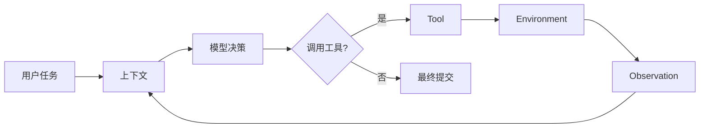
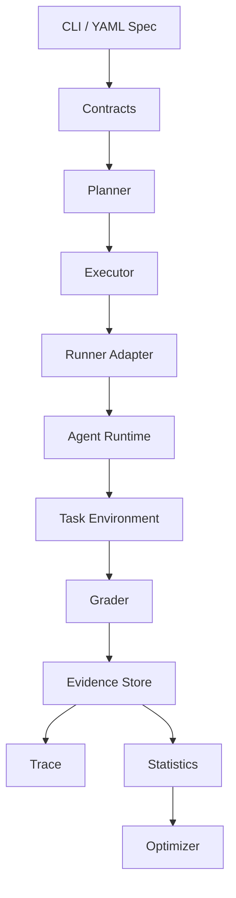
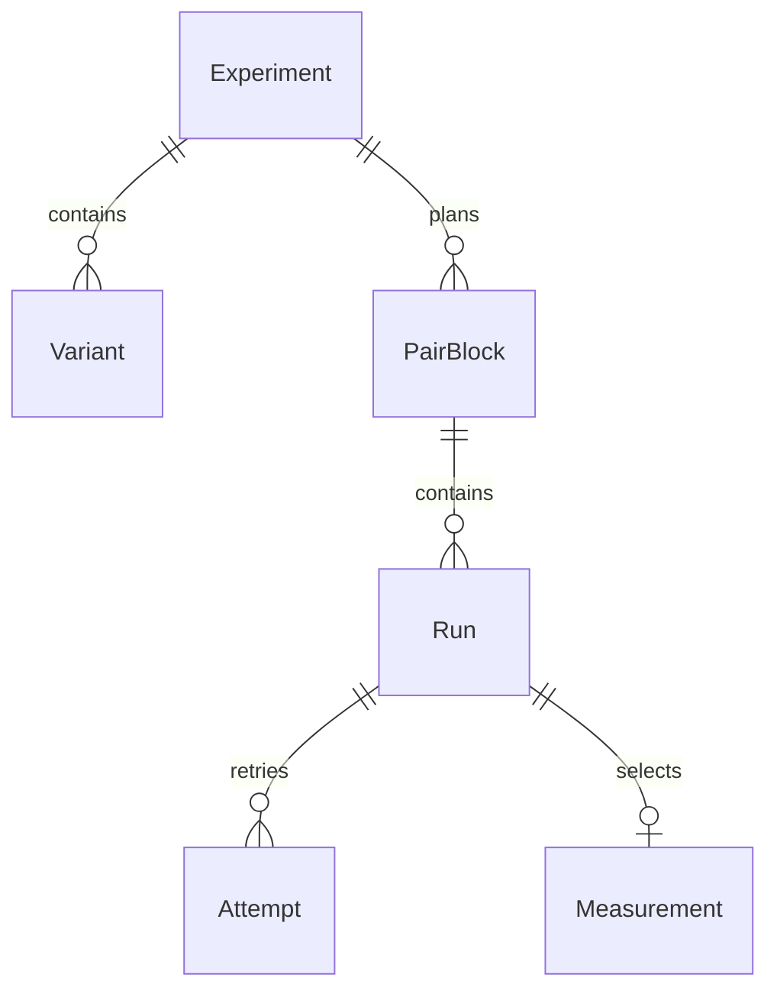
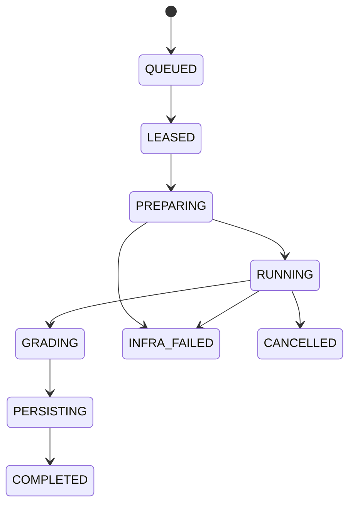
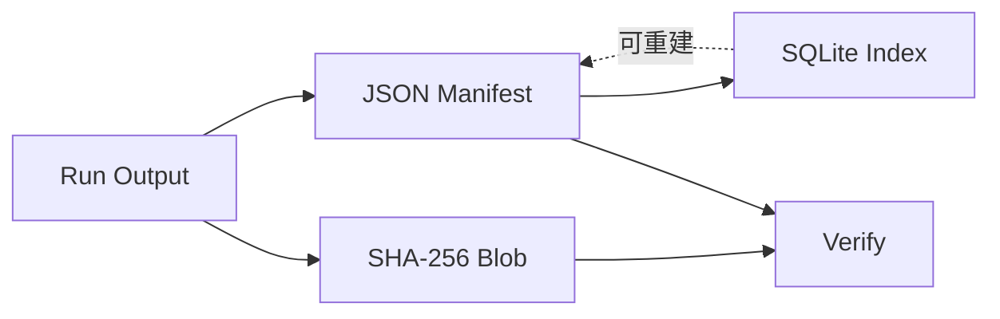
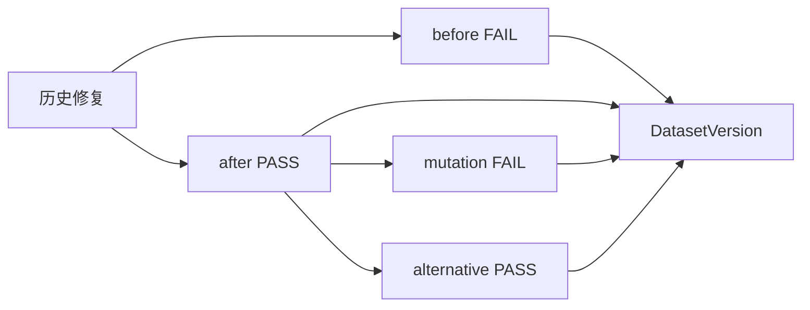
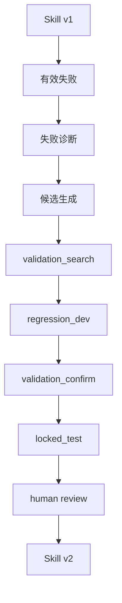

# AgentSkill-Eval 三天速成版

> 目标：三天内系统掌握项目主要知识，达到“能读核心源码、能做五分钟演示、能回答架构和评测追问”的水平。  
> 完整版参考：[AgentSkill-Eval 秋招知识与源码讲解手册](./AgentSkill-Eval_秋招知识与源码讲解手册.md)

---

# 总体安排

| 日期 | 主题 | 最终产出 |
|---|---|---|
| 第一天 | Agent 基础与一次 Run | Agent loop、系统架构图、Run 时序图 |
| 第二天 | Benchmark、Evidence 与统计 | 四态 Case、W/T/L 手算、证据链图 |
| 第三天 | Skill 演化、架构与面试 | v1→v2 流程图、五分钟讲稿、问答演练 |

每天建议投入 8 小时：

```text
概念学习 2 小时
源码阅读 3 小时
动手练习 2 小时
复盘表达 1 小时
```

---

# 第一天：Agent 基础与执行主链

## Day 1 学习目标

完成后能够：

- 区分 LLM、Agent、Tool、Skill 和 Runtime；
- 画出 AgentSkill-Eval 总体架构；
- 解释 Experiment、Variant、PairBlock、Run、Attempt；
- 顺着 Planner 和 Runner 解释一次执行；
- 解释 PASS、FAIL、INVALID；
- 理解 UUIDv5、fingerprint、状态机和 Adapter。

## 1. 上午第一阶段：Agent 心智模型

### 1.1 Agent 是什么



理解下面公式：

```text
Agent System =
Model + Prompt + Skill + Tools + Runtime + Environment + Evaluator
```

### 1.2 核心概念

| 概念 | 作用 | 项目中的体现 |
|---|---|---|
| Model | 决策与生成 | DeepSeek/Qwen |
| Prompt | 当前任务 | Case task |
| Skill | 可复用方法 | `SKILL.md` |
| Tool | 外部动作 | 文件、命令、测试 |
| Runtime | 循环和预算 | skill-up/Qwen Code |
| Environment | 真实状态 | Bug fixture |
| Evaluator | 判断结果 | deterministic grader |

### 1.3 必须讲清的区别

```text
Prompt：描述一次任务
Skill：描述一类任务的方法
Tool：提供动作能力
Runtime：执行多轮循环
Evaluator：验证任务结果
```

### 1.4 为什么要评测 Skill

加载 Skill 后表现变好，不一定是 Skill 的功劳。

混杂变量包括：

- 模型变化；
- 数据变化；
- Tool 变化；
- Token 预算变化；
- Provider 漂移；
- 随机性。

项目采用：

> 同一 Case、相同 Agent/模型/环境/预算，只改变 Skill。

## 2. 上午第二阶段：系统架构



### 2.1 先记七个模块

1. `contracts`：定义对象和状态；
2. `experiment/planning.py`：生成 PairBlock 和 Run；
3. `experiment/execution.py`：驱动执行和结果发布；
4. `runner_adapters`：适配外部 Runner；
5. `experiment/storage`：保存证据；
6. `experiment/statistics.py`：计算配对结果；
7. `skill_optimizer`：搜索和发布门禁。

## 3. 下午第一阶段：领域对象



### 3.1 对象解释

| 对象 | 一句话 |
|---|---|
| Experiment | 一次冻结实验 |
| Variant | 一个对照或处理臂 |
| PairBlock | 同 Case、同 repeat 下的两臂 |
| Run | 一次逻辑执行 |
| Attempt | Run 的一次物理尝试 |
| Measurement | Token、时延、费用和得分 |

### 3.2 为什么 Run 和 Attempt 分开

示例：

```text
Run: 修复 Case A，使用 Skill v1
├── Attempt 1: Provider timeout
└── Attempt 2: 有效执行并完成
```

Run 保持任务身份，Attempt 保存物理执行历史。

## 4. 下午第二阶段：Planner 源码

阅读：

[planning.py](https://github.com/ranmaoxia0123/AgentSkill-Eval/blob/main/packages/experiment/agentskill_eval_experiment/planning.py)

### 4.1 build() 四步

```text
验证输入
-> 为 Case × Repeat 创建 PairBlock
-> 随机化 Variant 顺序
-> 为每个 Variant 创建 Run
```

### 4.2 UUIDv5

```python
block_id = uuid5(experiment.id, f"pair-block:{case.id}:{repeat}")
run_id = uuid5(block_id, f"run:{variant_id}")
```

价值：

- 相同输入产生相同 ID；
- 支持幂等；
- 防止重复创建逻辑任务。

### 4.3 随机化顺序

```python
seed = hash(master_seed, case_id, repeat)
order = shuffle(variants, seed)
```

价值：

- 降低缓存偏差；
- 降低固定先后顺序偏差；
- 固定 seed 又能复现。

### 4.4 Fingerprint

包含：

- Case；
- Grader；
- Prompt；
- Variant；
- Engine；
- Environment；
- timeout；
- max turns；
- image digest。

恢复时 fingerprint 变化，应拒绝把新结果写进旧 Run。

## 5. 晚上第一阶段：Executor 与状态机



阅读：

[execution.py](https://github.com/ranmaoxia0123/AgentSkill-Eval/blob/main/packages/experiment/agentskill_eval_experiment/execution.py)

只关注：

- PairBlock 主循环；
- RunnerRequest；
- finalize result；
- infra failure；
- artifact archive；
- measurement。

### 5.1 三个结果

```text
PASS    = 有效执行 + grader 通过
FAIL    = 有效执行 + grader 不通过
INVALID = 无法支持能力判断
```

### 5.2 为什么 INVALID 单独存在

如果网络断开也记成 FAIL：

```text
基础设施故障
-> 被误认为 Skill 问题
-> Optimizer 修改 Skill
-> 无效候选
```

## 6. 晚上第二阶段：Runner Adapter

阅读：

- [compiler.py](https://github.com/ranmaoxia0123/AgentSkill-Eval/blob/main/packages/runner_adapters/agentskill_eval_runner_adapters/compiler.py)
- [process.py](https://github.com/ranmaoxia0123/AgentSkill-Eval/blob/main/packages/runner_adapters/agentskill_eval_runner_adapters/process.py)
- [skill_up.py](https://github.com/ranmaoxia0123/AgentSkill-Eval/blob/main/packages/runner_adapters/agentskill_eval_runner_adapters/skill_up.py)

理解：

```text
内部 RunnerRequest
-> Adapter
-> 外部 skill-up CLI
-> result.json
-> Adapter
-> 内部 RunnerResult
```

Adapter 负责：

- 外部协议转换；
- 二进制哈希校验；
- 独立 HOME；
- Secret 注入；
- timeout/cancel；
- result 解析；
- capability 声明。

## Day 1 动手任务

1. 手写 2 Case × 2 Variant × 3 repeats 的 Planner；
2. 使用 UUIDv5 生成 12 个稳定 Run ID；
3. 写 Fake Runner 返回 PASS/FAIL/TIMEOUT；
4. 确认 TIMEOUT 被归为 INVALID；
5. 画一次 Run 的时序图。

## Day 1 验收问题

- Agent 和 LLM 的区别？
- Skill 和 Tool 的区别？
- PairBlock 为什么存在？
- UUIDv5 为什么优于 UUIDv4？
- 为什么随机化执行顺序？
- Run 和 Attempt 为什么分开？
- FAIL 和 INVALID 有什么区别？
- Adapter 解决了什么问题？

答对 7/8 才进入第二天。

---

# 第二天：Benchmark、Evidence 与统计

## Day 2 学习目标

完成后能够：

- 解释 Manifest、Blob、SQLite 的职责；
- 解释原子写和内容寻址；
- 解释 Trace 和 capability unavailable；
- 从 Git 历史说明四态 Benchmark；
- 解释五个 split 和数据泄漏；
- 手算 W/T/L 和 Absolute Gain；
- 指出 cluster bootstrap 的适用边界。

## 7. 上午第一阶段：证据存储



### 7.1 三种存储

| 存储 | 职责 |
|---|---|
| Manifest | 领域真值 |
| Blob | 原始 artifact 字节 |
| SQLite | 查询索引 |

SQLite 删除后可由 Manifest 重建，因此不是唯一真值。

### 7.2 原子写

```text
temp file
-> write
-> flush
-> fsync file
-> replace
-> fsync directory
```

理解：

- 临时文件防止目标出现半写；
- replace 提供原子可见；
- fsync 提高崩溃后的持久性。

### 7.3 哈希边界

```text
SHA-256：内容是否变化
数字签名：内容由谁签发
```

项目主要提供 tamper-evident，不是强不可篡改。

## 8. 上午第二阶段：Trace

Trace 记录：

- Tool；
- Command；
- File；
- Test；
- Runner；
- 最终状态；
- Token/Cost。

为什么不推断隐藏思维：

- 不可验证；
- Provider 未必暴露；
- 解释不等于真实因果；
- 评测更关心可观察动作。

`capability unavailable` 的意义：

> Runner 不提供某字段时，系统记录“不可观测”，而不是猜测为 false。

## 9. 下午第一阶段：Git Benchmark



### 9.1 四态的意义

| 状态 | 验证 |
|---|---|
| before-fail | Bug 真实存在 |
| after-pass | 历史修复有效 |
| mutation-fail | Grader 对关键逻辑敏感 |
| alternative-pass | Grader 不绑定唯一补丁 |

### 9.2 需要保存的 provenance

- 仓库 URL；
- commit；
- 许可证；
- 修复文件；
- 测试命令；
- fixture hash；
- grader hash；
- defect family；
- split。

## 10. 下午第二阶段：数据划分

```text
train
-> validation_search
-> regression_dev
-> validation_confirm
-> locked_test
```

| Split | 能否影响候选 |
|---|---|
| train | 是 |
| validation_search | 是，自适应搜索 |
| regression_dev | 是，开发门禁 |
| validation_confirm | 否，独立确认 |
| locked_test | 否，一次性最终评测 |

### 10.1 泄漏来源

- 同一缺陷跨 split；
- fork 跨 split；
- 任务文本泄漏补丁；
- Optimizer 读取 holdout grader；
- locked 后继续调参；
- 模型预训练见过公开 commit。

### 10.2 当前项目的关键问题

20 个 Case 来自 5 个仓库，每个 split 只对应一个仓库。

结果：

- repository effect 与 split effect 混淆；
- 4 个 Case 不一定是 4 个仓库级独立样本；
- confirmation 的泛化证据偏弱。

改进：

- 每 split 多仓库；
- repository 作为第一层 cluster；
- defect family 作为第二层 cluster；
- repeat 不当作独立样本。

## 11. 晚上第一阶段：配对统计

### 11.1 聚合顺序

```text
Run -> Case -> Independence Group -> Experiment
```

### 11.2 W/T/L

| Control | Treatment | 分类 |
|---|---|---|
| 未达阈值 | 达阈值 | WIN |
| 达阈值 | 达阈值 | TIE_POSITIVE |
| 未达阈值 | 未达阈值 | TIE_NEGATIVE |
| 达阈值 | 未达阈值 | LOSS |

### 11.3 两种口径

assignment-based：

```text
PASS=1，FAIL/INVALID/CANCELLED=0
```

capability：

```text
只保留两臂均有效的 PASS/FAIL Pair
```

两者都要报告，因为：

- 前者反映端到端交付；
- 后者观察有效执行条件下的能力；
- 单独使用任一个都可能误导。

### 11.4 Bootstrap

用途：估计成功率和增益的不确定性。

局限：

- 不能凭空创造独立信息；
- 两三个 cluster 时 CI 不可靠；
- 同仓库 Case 相关时必须按仓库聚类。

### 11.5 Ceiling Effect

baseline 100% 时：

- 可以检查回归；
- 无法获得正向 Win；
- 不适合证明 Skill 提升。

## 12. 晚上第二阶段：手算练习

阈值 0.5：

```text
Case A: control 0/3, treatment 2/3 -> WIN
Case B: control 3/3, treatment 3/3 -> TIE_POSITIVE
Case C: control 1/3, treatment 0/3 -> TIE_NEGATIVE
Case D: control 3/3, treatment 1/3 -> LOSS
```

因此：

```text
W/T/L = 1/2/1
```

如果四个 Case 分属两个仓库：

1. 先计算每个 Case pass rate；
2. 再计算仓库平均；
3. 最后对两个仓库等权平均。

## Day 2 动手任务

1. 写一个 atomic JSON writer；
2. 修改文件一个字节并验证 SHA-256 变化；
3. 从 Git commit 构造 before/after；
4. 手工设计 mutation 和 alternative repair；
5. 手算 4 个 Case 的 W/T/L；
6. 写出 assignment/capability 两种成功率。

## Day 2 验收问题

- Manifest、Blob、SQLite 分别是什么？
- 原子 replace 为什么还需要 fsync？
- 哈希和签名的区别？
- 四态 Benchmark 防什么？
- split 如何隔离？
- repeats 为什么不增加独立样本数？
- cluster 太少为什么不能确认？
- ceiling effect 是什么？

答对 7/8 才进入第三天。

---

# 第三天：Skill 演化、架构与面试

## Day 3 学习目标

完成后能够：

- 解释失败如何变成候选；
- 解释 successive halving 和 Pareto；
- 解释 regression、confirmation、locked test；
- 讲清当前真实实验；
- 识别项目使用的架构模式；
- 完成五分钟项目讲解。

## 13. 上午第一阶段：Skill 演化



### 13.1 失败证据

只有满足以下条件的失败进入优化：

- Agent 执行有效；
- grader 已完成；
- 不是 Provider/Runner 故障；
- Trace 足够；
- 已脱敏；
- 人工审核归因合理。

### 13.2 Candidate Proposal

LLM 生成候选只代表提出假设。

```text
失败：Agent 修改后未运行回归测试
候选：Skill 增加回归测试检查点
```

候选是否更好必须由独立执行证明。

## 14. 上午第二阶段：搜索算法

### 14.1 Successive Halving

```text
所有候选 × 小子集
-> 淘汰一半
-> 晋级候选 × 更多 Case
-> 冻结 provisional winner
```

优点：

- 节省真实模型成本。

风险：

- 小样本波动；
- 早期错误淘汰；
- 对 validation_search 过拟合。

### 14.2 Pareto

同时优化：

- 成功率；
- Token；
- 时延；
- 费用；
- 回归数。

一个候选在所有指标不差、至少一个更好，才支配另一个候选。

### 14.3 Search Winner 不是 v2

原因：

- 搜索过程多次观察 validation_search；
- winner 是多候选中的最优者；
- 存在 selection bias；
- 需要独立 confirmation。

## 15. 下午第一阶段：发布门禁

### 15.1 Regression

检查：

- Loss；
- invalid；
- Token overhead；
- 最低 winner pass rate；
- 至少一个正向 Win。

### 15.2 Confirmation

在未参与候选选择的数据上确认：

- 增益是否仍存在；
- 回归是否仍为 0；
- 统计不确定性是否过门。

### 15.3 Locked Test

规则：

- 精确候选只消费一次；
- 看过结果不能继续改；
- 失败也保留；
- 新候选必须用新测试版本。

### 15.4 Human Review

检查：

- 测试特化；
- 危险指令；
- 硬编码答案；
- 成本；
- 可维护性；
- 发布声明。

## 16. 下午第二阶段：架构模式

| 模式 | 项目体现 |
|---|---|
| Ports and Adapters | Runner/Evaluator Adapter |
| Anti-Corruption Layer | 外部 result 转内部 Contract |
| Domain Model | Experiment、Run、Promotion |
| State Machine | Run/Attempt/Workflow |
| Repository | LocalExperimentStore |
| Content Addressing | SHA-256 Blob |
| CQRS 倾向 | CLI 写、Dashboard 只读 |
| Fail Closed | 证据不足时拒绝运行/发布 |

### 16.1 最值得讲的架构选择

1. Runner Adapter：外部执行变化不污染实验核心；
2. Manifest 真值、SQLite 索引：兼顾审计和查询；
3. FAIL/INVALID 分流：保护优化信号；
4. search/locked 隔离：防止过拟合；
5. 状态机和原子发布：避免假完成。

## 17. 晚上第一阶段：真实结果

必须准确表达：

```text
公开 Benchmark：20 Case / 5 repositories
真实 validation_search：48 valid Runs
真实 regression：16 valid Runs
结果：0W / 4T / 0L
Promotion：blocked
confirmation：未执行
locked test：未执行
真实 Skill v2：未发布
```

这说明：

- 执行和门禁链工作；
- 候选没有回归；
- 但没有正向证据；
- regression 数据存在 ceiling effect；
- 项目尚未完成真实能力闭环。

## 18. 晚上第二阶段：五分钟讲稿

### 0:00～0:40 问题

> Agent 表现同时受模型、工具、环境、预算和 Skill 影响，只看加载 Skill 后的分数无法判断 Skill 的边际价值。

### 0:40～1:20 方法

> 系统冻结其他变量，让同一个 Case 在 control 和 treatment 两臂重复执行，并随机化执行顺序。

### 1:20～2:00 判分

> 使用确定性 grader，不相信 Agent 自述；区分 PASS、任务 FAIL 和基础设施 INVALID。

### 2:00～2:40 架构

> Planner 生成 PairBlock/Run，Runner Adapter 调用 skill-up，Executor 驱动状态机，Manifest 和 Blob 保存证据，Statistics 输出 W/T/L。

### 2:40～3:20 Benchmark

> 从真实 Git 历史重建 before-fail、after-pass、mutation-fail、alternative-pass Case。

### 3:20～4:10 Skill 演化

> 失败生成候选，经过 search、regression、confirmation、locked test 和人工审核后才能发布。

### 4:10～5:00 真实结果和边界

> 当前真实 regression 为 0W/4T/0L，系统因无正向 Win 拒绝发布。项目证明控制链有效，但没有证明 Skill 普遍提升；下一步需要多仓库、中等难度和私有 holdout。

## Day 3 动手任务

1. 从一个 FAIL 写三个候选 Skill；
2. 设计 successive halving 预算表；
3. 构造一个 search Win、regression Loss 的反例；
4. 画完整 v1→v2 门禁图；
5. 录制一次五分钟口述；
6. 不看资料回答下面 15 题。

---

# 三天最终验收

## 必答 15 题

1. Agent 与 LLM 的区别？
2. Prompt、Tool、Skill 的区别？
3. 为什么使用配对实验？
4. PairBlock 是什么？
5. 为什么随机化执行顺序？
6. Run 和 Attempt 为什么分开？
7. FAIL 和 INVALID 为什么分开？
8. Runner Adapter 的价值？
9. Manifest 和 SQLite 的关系？
10. 四态 Benchmark 是什么？
11. 为什么不能平均所有 Run？
12. successive halving 的风险？
13. search winner 为什么不能发布？
14. locked test 为什么只能一次？
15. 当前真实 v2 为什么没有产生？

## 源码验收

能在 60 秒内定位：

- Planner 的随机化；
- Run ID 的 UUIDv5；
- Runner 二进制哈希；
- Process timeout；
- Manifest 哈希验证；
- PASS/FAIL/INVALID；
- W/T/L；
- final gain gate。

## 图示验收

能在白板画出：

1. Agent loop；
2. 系统架构；
3. PairBlock；
4. Run 状态机；
5. 四态 Benchmark；
6. v1→v2 门禁。

## 表达验收

禁止出现：

- “真实 v2 已发布”；
- “成功率显著提升”；
- “生产级安全沙箱”；
- “哈希保证不可篡改”；
- “20 Case 证明普遍有效”。

---

# 三天后的继续学习方向

优先级：

1. 自己实现一个最小配对实验；
2. 为真实小仓库构建一个四态 Case；
3. 把独立组提升到多仓库；
4. 学习 exact McNemar 和分层 bootstrap；
5. 增加私有 holdout；
6. 给发布 Manifest 加数字签名；
7. 再考虑多 Agent、MCP 和 RAG 扩展。

三天速成不是让你记住所有类，而是让你建立一条稳定主线：

```text
Agent 如何行动
-> 实验如何隔离变量
-> Grader 如何判断结果
-> Evidence 如何保存
-> Statistics 如何比较
-> Gate 如何阻止错误发布
```
